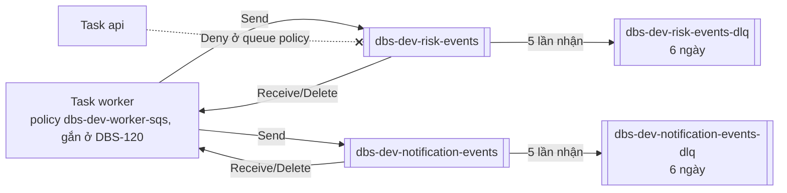

# DBS-73 · Terraform: hai queue SQS (risk-events, notification-events) mỗi queue một DLQ

> **Status:** Implemented (G4 duyệt 2026-10-29: chấp nhận không có ảnh chụp, DoD 2 và 3 đạt một phần qua BL-113…115) · **Vai:** #5 Platform & Ops · **Cặp đôi review:** Dev · **Nhánh:** `chore/DBS-73-terraform-sqs` (từ `main`, không xếp chồng) · **PR:** [#40](https://github.com/Lawliet119/digital-banking-simulator/pull/40) · **Cập nhật:** 2026-10-29

## 1. Bối cảnh

- **Task trên board:** Task, Tuần 3, Deliverable P3, Ưu tiên High, board "To Do". **Expect:** Hạ tầng hàng đợi dựng bằng code, khớp bảng định tuyến ở docs/03 §10.
- **DoD** (nguyên văn, đánh số):
  1. Hai queue + hai DLQ, redrive maxReceiveCount = 5, mã hóa phía server, thời gian giữ message ghi rõ (khớp tính toán thời gian giữ processed_events ở database-design)
  2. Chính sách IAM chỉ cho task worker gửi/nhận/xóa; api không có quyền SQS
  3. Tên queue và URL đưa vào biến môi trường theo sqs.config.ts
  4. PR đã merge vào main (CI xanh); Dev review; bảng «Đối chiếu test case» trong PR điền đủ
- **Thực trạng trên board:** SQS mới chạy local bằng ElasticMQ; ADR-03: visibility 30 giây, long polling 20 giây, `maxReceiveCount` 5, giữ message 4 ngày.
- **Phụ thuộc:** DBS-33 (Done, đã merge `main`). Không phụ thuộc các PR Ops đang mở (#27, #36–#39): nhánh cắt từ `main`, chỉ thêm file mới ở `envs/dev/base`.
- **Đã có gì:**
  - `infra/local/elasticmq.conf`: `risk-events`, `notification-events`, mỗi queue một DLQ, visibility 30 giây, chờ 20 giây, `maxReceiveCount = 5`.
  - `backend/src/config/sqs.config.ts` và `validation.schema.ts`: `SQS_RISK_QUEUE_URL`, `SQS_NOTIFICATION_QUEUE_URL` bắt buộc khi `APP_ROLE` là `worker` hoặc `both`; `SQS_ENDPOINT` chỉ dùng cho ElasticMQ; `AWS_REGION` mặc định `ap-southeast-1`. Tên queue không có biến riêng: app chỉ nhận URL.
  - ADR-03 (tham số queue), docs/03 §10 (bảng định tuyến, mỗi consumer một queue), §14 (alarm DLQ > 0, tuổi message cũ nhất), database-design §10 (`processed_events` giữ 7 ngày vì queue giữ 4 ngày).
  - `envs/dev/session/iam.tf`: chỉ có role `dbs-dev-api-task` (không policy). **Chưa có** role task worker, chưa có ECS service `worker`: đó là DBS-120 (task role riêng api và worker, Tuần 4) và DBS-121 (service worker, Tuần 4).
  - Backlog cùng chủ đề: BL-051 (alarm DLQ, runbook redrive, "retention DLQ do Ops xác nhận"). Task này **xác nhận retention DLQ** (thêm DBS-73 làm nguồn của BL-051); alarm thuộc DBS-163, runbook redrive giữ ở BL-051.
- **Baseline** (`main` b8742a3, Terraform 1.16.6): `terraform fmt -check -recursive` sạch; `validate` đạt cả ba stack; `terraform test`: bootstrap 9/9, `base` 17/17, `session` 9/9.
- **Ngoài phạm vi:** role task worker và gắn policy vào role (DBS-120); service worker và đưa URL vào task definition worker (DBS-121); alarm DLQ và tuổi message (DBS-163); runbook redrive (BL-051); `libs/sqs` và consumer (DBS-77, DBS-90); queue production (DBS-152).
- **Câu hỏi mở** (kèm đề xuất):
  1. **Stack:** đặt queue ở `envs/dev/base` (giữ lại), không ở `session`. Lý do: SQS không tính tiền khi rảnh (trả theo request, 1 triệu request/tháng đầu miễn phí), URL ổn định qua các phiên nên task definition worker không đổi, message trong DLQ sống qua một lần `destroy session` để còn redrive. `references/platform.md` đã xếp SQS vào phần giữ lại; README Terraform đang xếp vào `session`: sửa README cho khớp.
  2. **Tên:** `dbs-dev-risk-events`, `dbs-dev-risk-events-dlq`, `dbs-dev-notification-events`, `dbs-dev-notification-events-dlq` (tiền tố `dbs-<env>-` theo README). Tên local (`risk-events`) khác cũng không sao vì app chỉ nhận URL.
  3. **Mã hóa:** SSE-SQS (`sqs_managed_sse_enabled = true`, miễn phí, không cần quyền KMS cho worker), không dùng CMK `alias/dbs-dev` (CMK chưa có trên `main`, nằm ở PR #27; thêm phí request KMS và quyền `kms:Decrypt`/`GenerateDataKey` cho worker).
  4. **Retention:** queue chính 4 ngày (ADR-03). DLQ **6 ngày**, không phải 14: với queue standard, hạn của message trong DLQ tính từ lúc gửi gốc, nên tổng đời message ≤ 6 ngày < 7 ngày `processed_events`. Nếu DLQ giữ lâu hơn 7 ngày, một message đã xử lý (commit `processed_events`) nhưng xóa thất bại có thể được redrive sau khi dòng dedup bị dọn, gây xử lý hai lần. Đổi lại: redrive phải xong trong 6 ngày kể từ lúc gửi (ghi vào BL-051). Cách redrive có reset hạn hay không sẽ kiểm ở Phase 2.
  5. **IAM khi chưa có role worker:** tạo **managed policy** `dbs-dev-worker-sqs` ở `base` (gửi tới hai queue chính; nhận, xóa, đổi visibility, đọc thuộc tính trên hai queue chính; trên DLQ chỉ `SendMessage`, xem §6 #1) nhưng **không gắn** vào role nào; DBS-120 gắn vào role task worker. Không tạo role worker giả (SKILL: không stub thứ task khác giao). Test chứng minh role `dbs-dev-api-task` không có quyền SQS. Bàn giao bằng một dòng BL.
  6. **Biến môi trường:** `base` xuất output `sqs_risk_queue_url`, `sqs_notification_queue_url` (và ARN, tên); README ghi bảng output → `SQS_RISK_QUEUE_URL`, `SQS_NOTIFICATION_QUEUE_URL`. Đưa vào task definition worker là DBS-121 (chưa có task worker), ghi BL. Không thêm biến môi trường mới cho app.
  7. **Redrive allow policy:** mỗi DLQ chỉ nhận từ đúng queue chính của nó (`redrivePermission = byQueue`).
  8. **Test thủ công trên AWS thật:** cần `terraform apply envs/dev/base` (chỉ thêm 4 queue và 1 policy, ≈ 0 USD). Kịch bản: gửi một message, nhận 5 lần không xóa, lần 6 thấy ở DLQ; `simulate-principal-policy` cho policy worker (đạt) và role api (bị từ chối); đọc thuộc tính queue. Queue giữ lại sau kiểm (phần giữ lại). Cần bạn đồng ý `apply` trong hội thoại này.
  9. **`CLAUDE_local.md`:** file cục bộ (không commit) ghi rằng bạn cho phép agent tự duyệt G1–G4 cho task #5 và sửa cột Status trên board. Đó là nội dung file, không phải lời bạn nói trong hội thoại này, còn `CLAUDE.md` thì cấm sửa board và cấm bỏ gate; nên mình chưa áp dụng và chờ bạn xác nhận.

**Quyết định ở G1** (người dùng trả lời «Duyệt cả hai G1», 2026-10-29): chọn đúng đề xuất 1 đến 8. `apply` thật cho test thủ công (câu 8) sẽ hỏi riêng ngay trước khi chạy. Câu 9: người dùng chưa xác nhận `CLAUDE_local.md`, nên mọi gate vẫn chờ người dùng trả lời.

## 2. Hành vi

| Tác nhân | Hành động | Kết quả |
|---|---|---|
| Relay outbox (task worker, sau DBS-120 gắn policy) | `SendMessage` tới `dbs-dev-risk-events`, `dbs-dev-notification-events` | cho phép (policy `dbs-dev-worker-sqs`) |
| Consumer risk/notification (task worker) | `ReceiveMessage` (long polling 20 giây), `DeleteMessage`, `ChangeMessageVisibility`, `GetQueueAttributes` trên queue chính của mình | cho phép |
| Consumer (task worker) | gặp message sai schema hoặc JSON hỏng: `SendMessage` vào DLQ của queue mình rồi `DeleteMessage` ở queue chính | cho phép (hợp đồng event: sai schema đi thẳng DLQ, không retry; SQS không có API "chuyển sang DLQ") |
| Task worker | `ReceiveMessage`, `DeleteMessage`, `PurgeQueue` trên DLQ; `PurgeQueue`, `DeleteQueue`, `SetQueueAttributes` trên mọi queue | bị từ chối (không có trong policy); đọc và redrive DLQ là việc của Ops |
| Task api (`dbs-dev-api-task`) | bất kỳ action SQS nào trên 4 queue | bị từ chối hai lớp: role không có policy SQS, và queue policy `Deny` theo `aws:PrincipalArn` |
| Consumer | nhận một message 5 lần không xóa (lỗi tạm thời lặp lại) | lần nhận tiếp theo SQS chuyển message sang DLQ của queue đó (`maxReceiveCount = 5`, visibility 30 giây, tức khoảng 2,5 phút) |
| Queue khác (ngoài queue chính tương ứng) | đặt DLQ của mình trỏ vào `*-dlq` | bị từ chối (`redrivePermission = byQueue`, chỉ queue chính của nó) |
| Ops | redrive DLQ → queue chính (`start-message-move-task`) | message về queue chính với `MessageId` mới, hạn giữ reset (tài liệu AWS) |
| `terraform destroy envs/dev/session` | xóa phần theo phiên | queue không bị đụng (nằm ở `base`) |

**Tham số** (ADR-03, docs/03 §10):

| Thuộc tính | Queue chính | DLQ |
|---|---|---|
| Visibility timeout | 30 giây | mặc định (30 giây) |
| Long polling (`receive_wait_time_seconds`) | 20 giây | 0 |
| Giữ message | 4 ngày (345600 giây) | 6 ngày (518400 giây) |
| Redrive | `maxReceiveCount = 5` → DLQ của nó | redrive allow `byQueue` = queue chính của nó |
| Mã hóa | SSE-SQS | SSE-SQS |
| Delay | 0 | 0 |

**Thời gian giữ và `processed_events` (7 ngày, database-design §10):**
- Message chỉ còn có thể giao lại cho consumer khi còn trong queue chính (≤ 4 ngày từ lúc gửi) hoặc sau redrive. 4 ngày < 7 ngày: giao lại muộn vẫn gặp dòng dedup.
- Hạn trong DLQ tính từ lúc gửi gốc (queue standard), nên DLQ 6 ngày nghĩa là message bị xóa khỏi DLQ chậm nhất 6 ngày sau khi gửi. AWS khuyên DLQ giữ lâu hơn queue chính (6 > 4 đạt).
- **Redrive reset hạn** (message thành message mới, giữ thêm 4 ngày), nên DLQ 6 ngày không tự ép được an toàn. Giới hạn thật: message được redrive phải được **tiêu thụ và xóa** trước `processed_at + 7 ngày` (`processed_at` ≥ lúc gửi gốc T0, nên đủ điều kiện nếu xong trước T0 + 7 ngày). Rủi ro chỉ có ở message đã commit `processed_events` nhưng xóa thất bại 5 lần; message lỗi thật (chưa commit) không có dòng dedup nên redrive lúc nào cũng an toàn.
- Tiêu chí đo được cho runbook (ghi vào BL-051), không cần lấy mẫu message: DLQ giữ 6 ngày nên mọi message còn trong DLQ có T0 ≥ lúc redrive − 6 ngày. Quy tắc: `ApproximateNumberOfMessages` + `ApproximateNumberOfMessagesNotVisible` của queue chính phải về 0 **trong vòng 24 giờ** kể từ lúc bắt đầu redrive (`aws sqs get-queue-attributes --attribute-names ApproximateNumberOfMessages ApproximateNumberOfMessagesNotVisible`), tức trước T0 + 7 ngày. Không đạt thì dừng (`cancel-message-move-task`) và xử lý tay. Mỗi message **chỉ redrive một lần**: message quay lại DLQ sau redrive có hạn DLQ tính từ lúc redrive (có thể sống tới khoảng T0 + 12 ngày), nên không redrive lần hai mà xử lý tay. Đọc số message của DLQ **ở cuối lần kiểm** (khi queue chính về 0, hoặc ở mốc 24 giờ, tùy cái nào tới trước), mốc so sánh là 0 (DLQ vừa được dọn khi move task xong); còn message nào trong DLQ lúc đó thì xử lý tay ngay, không để cho lần redrive sau. Thêm một rào chắn đơn giản: không redrive một DLQ nếu lần redrive trước của nó mới bắt đầu chưa đủ 6 ngày (`list-message-move-tasks`). Lưu lượng mới của relay có thể giữ queue chính trên 0 và báo "không đạt" nhầm, sai về phía an toàn. Nếu nhóm muốn cửa sổ rộng hơn: chủ `processed_events` nâng retention (≥ 6 + 4 ngày + dư), bàn giao ở §8.

**Ca biên:**
- `maxReceiveCount > 3` trên queue standard: SQS đẩy message nhận ≥ 3 lần về cuối queue, `ApproximateAgeOfOldestMessage` bỏ qua nó (tài liệu AWS). Ghi cho DBS-163 (alarm tuổi message).
- Tên queue có tiền tố `dbs-dev-`, khác local (`risk-events`): app chỉ dùng URL nên không ảnh hưởng.
- Queue policy `Deny` theo tên role `dbs-dev-api-task`: nếu DBS-120 đổi tên role api thì phải sửa queue policy (bàn giao).
- Chi phí: 0 khi rảnh; worker long polling 20 giây ≈ 4.320 request/ngày mỗi queue mỗi task, trong 1 triệu request miễn phí/tháng.

## 3. Kiến trúc

- **Vị trí:** `envs/dev/base` (giữ lại).
  - `sqs.tf` (mới): `locals.sqs_consumers = ["risk", "notification"]`; `aws_sqs_queue.dlq[each]`, `aws_sqs_queue.main[each]` (`for_each`), `aws_sqs_queue_redrive_allow_policy.dlq[each]`, `aws_sqs_queue_policy.deny_api[each]` cho cả 4 queue, `aws_iam_policy.worker_sqs` (`dbs-dev-worker-sqs`, không gắn).
  - `outputs.tf`: thêm `sqs_risk_queue_url`, `sqs_notification_queue_url`, `sqs_risk_dlq_url`, `sqs_notification_dlq_url`, `sqs_queue_arns` (map), `sqs_dlq_arns` (map), `sqs_dlq_names` (map, cho alarm DBS-163), `worker_sqs_policy_arn`.
  - `tests/sqs.tftest.hcl` (mới).
  - `infra/terraform/README.md`: SQS chuyển sang cột "giữ lại", mục "Hàng đợi SQS (DBS-73)" (bảng output → biến môi trường, retention, redrive, chi phí).
- **Interface cung cấp:** output → biến môi trường của `sqs.config.ts`: `sqs_risk_queue_url` → `SQS_RISK_QUEUE_URL`, `sqs_notification_queue_url` → `SQS_NOTIFICATION_QUEUE_URL`; `AWS_REGION` = `ap-southeast-1` (task đã có); `SQS_ENDPOINT` không đặt trên AWS. DBS-121 đưa vào task definition worker qua `terraform_remote_state` của `base`; DBS-120 gắn `worker_sqs_policy_arn` vào role task worker. **Khoảng trống:** app chưa có biến cho URL DLQ (`sqs.config.ts` chỉ có hai URL queue chính), nên consumer chưa có cách cấu hình để gửi message sai schema vào DLQ. Task này chỉ xuất output `sqs_*_dlq_url`; thêm `SQS_RISK_DLQ_URL`, `SQS_NOTIFICATION_DLQ_URL` là việc của DBS-77/DBS-90 (không dùng đường đọc `RedrivePolicy`: nó trả ARN, đổi ra URL cần `sqs:GetQueueUrl` trên DLQ mà policy không cấp), bàn giao ở §8 (không đổi biến môi trường dùng chung trong task Ops).
- **Policy worker** (`dbs-dev-worker-sqs`):

```json
{ "Version": "2012-10-17", "Statement": [
  { "Sid": "PublishAndConsume", "Effect": "Allow",
    "Action": ["sqs:SendMessage", "sqs:ReceiveMessage", "sqs:DeleteMessage",
               "sqs:ChangeMessageVisibility", "sqs:GetQueueAttributes"],
    "Resource": ["<arn dbs-dev-risk-events>", "<arn dbs-dev-notification-events>"] },
  { "Sid": "DeadLetterMalformed", "Effect": "Allow",
    "Action": "sqs:SendMessage",
    "Resource": ["<arn dbs-dev-risk-events-dlq>", "<arn dbs-dev-notification-events-dlq>"] } ] }
```

  `SendMessageBatch`, `DeleteMessageBatch`, `ChangeMessageVisibilityBatch` dùng chung quyền của action đơn. Không quyền KMS (SSE-SQS). Policy là một danh sách chung cho cả hai consumer (một role worker chạy cả risk và notification, ADR-13), nên không tách quyền theo consumer.
- **Queue policy** (mỗi queue): `Deny`, `Principal: *`, `Action: sqs:*`, điều kiện `ArnLike aws:PrincipalArn = arn:aws:iam::<account_id>:role/dbs-dev-api-task`. Không có `Allow` trong queue policy: quyền vẫn đến từ IAM của cùng account.
- **Dữ liệu chạm tới:** `dev/base.tfstate` (không có bí mật). Không bảng DB nào.
- **Sơ đồ:**



- **Comment `session/iam.tf`:** dòng trên `aws_iam_role.task` ghi "SQS, Cognito do task khác thêm" sai với DoD 2; sửa thành chỉ Cognito và ghi rằng role api không bao giờ có quyền SQS (queue policy chặn). File nằm ngoài `base` nhưng chỉ đổi comment.
- **Thay đổi cấp hệ thống:** README Terraform (SQS thuộc phần giữ lại). docs/03 §10 thêm retention DLQ 6 ngày cạnh "giữ message 4 ngày"; ADR-03 không đổi (DLQ retention chưa được ADR chốt).

## 4. Test cases tự động

`terraform test` ở `envs/dev/base` với `mock_provider "aws"` (thêm `override_resource` cho ARN/URL của `aws_sqs_queue` vì mock sinh chuỗi ngẫu nhiên, policy cần ARN hợp lệ).

| ID | Truy vết | Lớp | Given · When · Then | Mong đợi |
|---|---|---|---|---|
| TC-73-01 | DoD 1 | tf test | Hai queue chính: tên `dbs-dev-{risk,notification}-events`, visibility 30, wait 20, retention 345600, `sqs_managed_sse_enabled = true`, delay 0 | đúng |
| TC-73-02 | DoD 1 | tf test | Hai DLQ: tên `*-dlq`, retention 518400, SSE-SQS; retention DLQ > retention chính và < 604800 (7 ngày `processed_events`) | đúng |
| TC-73-03 | DoD 1 | tf test | `redrive_policy` mỗi queue chính: `maxReceiveCount = 5`, `deadLetterTargetArn` = DLQ **của chính nó** (không chéo) | đúng |
| TC-73-04 | DoD 1 | tf test | Redrive allow policy mỗi DLQ: `redrivePermission = byQueue`, `sourceQueueArns` = [queue chính tương ứng] | đúng |
| TC-73-05 | DoD 2 (một phần: policy chưa gắn, DBS-120) | tf test | Policy worker có đúng hai statement: 5 action ở §3 trên đúng 2 ARN queue chính; chỉ `sqs:SendMessage` trên đúng 2 ARN DLQ; không `*`, không action quản trị (`Purge`, `Delete*Queue`, `Set*`) | đúng |
| TC-73-06 | DoD 2 (api không có quyền) | tf test | Queue policy cả 4 queue: một statement `Deny`, `sqs:*`, `aws:PrincipalArn` = role `dbs-dev-api-task` của `account_id` | đúng |
| TC-73-07 | DoD 2 (api không có quyền) | tĩnh (grep) | Không file nào ở `envs/dev` gắn policy SQS vào role `task` của api; `session` không có `sqs:` | không có dòng nào |
| TC-73-08 | DoD 3 (một phần: chưa vào task definition worker, DBS-121) | tf test | Output `sqs_risk_queue_url`, `sqs_notification_queue_url` bằng URL queue chính; `sqs_*_dlq_url` bằng URL DLQ; `sqs_queue_arns`, `sqs_dlq_arns`, `sqs_dlq_names` đúng hai khóa `risk`, `notification` với giá trị bằng ARN/tên của queue tương ứng; `worker_sqs_policy_arn` bằng ARN policy | đúng |
| TC-73-09 | DoD 1 | tf test | Không queue nào là FIFO; `kms_master_key_id` null (đúng SSE-SQS, không lẫn hai kiểu) | đúng |
| — | DoD 2, 3 | ghi chú | DoD 2 và 3 chỉ đạt **một phần** ở task này: gắn policy (DBS-120) và đưa URL vào task worker (DBS-121) có dòng BL ở §8; người dùng chấp nhận ở G4 | — |
| — | DoD 4 | quy trình | PR merge, CI xanh, Dev review, bảng đối chiếu | kiểm lúc review |

## 5. Test thủ công

Điều kiện: `AWS_PROFILE=dbs-admin`, `ap-southeast-1`, budget alarm có sẵn; `terraform apply envs/dev/base` **chỉ sau khi người dùng đồng ý trong hội thoại**. Output thô vào `screenshots/DBS-73/manual-test.txt` (xóa account id và ARN). Message thử là một `TransferCompleted` mẫu đúng hợp đồng event (uuid chữ thường, `type: "TRANSFER"`, `amount: "1500000"`, `fromBalanceBefore: "8250000"`, `occurredAt` dạng `…Z`, `sameOwner: false`), không tên người, không dữ liệu thật; body lưu ở `screenshots/DBS-73/transfer-completed-sample.json`.

| Bước | Việc làm (lệnh hoặc thao tác) | Kết quả mong đợi |
|---|---|---|
| M-73-01 | `terraform plan -var account_id=…` ở `base` | chỉ thêm: 4 queue, 2 redrive allow, 4 queue policy, 1 IAM policy; 0 change, 0 destroy |
| M-73-02 | `terraform apply` bản plan đó; `aws sqs get-queue-attributes --attribute-names All` cho `dbs-dev-risk-events` | `VisibilityTimeout=30`, `ReceiveMessageWaitTimeSeconds=20`, `MessageRetentionPeriod=345600`, `SqsManagedSseEnabled=true`, `RedrivePolicy` có `maxReceiveCount 5` và ARN `dbs-dev-risk-events-dlq` |
| M-73-03 | `get-queue-attributes` cho `dbs-dev-risk-events-dlq` | `MessageRetentionPeriod=518400`, `RedriveAllowPolicy` `byQueue` chỉ `dbs-dev-risk-events` |
| M-73-04 | Gửi message mẫu vào `dbs-dev-risk-events`; `receive-message --visibility-timeout 1 --message-system-attribute-names ApproximateReceiveCount` 5 lần (mỗi lần chờ 2 giây, không xóa), rồi nhận lần 6 | 5 lần đầu nhận được (cùng `MessageId`, `ApproximateReceiveCount` 1→5); lần 6 queue chính trả rỗng |
| M-73-05 | `receive-message` trên `dbs-dev-risk-events-dlq` | message mẫu có ở DLQ, cùng nội dung |
| M-73-06 | Redrive: `aws sqs start-message-move-task --source-arn <dlq>`; `list-message-move-tasks` tới `COMPLETED`; nhận ở queue chính rồi `delete-message` | message trở lại queue chính với `MessageId` mới; xóa xong cả hai queue rỗng |
| M-73-07 | Tạo queue tạm `dbs-dev-probe` với `RedrivePolicy` trỏ `dbs-dev-risk-events-dlq`; xóa queue tạm | bị từ chối (redrive allow `byQueue`); queue tạm đã xóa |
| M-73-08 | `aws iam simulate-custom-policy` với policy `dbs-dev-worker-sqs` (lấy bằng `get-policy-version`): `sqs:SendMessage`/`ReceiveMessage`/`DeleteMessage` trên 2 queue chính; `sqs:SendMessage` trên 2 DLQ; `sqs:ReceiveMessage`, `sqs:PurgeQueue` trên DLQ; `sqs:PurgeQueue` trên queue chính | gửi/nhận/xóa ở queue chính và gửi vào DLQ `allowed`; nhận và purge DLQ, purge queue chính `implicitDeny` |
| M-73-09 | `aws sqs get-queue-attributes --attribute-names Policy` của 4 queue; `git grep -n 'sqs:' -- infra/terraform/envs/dev/session` | mỗi queue có statement `Deny` cho role `dbs-dev-api-task`; `session` không có dòng `sqs` |
| M-73-10 | `terraform output` ở `base` | có `sqs_risk_queue_url`, `sqs_notification_queue_url` dạng `https://sqs.ap-southeast-1.amazonaws.com/<account>/dbs-dev-…-events`, và hai `sqs_*_dlq_url` |
| M-73-11 | Điều kiện: `session` chưa dựng (`aws iam get-role --role-name dbs-dev-api-task` → `NoSuchEntity`, nên tên role còn trống). Tạo role tạm **cùng tên** `dbs-dev-api-task`, trust chỉ IAM user đang chạy (`aws sts get-caller-identity`), inline policy cho phép `sqs:*` trên 4 queue và `sqs:ListQueues` trên `*` (đối chứng dương: không gắn với queue nào nên queue policy không áp); đặt `trap` dọn **trước** `create-role` (`delete-role-policy` rồi `delete-role`, mỗi lệnh `--profile dbs-admin` để thắng biến môi trường, không chạy dưới `set -e` để lệnh sau vẫn chạy khi lệnh trước lỗi); `aws sts assume-role` lặp tối đa 12 lần × 5 giây (IAM nhất quán sau vài giây); credential tạm chỉ truyền cho từng lệnh SQS (`env AWS_ACCESS_KEY_ID=… AWS_SECRET_ACCESS_KEY=… AWS_SESSION_TOKEN=… aws sqs …`), không `export`: `list-queues --queue-name-prefix dbs-dev-` **trước**, rồi `send-message` và `receive-message` trên `dbs-dev-risk-events` và `dbs-dev-notification-events-dlq`; `get-role` bằng `--profile dbs-admin` | `list-queues` thành công (Allow của role đã có hiệu lực, nên từ chối sau đó không phải do policy chưa lan); 4 lệnh còn lại `AccessDenied`, ghi nguyên văn thông báo (dòng "explicit deny in a resource-based policy" nếu có là bằng chứng thêm, không phải điều kiện duy nhất); role tạm đã xóa (`NoSuchEntity`) |

Role api thật có trust chỉ `ecs-tasks.amazonaws.com` nên không assume được từ CLI, và `simulate-principal-policy` không hỗ trợ resource policy với role. M-73-11 vì vậy dùng role tạm cùng tên (queue policy so `aws:PrincipalArn` theo tên role), gọi thật, chi phí 0, xóa ngay; đó cũng là trường hợp xấu nhất (role api lỡ có `sqs:*`).

## 6. Domain review (AI)

**Reviewer:** subagent `general-purpose`, model Opus 5.5, ngày 2026-10-29 · **Kết quả vòng 1:** 9 phát hiện (blocking 1, should-fix 4, minor 4), verdict REVISE · [trả lời nguyên văn](screenshots/DBS-73/domain-review.md)

| # | Mức | Phát hiện | Xử lý |
|---|---|---|---|
| 1 | blocking | Policy worker cấm mọi action trên DLQ, nhưng hợp đồng event bắt message sai schema đi thẳng DLQ (consumer phải `SendMessage` vào DLQ) | đã sửa §2, §3 (statement `SendMessage` chỉ trên 2 DLQ), TC-73-05, M-73-08; thêm output `sqs_*_dlq_url` |
| 2 | should-fix | App chưa có biến URL DLQ | đã ghi khoảng trống ở §3; bàn giao DBS-77/DBS-90 (§8, BL) vì là biến môi trường dùng chung của module khác |
| 3 | should-fix | Tiêu chí redrive mơ hồ; redrive reset hạn | đã sửa §2: giới hạn thật và tiêu chí đo được (queue chính về 0 trước T0 + 7 ngày, kèm lệnh); thêm vào BL-051 ở Phase 5; phương án nâng retention `processed_events` bàn giao chủ outbox |
| 4 | should-fix | Đường từ chối DoD 2 không có bước thủ công | đã thêm M-73-11 (dựng tạm role bằng `-target`, `simulate-principal-policy` với queue policy, xóa ngay) |
| 5 | should-fix | DoD 2, 3 chỉ đạt một phần | đã ghi rõ ở §4 (cột truy vết và dòng ghi chú); BL cho DBS-120/DBS-121 ở Phase 5; người dùng chấp nhận ở G4 |
| 6 | minor | Mâu thuẫn §1 câu 5 với §2, §3 | đã thống nhất theo #1 |
| 7 | minor | Thiếu cờ `ApproximateReceiveCount` | đã sửa M-73-04 |
| 8 | minor | Message mẫu dùng tên người | đã đổi sang body đúng hợp đồng event |
| 9 | minor | Comment `session/iam.tf` hứa SQS cho role api | đã đưa vào phạm vi (§3, chỉ sửa comment) |

**Vòng 2** (cùng reviewer, model Opus 5.5, trên commit `2b2a3b0`): 6 phát hiện (blocking 1, should-fix 2, minor 3), verdict REVISE · [nguyên văn](screenshots/DBS-73/domain-review.md#vòng-2)

| # | Mức | Phát hiện | Xử lý |
|---|---|---|---|
| V2-1 | blocking | M-73-11 dùng `simulate-principal-policy` với resource policy, không hỗ trợ với role và không điền `aws:PrincipalArn` | đã thay bằng role tạm cùng tên, assume, gọi `send-message`/`receive-message` thật, mong đợi explicit deny |
| V2-2 | should-fix | Đường dự phòng đọc `RedrivePolicy` cần `GetQueueUrl` | đã bỏ đường dự phòng, chỉ giữ bàn giao biến `SQS_*_DLQ_URL` |
| V2-3 | should-fix | T0 lấy bằng mẫu `receive-message` không tin được | đã đổi quy tắc: queue chính về 0 trong 24 giờ kể từ lúc redrive (dựa trên DLQ 6 ngày) |
| V2-4 | minor | `grep -rn` quét `.terraform/` | đã đổi sang `git grep -n 'sqs:'` |
| V2-5 | minor | Thiếu biến và điều kiện cho `-target` | không còn áp dụng (M-73-11 không dùng `-target`); điều kiện `session` chưa dựng đã ghi |
| V2-6 | minor | `sqs_queue_arns` chưa được test | đã thêm vào TC-73-08 |

**Vòng 3** (cùng reviewer, Opus 5.5, trên commit `6c94585`): 2 phát hiện (should-fix 1, minor 1), verdict REVISE; xác nhận V2-1…V2-6 đã xử lý (`aws:PrincipalArn` của phiên assume-role là ARN role; Deny trong queue policy thắng Allow của identity policy) · [nguyên văn](screenshots/DBS-73/domain-review.md#vòng-3)

| # | Mức | Phát hiện | Xử lý |
|---|---|---|---|
| V3-1 | should-fix | M-73-11 có thể đạt sai lý do (IAM chưa lan, từ chối ngầm) | đã thêm đối chứng dương `sqs:ListQueues`, lặp `assume-role`, ghi nguyên văn lỗi, dọn bằng `trap` |
| V3-2 | minor | Quy tắc 24 giờ không đúng cho redrive lần hai; "về 0" chưa chứng minh đã tiêu thụ | đã thêm: một lần redrive mỗi message, kiểm số DLQ sau move task |

**Vòng 4** (cùng reviewer, Opus 5.5, trên commit `7a422f8`): 2 phát hiện (should-fix 1, minor 1), verdict REVISE; xác nhận `sqs:ListQueues` không chịu queue policy nên là đối chứng dương đúng · [nguyên văn](screenshots/DBS-73/domain-review.md#vòng-4)

| # | Mức | Phát hiện | Xử lý |
|---|---|---|---|
| V4-1 | should-fix | `trap` dọn có thể chạy bằng credential tạm (nếu `export`) và bị từ chối, để lại role | đã sửa M-73-11: credential tạm chỉ truyền theo từng lệnh, dọn bằng `--profile dbs-admin`, `trap` đặt trước `create-role`, không `set -e`, giới hạn 12 lần thử |
| V4-2 | minor | Đọc số DLQ ngay sau move task là sai thời điểm | đã sửa §2: đọc ở cuối lần kiểm, mốc 0, xử lý tay ngay; không redrive lại trong 6 ngày |

Vòng 5 chưa chạy: hai xử lý cuối chỉ là chi tiết lệnh chạy tay và thời điểm đo trong runbook, không đổi thiết kế Terraform; nêu ở G2 để người dùng quyết định có cần vòng 5 không.

**Quyết định ở G2** (người dùng trả lời «Duyệt cả hai G2», 2026-10-29): chấp nhận đề xuất 1–4: DoD 2 và 3 đạt một phần, bàn giao DBS-120/DBS-121 bằng BL; biến `SQS_*_DLQ_URL` bàn giao DBS-77/DBS-90; không chạy vòng review 5; `apply envs/dev/base` cho test thủ công (vẫn cho xem `terraform plan` trước khi chạy).

## 7. Kế hoạch triển khai

Mọi lệnh chạy từ `infra/terraform/envs/dev/base` trừ khi ghi khác; `terraform test` dùng `mock_provider "aws"` với `override_resource` cho `aws_sqs_queue.main`/`dlq` (ARN `arn:aws:sqs:ap-southeast-1:123456789012:dbs-dev-…`, URL `https://sqs.ap-southeast-1.amazonaws.com/123456789012/dbs-dev-…`) và `aws_iam_policy.worker_sqs`.

| Bước | File | Test viết trước | Kết quả đỏ (1 dòng, điền khi chạy) | Lệnh chứng minh | Commit |
|---|---|---|---|---|---|
| 1 | `sqs.tf` (queue chính, DLQ, redrive, redrive allow), `tests/sqs.tftest.hcl` | TC-73-01, 02, 03, 04, 09 | `Error: Reference to undeclared resource` (`aws_sqs_queue.main`) | `terraform test -filter=tests/sqs.tftest.hcl` | `feat(infra): sqs queues with a dlq each and redrive after 5 receives` |
| 2 | `sqs.tf` (`aws_iam_policy.worker_sqs`) | TC-73-05 | `Reference to undeclared resource` (`aws_iam_policy.worker_sqs`) | như trên | `feat(infra): least-privilege sqs policy for the worker` |
| 3 | `sqs.tf` (`aws_sqs_queue_policy.deny_api`) | TC-73-06 | `run "queue_policy_denies_api"... fail` (resource chưa có) | như trên | `feat(infra): deny the api task role on every queue` |
| 4 | `outputs.tf` | TC-73-08 | `Error: Reference to undeclared output value` | như trên | `feat(infra): export queue urls, arns and the worker policy` |
| 5 | `envs/dev/session/iam.tf` (chỉ comment) | TC-73-07 (`git grep -n 'sqs:' -- infra/terraform/envs/dev/session` rỗng; chạy trước để thấy đã rỗng, sau khi sửa vẫn rỗng) | không có đỏ (kiểm tĩnh, giữ nguyên) | `git grep` | `docs(infra): the api task role never gets sqs` |
| 6 | Toàn bộ | baseline | | `terraform fmt -check -recursive` ở `infra/terraform`; `validate` + `test` ở ba stack | (không commit riêng) |
| 7 | AWS thật (sau khi người dùng xem plan và đồng ý) | §5 M-73-01…11 | | `terraform plan/apply`, `aws sqs …`, `aws iam …` | `docs(features): DBS-73 manual test` (output thô) |
| 8 | `infra/terraform/README.md`, `docs/03_HIGH_LEVEL_ARCHITECTURE.md` §10 (DLQ giữ 6 ngày), `docs/BACKLOG.md`, `docs/features/README.md`, feature doc §8–§9 | — | — | `check-doc-links.mjs` | `docs(infra): sqs queues` |

**Plan dự kiến** (bước 7, M-73-01): `base` thêm 11 tài nguyên (4 `aws_sqs_queue`, 2 `aws_sqs_queue_redrive_allow_policy`, 4 `aws_sqs_queue_policy`, 1 `aws_iam_policy`), 0 thay đổi, 0 xóa.

**Rà soát giới hạn và DoD:**

| Mục | Xử lý |
|---|---|
| DoD 1 | bước 1 (TC-73-01…04, 09), M-73-02…07 |
| DoD 2 (phần task này) | bước 2, 3, 5; M-73-08, 09, 11. Gắn policy vào role worker: ngoài phạm vi, BL cho DBS-120 |
| DoD 3 (phần task này) | bước 4; M-73-10. Đưa vào task worker: ngoài phạm vi, BL cho DBS-121 |
| DoD 4 | quy trình, sau G4 |
| BL-051 (retention DLQ, runbook redrive) | bước 8: thêm DBS-73 làm nguồn, ghi retention 6 ngày đã chốt và quy tắc redrive §2; alarm và runbook chạy thật vẫn mở |
| Biến `SQS_*_DLQ_URL` | ngoài phạm vi, BL cho DBS-77/DBS-90 ở bước 8 |
| `ApproximateAgeOfOldestMessage` bỏ qua message nhận ≥ 3 lần | ghi chú cho DBS-163 trong README (bước 8) |
| Queue policy theo tên role `dbs-dev-api-task` | ghi bàn giao DBS-120 (đổi tên role thì sửa queue policy) trong cùng dòng BL |
| Đối chiếu chi phí | SQS ≈ 0 USD khi rảnh; ghi README, không cần dòng BL Cost Explorer |

**Rủi ro và cách lùi:** mock provider sinh ARN ngẫu nhiên làm `jsonencode` policy sai định dạng → dùng `override_resource` (như DBS-66). Queue SQS bị xóa thì phải chờ 60 giây mới tạo lại cùng tên: không xóa trong lúc kiểm. Lùi: `git revert` các commit, rồi `terraform apply` ở `base` để xóa 11 tài nguyên (queue rỗng, không mất dữ liệu nào vì chưa có producer).

**Quyết định ở G3** (người dùng trả lời «Duyệt cả hai G3», 2026-10-29): chấp nhận kế hoạch; sửa docs/03 §10 trong PR này; không mở Draft PR, push và mở PR sau G4.

## 8. Kết quả

- **Lệnh kiểm tra** (nhánh `chore/DBS-73-terraform-sqs`, Terraform 1.16.6, aws 6.70.0):
  - `terraform fmt -check -recursive`: sạch. `validate`: đạt ở `bootstrap`, `base`, `session`.
  - `terraform test`: bootstrap 9/9, `base` 25/25 (17 cũ + 8 run mới trong `tests/sqs.tftest.hcl`), `session` 9/9. Không có run bị bỏ qua.
  - TC-73-07: `git grep -n 'sqs:' -- infra/terraform/envs/dev/session` không có dòng nào (exit 1), trước và sau khi sửa comment.
  - Chạy chung với chuỗi PR Ops (worktree tạm gộp DBS-68 + DBS-75 + nhánh này, không commit): `base` 42/42. Lần đầu chạy chung, `tests/sqs.tftest.hcl` hỏng (`"user_pool_id" must be the region name…` của Cognito mock); đã sửa bằng `mock_resource "aws_cognito_user_pool"` như các file test khác (commit `test(infra): mock a valid cognito pool id in the sqs tests`).
- **Đối chiếu test case:**

| ID | Test | Đạt? |
|---|---|---|
| TC-73-01 | `base/tests/sqs.tftest.hcl` › `main_queues` | đạt |
| TC-73-02 | › `dead_letter_queues` | đạt |
| TC-73-03 | › `redrive_policy` | đạt |
| TC-73-04 | › `redrive_allow_policy` | đạt |
| TC-73-05 | › `worker_policy` | đạt (DoD 2 một phần: policy chưa gắn, DBS-120) |
| TC-73-06 | › `queue_policy_denies_api` | đạt |
| TC-73-07 | `git grep -n 'sqs:'` trên `session` | đạt |
| TC-73-08 | › `exports_for_worker` | đạt (DoD 3 một phần: chưa vào task worker, DBS-121) |
| TC-73-09 | › `standard_queues_sse_sqs` | đạt (mock để `fifo_queue` null, nên assert `!= true`) |

- **Test thủ công** (2026-10-29, `AWS_PROFILE=dbs-admin`, `ap-southeast-1`; output thô ở [manual-test.txt](screenshots/DBS-73/manual-test.txt), message mẫu ở [transfer-completed-sample.json](screenshots/DBS-73/transfer-completed-sample.json)). Code chạy là `142ae3a` (commit cuối đổi code), từ worktree tích hợp DBS-68 + DBS-75 + nhánh này (xem "Lệch so với kế hoạch").

| Bước | Lệnh | Phản hồi thật (rút gọn) | Kết quả |
|---|---|---|---|
| M-73-01 | `terraform plan -target=…` ở `base` | 11 tài nguyên SQS và IAM như dự kiến, cộng 5 tài nguyên Redis của DBS-75 (cùng một lần `apply`); `Plan: 16 to add, 0 to change, 0 to destroy` | đạt |
| M-73-02 | `apply`; `get-queue-attributes` `dbs-dev-risk-events` (và `notification`) | `VisibilityTimeout 30`, `ReceiveMessageWaitTimeSeconds 20`, `MessageRetentionPeriod 345600`, `SqsManagedSseEnabled true`, `RedrivePolicy` `maxReceiveCount 5` → `dbs-dev-risk-events-dlq` | đạt |
| M-73-03 | `get-queue-attributes` DLQ | `MessageRetentionPeriod 518400`, `RedriveAllowPolicy {"redrivePermission":"byQueue","sourceQueueArns":[…dbs-dev-risk-events]}` | đạt |
| M-73-04 | gửi mẫu, nhận 6 lần (`--visibility-timeout 1`, không xóa) | lần 1–5 cùng `MessageId c826a39a…`, `ApproximateReceiveCount` 1→5; lần 6 rỗng | đạt |
| M-73-05 | `receive-message` DLQ | cùng `MessageId`, cùng MD5 `882b1073…`, `eventId 6f1c2a3b…`, `amount "1500000"` | đạt |
| M-73-06 | `start-message-move-task`, nhận ở queue chính, `delete-message` | lần 1 hỏng do script (task chạy khi message còn in-flight sau M-73-05, chuyển 0). Lần 2: message về queue chính với `MessageId 2715fbd9…` mới, cùng MD5 và `eventId`, `ApproximateReceiveCount 1`; đã xóa; 2 phút sau cả 4 queue `0 0 0`, nhận thử DLQ rỗng | đạt |
| M-73-07 | `create-queue dbs-dev-probe` trỏ redrive vào DLQ risk | `InvalidParameterValue … The value for the dead-letter queue's RedriveAllowPolicy attribute prevents you from completing this request`; queue không được tạo | đạt |
| M-73-08 | `simulate-custom-policy` với bản policy lấy bằng `get-policy-version` | queue chính: Send, Receive, Delete, ChangeMessageVisibility, GetQueueAttributes `allowed`; Purge, DeleteQueue `implicitDeny`. DLQ: Send `allowed`; Receive, Delete, Purge `implicitDeny`. Policy chưa gắn entity nào. (Lần 1 lỗi `InvalidInput` do truyền `file://` cho tham số danh sách; chạy lại bằng nội dung chuỗi.) | đạt |
| M-73-09 | `get-queue-attributes Policy` 4 queue; `git grep -n 'sqs:'` trên `session` | mỗi queue một statement `DenyApiTaskRole` (`Deny`, `sqs:*`, `ArnLike aws:PrincipalArn …:role/dbs-dev-api-task`); `git grep` exit 1 | đạt |
| M-73-10 | `terraform output` | `sqs_risk_queue_url = "https://sqs.ap-southeast-1.amazonaws.com/<account>/dbs-dev-risk-events"`, tương tự `notification` và hai `sqs_*_dlq_url` | đạt |
| M-73-11 | role tạm `dbs-dev-api-task` (role thật chưa có: `NoSuchEntity`), assume, gọi SQS, dọn | `assume-role` thành công lần 2; `list-queues` liệt kê 4 queue (đối chứng dương); `send-message`/`receive-message` trên `dbs-dev-risk-events` và `dbs-dev-notification-events-dlq`: cả 4 `AccessDenied … with an explicit deny in a resource-based policy`; dọn xong, `get-role` → `NoSuchEntity` | đạt |

- **Phạm vi so với §7:** `git diff --stat origin/main...HEAD`: `base/sqs.tf`, `base/outputs.tf`, `base/tests/sqs.tftest.hcl`, `session/iam.tf` (comment), feature doc và `screenshots/DBS-73/` (domain review, `manual-test.txt`, `transfer-completed-sample.json`), `infra/terraform/README.md`, `docs/03_HIGH_LEVEL_ARCHITECTURE.md`, `docs/BACKLOG.md`, `docs/features/README.md`. Khớp §7; `transfer-completed-sample.json` là body message mà §5 đã nêu.
- **Ảnh chụp:** không có (không có bước giao diện, như DBS-66, DBS-67); bằng chứng là `manual-test.txt`. Chờ người dùng chấp nhận ở G4.
- **Tài nguyên trên AWS sau test:** 4 queue và policy `dbs-dev-worker-sqs` **giữ lại** ở `base` (SQS không tính tiền khi rảnh, đúng §3); queue tạm và role tạm đã xóa.
- **Lệch so với kế hoạch:** §7 bước 7 ghi `apply` từ nhánh này, nhưng nhánh cắt từ `main` thiếu KMS, Cognito và RDS network đã có trên AWS, nên `apply` thẳng sẽ xóa chúng. Đã `apply` từ worktree tích hợp tạm (DBS-68 + DBS-75 + nhánh này, không commit, không push) bằng `-target` chỉ 16 tài nguyên của tuần 3; không `apply` role deploy của DBS-38/DBS-68 có trong plan đầy đủ (18 thêm). Người dùng đồng ý ngày 2026-10-29 («đồng ý và tiếp tục», trả lời câu hỏi "Apply base bằng -target chỉ 16 tài nguyên của tuần 3, rồi làm tiếp như đề xuất?").
- **Bàn giao cho vai khác:** BL-113 (DBS-120: gắn `dbs-dev-worker-sqs` vào role worker; giữ tên role api khớp queue policy), BL-114 (DBS-121: đưa URL queue vào task definition worker), BL-115 (DBS-77, DBS-90: biến URL DLQ cho consumer). BL-051 thêm DBS-73 làm nguồn (retention DLQ đã chốt, quy tắc redrive). DoD 4 (PR merge, Dev review) là quy trình, sau G4.

## 9. Tài liệu đã cập nhật

- `infra/terraform/README.md`: SQS chuyển sang nhóm giữ lại; mục "Hàng đợi SQS (DBS-73)" (tham số, IAM, output → biến môi trường, redrive, ghi chú cho DBS-163).
- `docs/03_HIGH_LEVEL_ARCHITECTURE.md` §10: DLQ giữ 6 ngày.
- `docs/BACKLOG.md`: thêm BL-113, BL-114, BL-115; BL-051 thêm nguồn DBS-73, bỏ điều kiện "retention DLQ được xác nhận".
- `docs/features/README.md`: thêm dòng DBS-73.
