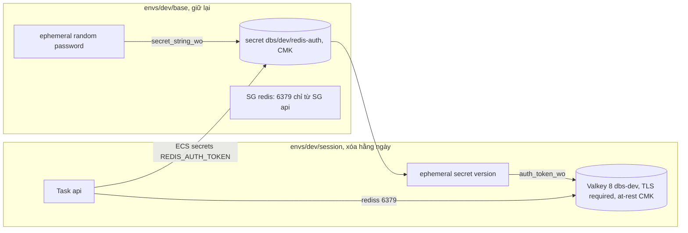

# DBS-75 · Terraform: ElastiCache Valkey (TLS) theo ADR-12

> **Status:** Draft (G1 đã duyệt) · **Vai:** #5 Platform & Ops · **Cặp đôi review:** Dev · **Nhánh:** `chore/DBS-75-terraform-valkey` (từ `main`) · **PR:** — · **Cập nhật:** 2026-10-29

## 1. Bối cảnh

- **Task trên board:** Task, Tuần 3, Deliverable P3, Ưu tiên High, board "To Do". **Expect:** App trên cloud có Redis, xóa được cùng phần «xóa hằng ngày».
- **DoD** (nguyên văn, đánh số):
  1. ElastiCache theo phương án ADR-12, TLS bật, security group chỉ cho phép từ task ECS
  2. REDIS_URL dạng rediss:// đưa vào cấu hình task
  3. apply/destroy trong cùng lệnh với phần dựng/xóa; ghi chi phí
  4. PR đã merge vào main (CI xanh); Dev review; bảng «Đối chiếu test case» trong PR điền đủ
- **Thực trạng trên board:** Redis mới chạy local (Valkey 8); production bắt buộc `rediss://`. ADR-12: node `cache.t4g.micro`, cluster mode tắt, TLS + AUTH token (Secrets Manager); production thêm 1 replica Multi-AZ.
- **Phụ thuộc:** DBS-33 (Done, đã merge `main`).
- **Đã có gì:**
  - ADR-12 (Accepted): Valkey node-based, cluster mode tắt, dev 1 node `cache.t4g.micro` (≈ 0,016 USD/giờ), TLS khi truyền, AUTH token ở Secrets Manager. docs/03 §9, §12 (mã hóa at-rest bằng KMS cho ElastiCache, NFR-SEC-03), §13 (Redis chỉ mở cho SG của app, NFR-SEC-06).
  - `validation.schema.ts`: `REDIS_URL` bắt buộc, `rediss://` khi `NODE_ENV` là `staging`/`production`. `redis.config.ts` chỉ đọc `REDIS_URL`. Chưa có `libs/redis` (DBS-76).
  - `envs/dev/base/security_groups.tf`: SG `alb`, `api`; ghi chú dòng 53 hẹn egress 6379 "do task ElastiCache thêm theo SG-to-SG". `envs/dev/session/ecs.tf`: task api chưa có `REDIS_URL`, `desired_count` mặc định 0.
  - Mẫu cùng loại trên PR chưa merge: DBS-66 (#27, SG `db` ở `base`, CMK `alias/dbs-dev`), DBS-67 (#37, app ghép `DATABASE_URL` từ `DB_*` vì ECS `secrets` không ghép được URL).
  - Backlog cùng module: không có dòng Redis/ElastiCache.
- **Baseline** (`main` b8742a3): như DBS-73: `fmt` sạch, `validate` đạt, `terraform test` bootstrap 9/9, `base` 17/17, `session` 9/9.
- **Ngoài phạm vi:** `libs/redis`, timeout và circuit breaker (DBS-76); `/health/ready` degraded (DBS-78); replica Multi-AZ production (DBS-152, chỉ để biến); task worker (DBS-121); diễn tập tắt Redis (DBS-186).
- **Câu hỏi mở** (kèm đề xuất):
  1. **Vị trí:** subnet group ElastiCache (2 private subnet), SG `dbs-dev-redis` (6379 chỉ từ SG `api`) và egress 6379 của SG `api` tới SG `redis` ở `base` (miễn phí, giống DBS-66); `aws_elasticache_replication_group` `dbs-dev` ở `session` (xóa hằng ngày, nên DoD 3 tự đạt: cùng một `apply`/`destroy` của `session`).
  2. **Cấu hình:** engine `valkey` 8, `cache.t4g.micro`, 1 node, cluster mode tắt, `transit_encryption_enabled = true` (mode `required`), `at_rest_encryption_enabled = true` bằng khóa do AWS quản lý (CMK `alias/dbs-dev` chưa có trên `main`; đổi sang CMK khi PR #27 merge, ghi BL), `automatic_failover_enabled = false`, `snapshot_retention_limit = 0`, `apply_immediately = true`. Biến `redis_node_type`, `redis_replicas` (mặc định 0) cho production.
  3. **AUTH token và `REDIS_URL` (gate phụ: biến môi trường):** URL `rediss://:<token>@host:6379` chứa bí mật nên không đặt được làm biến thường, và ECS `secrets` không ghép được URL. Hai cách:
     - **(a) Đề xuất:** app ghép `REDIS_URL` từ `REDIS_HOST`, `REDIS_PORT` (biến thường) và `REDIS_AUTH_TOKEN` (từ secret), cùng cách DBS-67 làm với `DATABASE_URL`. Cần **thêm 3 biến môi trường** và sửa `backend/src/config`; nên xếp chồng lên PR #37 (DBS-67) để dùng lại `env.bootstrap.ts`, hoặc chờ #37 merge.
     - (b) Secret chứa nguyên URL, một script ghi giá trị sau mỗi lần `apply session` (endpoint đổi theo phiên). Không đổi app nhưng thêm một bước tay mỗi phiên, dễ quên.
  4. **Token có vào Terraform state không:** đề xuất secret `dbs/dev/redis-auth` ở `base` (giữ lại; tránh bẫy 7–30 ngày chờ xóa khi tạo lại cùng tên), sinh bằng ephemeral random password và `secret_string_wo` để token không vào state của `base`. Thuộc tính `auth_token` của ElastiCache có bản write-only hay không sẽ kiểm ở Phase 2; nếu không có thì token nằm trong `dev/session.tfstate` (đã chỉ bảo vệ bằng IAM, như README ghi), và mình ghi rõ ở §3.
  5. **Test thủ công trên AWS thật:** task api trên `main` chưa khởi động được (thiếu DB, DBS-67/68 chưa merge), nên kiểm bằng **task thử** dùng image công khai có `valkey-cli` (cách DBS-66 dùng): TLS + token đúng thì `PING` → `PONG`; không TLS hoặc sai token thì bị từ chối; SG khác thì không tới được. Cần `apply`/`destroy envs/dev/session` (RDS không có trên `main`; ALB, ECS, ElastiCache ≈ 0,05 USD/giờ, destroy ngay sau khi kiểm). Cần bạn đồng ý trong hội thoại.
  6. **Chi phí:** ghi ≈ 0,016 USD/giờ cho node (ADR-11/12) và 0,40 USD/tháng cho secret vào README; đối chiếu Cost Explorer ngày hôm sau thành dòng BL (như BL-102).

**Quyết định ở G1** (người dùng trả lời «Duyệt cả hai G1», 2026-10-29): chọn đúng đề xuất 1, 2, 4, 6; câu 3 chọn (a): app ghép `REDIS_URL` từ `REDIS_HOST`, `REDIS_PORT`, `REDIS_AUTH_TOKEN` (gate phụ về biến môi trường được duyệt cùng G1). Câu 5: kịch bản task thử được duyệt; `apply`/`destroy` thật trên AWS sẽ hỏi riêng ngay trước khi chạy. Gate vẫn chờ người dùng trả lời (chưa áp dụng `CLAUDE_local.md`).

## 2. Hành vi

**Nhánh:** xếp chồng lên `chore/DBS-67-rds-tls-secrets` (PR #37) theo G1 câu 3(a): dùng lại `env.bootstrap.ts` và task api đã có `secrets`. Chuỗi này có cả CMK `alias/dbs-dev` (DBS-66), nên **mã hóa at-rest dùng CMK** thay cho khóa do AWS quản lý như G1 câu 2. Đây là lệch so với G1, cần duyệt ở G2 (câu hỏi 1).

| Tác nhân | Hành động | Kết quả |
|---|---|---|
| Task api (SG `api`) | TCP 6379 tới endpoint Valkey, TLS, AUTH token đúng | `PING` → `PONG` |
| Task api | kết nối không TLS | bị từ chối (`transit_encryption_mode = required`) |
| Task api | TLS nhưng token sai hoặc không có | `WRONGPASS` / `NOAUTH` |
| SG khác, internet, máy cá nhân | 6379 | không tới được: private subnet, SG `redis` chỉ nhận từ SG `api` |
| App khởi động (`NODE_ENV=staging`) | có `REDIS_HOST`, `REDIS_PORT`, `REDIS_AUTH_TOKEN`, không có `REDIS_URL` | `env.bootstrap` ghép `REDIS_URL = rediss://:<token đã encode>@<host>:<port>`, schema chấp nhận |
| App khởi động | đã có `REDIS_URL` (local, CI) | giữ nguyên, không ghép |
| App khởi động | thiếu hoặc sai một phần (`REDIS_PORT=abc`, token rỗng) | không ghép; stderr ghi **tên** biến sai (không ghi giá trị); schema báo thiếu `REDIS_URL` → không khởi động |
| `terraform apply session` | dựng cùng RDS, ALB, ECS | replication group `dbs-dev` tạo ≈ 5–10 phút |
| `terraform destroy session` | xóa | replication group xóa (không snapshot cuối); secret, SG, subnet group ở `base` ở lại |

**Token:**
- Sinh một lần ở `base` bằng ephemeral `aws_secretsmanager_random_password` (64 ký tự, chỉ chữ và số, hợp quy tắc AUTH của ElastiCache: 16–128 ký tự, không `@`, `"`, `/`, khoảng trắng), ghi vào secret `dbs/dev/redis-auth` bằng `secret_string_wo` (write-only, phiên bản 1).
- `session` đọc bằng ephemeral `aws_secretsmanager_secret_version` và đưa vào `auth_token_wo` của replication group (provider 6.70 có thuộc tính write-only này). **Token không nằm trong state nào** và không có trong biến Terraform.
- Task api nhận token qua ECS `secrets` (cả giá trị secret), execution role được `GetSecretValue` đúng secret này; `kms:Decrypt` qua Secrets Manager đã có từ DBS-67 (cùng CMK).
- Xoay token: tăng `secret_string_wo_version` ở `base` và `auth_token_wo_version` ở `session` (`auth_token_update_strategy = ROTATE` rồi `SET`), khởi động lại task. Chưa làm ở task này, ghi README.

**Ca biên:**
- Token chỉ có chữ và số nên `encodeURIComponent` không đổi gì; vẫn encode để không phụ thuộc giả định.
- Secret có `recovery_window_in_days = 0`: xóa `base` rồi dựng lại ngay không vướng tên trùng (platform.md). Đổi lại xóa là mất ngay; token sinh lại được.
- Endpoint đổi mỗi phiên: task definition mới mỗi `apply` (giống `DB_HOST`); `deploy.sh` lấy revision ACTIVE mới nhất.
- Cluster mode tắt: dùng `primary_endpoint_address`, không phải configuration endpoint.
- Quên `destroy`: ≈ 0,016 USD/giờ ≈ 12 USD/tháng chỉ riêng Valkey.
- Task worker (DBS-121) cần SG được Valkey nhận: DBS-121 dùng SG `api` hoặc thêm luật vào SG `redis` (bàn giao).

## 3. Kiến trúc

- **Vị trí:**
  - `envs/dev/base`: `redis_network.tf` (mới: `aws_elasticache_subnet_group.main` `dbs-dev` trên 2 private subnet; `aws_security_group.redis` `dbs-dev-redis`; ingress 6379 từ SG `api`; egress 6379 của SG `api` tới SG `redis`), `redis_auth.tf` (mới: ephemeral random password, `aws_secretsmanager_secret.redis_auth` mã hóa bằng CMK, `aws_secretsmanager_secret_version` write-only), `outputs.tf` (thêm `redis_subnet_group_name`, `redis_security_group_id`, `redis_auth_secret_arn`), `tests/redis.tftest.hcl` (mới).
  - `envs/dev/session`: `redis.tf` (mới: ephemeral đọc secret, `aws_elasticache_replication_group.main` `dbs-dev`), `variables.tf` (`redis_node_type` mặc định `cache.t4g.micro`, `redis_replicas` mặc định 0, 0–2), `ecs.tf` (thêm `REDIS_HOST`, `REDIS_PORT`, secret `REDIS_AUTH_TOKEN`), `iam.tf` (execution role đọc thêm secret Redis), `outputs.tf` (`redis_primary_endpoint`), `tests/session.tftest.hcl` (run mới, override remote state).
  - `backend/src/config`: `compose-redis-url.ts` (mới) + spec, `env.bootstrap.ts` (gọi thêm), `validation.schema.ts` (3 biến tùy chọn), `env/.env.example` (ghi chú), `backend/README.md`.
  - `infra/terraform/README.md`: mục "ElastiCache Valkey (DBS-75)", chi phí.
- **Interface cung cấp:**

```ts
export interface ComposedRedisUrl {
  url?: string;
  /** Names (never values) of the REDIS_* variables that are missing or malformed. */
  invalid: string[];
}
export function composeRedisUrl(env: NodeJS.ProcessEnv): ComposedRedisUrl;
// REDIS_URL có sẵn thì thắng; không có REDIS_HOST thì không làm gì;
// đủ REDIS_HOST, REDIS_PORT (1–65535), REDIS_AUTH_TOKEN → `rediss://:${encodeURIComponent(token)}@${host}:${port}`
```

  Luôn `rediss://`: đường ghép chỉ dùng trên AWS, và staging/production bắt buộc TLS. Người gọi: chỉ `env.bootstrap.ts`.
- **Biến môi trường mới** (duyệt ở G1): `REDIS_HOST`, `REDIS_PORT`, `REDIS_AUTH_TOKEN`, tùy chọn trong schema (Joi `string`), chỉ dùng để ghép `REDIS_URL`.
- **Dữ liệu chạm tới:** không bảng DB. State `base` và `session`: không có token.
- **Sơ đồ:**



- **Thay đổi cấp hệ thống:** README Terraform, `backend/README.md` (biến `REDIS_*`), docs/03 §13 (nếu có bảng biến môi trường của task; kiểm ở Phase 5). ADR-12 không đổi.

## 4. Test cases tự động

| ID | Truy vết | Lớp | Given · When · Then | Mong đợi |
|---|---|---|---|---|
| TC-75-01 | DoD 1 | tf test (base) | SG `redis` chỉ có ingress 6379 từ SG `api` (không CIDR); SG `api` có egress 6379 chỉ tới SG `redis`; cả hai trong VPC dev | đúng |
| TC-75-02 | DoD 1 | tf test (base) | Subnet group `dbs-dev` gồm đúng 2 private subnet | đúng |
| TC-75-03 | DoD 1, NFR-SEC-03 | tf test (base) | Secret `dbs/dev/redis-auth`, `kms_key_id` = CMK, recovery 0; version dùng `secret_string_wo` (`secret_string` null), `secret_string_wo_version = 1` | đúng |
| TC-75-04 | DoD 1 | tf test (session) | Replication group: `engine = valkey`, `engine_version` bắt đầu `8`, `cache.t4g.micro`, `num_cache_clusters = 1`, failover và Multi-AZ tắt, port 6379, `transit_encryption_enabled`, mode `required`, at-rest bật với CMK, `auth_token` null và `auth_token_wo_version = 1`, `snapshot_retention_limit = 0`, SG và subnet group từ `base` | đúng |
| TC-75-05 | ADR-12 (production) | tf test (session) | `redis_replicas = 1` → `num_cache_clusters = 2`, failover và Multi-AZ bật; `redis_replicas = 3` bị từ chối | đúng / lỗi validation |
| TC-75-06 | DoD 2 | tf test (session) | Container api: `REDIS_HOST` = `primary_endpoint_address`, `REDIS_PORT = 6379`; `secrets` có `REDIS_AUTH_TOKEN` trỏ ARN secret; không có `REDIS_URL` hay token trong `environment` | đúng |
| TC-75-07 | DoD 2 | tf test (session) | Execution role: `secretsmanager:GetSecretValue` có ARN secret Redis, không `*` | đúng |
| TC-75-08 | DoD 2 | unit | `composeRedisUrl`: đủ phần → `rediss://:<enc>@host:6379`; token có ký tự đặc biệt được encode; `REDIS_URL` có sẵn thắng; không `REDIS_HOST` → không gì; thiếu hay sai `REDIS_PORT` (`abc`, `0`, `70000`), host có ký tự lạ, token rỗng → `invalid` chỉ chứa tên | đúng |
| TC-75-09 | DoD 2 | unit | `env.bootstrap` đặt `REDIS_URL` từ phần; phần hỏng → stderr có tên biến, không có token (cả dạng encode); không cấu hình → im lặng; `NODE_ENV=staging` với `REDIS_URL` ghép thì `validateEnv` chấp nhận phần Redis | đúng |
| TC-75-10 | DoD 2 | unit | Schema chấp nhận `REDIS_HOST`, `REDIS_PORT`, `REDIS_AUTH_TOKEN` cạnh `REDIS_URL`; vẫn từ chối `redis://` ở staging | đúng / lỗi `REDIS_URL` |
| TC-75-11 | DoD 1 (bí mật) | tĩnh (grep) | Không có `auth_token =` hay `secret_string =` trong `envs/dev`; không output nào chứa giá trị secret | không có dòng nào |
| TC-75-12 | DoD 3 | tf test (session) | Output `redis_primary_endpoint`; replication group nằm trong stack `session` (cùng lệnh `apply`/`destroy`) | đúng |
| — | DoD 4 | quy trình | PR merge, CI xanh, Dev review | kiểm lúc review |

Baseline backend chạy đủ: `npm run lint:check && npm run typecheck && npm test && npm run test:e2e`.

## 5. Test thủ công

Điều kiện: `AWS_PROFILE=dbs-admin`; `apply`/`destroy` `base` và `session` **chỉ sau khi người dùng đồng ý trong hội thoại**, `destroy session` ngay sau bước cuối. `image_tag` là SHA đã có trên ECR. Output thô vào `screenshots/DBS-75/manual-test.txt` (xóa account id, ARN, token). Probe dùng image công khai `public.ecr.aws/docker/library/valkey:8` (có `valkey-cli`), chạy bằng `aws ecs run-task` trong public subnet, giống task thử của DBS-66.

| Bước | Việc làm (lệnh hoặc thao tác) | Kết quả mong đợi |
|---|---|---|
| M-75-01 | Local: từ `backend/`, `npm run build`; `NODE_ENV=staging REDIS_HOST=valkey.example.internal REDIS_PORT=6379 REDIS_AUTH_TOKEN=<token thử> node -e "require('./dist/config/env.bootstrap'); …"` in scheme, host, port của `REDIS_URL` (che mật khẩu) | `rediss:` `valkey.example.internal` `6379` |
| M-75-02 | Như trên nhưng `REDIS_PORT=abc` | stderr `REDIS_* … REDIS_PORT`, không in token; `REDIS_URL` không được đặt |
| M-75-03 | `terraform plan` ở `base` | chỉ thêm SG `redis`, 2 rule, subnet group, secret, secret version; 0 destroy. Plan không hiện token |
| M-75-04 | `apply base`; `aws secretsmanager describe-secret --secret-id dbs/dev/redis-auth`; `terraform state pull \| grep -c <8 ký tự đầu token>` (đọc token bằng `get-secret-value` vào biến shell, không in) | secret mã hóa bằng CMK; state `base` không chứa token (0) |
| M-75-05 | `terraform apply session`; `aws elasticache describe-replication-groups --replication-group-id dbs-dev` | `Engine valkey`, `CacheNodeType cache.t4g.micro`, `TransitEncryptionEnabled true`, `TransitEncryptionMode required`, `AtRestEncryptionEnabled true`, `KmsKeyId` = CMK, `AuthTokenEnabled true`, 1 node; state `session` không chứa token (0) |
| M-75-06 | `aws ecs describe-task-definition dbs-api` (revision mới nhất) | `REDIS_HOST` = endpoint, `REDIS_PORT 6379`, `secrets` có `REDIS_AUTH_TOKEN`; không có token dạng chữ |
| M-75-07 | Probe với SG `api`, execution role api, token qua `secrets`: `valkey-cli --tls --cacert /etc/ssl/certs/ca-certificates.crt -h $REDIS_HOST -p 6379 --no-auth-warning -a "$REDIS_AUTH_TOKEN" PING` | log task: `PONG` |
| M-75-08 | Cùng probe, ba lệnh: không `--tls`; `--tls` với token sai; `--tls` không token | không TLS: lỗi kết nối; token sai: `WRONGPASS`; không token: `NOAUTH` |
| M-75-09 | Probe với SG tạm `dbs-probe-deny` (egress 6379 mở, không được SG `redis` nhận), `valkey-cli … PING` với timeout 5 giây | timeout, không `PONG` |
| M-75-10 | `terraform destroy session`; `describe-replication-groups`, `describe-network-interfaces --filters Name=status,Values=available`; xóa SG tạm, task definition probe | replication group không còn; không ENI thừa; ghi thời gian bật/tắt và chi phí ước tính |

App chưa có client Redis (DBS-76), nên kết nối bằng app thật trên cloud **chưa chạy được** ở task này; probe `valkey-cli` chứng minh mạng, TLS và token, M-75-01/02 chứng minh app ghép đúng URL.
