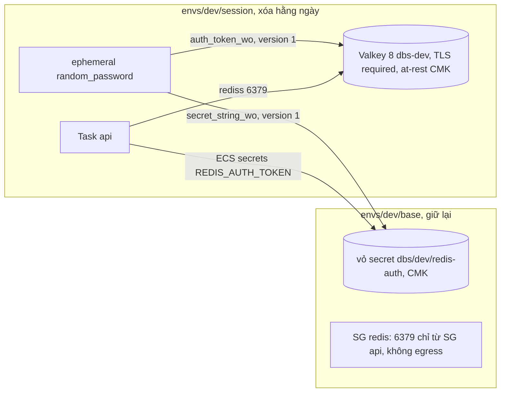

# DBS-75 · Terraform: ElastiCache Valkey (TLS) theo ADR-12

> **Status:** Design approved · **Vai:** #5 Platform & Ops · **Cặp đôi review:** Dev · **Nhánh:** `chore/DBS-75-terraform-valkey` (xếp chồng trên `chore/DBS-67-rds-tls-secrets`, PR #37) · **PR:** — · **Cập nhật:** 2026-10-29

## 1. Bối cảnh

- **Task trên board:** Task, Tuần 3, Deliverable P3, Ưu tiên High, board "To Do". **Expect:** App trên cloud có Redis, xóa được cùng phần «xóa hằng ngày».
- **DoD** (nguyên văn, đánh số):
  1. ElastiCache theo phương án ADR-12, TLS bật, security group chỉ cho phép từ task ECS
  2. REDIS_URL dạng rediss:// đưa vào cấu hình task
  3. apply/destroy trong cùng lệnh với phần dựng/xóa; ghi chi phí
  4. PR đã merge vào main (CI xanh); Dev review; bảng «Đối chiếu test case» trong PR điền đủ
- **Thực trạng trên board:** Redis mới chạy local (Valkey 8); production bắt buộc `rediss://`. ADR-12: node `cache.t4g.micro`, cluster mode tắt, TLS + AUTH token (Secrets Manager); production thêm 1 replica Multi-AZ.
- **Phụ thuộc:** DBS-33 (Done, đã merge `main`).
- **Đã có gì:**
  - ADR-12 (Accepted): Valkey node-based, cluster mode tắt, dev 1 node `cache.t4g.micro` (≈ 0,016 USD/giờ), TLS khi truyền, AUTH token ở Secrets Manager. docs/03 §9, §12 (mã hóa at-rest bằng KMS cho ElastiCache, NFR-SEC-03), §13 (Redis chỉ mở cho SG của app, NFR-SEC-06).
  - `validation.schema.ts`: `REDIS_URL` bắt buộc, `rediss://` khi `NODE_ENV` là `staging`/`production`. `redis.config.ts` chỉ đọc `REDIS_URL`. Chưa có `libs/redis` (DBS-76).
  - `envs/dev/base/security_groups.tf`: SG `alb`, `api`; ghi chú dòng 53 hẹn egress 6379 "do task ElastiCache thêm theo SG-to-SG". `envs/dev/session/ecs.tf`: task api chưa có `REDIS_URL`, `desired_count` mặc định 0.
  - Mẫu cùng loại trên PR chưa merge: DBS-66 (#27, SG `db` ở `base`, CMK `alias/dbs-dev`), DBS-67 (#37, app ghép `DATABASE_URL` từ `DB_*` vì ECS `secrets` không ghép được URL).
  - Backlog cùng module: không có dòng Redis/ElastiCache.
- **Baseline** (`main` b8742a3, lúc G1): `fmt` sạch, `validate` đạt, `terraform test` bootstrap 9/9, `base` 17/17, `session` 9/9. **Đo lại trên đỉnh nhánh DBS-67** `a09faa5` (gốc thật của nhánh này, Phase 2): `fmt` sạch, `validate` đạt, bootstrap 9/9, `base` 29/29, `session` 15/15. Baseline backend đo ở Phase 4.
- **Ngoài phạm vi:** `libs/redis`, timeout và circuit breaker (DBS-76); `/health/ready` degraded (DBS-78); replica Multi-AZ production (DBS-152, chỉ để biến); task worker (DBS-121); diễn tập tắt Redis (DBS-186).
- **Câu hỏi mở** (kèm đề xuất):
  1. **Vị trí:** subnet group ElastiCache (2 private subnet), SG `dbs-dev-redis` (6379 chỉ từ SG `api`) và egress 6379 của SG `api` tới SG `redis` ở `base` (miễn phí, giống DBS-66); `aws_elasticache_replication_group` `dbs-dev` ở `session` (xóa hằng ngày, nên DoD 3 tự đạt: cùng một `apply`/`destroy` của `session`).
  2. **Cấu hình:** engine `valkey` 8, `cache.t4g.micro`, 1 node, cluster mode tắt, `transit_encryption_enabled = true` (mode `required`), `at_rest_encryption_enabled = true` bằng khóa do AWS quản lý (CMK `alias/dbs-dev` chưa có trên `main`; đổi sang CMK khi PR #27 merge, ghi BL), `automatic_failover_enabled = false`, `snapshot_retention_limit = 0`, `apply_immediately = true`. Biến `redis_node_type`, `redis_replicas` (mặc định 0) cho production.
  3. **AUTH token và `REDIS_URL` (gate phụ: biến môi trường):** URL `rediss://:<token>@host:6379` chứa bí mật nên không đặt được làm biến thường, và ECS `secrets` không ghép được URL. Hai cách:
     - **(a) Đề xuất:** app ghép `REDIS_URL` từ `REDIS_HOST`, `REDIS_PORT` (biến thường) và `REDIS_AUTH_TOKEN` (từ secret), cùng cách DBS-67 làm với `DATABASE_URL`. Cần **thêm 3 biến môi trường** và sửa `backend/src/config`; nên xếp chồng lên PR #37 (DBS-67) để dùng lại `env.bootstrap.ts`, hoặc chờ #37 merge.
     - (b) Secret chứa nguyên URL, một script ghi giá trị sau mỗi lần `apply session` (endpoint đổi theo phiên). Không đổi app nhưng thêm một bước tay mỗi phiên, dễ quên.
  4. **Token có vào Terraform state không:** đề xuất secret `dbs/dev/redis-auth` ở `base` (giữ lại; tránh bẫy 7–30 ngày chờ xóa khi tạo lại cùng tên), sinh bằng ephemeral random password và `secret_string_wo` để token không vào state của `base`. Thuộc tính `auth_token` của ElastiCache có bản write-only hay không sẽ kiểm ở Phase 2; nếu không có thì token nằm trong `dev/session.tfstate` (đã chỉ bảo vệ bằng IAM, như README ghi), và mình ghi rõ ở §3.
  5. **Test thủ công trên AWS thật:** task api trên `main` chưa khởi động được (thiếu DB, DBS-67/68 chưa merge), nên kiểm bằng **task thử** dùng image công khai có `valkey-cli` (cách DBS-66 dùng): TLS + token đúng thì `PING` → `PONG`; không TLS hoặc sai token thì bị từ chối; SG khác thì không tới được. Cần `apply`/`destroy envs/dev/session` (RDS không có trên `main`; ALB, ECS, ElastiCache ≈ 0,05 USD/giờ, destroy ngay sau khi kiểm). Cần bạn đồng ý trong hội thoại.
  6. **Chi phí:** ghi ≈ 0,016 USD/giờ cho node (ADR-11/12) và 0,40 USD/tháng cho secret vào README; đối chiếu Cost Explorer ngày hôm sau thành dòng BL (như BL-102).

**Quyết định ở G1** (người dùng trả lời «Duyệt cả hai G1», 2026-10-29): chọn đúng đề xuất 1, 2, 4, 6; câu 3 chọn (a): app ghép `REDIS_URL` từ `REDIS_HOST`, `REDIS_PORT`, `REDIS_AUTH_TOKEN` (gate phụ về biến môi trường được duyệt cùng G1). Câu 5: kịch bản task thử được duyệt; `apply`/`destroy` thật trên AWS sẽ hỏi riêng ngay trước khi chạy. Gate vẫn chờ người dùng trả lời (chưa áp dụng `CLAUDE_local.md`).

## 2. Hành vi

**Nhánh:** xếp chồng lên `chore/DBS-67-rds-tls-secrets` (PR #37) theo G1 câu 3(a): dùng lại `env.bootstrap.ts` và task api đã có `secrets`. Chuỗi này có cả CMK `alias/dbs-dev` (DBS-66), nên **mã hóa at-rest dùng CMK** thay cho khóa do AWS quản lý như G1 câu 2. Đây là lệch so với G1, cần duyệt ở G2 (câu hỏi 1).

| Tác nhân | Hành động | Kết quả |
|---|---|---|
| Task api (SG `api`) | TCP 6379 tới endpoint Valkey, TLS, AUTH token đúng | `PING` → `PONG` |
| Task api | kết nối không TLS | bị từ chối (`transit_encryption_mode = required`) |
| Task api | TLS nhưng token sai hoặc không có | `WRONGPASS` / `NOAUTH` |
| SG khác, internet, máy cá nhân | 6379 | không tới được: private subnet, SG `redis` chỉ nhận từ SG `api` |
| App khởi động (`NODE_ENV=staging`) | có `REDIS_HOST`, `REDIS_PORT`, `REDIS_AUTH_TOKEN`, không có `REDIS_URL` | `env.bootstrap` ghép `REDIS_URL = rediss://:<token đã encode>@<host>:<port>`, schema chấp nhận |
| App khởi động | đã có `REDIS_URL` (local, CI) | giữ nguyên, không ghép |
| App khởi động | thiếu hoặc sai một phần (`REDIS_PORT=abc`, token rỗng) | không ghép; stderr ghi **tên** biến sai (không ghi giá trị); schema báo thiếu `REDIS_URL` → không khởi động |
| `terraform apply session` | dựng cùng RDS, ALB, ECS | replication group `dbs-dev` tạo ≈ 5–10 phút |
| `terraform destroy session` | xóa | replication group xóa (không snapshot cuối); secret, SG, subnet group ở `base` ở lại |

**Token:**
- **Đã đổi sau domain review vòng 1 (#2):** làm thử cho thấy `mock_provider` của Terraform 1.16.6 không hỗ trợ ephemeral resource (`Error: No ephemeral resource types in mock providers`), và `override_resource` không nhắm được ephemeral (`Invalid override target`). Thiết kế cũ (ephemeral `aws_secretsmanager_*` ở cả hai stack) sẽ làm hỏng mọi `terraform test` hiện có.
- Thiết kế mới: `base` chỉ giữ **vỏ** secret `dbs/dev/redis-auth` (CMK, recovery 0, không có giá trị). Ở `session`, ephemeral `random_password` của provider **`hashicorp/random`** (64 ký tự, `special = false`, hợp quy tắc AUTH của ElastiCache: 16–128 ký tự, không `@`, `"`, `/`, khoảng trắng) được ghi **trong cùng một lần `apply`** vào `aws_secretsmanager_secret_version.redis_auth` (`secret_string_wo`, phiên bản 1) và vào `auth_token_wo` của replication group (phiên bản 1). Cả hai thuộc tính đọc cùng một instance ephemeral nên cùng giá trị.
- Provider `random` chạy thật trong `terraform test` (không cần mock, không cần mạng sau `init`); đã làm thử với aws 6.70.0 + random 3.9.1: test đạt, `auth_token` và `secret_string` null trong state. **Token không nằm trong state nào** và không có trong biến Terraform.
- Hệ quả: mỗi phiên (`apply` sau `destroy`) có token mới, tức xoay tự động theo phiên.
- **Giữ hai nơi khớp nhau** (domain review vòng 2 #1): write-only chỉ được gửi khi resource được tạo hoặc `*_wo_version` đổi, còn ephemeral sinh giá trị mới mỗi lần chạy. Nếu chỉ một trong hai resource được tạo lại thì hai bên lệch nhau (`WRONGPASS`) mà plan không báo gì. Cách giữ:
  - Một biến `redis_auth_version` (mặc định 1) cấp cho cả `secret_string_wo_version` và `auth_token_wo_version`; `auth_token_update_strategy = "SET"`.
  - `aws_secretsmanager_secret_version.redis_auth` có `lifecycle { replace_triggered_by = [aws_elasticache_replication_group.main.id] }`. Replication group được tạo trước (không phụ thuộc secret version), nên khi nó tạo mới, bị taint, hay thay do đổi thuộc tính force-new, secret version được thay trong **cùng** lần `apply` và cả hai nhận cùng một giá trị ephemeral.
  - Còn một trường hợp: ghi secret thất bại sau khi replication group đã có. Khi đó `apply` lại ghi token mới vào secret còn Valkey giữ token cũ. Cách khôi phục (ghi README): tăng `redis_auth_version` một đơn vị rồi `apply`, cả hai nhận token mới trong cùng lần chạy; khởi động lại task.
- `hashicorp/random ~> 3.7` là **phụ thuộc mới** của stack `session` (gate phụ, câu hỏi ở G2).
- Task api nhận token qua ECS `secrets` (cả giá trị secret), execution role được `GetSecretValue` đúng secret này; `kms:Decrypt` qua Secrets Manager đã có từ DBS-67 (cùng CMK).
- Xoay token giữa phiên: tăng `redis_auth_version` rồi `apply` (`SET` thay token ngay, nên task đang chạy mất kết nối tới khi khởi động lại; ADR-12 cho phép vì Redis không phải nguồn sự thật). Kiểm thật ở M-75-11.
- `destroy session`: provider không gỡ nhãn `AWSCURRENT` khi xóa secret version, nên sau khi xóa vẫn còn một version `AWSCURRENT` chứa token cũ. Không hại gì vì Valkey mà token đó dùng đã bị xóa. Lần `apply` sau, version mới thành `AWSCURRENT`, version cũ thành `AWSPREVIOUS`.

**Ca biên:**
- Token chỉ có chữ và số nên `encodeURIComponent` không đổi gì; vẫn encode để không phụ thuộc giả định.
- Secret có `recovery_window_in_days = 0`: xóa `base` rồi dựng lại ngay không vướng tên trùng (platform.md). Đổi lại xóa là mất ngay; token sinh lại được.
- Endpoint đổi mỗi phiên: task definition mới mỗi `apply` (giống `DB_HOST`); `deploy.sh` lấy revision ACTIVE mới nhất.
- Cluster mode tắt: dùng `primary_endpoint_address`, không phải configuration endpoint.
- Quên `destroy`: ≈ 0,016 USD/giờ ≈ 12 USD/tháng chỉ riêng Valkey.
- Task worker (DBS-121) cần SG được Valkey nhận: DBS-121 dùng SG `api` hoặc thêm luật vào SG `redis` (bàn giao).
- Alarm "Redis không truy cập được > 1 phút" (docs/03 §14) cần id replication group (output `redis_replication_group_id`): bàn giao task monitoring/alarm của #5 (BL ở Phase 5).

## 3. Kiến trúc

- **Vị trí:**
  - `envs/dev/base`: `redis_network.tf` (mới: `aws_elasticache_subnet_group.main` `dbs-dev` trên 2 private subnet; `aws_security_group.redis` `dbs-dev-redis`, **không có luật egress nào**; ingress 6379 từ SG `api`; egress 6379 của SG `api` tới SG `redis`), `redis_auth.tf` (mới: chỉ `aws_secretsmanager_secret.redis_auth`, CMK, recovery 0), `outputs.tf` (thêm `redis_subnet_group_name`, `redis_security_group_id`, `redis_auth_secret_arn`), `versions.tf` (`aws >= 6.70, < 7.0`), `tests/redis.tftest.hcl` (mới).
  - `envs/dev/session`: `redis.tf` (mới: ephemeral `random_password.redis_auth`, `aws_secretsmanager_secret_version.redis_auth`, `aws_elasticache_replication_group.main` `dbs-dev`), `versions.tf` (thêm `hashicorp/random ~> 3.7`, `aws >= 6.70, < 7.0`; cập nhật `.terraform.lock.hcl`), `variables.tf` (`redis_node_type` mặc định `cache.t4g.micro`, `redis_replicas` mặc định 0, 0–2), `ecs.tf` (thêm `REDIS_HOST`, `REDIS_PORT`, secret `REDIS_AUTH_TOKEN`; sửa comment cũ "REDIS_URL … qua `secrets`"), `iam.tf` (execution role đọc thêm secret Redis), `outputs.tf` (`redis_primary_endpoint`, `redis_replication_group_id`), `tests/session.tftest.hcl` (run mới; thêm vào `override_data` của remote state: `redis_subnet_group_name`, `redis_security_group_id`, `redis_auth_secret_arn` dạng ARN hợp lệ).
  - `backend/src/config`: `compose-redis-url.ts` (mới) + spec, `env.bootstrap.ts` (gọi thêm), `validation.schema.ts` (3 biến tùy chọn), `env/.env.example` (ghi chú), `backend/README.md`.
  - `infra/terraform/README.md`: mục "ElastiCache Valkey (DBS-75)", chi phí.
- **Interface cung cấp:**

```ts
export interface ComposedRedisUrl {
  url?: string;
  /** Names (never values) of the REDIS_* variables that are missing or malformed. */
  invalid: string[];
}
export function composeRedisUrl(env: NodeJS.ProcessEnv): ComposedRedisUrl;
// REDIS_URL có sẵn thì thắng; không có REDIS_HOST thì không làm gì;
// đủ REDIS_HOST, REDIS_PORT (1–65535), REDIS_AUTH_TOKEN → `rediss://:${encodeURIComponent(token)}@${host}:${port}`
```

  Luôn `rediss://`: đường ghép chỉ dùng trên AWS, và staging/production bắt buộc TLS. Người gọi: chỉ `env.bootstrap.ts`.
- **Biến môi trường mới** (duyệt ở G1): `REDIS_HOST`, `REDIS_PORT`, `REDIS_AUTH_TOKEN`, tùy chọn trong schema (Joi `string`), chỉ dùng để ghép `REDIS_URL`.
- **Dữ liệu chạm tới:** không bảng DB. State `base` và `session`: không có token.
- **Sơ đồ:**



- **Thay đổi cấp hệ thống:** README Terraform, `backend/README.md` (biến `REDIS_*`), docs/03 §13 (nếu có bảng biến môi trường của task; kiểm ở Phase 5). ADR-12 không đổi.

## 4. Test cases tự động

| ID | Truy vết | Lớp | Given · When · Then | Mong đợi |
|---|---|---|---|---|
| TC-75-01 | DoD 1 | tf test (base) | SG `redis` chỉ có ingress 6379 từ SG `api` (không CIDR) và không có luật egress (`egress` rỗng, không `aws_vpc_security_group_egress_rule` nào trỏ SG `redis` làm nguồn); SG `api` có egress 6379 chỉ tới SG `redis`; cả hai trong VPC dev | đúng |
| TC-75-02 | DoD 1 | tf test (base) | Subnet group `dbs-dev` gồm đúng 2 private subnet | đúng |
| TC-75-03 | DoD 1, NFR-SEC-03 | tf test (base + session) | `base`: secret `dbs/dev/redis-auth`, `kms_key_id` = CMK, recovery 0. `session`: secret version trỏ ARN secret từ remote state, `secret_string` null; `secret_string_wo_version` và `auth_token_wo_version` cùng bằng `var.redis_auth_version` (chạy với 1 và 2); `auth_token_update_strategy = SET` | đúng |
| TC-75-04 | DoD 1 | tf test (session) | Replication group: `engine = valkey`, `engine_version` bắt đầu `8`, `cache.t4g.micro`, `num_cache_clusters = 1`, failover và Multi-AZ tắt, port 6379, `transit_encryption_enabled`, mode `required`, at-rest bật với CMK, `auth_token` null và `auth_token_wo_version = 1`, `snapshot_retention_limit = 0`, `final_snapshot_identifier` null, SG và subnet group từ `base` | đúng |
| TC-75-05 | ADR-12 (production) | tf test (session) | `redis_replicas = 1` → `num_cache_clusters = 2`, failover và Multi-AZ bật; `redis_replicas = 3` bị từ chối | đúng / lỗi validation |
| TC-75-06 | DoD 2 | tf test (session) | Container api: `REDIS_HOST` = `primary_endpoint_address`, `REDIS_PORT = 6379`; `secrets` có `REDIS_AUTH_TOKEN` trỏ ARN secret; không có `REDIS_URL` hay token trong `environment` | đúng |
| TC-75-07 | DoD 2 | tf test (session) | Execution role: `secretsmanager:GetSecretValue` có ARN secret Redis, không `*` | đúng |
| TC-75-08 | DoD 2 | unit | `composeRedisUrl`: đủ phần → `rediss://:<enc>@host:6379`; token có ký tự đặc biệt được encode; `REDIS_URL` có sẵn thắng; không `REDIS_HOST` → không gì; thiếu hay sai `REDIS_PORT` (`abc`, `0`, `70000`), host có ký tự lạ, token rỗng → `invalid` chỉ chứa tên | đúng |
| TC-75-09 | DoD 2 | unit | `env.bootstrap` đặt `REDIS_URL` từ phần; phần hỏng → stderr có tên biến, không có token (cả dạng encode); không cấu hình → im lặng; `NODE_ENV=staging` với `REDIS_URL` ghép thì `validateEnv` chấp nhận phần Redis | đúng |
| TC-75-10 | DoD 2 | unit | Schema chấp nhận `REDIS_HOST`, `REDIS_PORT`, `REDIS_AUTH_TOKEN` cạnh `REDIS_URL`; vẫn từ chối `redis://` ở staging | đúng / lỗi `REDIS_URL` |
| TC-75-11 | DoD 1 (bí mật) | tĩnh (grep) | `git grep -nE '^\s*(auth_token\|secret_string\|password)\s*=' -- infra/terraform/envs/dev` (chịu được căn lề của `terraform fmt`); không output nào chứa giá trị secret hay ephemeral | không có dòng nào |
| TC-75-12 | DoD 3 | tf test (session) | Output `redis_primary_endpoint`, `redis_replication_group_id`; replication group nằm trong stack `session` (cùng lệnh `apply`/`destroy`) | đúng |
| — | DoD 4 | quy trình | PR merge, CI xanh, Dev review | kiểm lúc review |

Baseline backend chạy đủ: `npm run lint:check && npm run typecheck && npm test && npm run test:e2e`.

## 5. Test thủ công

**Điều kiện:** `AWS_PROFILE=dbs-admin`; `apply`/`destroy` `base` và `session` **chỉ sau khi người dùng đồng ý trong hội thoại**, `destroy session` ngay sau bước cuối. `image_tag` là SHA đã có trên ECR. Không có `backend/env/.env.staging` trên máy chạy (nếu có, `loadEnv` nạp `REDIS_URL` của nó và bỏ qua phần ghép). Output thô vào `screenshots/DBS-75/manual-test.txt` (xóa account id, ARN, token).

**Chi phí và thời gian:** nhánh xếp chồng trên DBS-67 nên `apply session` dựng cả RDS. Mỗi giờ khoảng: RDS 0,025 + gp3 0,004 + ALB ≈ 0,025 + 2 IPv4 của ALB 0,01 + Valkey 0,016 + IPv4 của probe 0,005 ≈ **0,085 USD/giờ** (ADR-11, README Terraform). Tạo ≈ 15–20 phút (RDS 10–15, Valkey 5–10, song song), xóa ≈ 8–12 phút. Cả phiên dự kiến ≈ 1 giờ, ≈ 0,09 USD. Quên `destroy` thì ≈ 2 USD/ngày.

**Probe** (giống DBS-66 M-66-04): role tạm `dbs-probe-exec` (trust `ecs-tasks.amazonaws.com`; inline `secretsmanager:GetSecretValue` trên `dbs/dev/redis-auth`, `kms:Decrypt` trên CMK với `kms:ViaService` Secrets Manager, `logs:CreateLogStream`/`PutLogEvents` trên `/dbs/dev/api:*`); task definition `dbs-probe-redis` (container `probe`, image `public.ecr.aws/docker/library/valkey:8-alpine`; `REDIS_AUTH_TOKEN` từ `secrets` = ARN secret; `REDIS_HOST` biến thường; log `awslogs` về `/dbs/dev/api` prefix `probe`); `run-task` ở public subnet, `assignPublicIp=ENABLED`, lệnh qua `--overrides file://probe-overrides.json`.

| Bước | Việc làm (lệnh hoặc thao tác) | Kết quả mong đợi |
|---|---|---|
| M-75-01 | Local: từ `backend/`, `npm run build`; `env -u REDIS_URL NODE_ENV=staging REDIS_HOST=valkey.example.internal REDIS_PORT=6379 REDIS_AUTH_TOKEN=<token thử 64 ký tự> node -e "require('./dist/config/env.bootstrap'); const u=new URL(process.env.REDIS_URL); console.log(u.protocol,u.hostname,u.port,u.password.length)"` | `rediss: valkey.example.internal 6379 64` |
| M-75-02 | Như trên nhưng `REDIS_PORT=abc` | stderr có `REDIS_PORT`, không có token; `REDIS_URL` không được đặt (`new URL` lỗi `Invalid URL`) |
| M-75-03 | `terraform plan` ở `base` | chỉ thêm SG `redis`, 2 rule, subnet group, vỏ secret; 0 destroy |
| M-75-04 | `apply base`; `aws secretsmanager describe-secret --secret-id dbs/dev/redis-auth`; `list-secret-version-ids --include-deprecated` | secret dùng CMK `alias/dbs-dev`; lần `apply base` đầu tiên thì chưa có version nào |
| M-75-05 | `terraform apply session` (ghi giờ bắt đầu); `aws elasticache describe-replication-groups --replication-group-id dbs-dev`; đọc token vào biến shell bằng `get-secret-value` (không in), rồi `terraform state pull \| grep -c "${TOKEN:0:12}"` ở cả `base` và `session` | `Engine valkey`, 1 node `cache.t4g.micro`, `TransitEncryptionEnabled true`, mode `required`, `AtRestEncryptionEnabled true`, `KmsKeyId` = CMK, `AuthTokenEnabled true`, `SnapshotRetentionLimit 0`; grep trả `0` ở cả hai state |
| M-75-06 | `aws ecs describe-task-definition --task-definition dbs-api` (revision mới nhất) | `REDIS_HOST` = endpoint, `REDIS_PORT 6379`, `secrets` có `REDIS_AUTH_TOKEN`; không có token dạng chữ |
| M-75-07 | Tạo role tạm, đăng ký `dbs-probe-redis`, `run-task` với **SG `api`** và `probe-overrides.json`; `aws ecs wait tasks-stopped`; đọc log prefix `probe` (mã thoát của task không dùng làm bằng chứng vì lệnh cuối là `echo`) | log có `start`; `ok-tls: PONG`; dòng `notls:` không có `PONG` (lỗi hoặc rỗng); dòng `badpass:` có `WRONGPASS` (`AUTH failed: WRONGPASS …`), không `PONG`; dòng `nopass:` có `NOAUTH`, không `PONG` |
| M-75-08 | Đối chứng âm: SG tạm `dbs-probe-deny` (egress 443 tới `0.0.0.0/0` để kéo image và đọc secret, egress 6379 tới CIDR VPC `10.20.0.0/16`; không có trong ingress SG `redis`); `run-task` cùng task definition với `probe-overrides-deny.json` | log có `start` (task đã chạy và đọc được secret), không `PONG`, dòng `exit=` khác 0 (`timeout` trả 124 hoặc 143) |
| M-75-09 | Dọn probe theo thứ tự: `wait tasks-stopped` → `iam delete-role-policy` → `iam delete-role` → `ecs deregister-task-definition` → `ecs delete-task-definitions` → xóa SG `dbs-probe-deny` sau khi ENI nhả; kiểm `iam get-role` (`NoSuchEntity`), `ecs list-task-definitions --family-prefix dbs-probe-redis --status ACTIVE` | không còn role, task definition hay SG tạm |
| M-75-11 | Xoay token trong phiên: `terraform apply -var redis_auth_version=2 …`; chạy lại probe M-75-07 (task definition mới đọc secret lúc khởi động) | plan chỉ đổi tại chỗ (không thay replication group); probe `ok-tls: PONG` với token mới; `list-secret-version-ids --include-deprecated` có 2 version |
| M-75-10 | `terraform destroy session` (ghi giờ kết thúc); kiểm từng dịch vụ: `elasticache describe-replication-groups`, `elasticache describe-snapshots --replication-group-id dbs-dev`, `rds describe-db-instances`, `rds describe-db-snapshots --db-instance-identifier dbs-dev`, `elbv2 describe-load-balancers`, `ecs list-tasks --cluster dbs-dev` (nếu cluster còn), `ec2 describe-addresses`, `ec2 describe-network-interfaces --filters Name=vpc-id,Values=<vpc> Name=status,Values=available`, `secretsmanager list-secrets --include-planned-deletion --filters Key=name,Values=rds!db`, `secretsmanager list-secret-version-ids --secret-id dbs/dev/redis-auth --include-deprecated` | không còn replication group, snapshot, instance RDS, ALB, task, EIP, ENI thừa; secret master RDS đã xóa hoặc chờ xóa (ghi lại); `dbs/dev/redis-auth` còn version `AWSCURRENT` của phiên vừa xóa (đúng như §2); thời gian bật/tắt và chi phí ước tính ghi vào §8 |

`probe-overrides.json` (tệp thường, không chứa bí mật; token vào qua `secrets`):

```json
{"containerOverrides": [{"name": "probe", "command": ["sh", "-c",
 "echo start; c='valkey-cli -h '$REDIS_HOST' -p 6379 --no-auth-warning'; echo ok-tls: $($c --tls -a \"$REDIS_AUTH_TOKEN\" PING 2>&1); echo notls: $(timeout 5 $c -a \"$REDIS_AUTH_TOKEN\" PING 2>&1); echo badpass: $($c --tls -a wrong-token-0000000000000000 PING 2>&1); echo nopass: $($c --tls PING 2>&1)"]}]}
```

`probe-overrides-deny.json` (M-75-08):

```json
{"containerOverrides": [{"name": "probe", "command": ["sh", "-c",
 "echo start; timeout 5 valkey-cli -h $REDIS_HOST -p 6379 --tls --no-auth-warning -a \"$REDIS_AUTH_TOKEN\" PING; echo exit=$?"]}]}
```

Thứ tự chạy: M-75-01…07, M-75-08, M-75-11, M-75-09 (dọn probe), M-75-10.

`valkey-cli --tls` dùng kho CA hệ thống của image (`ca-certificates` của Alpine); endpoint ElastiCache dùng chứng chỉ Amazon công khai. Nếu image thiếu kho CA, thêm `--cacert /etc/ssl/certs/ca-certificates.crt` và ghi lại; không dùng `--insecure`.

App chưa có client Redis (DBS-76), nên kết nối bằng app thật trên cloud **chưa chạy được** ở task này; probe `valkey-cli` chứng minh mạng, TLS và token, M-75-01/02 chứng minh app ghép đúng URL.

## 6. Domain review (AI)

**Reviewer:** subagent `general-purpose`, model Opus 5.5, ngày 2026-10-29 · **Kết quả vòng 1:** 10 phát hiện (blocking 0, should-fix 5, minor 5), verdict REVISE · [trả lời nguyên văn](screenshots/DBS-75/domain-review.md)

| # | Mức | Phát hiện | Xử lý |
|---|---|---|---|
| 1 | should-fix | Grep `auth_token =` vỡ khi `fmt` căn lề | đã sửa TC-75-11 (regex `git grep -nE`); TC-75-03/04 assert null |
| 2 | should-fix | Ephemeral resource dưới `mock_provider` chưa rõ | đã làm thử: không hỗ trợ; **đổi thiết kế** sang `hashicorp/random` ephemeral ở `session` (§2 Token, §3); thêm override remote state; phụ thuộc mới là câu hỏi G2 |
| 3 | should-fix | Kiểm dọn chưa đủ từng dịch vụ, chưa kiểm snapshot | đã sửa M-75-10 và TC-75-04 (`final_snapshot_identifier` null) |
| 4 | should-fix | Chi phí và thời gian cũ (chưa tính RDS) | đã sửa §5 (≈ 0,085 USD/giờ, ≈ 1 giờ); dùng con số này khi xin `apply` |
| 5 | should-fix | Probe thiếu chi tiết, đối chứng âm thiếu egress 443 | đã sửa M-75-07…09 theo mẫu DBS-66, có `probe-overrides.json` và thứ tự dọn |
| 6 | minor | `loadEnv` có thể nạp `.env.staging` | đã thêm điều kiện và `env -u REDIS_URL` |
| 7 | minor | Chưa assert SG `redis` không có egress | đã sửa §3, TC-75-01 |
| 8 | minor | BL-039, BL-038, comment `ecs.tf` | xóa BL-039 và cập nhật BL-038 ở Phase 5; sửa comment `ecs.tf` (§3) |
| 9 | minor | Thiếu bàn giao alarm Redis | đã thêm ở §2 ca biên, output `redis_replication_group_id`; BL ở Phase 5 |
| 10 | minor | Ràng buộc provider `~> 6.0` | đã đưa `aws >= 6.70, < 7.0` vào §3 (cả hai stack) và README |

**Vòng 2** (cùng reviewer, Opus 5.5, trên commit `a6f4cd4`): 5 phát hiện (blocking 0, should-fix 2, minor 3), verdict REVISE; xác nhận 10 phát hiện vòng 1 đã xử lý, quoting của `probe-overrides.json` đúng · [nguyên văn](screenshots/DBS-75/domain-review.md#vòng-2)

| # | Mức | Phát hiện | Xử lý |
|---|---|---|---|
| V2-1 | should-fix | Token ở secret và Valkey có thể lệch khi chỉ một resource được tạo lại | đã sửa §2: một biến `redis_auth_version` cho cả hai, `replace_triggered_by` trên secret version, `SET`; cách khôi phục; TC-75-03; thêm M-75-11 |
| V2-2 | should-fix | M-75-08 không có lệnh cụ thể, mã thoát luôn 0 | đã thêm `probe-overrides-deny.json` có `exit=$?`; M-75-07 không dùng mã thoát task |
| V2-3 | minor | Vòng đời secret version khi destroy | đã ghi kết quả mong đợi cụ thể (§2, M-75-04, M-75-10), thêm `--include-deprecated` |
| V2-4 | minor | Chữ lỗi `AUTH failed: WRONGPASS` | đã đổi kỳ vọng thành "có `WRONGPASS`, không `PONG`" |
| V2-5 | minor | Header và baseline cũ | đã sửa header; đo lại baseline trên DBS-67 (9/29/15) |

Vòng 3 chưa chạy: các xử lý vòng 2 là chi tiết lệnh và một ràng buộc lifecycle; `replace_triggered_by` và phiên bản dùng chung sẽ được chứng minh bằng `terraform test` (plan có thay secret version khi replication group thay) ở Phase 4 và M-75-11. Nêu ở G2 để người dùng quyết định có cần vòng 3 không.

**Quyết định ở G2** (người dùng trả lời «Duyệt cả hai G2», 2026-10-29): chấp nhận đề xuất 1–5: at-rest bằng CMK `alias/dbs-dev`; thêm phụ thuộc `hashicorp/random ~> 3.7` ở `session`; không chạy vòng review 3; các bàn giao ghi BL; `apply`/`destroy` `base` và `session` cho test thủ công (vẫn cho xem `terraform plan` và hỏi trước khi chạy).

## 7. Kế hoạch triển khai

| Bước | File | Test viết trước | Kết quả đỏ (1 dòng, điền khi chạy) | Lệnh chứng minh | Commit |
|---|---|---|---|---|---|
| 1 | `base/redis_network.tf`, `base/outputs.tf`, `base/tests/redis.tftest.hcl` | TC-75-01, 02 | | `terraform test -filter=tests/redis.tftest.hcl` (ở `base`) | `feat(infra): valkey subnet group and security group` |
| 2 | `base/redis_auth.tf`, `base/outputs.tf`, `base/versions.tf` (`aws >= 6.70, < 7.0`) | TC-75-03 (phần base) | | như trên | `feat(infra): redis auth secret shell in base` |
| 3 | `session/versions.tf` (+ `hashicorp/random ~> 3.7`, `aws >= 6.70, < 7.0`), `.terraform.lock.hcl`, `session/variables.tf`, `session/redis.tf`, `session/outputs.tf`, `session/tests/session.tftest.hcl` (override remote state thêm `redis_*`) | TC-75-03 (phần session), 04, 05, 12 | | `terraform test` (ở `session`, cả 15 run cũ phải còn đạt) | `feat(infra): valkey replication group with tls and a write-only token` |
| 4 | `session/ecs.tf`, `session/iam.tf` | TC-75-06, 07 | | như trên | `feat(infra): redis host, port and token secret in the api task` |
| 5 | `backend/src/config/compose-redis-url.ts`, `compose-redis-url.spec.ts` | TC-75-08 | | `npx jest src/config/compose-redis-url.spec.ts` | `feat(config): compose redis url from parts` |
| 6 | `backend/src/config/env.bootstrap.ts`, `env.bootstrap.spec.ts`, `validation.schema.ts`, `validation.schema.spec.ts`, `backend/env/.env.example` | TC-75-09, 10 | | `npx jest src/config` | `feat(config): bootstrap redis url on ecs` |
| 7 | — | TC-75-11 (`git grep -nE '^\s*(auth_token\|secret_string\|password)\s*=' -- infra/terraform/envs/dev` rỗng) | không có đỏ (kiểm tĩnh) | `git grep` | (không commit) |
| 8 | Toàn bộ | baseline | | `terraform fmt -check -recursive`; `validate` + `test` ba stack; từ `backend/`: `npm run lint:check && npm run typecheck && npm test && npm run test:e2e` (cần `docker compose up -d`) | (không commit riêng) |
| 9 | AWS thật (sau khi người dùng xem plan và đồng ý, kèm đồng ý trước cho `destroy session`) | §5 M-75-01…11 | | `npm run build`, `terraform plan/apply/destroy`, `aws …` | `docs(features): DBS-75 manual test` |
| 10 | `infra/terraform/README.md`, `backend/README.md`, `docs/BACKLOG.md` (xóa BL-039, sửa BL-038, thêm BL mới), `docs/features/README.md`, feature doc §8–§9 | — | — | `check-doc-links.mjs` | `docs(infra): elasticache valkey` |

**Plan dự kiến** (bước 9): `base` thêm 5 (SG `redis`, ingress, egress của SG `api`, subnet group, secret), 0 thay đổi, 0 xóa. `session` khi dựng từ trống: như DBS-67 cộng 2 (replication group, secret version); task definition và policy execution role có thêm phần Redis.

**Rà soát giới hạn và DoD:**

| Mục | Xử lý |
|---|---|
| DoD 1 | bước 1, 3; M-75-05, 07, 08 |
| DoD 2 | bước 4, 5, 6; M-75-01, 02, 06 |
| DoD 3 | bước 3 (cùng stack `session`), bước 10 (chi phí ở README); M-75-10; đối chiếu Cost Explorer ngày hôm sau → BL |
| DoD 4 | quy trình, sau G4 |
| BL-039 (egress 6379 của SG `api`) | bước 1; xóa dòng ở bước 10 |
| BL-038 (thiếu `REDIS_URL` cho task api) | bước 4; sửa dòng ở bước 10 (Redis đã có, các phần khác giữ nguyên) |
| Comment `ecs.tf` về `REDIS_URL` | bước 4 |
| Kết nối bằng app thật (DBS-76), alarm Redis (§14), SG worker (DBS-121), replica production (DBS-152) | ngoài phạm vi; BL ở bước 10 |

**Rủi ro và cách lùi:** `replace_triggered_by` trỏ tới thuộc tính `id` của replication group có thể báo lỗi nếu Terraform không cho tham chiếu thuộc tính đã biết khi tạo; khi đó dùng tham chiếu cả resource (`[aws_elasticache_replication_group.main]`). Nếu thay đổi này làm lệch kế hoạch §3 thì là gate phụ. Lùi: `git revert`; `destroy session` xóa Valkey; vỏ secret ở `base` xóa bằng `apply` sau khi revert (recovery 0).

**Quyết định ở G3:** (chờ)
