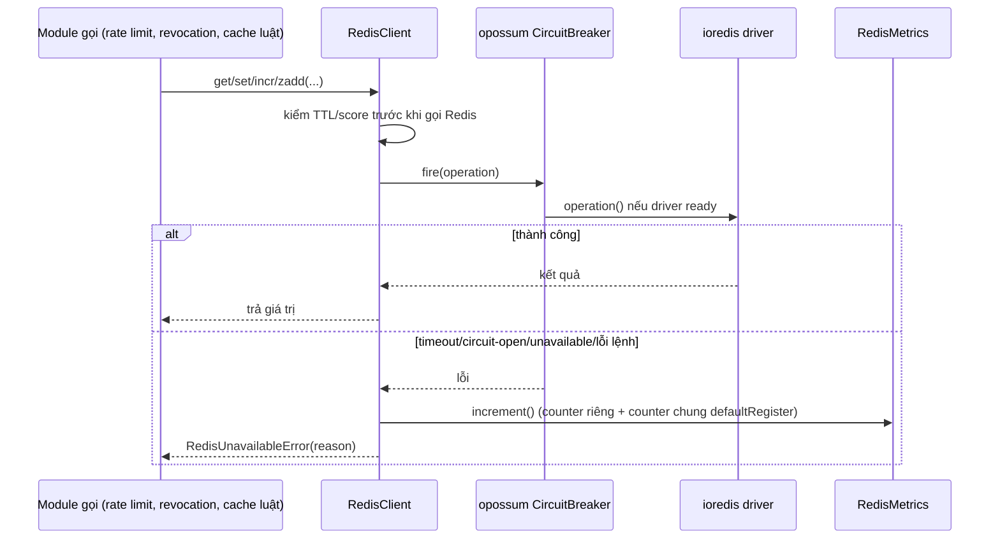
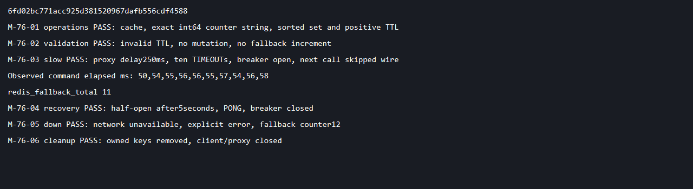

# DBS-76 · Redis adapter: timeout, circuit breaker, metric

> **Status:** Implemented · PR #52 đã merge 2026-11-07; chưa có Dev review (BL-160) · **Vai:** Dev · **PR:** [#52](https://github.com/Lawliet119/digital-banking-simulator/pull/52) · **Cập nhật:** 2026-11-07

## 1. Bối cảnh và phụ thuộc

Board: Dev, High, In Progress. DBS-40 (Testcontainers Valkey/ElasticMQ) đã Done. Main đã có Testcontainers Valkey nhưng chưa có adapter runtime bọc `ioredis`/`opossum`, chưa có metrics. Người dùng duy trì quy trình trước đó, giống DBS-77/DBS-62 (implement/test/manual/commit/push/mở Draft PR không dừng ở gate) — **note G1 retroactive**: gate G1-G3 không có bản ghi duyệt tường minh ở lịch sử commit nhánh; techlead đã duyệt retroactive cho cả ba gate sau khi review lại, với điều kiện fix hết gap kỹ thuật tìm được. Không sửa board, không tự merge.

DoD theo board: adapter bọc `ioredis` với timeout ≤50ms (giả định) và circuit breaker (`opossum`); timeout/breaker mở trả lỗi tường minh để caller rơi về dự phòng; metric `redis_fallback_total` tăng mỗi lần rơi về dự phòng; test Testcontainers chứng minh Redis chậm (qua proxy, không chỉ tắt) mở breaker trong ngưỡng và hồi phục khi Redis ổn lại; có hàm `get/set/incr/zadd...` hợp đồng lỗi rõ ràng, không nơi nào gọi `ioredis` trực tiếp; PR merge main (CI xanh), Dev review, bảng đối chiếu test case điền đủ.

ADR-12 chốt tham số: timeout 50ms; breaker `errorThresholdPercentage` 50, `volumeThreshold` 10, cửa sổ rolling 10s, `resetTimeout` 5s.

## 2. Hành vi

`RedisClient` có `get`, `set(key,value,ttlSeconds)`, `incr(key,ttlSeconds)`, `zadd(key,score,member,ttlSeconds)`, `zrangebyscore`, `del`, `ping`. TTL phải là safe integer từ 1 đến 604800 giây (tối đa 7 ngày theo ADR-12), kiểm trước khi gọi Redis cho `set`/`incr`/`zadd`; TTL quá lớn/không an toàn/bằng 0 ném `TypeError`, không đổi key, không tăng metric fallback. `incr`/`zadd` dùng một Lua script để mutate và `EXPIRE` không bị interleave. Lua **không rollback** lỗi runtime/ACL xảy ra sau khi đã ghi — lỗi ghi vẫn ở trạng thái không xác định. Không có dữ liệu tiền/nghiệp vụ, không đổi auth, không cache số dư. Giá trị/kết quả counter là string (`INCR` rồi `GET` trong Lua giữ đúng int64), score/range bound là safe integer. Mọi lệnh đi qua cùng breaker `opossum`; không có cửa thoát gọi `ioredis` thô.

Timeout là `min(REDIS_COMMAND_TIMEOUT_MS, 50)` dùng config có sẵn (10..1000); config lớn hơn vẫn bị cap 50 theo ADR-12. Command deadline từ chối tường minh, không phải cam kết scheduler hard real-time. Offline queue tắt, `maxRetriesPerRequest` 0, lệnh chưa hoàn tất không bao giờ gửi lại. Reconnect nền được phép mà không buffer lệnh. Lỗi connect/readiness không lộ URL, password, key/value hay message gốc. Trả `RedisUnavailableError` với lý do giới hạn `TIMEOUT`/`CIRCUIT_OPEN`/`UNAVAILABLE`/`COMMAND_FAILED`/`SHUTDOWN`. Lỗi báo cho caller biết nên fail-open cho rate limit hoặc hỏi PostgreSQL cho revocation/features/config. Timeout trên một lệnh ghi là không xác định; không retry một `INCR` không idempotent như thể nó đã rollback.

Cấu hình breaker theo ADR-12: `errorThresholdPercentage` 50, `volumeThreshold` 10, rolling window 10000ms, reset 5000ms. Test xác nhận mở đúng ở 10 lệnh toàn lỗi và biên 50%, hồi phục half-open thành công. Expose trạng thái đọc-only (`closed`/`open`/`half-open`/`shutdown`) cho test/health integration, không polling loop.

`RedisMetrics` sở hữu `Registry` + `Counter redis_fallback_total` riêng (dùng cho `metrics()`/`count()` theo từng instance, cần cho test tạo nhiều instance độc lập), tăng một lần mỗi khi một lệnh nghiệp vụ bị từ chối ở biên fallback của adapter (bao gồm circuit mở/chưa sẵn sàng), không tăng theo mỗi lần reconnect hay lỗi validate của caller.

**Gap đã sửa sau code-review:** `RedisMetrics` ban đầu chỉ đăng ký `Counter` vào `Registry` riêng của chính nó, không đăng ký vào `defaultRegister` của `prom-client` — một endpoint `/metrics` HTTP dựng theo cách thông thường (`defaultRegister.metrics()`) sẽ **không thấy** `redis_fallback_total`, mâu thuẫn với mục tiêu "expose cho metrics endpoint tương lai" mà task này tự ghi. Đã sửa: thêm một `Counter` dùng chung tên, được tạo một lần cho toàn tiến trình và tái sử dụng (không tạo lại — `prom-client` từ chối đăng ký trùng tên) trên `defaultRegister`, cộng dồn song song với counter riêng của từng instance; test xác nhận tạo nhiều `RedisMetrics` không ném lỗi và counter chung cộng đúng (xem §7).

Không log body/key/URL/credential/cause. Module exports `RedisClient`/`RedisMetrics`; chưa tích hợp `AppModule` ở task này. Lifecycle `onModuleDestroy` tắt timer breaker và đóng socket/reconnect timer của `ioredis` ngay, không giữ timer force-close 2 giây mặc định.

## 3. Kiến trúc

`@libs/redis` export `RedisModule`, `RedisClient`, `RedisMetrics`, `RedisUnavailableError`. Module dùng `redisConfig` có sẵn, `ioredis` node client chuẩn cho `redis://` (local) và `rediss://` (cloud) với TLS verify chuẩn. Thêm `ioredis`, `opossum`, `prom-client` vào `dependencies` và `@types/opossum` vào `devDependencies`; không env/ADR mới. Lua script chỉ tham số hóa key/value, chỉ thực hiện mutation cache/counter. `libs` không phụ thuộc module nghiệp vụ. `node-redis` trong test harness vẫn chỉ dùng cho admin/test; không có `ioredis` trực tiếp ngoài adapter ở production, enforce bằng ESLint.

**Gap đã sửa sau code-review:** rule `no-restricted-syntax` chặn `ImportDeclaration`/`ImportExpression` có `source.value` khớp `/^ioredis/` chỉ bắt được import dạng literal string. Dynamic import bằng template literal (`import(\`ioredis\`)`) không có `.value` kiểu Literal nên lách được rule, bỏ qua toàn bộ timeout/breaker/metric. Đã thêm 2 selector mới bắt `TemplateLiteral` sau `ImportExpression` và sau `require(...)`.

Proxy TCP độ trễ chỉ dùng cho test, nối tới cổng Valkey đã map ra host. Proxy làm trễ response server 250ms (vượt 50ms); tự quản socket/timer, giữ đúng thứ tự byte và flush đúng thứ tự khi bỏ độ trễ; đóng hết ở `finally`. Helper không đổi networking cloud. CI thêm suite Redis targeted vào job `e2e` có sẵn, giữ tên job bắt buộc.

## 4. Test cases tự động

| Case | Bằng chứng |
|---|---|
| TC-76-01 | Unit: cap config/default/không replay offline, lỗi có kiểu đã redact, metric tăng đúng một lần, validate không tăng metric, DI/shutdown Nest |
| TC-76-02 | Real Valkey: get/set/incr/zadd/range/del/ping, TTL dương và atomic script; key vắng trả null; TTL quá lớn thì `set`/`incr`/`zadd` bị từ chối, key/metric không đổi |
| TC-76-03 | Real proxy trễ 250ms: 10 lỗi mở breaker, lệnh tiếp theo short-circuit và tăng metric; bỏ trễ rồi thật sự hồi phục half-open sau 5s |
| TC-76-04 | Valkey dừng: lỗi tường minh và counter tăng; không hang; lifecycle dừng socket/timer |
| TC-76-05 | Unit fake clock: đúng 5 lỗi/10 lệnh mở, 4/10 vẫn đóng, rolling 10s/reset 5s và hồi phục half-open; không replay lệnh |
| TC-76-05c đến g (BL-152) | Unit fake clock với `opossum` thật, caller retry liên tục lúc OPEN: c ghim hành vi thư viện (lệnh bị từ chối nhanh làm tăng `stats.fires` và `rejects`, không tăng `failures`); d retry không dời thời điểm half-open (đúng `resetTimeout`); e probe half-open lỗi thì mở lại đủ 5 giây; f sau khi hồi phục breaker vẫn mở đúng biên 5/10 tính trên lệnh đã chạy (6/12); g dưới biên (6/13) vẫn đóng, 7/14 mở |
| Mới | Unit: tạo nhiều `RedisMetrics` không ném lỗi do đăng ký trùng tên trên `defaultRegister`; counter chung cộng đúng, counter riêng của từng instance không bị ảnh hưởng |
| Process | CI đầy đủ, Dev khác review/merge, bảng đối chiếu DoD trong PR |

Test nằm ở `backend/src/libs/redis/redis.client.spec.ts` (unit, mock `ioredis`, fake timer) và `backend/test/services/redis-adapter.services-spec.ts` (Valkey Testcontainers thật qua proxy TCP, cổng động).

## 5. Test thủ công

Lệnh từ repo: `docker compose up -d valkey`; từ `backend`: `npm run build`; `node scripts/manual-dbs76.cjs`. Driver dùng prefix key riêng, chỉ qua Compose local và proxy TCP test, không bao giờ chạm AWS.

| Bước | Hành động | Kỳ vọng |
|---|---|---|
| M-76-01 | Ready/connect, get/set/incr/zadd/range với TTL | Giá trị đúng; counter string giữ nguyên, TTL dương; in `operations PASS` |
| M-76-02 | TTL bằng 0 | `TypeError` trước khi gọi Redis, counter fallback không đổi; in `validation PASS` |
| M-76-03 | Đặt proxy trễ 250, thực hiện 10 lần đọc với deadline 50ms | Lỗi `TIMEOUT` có kiểu, breaker mở, count=10; lệnh tiếp theo `CIRCUIT_OPEN`, count=11; in `slow PASS` |
| M-76-04 | Bỏ độ trễ, chờ reset thật 5s, gửi probe | Đọc thành công và breaker đóng; in `recovery PASS` |
| M-76-05 | Đóng proxy để giả lập mất kết nối | Lỗi tường minh, counter tăng; in `down PASS` |
| M-76-06 | `finally` dọn prefix key đã tạo nếu còn kết nối, dừng proxy và client | TTL tránh sót lại; socket/timer dừng, in `cleanup PASS`, exit 0 chỉ khi mọi assertion qua |

## 6. Domain review

Review độc lập (subagent) phát hiện 1 blocking: thiếu kiểm biên TTL. Đã sửa §2/TC-76-02 với validate safe integer 1..604800 trước khi mutate, làm rõ Lua không rollback lỗi runtime. [Bản gốc](screenshots/DBS-76/domain-review.md). Verdict cuối: APPROVE.

**Code-review kỹ thuật (techlead yêu cầu, sau khi duyệt G1-G3 retroactive):** chạy skill `code-review` mức `medium`, kết quả 8 phát hiện:

| # | Mức độ | Nội dung | Xử lý |
|---|---|---|---|
| 1 | Should-fix | `RedisMetrics` chỉ đăng ký counter vào `Registry` riêng, không vào `defaultRegister` của `prom-client` — endpoint `/metrics` tương lai theo pattern chuẩn sẽ không thấy `redis_fallback_total` | Đã sửa: thêm counter chung trên `defaultRegister`, tạo một lần/tiến trình, cộng song song với counter riêng; thêm test |
| 2 | Should-fix | CI: job `e2e` vẫn `timeout-minutes: 15` dù thêm suite Redis mới (10×50ms timeout + 5s breaker reset + container startup) cộng dồn với `test:e2e` và các bước Testcontainers khác | Đã sửa: nâng `timeout-minutes` lên 35, khớp giá trị đã áp dụng ở DBS-77 trên main (nhánh này rebase lên main sẽ không xung đột) |
| 3 | Plausible, đã xác nhận và sửa (BL-152) | `stats.fires` của `opossum` tăng cả khi breaker đã OPEN (fast-reject), có thể loãng tỷ lệ lỗi dùng trong listener `>=50%` tự viết, trễ việc mở lại breaker đúng ở biên 5/10 | Đọc `opossum@10.0.0` (`lib/circuit.js` `fire()` phát `fire` trước khi xét trạng thái; `lib/status.js` không reset cửa sổ khi `close()`) và chạy test với `opossum` thật: lệnh bị từ chối lúc OPEN làm tăng `fires` và `rejects`, nhưng không đổi thời điểm half-open (timer bắt đầu ở sự kiện `open`) và probe half-open lỗi vẫn mở lại ngay (`circuit.halfOpen`). Lệch thật là sau hồi phục: cửa sổ 10 giây còn giữ các lệnh fast-reject của lần OPEN trước (OPEN kéo dài 5 giây), nên với caller retry liên tục (ví dụ 50 lệnh) tỷ lệ lỗi bị pha loãng (6/61 thay vì 6/12) và breaker cần khoảng 50 lỗi thay vì 1 để mở lại, tối đa tới khi cửa sổ trôi qua. Sửa: `RedisClient.run` từ chối `CIRCUIT_OPEN` trước khi gọi `breaker.fire` (cùng điều kiện với `opossum`: không closed và không pendingClose), nên `fires` chỉ đếm lệnh đã chạy |
| 4 | Design note | Listener `'failure'` tự viết trùng logic mở breaker có sẵn của `opossum`, chỉ để bù khoảng hở `>` vs `>=`; hai cài đặt có thể lệch nhau khi nâng cấp `opossum` | Ghi nhận BACKLOG; phương án thay thế (set `errorThresholdPercentage` lệch nhẹ để lợi dụng `>` của opossum) đổi hành vi cấu hình, cần design riêng |
| 5 | Minor | ESLint: rule `no-restricted-syntax` chặn import `ioredis` chỉ bắt `Literal`, dynamic import bằng template literal lách được | Đã sửa: thêm 2 selector bắt `TemplateLiteral` sau `ImportExpression`/`require` |
| 6 | Minor, test-only | `latency-proxy.ts`: `setDelay()` giảm độ trễ không reschedule timer đang chờ, chunk đã enqueue vẫn đợi hết timer cũ | Không sửa — chỉ ảnh hưởng test helper, không phải code production; không có test nào dựa vào việc giảm độ trễ giữa chừng |
| 7 | Minor, tài liệu | `backend/src/libs/README.md` dòng cập nhật bỏ cam kết rõ ràng cũ ("mỗi nơi dùng có đường dự phòng") thay bằng "caller chọn fallback", không có enforcement giữ lại invariant | Đã sửa khi viết lại README (giữ lại cam kết, xem §9) |
| 8 | Cosmetic | Lỗi message TTL thiếu khoảng trắng: `"integer from1 to604800 seconds"` | Đã sửa |

Ngoài ra, tự rà soát khi viết lại tài liệu (không qua code-review): `docs/BACKLOG.md` bị PR gốc chèn bảng mới trùng header, dùng lại ID `BL-141` đã tồn tại (từ DBS-58) — vi phạm quy tắc "ID tăng dần, không dùng lại"; `docs/features/README.md` bị chèn dòng DBS-76 rời ngoài bảng "Danh sách"; `backend/src/libs/redis/README.md` viết hoàn toàn tiếng Anh. Cả ba đã sửa.

## 7. Kế hoạch triển khai (ghi lại retroactive)

Baseline lint/typecheck/unit/e2e; test đỏ vì thiếu adapter. Cài dependency khóa version sau baseline. Implement adapter/module/metrics và proxy helper; unit fake-clock và test service thật; lint/typecheck/build/unit/e2e/services và bước CI. Commit code, chạy manual trên SHA cuối, docs/backlog/index, push Draft PR. Không thêm health API (DBS-78), rate limiting (DBS-89), business resilience (DBS-100), hay live AWS session (BL-116 vẫn mở).

Sau code-review kỹ thuật: sửa `RedisMetrics` (shared counter), nâng `timeout-minutes` CI, sửa ESLint selector, sửa typo, sửa `libs/README.md`, viết lại feature doc + README adapter sang tiếng Việt, sửa cấu trúc BACKLOG/README.md.

## 8. Kết quả

Code gốc `6fd02bc` (implementation), `eb4ec89` (docs). Test-first: thiếu module adapter → unit đỏ `TS2307`. Baseline main: lint/typecheck pass; unit 769/770 (lỗi cooldown Identity đã biết, BL-112), e2e 135/135. Sau implementation: lint/typecheck/build pass; unit 776/776, e2e 135/135. Test mới: 6 unit + 3 Valkey service, không skip. `--detectOpenHandles` sạch sau khi bỏ timer force-close 2 giây mặc định của `ioredis` lúc shutdown. Dependency khóa: `ioredis@5.11.1` (6.x xung đột optional peer của TypeORM hiện có), `opossum@10.0.0`, `prom-client@15.1.3`, `@types/opossum@8.1.9`.

| DoD / case | Bằng chứng | Khớp? |
|---|---|---|
| `ioredis` timeout≤50, lỗi tường minh, breaker | TC-76-01/03/05 | Khớp: config cap 50, fake-clock reject 50ms, đúng biên 5/10 và 4/10 không mở, rolling 10s/reset 5s, real proxy 250ms timeout/hồi phục |
| `redis_fallback_total` | TC-76-01/02/03/04, manual | Khớp: Counter Prometheus thật tăng đúng 1 mỗi lần từ chối nghiệp vụ; TTL sai/miss/reconnect không tăng; **nay cũng xuất hiện trên `defaultRegister`** (gap #1 đã sửa) |
| Redis chậm thật và chết | TC-76-03/04 | Khớp: Valkey Testcontainers qua proxy trễ thật; container dừng thật; lỗi không hang; cleanup đã kiểm |
| get/set/incr/zadd... và không import trực tiếp | TC-76-02 + chính sách ESLint | Khớp: TTL dương, TTL sai/quá lớn không ghi, counter chính xác >2^53; production chỉ dùng `ioredis` trong adapter (gap #5 đã sửa khoảng hở dynamic import) |
| CI/review/merge | PR checks, BL-160 | PR #52 đã merge với CI xanh; chưa có Dev review (BL-160) |

Test thủ công M-76-01..06 trên code cuối (sau khi sửa gap) đạt cả 6 bước, transcript tại [manual-test.txt](screenshots/DBS-76/manual-test.txt), ảnh output tại [01-manual-output.png](screenshots/DBS-76/01-manual-output.png). Driver dùng Compose local + proxy test, dọn sạch ở `finally`.

Đã đóng ở BL-152: `stats.fires` của `opossum` tăng cả khi fast-reject lúc breaker OPEN và làm loãng tỷ lệ lỗi sau hồi phục; đã xác nhận bằng đọc mã và test (TC-76-05c đến g, §4), đã sửa trong `RedisClient.run` (§6 #3). Giới hạn còn lại, chưa đóng ở task này: `latency-proxy.ts` không reschedule khi giảm độ trễ giữa chừng (§6 #6, chỉ ảnh hưởng test). BL-116 (cloud app integration) và BL-119 (worker SG) vẫn thuộc task khác. BL-141 theo dõi việc ghép metrics vào HTTP endpoint/dashboard thật.

## 9. Tài liệu đã cập nhật

Nguồn: ADR-12, docs/03 §9/§14, `config/redis.config.ts`, database-design, BACKLOG BL-140/BL-141 (BL-116/BL-119 không đóng ở đây).

Đã cập nhật: [README của adapter](../../backend/src/libs/redis/README.md) (viết lại tiếng Việt, giữ lại cam kết "mỗi nơi dùng có đường dự phòng"), `backend/src/libs/README.md`, `docs/features/README.md` (bảng Danh sách), `docs/BACKLOG.md` (gộp đúng bảng, sửa trùng ID `BL-141`), file feature doc này, `.github/workflows/ci.yml` (timeout job `e2e`), `backend/eslint.config.mjs` (selector dynamic import), `backend/src/libs/redis/redis.metrics.ts` và `redis.client.ts`/`redis.client.spec.ts` (sửa gap shared registry, typo).
