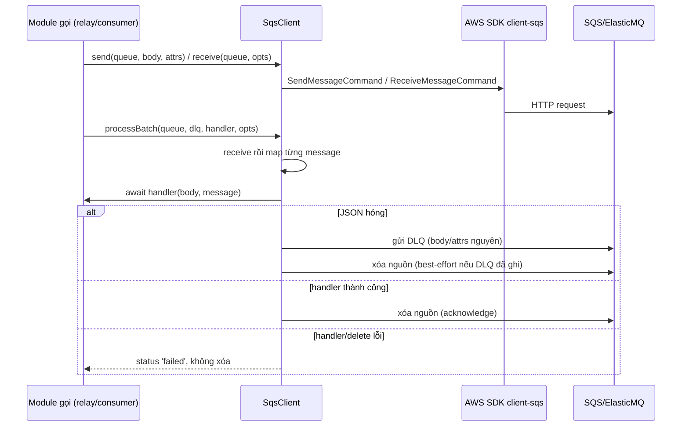
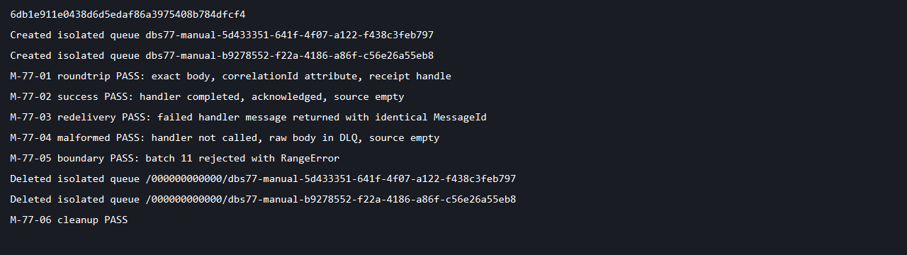

# DBS-77 · SQS adapter

> **Status:** Implemented · PR #51 đã merge 2026-11-06; chưa có Dev review (BL-160) · **Vai:** Dev · **PR:** [#51](https://github.com/Lawliet119/digital-banking-simulator/pull/51) · **Cập nhật:** 2026-11-07

## 1. Bối cảnh và phụ thuộc

Board: Dev, High, In Progress. DBS-40 (Testcontainers Valkey/ElasticMQ) đã Done. Main đã có Testcontainers ElasticMQ và AWS SDK ở `devDependencies`, chưa có adapter runtime. Người dùng duy trì quy trình trước đó (implement/test/manual/commit/push/mở Draft PR mà không dừng ở gate) — **note G1 retroactive**: gate G1-G3 không có bản ghi duyệt tường minh ("duyệt G1" v.v.) ở lịch sử commit nhánh; techlead đã duyệt retroactive cho cả ba gate sau khi review lại, với điều kiện fix hết gap kỹ thuật tìm được. Không sửa board, không tự merge.

DoD theo board: `SqsClient.send/receive` (long polling, batch, xóa message sau khi xử lý xong); cấu hình endpoint/queue theo `sqs.config.ts` (ElasticMQ ở local, SQS thật ở cloud, không đổi code); test Testcontainers chứng minh gửi/nhận, message không bị xóa nếu xử lý lỗi, xử lý batch; PR merge main (CI xanh), Dev review, bảng đối chiếu test case điền đủ.

## 2. Hành vi

`SqsClient.send(queue, body: string, attributes?)` gửi message thô, mọi attribute kiểu String. `receive(queue, options?)` trả nguyên message SDK (body, receipt handle, attributes); mặc định long poll 20 giây, batch tối đa 10, visibility timeout 30 giây. Giới hạn hợp lệ: `waitTimeSeconds` 0..20, `maxMessages` 1..10, `visibilityTimeout` 0..43200, đều phải là số nguyên — sai thì ném `RangeError` trước khi gọi SDK. Credentials dùng provider chain chuẩn của SDK; endpoint/region lấy từ `sqs.config.ts` đã có sẵn. Không polling tự động, không hardcode credential cloud.

`acknowledge(queue, message)` xóa message theo receipt handle — chỉ gọi sau khi transaction phía caller đã commit.

`processBatch(queue, dlqUrl, handler, options?)` nhận một batch, parse JSON từng message rồi `await` handler trước khi xóa message đó. Nếu JSON hỏng: gửi nguyên body/attributes sang DLQ, **rồi mới xóa nguồn**. Nếu handler hoặc delete lỗi: trả `status: 'failed'` cho message đó, không chặn các message khác trong batch (xử lý song song qua `Promise.all`). Message `failed` không bị xóa, sẽ redeliver sau visibility timeout (SQS at-least-once); caller tự chịu trách nhiệm dedup/schema validation/quyết định `UNKNOWN_EVENT_TYPE` (BL-010 vẫn còn mở ở phần đó). Guard `dlq !== queue` chặn cấu hình DLQ trùng nguồn kiểu literal; chưa chuẩn hóa URL (BL mới, xem §8 giới hạn đã biết).

**Gap đã sửa sau code-review (round 1):** nhánh JSON hỏng trước đây nếu gửi DLQ thành công nhưng xóa message nguồn thất bại thì trả `'failed'`, khiến message được redeliver và bị gửi DLQ **lần hai** (trùng lặp). Đã sửa: forward DLQ thành công thì luôn trả `'dead-lettered'`, dù xóa nguồn sau đó có lỗi hay không (xem §7, TC-77-04 mới).

Không log body/attribute/receipt handle/lỗi. `send`/`receive` lỗi SDK thì ném nguyên lỗi lên caller.

## 3. Kiến trúc

`@libs/sqs` export `SqsClient` và `SqsModule`. `SqsClient` là `Injectable`, nhận `sqsConfig` qua DI, tạo một `AwsClient` SDK, đóng nó ở `onModuleDestroy`. `SqsModule` đăng ký `ConfigModule.forFeature(sqsConfig)`, export `SqsClient`; module khác phải tự import, không có trong `AppModule` hay worker loop ở task này. Chuyển `@aws-sdk/client-sqs` từ `devDependencies` sang `dependencies` ở version khóa cũ (`^3.1156.0`, lock thực tế `3.1157.0`), không nâng version SDK.

## 4. Test cases tự động

| Case | Bằng chứng |
|---|---|
| TC-77-01 | Unit: tham số SDK long poll/batch/visibility/attribute, biên hợp lệ của options, config endpoint/region, destroy khi module đóng |
| TC-77-02 | Real ElasticMQ Testcontainers: gửi/nhận giữ nguyên body + `correlationId`, trả receipt; `receive` một mình không xóa |
| TC-77-03 | Real batch: handler bị reject thì message quay lại sau visibility timeout, peer thành công bị xóa; message đang chờ handler bất đồng bộ vẫn in-flight, chưa bị xóa |
| TC-77-04 | JSON hỏng → DLQ trước khi xóa nguồn; DLQ gửi lỗi thì giữ nguyên nguồn; **mới:** DLQ gửi thành công nhưng xóa nguồn lỗi vẫn trả `'dead-lettered'` (không báo `'failed'` sai) |
| TC-77-05 | Nhiều message xử lý không rơi vào batch rỗng; lỗi SDK receive/send/delete lan lên hoặc đánh dấu `'failed'` đúng từng message |
| Process | CI, Dev review, merge, bảng đối chiếu DoD đầy đủ trong PR |

Test nằm ở `backend/src/libs/sqs/sqs.client.spec.ts` (unit, mock SDK) và `backend/test/services/sqs-adapter.services-spec.ts` (ElasticMQ Testcontainers thật, cổng động, cleanup queue sau mỗi test).

## 5. Test thủ công

Lệnh từ `backend`: `docker compose up -d elasticmq`; `npm run build`; `node scripts/manual-dbs77.cjs`. Driver đọc adapter đã build, chỉ nối `localhost:9324`, tạo queue tên ngẫu nhiên riêng và xóa đúng những queue đó ở `finally`. Ghi lại SHA code và output, không log credential/PII.

| Bước | Hành động | Kỳ vọng |
|---|---|---|
| M-77-01 | Gửi JSON kèm attribute `correlationId`, nhận qua adapter | Body và attribute khớp; có receipt handle; in `roundtrip PASS` |
| M-77-02 | `processBatch` thành công | Message được xóa, nguồn trống; in `success PASS` |
| M-77-03 | Callback reject, nhận lại | Trả `failed`, redeliver đúng `MessageId`; in `redelivery PASS`, ack để dọn |
| M-77-04 | Gửi JSON hỏng, `processBatch` với DLQ riêng | Không gọi callback, nguồn trống, body thô nằm ở DLQ; in `malformed PASS` |
| M-77-05 | `receive` với `maxMessages=11` | Ném `RangeError` trước khi gọi SDK; in `boundary PASS` |
| M-77-06 | `finally` xóa các queue đã tạo | Mọi `DeleteQueue` thành công, in `cleanup PASS`, exit 0; lỗi assertion/transport vẫn thử dọn và exit khác 0 |

## 6. Domain review

Review độc lập (subagent) vòng 1: 1 should-fix (test thủ công cần bước/kỳ vọng cụ thể hơn) — đã sửa §5. Vòng cuối: APPROVE, không còn phát hiện treo. [Bản gốc](screenshots/DBS-77/domain-review.md).

**Code-review kỹ thuật (techlead yêu cầu, sau khi duyệt G1-G3 retroactive):** chạy skill `code-review` mức `high`, kết quả 5 phát hiện đã verify:

| # | Mức độ | Nội dung | Xử lý |
|---|---|---|---|
| 1 | Should-fix | `processBatch` nhánh JSON hỏng: DLQ-forward thành công nhưng `acknowledge` nguồn lỗi thì trả `'failed'` sai, dẫn tới gửi DLQ trùng lặp khi message redeliver | Đã sửa: luôn trả `'dead-lettered'` sau khi DLQ-forward thành công, kể cả xóa nguồn sau đó lỗi; thêm test |
| 2 | Should-fix | CI: step SQS/ElasticMQ thêm vào cuối job `e2e` (`timeout-minutes: 15`) trong khi suite tự ghi ngân sách tệ nhất ~18 phút, cộng dồn với `test:e2e` và bước Testcontainers Postgres phía trước | Đã sửa: nâng `timeout-minutes` của job `e2e` lên 35 |
| 3 | Vi phạm tài liệu | Toàn bộ feature doc viết tiếng Anh, khác mọi feature doc khác trong repo, vi phạm CLAUDE.md | Đã sửa: viết lại bằng tiếng Việt (file này) |
| 4 | Vi phạm tài liệu | `domain-review.md` của DBS-77 viết tiếng Anh | Giữ nguyên bản gốc tiếng Anh của reviewer làm bằng chứng raw (như các feature doc khác trong repo); mô tả lại bằng tiếng Việt ở §6 này |
| 5 | Minor | Guard `dlq !== queue` so sánh string thô, không chuẩn hóa URL (trailing slash, casing) | Chưa sửa — cần cấu hình sai cố ý mới gặp, rủi ro thấp, ghi nhận ở BACKLOG nếu phát sinh |

Ngoài ra phát hiện và sửa riêng (không qua code-review, tự rà soát khi viết lại tài liệu): `docs/BACKLOG.md` bị PR gốc chèn một bảng mới trùng header phía trên bảng chính, dùng lại ID `BL-139` đã tồn tại (từ DBS-59) — vi phạm quy tắc "ID tăng dần, không dùng lại" ghi ngay trong file; và `docs/features/README.md` bị chèn một dòng DBS-77 rời phía trên bảng "Danh sách" thay vì vào đúng bảng. Cả hai đã gộp lại đúng vị trí, đổi ID dòng mới sang `BL-150`.

## 7. Kế hoạch triển khai (ghi lại retroactive)

Viết test trước (route/module thiếu, đỏ vì `TS2307`), implement `SqsClient`/`SqsModule`, chuyển SDK sang `dependencies`. Thêm suite ElasticMQ vào step cuối job `e2e` hiện có (giữ tên 6 job bắt buộc). Chạy lint/typecheck/unit/e2e/build, suite service thật, test thủ công ở commit cuối. Cập nhật docs/README/feature index/backlog, kiểm link, push Draft PR. Không thêm consumer loop hay nghiệp vụ (BL-009/123 vẫn thuộc worker/relay).

Sau code-review kỹ thuật: sửa `processBatch` (double dead-letter), nâng `timeout-minutes` CI, viết lại feature doc + sửa cấu trúc BACKLOG/README, thêm test cho nhánh vừa sửa.

## 8. Kết quả

Code gốc `6db1e91` (implementation), `65b8468` (docs). Test-first: thiếu module → unit đỏ `TS2307`. Baseline main trước khi làm: lint/typecheck/unit 770/770, e2e 135/135. Sau implementation: lint/typecheck/build pass, unit 775/775, e2e 135/135. Test mới: 5 unit (SDK input/validation/DI/shutdown/lỗi) + 5 service thật (ElasticMQ Testcontainers, cổng động), không skip nào.

| DoD / case | Bằng chứng | Khớp? |
|---|---|---|
| Gửi/nhận long poll/batch | TC-77-01/02/03/05 | Khớp: unit kiểm default, real batch nhiều message, giữ nguyên body/attribute |
| Xóa sau xử lý, giữ khi lỗi | TC-77-03/05 | Khớp: message đang chờ handler vẫn in-flight; handler reject thì redeliver; peer thành công bị xóa; lỗi delete trả `failed` |
| Cấu hình local/cloud theo `sqs.config.ts` | TC-77-01, test DI Nest | Khớp: dùng config và provider chain có sẵn, real ElasticMQ ở local; cloud thật chưa provision |
| JSON hỏng đi DLQ (BL-010) | TC-77-04 | Khớp phần adapter: DLQ-forward thật, giữ nguồn khi DLQ không tới được, và nhánh double-dead-letter vừa sửa; schema/`UNKNOWN_EVENT_TYPE` vẫn thuộc consumer, BL-010 chưa đóng hết |
| CI/Dev review/merge | PR checks, BL-160 | PR #51 đã merge với CI xanh; chưa có Dev review (BL-160) |

Test thủ công M-77-01..06 trên code cuối (sau khi sửa gap) đạt cả 6 bước, transcript tại [manual-test.txt](screenshots/DBS-77/manual-test.txt), ảnh output tại [01-manual-output.png](screenshots/DBS-77/01-manual-output.png). Driver dùng queue tạm, tên ngẫu nhiên, dọn sạch ở `finally`; không tạo tài nguyên AWS thật.

Giới hạn còn lại, chưa đóng ở task này: guard DLQ-trùng-nguồn chưa chuẩn hóa URL (§6 #5); BL-009 (serialize `bigint` thật từ `worker`) và BL-123 (context relay/giới hạn payload) vẫn thuộc task khác; BL-010 còn phần schema/`UNKNOWN_EVENT_TYPE` ở consumer.

## 9. Tài liệu đã cập nhật

Nguồn: docs/03 §10, ADR-03, event-contract, `libs/README.md`, `sqs.config.ts`, BACKLOG BL-010/BL-150 (BL-009/BL-123 không đóng ở đây).

Đã cập nhật: [README của adapter](../../backend/src/libs/sqs/README.md), `backend/src/libs/README.md`, `docs/features/README.md` (bảng Danh sách), `docs/BACKLOG.md` (gộp đúng bảng, sửa trùng ID thành BL-150), file feature doc này, `.github/workflows/ci.yml` (timeout job `e2e`), `backend/src/libs/sqs/sqs.client.ts` và `sqs.client.spec.ts` (sửa gap double dead-letter).
