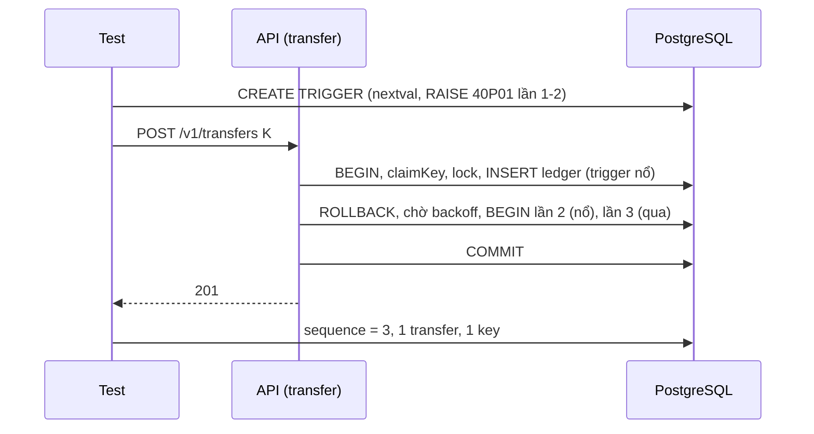

# DBS-80 · Khóa theo thứ tự id, retry deadlock, timeout và 503 + Retry-After

> **Status:** Implemented · **Vai:** Dev · **Nhánh:** `feat/DBS-80-lock-order-retry-timeouts` · **PR:** [#70](https://github.com/Lawliet119/digital-banking-simulator/pull/70) · **Cập nhật:** 2026-11-08
>
> Techlead waiver: G1–G4 do agent tự duyệt theo yêu cầu của techlead; không có Dev khác review trước merge (BL-174); không có ảnh PNG, bằng chứng là `manual-test.txt` thô; domain review do chính agent làm, không dùng subagent (§6).

## 1. Bối cảnh

- **Task trên board:** Story, Tuần 3, Dev, ưu tiên Highest, Demo 1. **Expect:** «Chuyển chéo đồng thời không treo, không lỗi 500, lỗi tạm thời được báo đúng.»
- **DoD:**
  1. Luồng chuyển tiền chạy trong `TransactionService.run`; callback chạy lại toàn bộ khi gặp 40P01/40001, tối đa 3 lần.
  2. Test: A→B và B→A song song ≥ 100 lần không treo, không 500, bất biến đúng.
  3. Giả lập lỗi DB tạm thời → 503 kèm `Retry-After`; gửi lại cùng `Idempotency-Key` an toàn (dòng key biến mất cùng rollback).
  4. Timeout lock/statement/idle-in-transaction được kiểm bằng test (cố giữ khóa quá hạn).
  5. PR đã merge vào main (CI xanh); Dev review; bảng «Đối chiếu test case» trong PR điền đủ.
- **Phụ thuộc:** DBS-61 đã vào `main`. DBS-79 vừa vào `main` (#69); task này dùng lại fixture của nó.
- **Cột «Thực trạng» đã cũ một phần.** `TransactionService` và luồng chuyển tiền trong `run` đã có. Chạy lại trên `main` `3056129` (Node 24.11.1): lint, typecheck sạch; unit 1066/1066; `test:db` 638/638.
- **Đối chiếu DoD với `main`:**

| DoD | Hiện trạng | Khoảng trống task này lấp |
|---|---|---|
| #1 chạy trong `run`, retry 40P01/40001 ×3 | `withTransaction` có retry và unit test với DataSource giả (`transaction.helper.spec.ts`); `TransferService` gọi `this.tx.run` | **Chưa** có bằng chứng trên luồng chuyển tiền thật: lỗi 40P01/40001 thật từ PostgreSQL làm chạy lại cả callback và chỉ để lại một transfer/key/audit/event |
| #2 ≥100 lệnh chéo | TC-61-06 chỉ 10 lệnh chéo | Thêm 100 A→B + 100 B→A; thêm đợt dồn 200 lệnh cùng lúc để xem hành vi quá tải |
| #3 503 + Retry-After, gửi lại an toàn | Chỉ lỗi lock timeout (TC-61-09) | Thêm lỗi tạm thời khác: deadlock/serialization còn sót sau 3 lần retry, statement timeout, idle-in-transaction |
| #4 timeout | `lock` có TC-61-09; **statement** và **idle-in-transaction** chưa có test trên PG thật (chỉ kiểm `set_config` bằng DataSource giả) | Thêm TC-80-05, 06, 07 |
| #5 | Quy trình | waiver |

- **Ngoài phạm vi:** lệnh gốc rollback khi lệnh cùng key chờ (DBS-81); sync guard (DBS-82); lưu REJECTED (DBS-83); retry cho `DepositService`/`AccountsService` (cùng cơ chế, không nằm trong DoD); metrics cho retry (observability).
- **Backlog:** không có dòng nào trên cùng module/DoD để lấy vào.
- **Câu hỏi mở / quyết định ở G1 (agent tự duyệt):** (1) Hành vi sản phẩm không đổi; chỉ thêm test, một tham số tùy chọn cho fixture, script manual. Nếu test phát hiện lỗi thật thì sửa trong task và ghi §8. (2) Đợt 200 lệnh cùng lúc có thể trả 503 hợp lệ (khóa hàng nóng quá `lock_timeout`, hoặc pool 30 kết nối cạn): kiểm chứng rằng *chỉ* có 201 hoặc 503 kèm `Retry-After`, rồi gửi lại cùng key thì tất cả hoàn tất đúng một lần.

## 2. Hành vi (được chứng minh, không đổi)

| # | Điều kiện | Kết quả |
|---|---|---|
| B1 | Hai lệnh A→B và B→A cùng lúc | Cả hai khóa theo `ORDER BY id` nên không chờ vòng tròn; mọi lệnh hoàn tất 201 (tải thường) |
| B2 | PostgreSQL hủy transaction vì deadlock `40P01` hoặc serialization `40001` | Cả callback chạy lại trong transaction mới, tối đa 3 lần chạy lại (4 lần chạy); mỗi lần chạy lại bắt đầu từ `claimKey`, nên cuối cùng chỉ còn một key, một transfer, hai bút toán, một audit, một event |
| B3 | Vẫn lỗi sau lần chạy lại thứ 3 | 503 `SERVICE_TEMPORARILY_UNAVAILABLE` + `Retry-After: 5`; rollback hết, không để lại key |
| B4 | `lock_timeout` (55P03), `statement_timeout` (57014), `idle_in_transaction_session_timeout` (25P03) | **Không** chạy lại (chờ thêm chỉ làm hàng đợi dài hơn); 503 + `Retry-After`; rollback hết |
| B5 | Gửi lại cùng key sau 503 | Xử lý như lệnh mới (key đã biến mất cùng rollback); 201 một lần |
| B6 | Mọi lỗi khác | 500, rollback, không lộ chi tiết |

Ví dụ 503:

```json
HTTP/1.1 503   Retry-After: 5   Content-Type: application/problem+json
{ "type": "about:blank", "title": "Service Unavailable", "status": 503, "detail": "Service temporarily unavailable — please retry.", "errorCode": "SERVICE_TEMPORARILY_UNAVAILABLE", "correlationId": "…" }
```

## 3. Kiến trúc

- **Vị trí:** `database/transaction.{helper,service}.ts`, `accounts.service.ts#lockForUpdate`, `ledger/transfer.service.ts`, `common/filters/problem-details.filter.ts`. **Một sửa lỗi sản phẩm** do TC-80-06 phát hiện (xem dưới): `transaction.helper.ts`. Đổi thêm `test/support/deposit-app.ts`, `test/support/fake-data-source.ts`.
- **Fixture:** `startDepositApp(url, { timeouts? })` nhận ghi đè `lockTimeoutMs/statementTimeoutMs/idleInTransactionTimeoutMs`; mặc định giữ 2000/5000/10000, nên mọi test cũ không đổi.
- **Cách gài lỗi (SQL thật, không mock):** trigger `BEFORE INSERT … FOR EACH STATEMENT` trên `ledger_entries` gọi `nextval` của một sequence (sequence không bị rollback nên đếm được số lần chạy callback) và `RAISE EXCEPTION … USING ERRCODE = '40P01' | '40001'` cho những lần đầu; hoặc `pg_sleep` để vượt statement timeout. Với idle-in-transaction: chen một độ trễ phía client vào giữa hai câu lệnh của transaction thật (gói `AuditService.record` bằng `jest.spyOn`) để PostgreSQL tự đóng session.
- **Transaction:** một `TransactionService.run` ngoài cùng; không gọi mạng bên trong.



- **Lỗi phát hiện (nguyên nhân gốc, đã tái hiện bằng M-80-05 và TC-80-06 trước khi sửa: 500):** khi `idle_in_transaction_session_timeout` nổ, PostgreSQL đóng session; TypeORM tự `release` runner ở sự kiện `error` của client pg, nên câu lệnh kế tiếp của callback ném `QueryRunnerProviderAlreadyReleasedError` (không có SQLSTATE) và `isTransientDbError` không nhận ra → HTTP 500 thay vì 503 + `Retry-After`. Sửa đúng chỗ: `withTransaction` nghe `error` của client pg trong lúc transaction chạy, và khi gặp lỗi `QueryRunnerProviderAlreadyReleasedError` thì báo lỗi đã đóng kết nối (25P03 hoặc lỗi "terminated"). Mọi lỗi khác giữ nguyên; listener được gỡ trước khi trả kết nối về pool.
- **Thay đổi cấp hệ thống:** không có (docs/03 §7 đã nói lỗi DB tạm thời là 503; code nay đúng với nó).

## 4. Test cases tự động

PostgreSQL 17 thật, HTTP + JWT thật, file `test/db/transfer-concurrency.db-spec.ts`; sau mỗi ca kiểm tra bất biến sổ cái.

| ID | Truy vết | Lớp | Given · When · Then | `errorCode` |
|---|---|---|---|---|
| TC-80-01 | DoD #2 | e2e Postgres | A, B mỗi bên 10.000.000. 100 lệnh A→B và 100 lệnh B→A (1.000đ), tối đa 20 lệnh cùng lúc → 200 × 201; số dư hai bên về đúng như cũ; 200 transfer, 400 bút toán, 200 key | — |
| TC-80-02 | DoD #2, #3 | e2e Postgres | 100 + 100 lệnh bắn cùng một lúc → chỉ có 201 hoặc 503 (503 có `errorCode` và `Retry-After`), **không** 500; gửi lại cùng key cho các lệnh 503 → 201; cuối cùng đúng 200 transfer không trùng, số dư đúng | `SERVICE_TEMPORARILY_UNAVAILABLE` |
| TC-80-03 | DoD #1 | e2e Postgres | (`it.each` 40P01, 40001) hai lần chạy đầu nổ lỗi thật, lần ba qua → 201; sequence = 3; đúng 1 transfer, 2 bút toán, 1 key, 1 audit, 1 event | — |
| TC-80-04 | DoD #1, #3 | e2e Postgres | (`it.each` 40P01, 40001) mọi lần nổ → 4 lần chạy rồi 503 + `Retry-After`; không còn dòng nào, kể cả key; gỡ trigger, cùng key → 201 | `SERVICE_TEMPORARILY_UNAVAILABLE` |
| TC-80-05 | DoD #4 | e2e Postgres | Statement timeout 300 ms, trigger `pg_sleep(1)` → 503 + `Retry-After`, **không** chạy lại (sequence = 1), không để lại gì; gỡ trigger, cùng key → 201 | `SERVICE_TEMPORARILY_UNAVAILABLE` |
| TC-80-06 | DoD #4 | e2e Postgres | Idle-in-transaction timeout 300 ms, độ trễ 1,2 s giữa hai câu lệnh của luồng chuyển tiền thật → 503 + `Retry-After`; không để lại gì; cùng key → 201 | `SERVICE_TEMPORARILY_UNAVAILABLE` |
| TC-80-07 | DoD #4 | e2e Postgres | Lock timeout 300 ms, giữ khóa hàng nguồn từ phiên khác → 503 + `Retry-After` sau khoảng ≥ 250 ms và < 3 s (không treo); nhả khóa, cùng key → 201 | `SERVICE_TEMPORARILY_UNAVAILABLE` |
| TC-80-08 | DoD #1 | e2e Postgres | Mọi dòng một lệnh chuyển để lại (transfer, bút toán, audit, outbox, key, hai số dư) có cùng `xmin`, tức do đúng một transaction ghi (không đếm lời gọi `run`, vì guard và kiểm sở hữu cũng gọi `run` cho việc đọc) | — |
| TC-80-09 | DoD #4 | unit | `withTransaction`: runner bị server đóng → ném lại lỗi kết nối (25P03), gỡ listener; lỗi `AlreadyReleased` không có lỗi kết nối thì giữ nguyên; lỗi khác không bị thay | — |
| TC-61-09 | DoD #4 | e2e Postgres | Đã có: lock timeout mặc định → 503, không còn key, cùng key → 201 | `SERVICE_TEMPORARILY_UNAVAILABLE` |
| Quy trình | DoD #5 | — | Merge, CI, Dev review | waiver |

## 5. Test thủ công

`node backend/scripts/manual-dbs80.cjs` (Docker, Node 24). App NestJS thật, JWT thật, Postgres 17.

| Bước | Việc làm | Kết quả mong đợi |
|---|---|---|
| M-80-01 | Nạp 10.000.000 cho Lê Văn Cường và Phạm Thị Dung; 100 lệnh C→D và 100 lệnh D→C xen kẽ, 20 lệnh cùng lúc | 200 × 201; số dư về như cũ; tổng Nợ = tổng Có; thời gian chạy in ra |
| M-80-02 | Gài trigger nổ 40P01 hai lần đầu, chuyển 50.000 | 201; sequence = 3; một transfer |
| M-80-03 | Gài trigger nổ 40P01 mọi lần; chuyển 50.000 key K | 503 + `Retry-After: 5`; không có key K; gỡ trigger, gửi lại K → 201; một transfer |
| M-80-04 | Giữ khóa hàng tài khoản nguồn từ phiên khác; chuyển | 503 + `Retry-After` sau khoảng `lock_timeout`; nhả khóa, gửi lại → 201 |
| cleanup | Dọn app, JWKS, database, container | `DBS-80 cleanup PASS` |

(Manual dùng timeout mặc định 2 s cho M-80-04.)

## 6. Domain review (AI)

**Reviewer:** chính agent (Sonnet 5.5), 2026-11-08, đọc `transaction.helper.ts`, `pg-error.util.ts`, `problem-details.filter.ts`, `transfer.service.ts`, `accounts.service.ts#lockForUpdate`, ADR-04, docs/03 §6.1. Không dùng subagent.

| # | Mức | Phát hiện | Xử lý |
|---|---|---|---|
| 1 | should-fix | DoD #1/#3/#4 chưa có bằng chứng trên luồng chuyển tiền thật (chỉ có DataSource giả) | Đã đưa vào phạm vi: TC-80-03..08 |
| 2 | should-fix | Cách gài lỗi phải bền: dùng sequence (không rollback) để đếm lần chạy, trigger luôn được gỡ trong `finally` | Đã thiết kế ở §3 |
| 3 | minor | Đợt 200 lệnh cùng lúc có thể vượt `lock_timeout` hợp lệ; nếu coi 503 là thất bại thì test sẽ flaky | Đã chia hai ca: TC-80-01 (tải thường, mọi lệnh phải 201) và TC-80-02 (quá tải, chỉ chấp nhận 201 hoặc 503 đúng dạng, rồi gửi lại) |
| 4 | minor | Idle-in-transaction không thể gây từ phía server; phải tạo độ trễ phía client | Đã thiết kế: spy `AuditService.record`; ghi rõ ở §8 đây là chèn độ trễ vào luồng thật, không phải mock kết quả |
| 5 | minor | `Retry-After` là hằng 5 giây cho mọi 503 | Không sửa (hợp đồng đã có, docs/03 §7); ghi lại |
| 6 | should-fix | **(phát hiện khi chạy TC-80-06, không phải lúc review thiết kế)** idle-in-transaction timeout trả 500 vì mất SQLSTATE | Đã sửa trong task: `transaction.helper.ts` (TC-80-09); ghi ở §8 là lệch so với dự kiến "không đổi code" và được agent duyệt theo quyết định G1 (1) |

Không có phát hiện blocking. Verdict tự đánh giá: APPROVE.

## 7. Kế hoạch triển khai

| Bước | File | Test viết trước | Kết quả đỏ | Lệnh chứng minh | Commit |
|---|---|---|---|---|---|
| 1 | `test/support/deposit-app.ts` | — (tham số tùy chọn, mặc định không đổi) | — | `npm --prefix backend run typecheck` + chạy lại `customer-transfers` | `test(ledger): let the deposit fixture shorten database timeouts` |
| 1b | `src/database/transaction.helper.ts`, `.spec.ts`, `test/support/fake-data-source.ts` | TC-80-09 (unit) | 2 ca đỏ: `Expected … Received …` (lỗi `AlreadyReleased` thay vì lỗi kết nối) | `npm --prefix backend test -- transaction` | `fix(database): report the cause when the server closes a transaction's connection` |
| 2 | `test/db/transfer-concurrency.db-spec.ts` | TC-80-01..08 | điền khi chạy | `npm --prefix backend run test:db -- --runInBand transfer-concurrency` | `test(ledger): prove cross transfers, deadlock retry and timeouts` |
| 3 | `scripts/manual-dbs80.cjs`, `screenshots/DBS-80/*` | M-80-01..04 | — | `node backend/scripts/manual-dbs80.cjs` | `test(ledger): add DBS-80 manual driver` |
| 4 | doc, index, `docs/BACKLOG.md` (BL-174) | — | — | `check-doc-links.mjs` | `docs(ledger): record DBS-80 evidence` |

Đột biến cho bước 2: (a) khóa theo thứ tự trong mảng đầu vào thay vì `ORDER BY a.id` (lệnh A→B và B→A khóa ngược nhau) để TC-80-01/02 lộ deadlock/503; (b) đặt `maxRetries = 0` để TC-80-03 hỏng; (c) bỏ `set_config` statement_timeout để TC-80-05 hỏng. Hoàn nguyên bằng `git checkout`.

Rủi ro: test dựa trên thời gian (TC-80-06, 07) có thể flaky trên CI chậm; dùng ngưỡng rộng (độ trễ ≥ 4× timeout) và chạy 5 lần liên tiếp trước khi mở PR. Lùi: `git revert`, không có migration.

**Quyết định ở G3 (agent tự duyệt):** theo bảng trên.

## 8. Kết quả

- **Lệnh kiểm tra** (Node 24.11.1, `backend/`, commit code cuối `509912e`; sau đó chỉ thêm test, script, docs):

| Lệnh | Kết quả |
|---|---|
| `npm run lint:check`, `typecheck`, `build` | đạt (mã thoát 0 cả ba) |
| `npm test -- --runInBand` | **1069/1069**, 65 suite (+3 ca TC-80-09) |
| `npm run test:e2e -- --runInBand` | **148/148**, 14 suite (với `DATABASE_URL` tới Postgres 17 tạm) |
| `npm run test:db -- --runInBand` | **648/648**, 33 suite (toàn bộ) |
| `transfer-concurrency` chạy riêng 3 lần liên tiếp | 10/10 cả ba lần |
| `node scripts/manual-dbs80.cjs` | 5/5 bước + dọn dẹp đạt |

  0 test bị `.skip/.only/.todo`.

- **Đối chiếu test case** (`test/db/transfer-concurrency.db-spec.ts` trừ khi ghi khác):

| ID | Test | Đạt? |
|---|---|---|
| TC-80-01 | `100 A→B and 100 B→A, 20 at a time…` | đạt (200 × 201). Đột biến khóa theo thứ tự đầu vào: vẫn qua nhờ retry deadlock, nên độ nhạy nằm ở TC-80-02 |
| TC-80-02 | `200 opposite transfers at once…` | đạt. Đột biến khóa theo thứ tự đầu vào → hỏng |
| TC-80-03 | `%s on the first two attempts…` (40P01, 40001) | đạt. Đột biến `maxRetries = 0` → hỏng |
| TC-80-04 | `%s on every attempt…` (40P01, 40001) | đạt (cùng đột biến) |
| TC-80-05 | `statement timeout…` | đạt. Đột biến tắt `statement_timeout` → hỏng |
| TC-80-06 | `idle in transaction…` | đạt. **Đỏ trước khi sửa: 500** (`QueryRunnerProviderAlreadyReleasedError`); sau sửa 503 |
| TC-80-07 | `lock timeout of 300 ms…` | đạt (chờ ≥ 250 ms và < 3 s) |
| TC-80-08 | `every row one transfer wrote… single database transaction` | đạt (cùng `xmin`) |
| TC-80-09 | `src/database/transaction.helper.spec.ts` › `connection killed by the server` (3 ca) | đạt. Đỏ trước sửa: 2/3 hỏng |
| TC-61-09 | đã có, lock timeout mặc định | đạt |
| Quy trình | DoD #5 | chưa làm: Dev review, ghi ở BL-174 |

  10 ca tự động đạt đủ độ sâu, 0 đơn giản hóa. **Giới hạn của TC-80-06:** độ trễ 1,2 s được chen vào giữa hai câu lệnh của luồng thật bằng `jest.spyOn(AuditService.record)`; transaction, kết nối và việc PostgreSQL đóng session là thật, nhưng điểm tạm dừng là do test đặt.

- **Test thủ công** (`node backend/scripts/manual-dbs80.cjs` trên commit `9a7df4a`; output thô [manual-test.txt](screenshots/DBS-80/manual-test.txt); output **trước khi sửa** [manual-test-before-fix.txt](screenshots/DBS-80/manual-test-before-fix.txt)):

| Bước | Kết quả thật | Kết quả |
|---|---|---|
| M-80-01 | 200 lệnh chéo, 20 cùng lúc: `{"201":200}` trong 1,9 s; số dư về như cũ | đạt |
| M-80-02 | 40P01 hai lần đầu → 201, callback chạy 3 lần, một transfer, một key | đạt |
| M-80-03 | 40P01 mọi lần → 4 lần chạy, 503 `Retry-After: 5`, không còn key; cùng key → 201 | đạt |
| M-80-04 | Giữ khóa hàng, `lock_timeout` 1 s → 503 sau 1010 ms; nhả khóa, cùng key → 201 | đạt |
| M-80-05 | Session bị đóng do idle-in-transaction 500 ms → **503** + `Retry-After`, không để lại gì; cùng key → 201. Trước khi sửa cùng bước này trả **500** | đạt |
| cleanup | JWKS, database tạm, container đã dọn | đạt |

  Seed SQL chỉ cho user/customer/tài khoản số dư 0; mọi khoản tiền vào qua API nạp tiền.

- **Phạm vi so với §7:** thêm `transaction.helper.ts` (+34/−2) và spec của nó (3 ca) cùng `fake-data-source.ts` (+2): sửa lỗi 500 → 503 phát hiện ở TC-80-06. Còn lại khớp: `deposit-app.ts`, `transfer-concurrency.db-spec.ts`, `manual-dbs80.cjs`, harness (tham số `options`), doc, index.
- **Ảnh chụp:** không có (waiver); bằng chứng là hai file `manual-test*.txt`.
- **Lệch so với kế hoạch:** (1) sửa code sản phẩm `transaction.helper.ts`, kế hoạch dự kiến không đổi; agent tự duyệt theo quyết định G1 (1) vì đây là lỗi thật thuộc DoD #3/#4, không đổi `ErrorCode`, schema, event, env. (2) TC-80-08 đổi từ "đếm lời gọi `run`" sang "cùng `xmin`" vì `getOwnedAccount` và guard cũng gọi `run` cho việc đọc (3 lời gọi), nên số lần gọi không phản ánh việc ghi.
- **Ghi nhận:** `Retry-After` là hằng 5 giây cho mọi 503. Khi dồn 200 lệnh cùng lúc vào hai tài khoản, hệ thống có thể trả 503 hợp lệ (TC-80-02 chấp nhận và kiểm gửi lại); với 20 lệnh cùng lúc (TC-80-01) không có 503.
- **Bàn giao:** BL-174 (thêm PR này). Không còn DoD kỹ thuật nào chưa đạt.

## 9. Tài liệu đã cập nhật

`docs/features/README.md` (dòng DBS-80), `docs/BACKLOG.md` (BL-174 thêm PR của task này). Không đổi docs/03 (hành vi 503 đã được mô tả; code nay khớp). Không xóa dòng BL nào.
