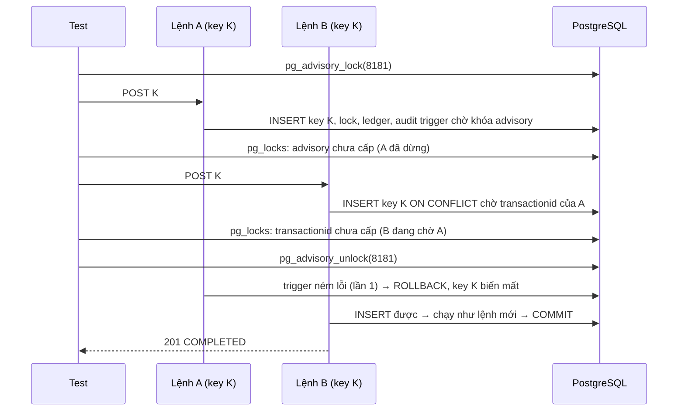

# DBS-81 · Review Focus 1: lệnh gốc rollback khi lệnh cùng key đang chờ

> **Status:** Implemented · **Vai:** Dev · **Nhánh:** `feat/DBS-81-rollback-waiting-same-key` · **PR:** — · **Cập nhật:** 2026-11-08
>
> Techlead waiver: G1–G4 do agent tự duyệt theo yêu cầu của techlead; không có Dev khác review trước merge (BL-174); không có ảnh PNG, bằng chứng là `manual-test.txt` thô; domain review do chính agent làm, không dùng subagent (§6).

## 1. Bối cảnh

- **Task trên board:** Task, Tuần 3, Dev, ưu tiên High, Demo 2. **Expect:** «Lệnh thứ hai không treo và không nhận kết quả của lệnh đã rollback.»
- **DoD:**
  1. Test Postgres thật, điều khiển thứ tự bằng cổng đồng bộ (barrier), không dùng sleep: A giữ khóa K, B (cùng K) chờ; A ném lỗi → rollback → B được xử lý như lệnh mới và COMPLETED.
  2. Số dư và số bút toán thay đổi đúng một lần; không có response của A lọt vào B.
  3. Biến thể: A thành công thì B nhận đúng response của A và không thực hiện lần hai; client gửi lại cùng key sau khi A rollback được xử lý như mới.
  4. Chạy 20 lần liên tiếp không flaky; ghi vào 04-test-cases.md với id.
  5. PR đã merge vào main (CI xanh); Dev review; bảng «Đối chiếu test case» trong PR điền đủ.
  - **Cập nhật 11/10 trên board:** không còn file `04-test-cases.md`; test case ghi trong PR (bảng Đối chiếu) và feature doc này (§4).
- **Phụ thuộc:** DBS-79 (#69) và DBS-80 (#70) đã vào `main`.
- **Đã có:** `LedgerPostingService.claimKey` (ADR-05; DBS-79), `TransactionService` (DBS-80). Hành vi này đã được ADR-05 và docs/03 §6.1 mô tả, nhưng **chưa có test nào** dựng cảnh «A giữ key, B chờ, A rollback». Baseline trên `main` `84f900e` (Node 24.11.1): lint, typecheck, build sạch; unit 1069/1069; `test:db` 648/648.
- **Đối chiếu DoD với `main`:** cả 4 bullet kỹ thuật đều là khoảng trống test (code đã có); không có đoạn nào của DoD đã được kiểm.
- **Ngoài phạm vi:** AC-5.10 trên cloud (DBS-185); thay đổi code sản phẩm (chỉ làm nếu test phát hiện lỗi).
- **Backlog:** không có dòng cùng module/DoD cần lấy vào.
- **Câu hỏi mở / quyết định ở G1 (agent tự duyệt):** (1) «Cổng đồng bộ» là khóa advisory của PostgreSQL giữ bởi test, cộng với việc đọc `pg_locks` để biết A và B đã đứng đúng chỗ; không dùng `sleep` làm đồng bộ. (2) Test đi qua HTTP + JWT thật (cả luồng `POST /v1/transfers`), không gọi `claimKey` riêng lẻ, để bao gồm cả `TransactionService`.

## 2. Hành vi (được chứng minh)

| # | Điều kiện | Kết quả |
|---|---|---|
| B1 | A đã chèn key K (chưa commit), B (cùng user, cùng K, cùng body) gửi tới | B đứng chờ ở `INSERT … ON CONFLICT DO NOTHING` (chờ transaction của A kết thúc), không lỗi `23505`, không treo |
| B2 | A gặp lỗi và rollback | Key K biến mất; câu `INSERT` của B chèn được; B chạy như lệnh mới đến hết: 201 `COMPLETED`; A nhận 500 (không có `transferId`) |
| B3 | A commit | Câu `INSERT` của B không chèn; `SELECT` thấy kết quả A đã lưu; B trả đúng body của A (cùng `transferId`), không ghi gì thêm |
| B4 | A rollback, không ai chờ, client gửi lại K | Xử lý như lệnh mới: 201 một lần |

Sau mỗi tình huống: đúng 1 transfer, 2 bút toán, số dư đổi đúng một lần, 1 audit, 1 outbox, 1 key; key lưu `response_body` của lệnh đã commit, không bao giờ của A khi A rollback.

## 3. Kiến trúc

- **Vị trí:** chỉ test. File mới: `backend/test/db/idempotency-rollback.db-spec.ts`; script `backend/scripts/manual-dbs81.cjs`. Không đổi code sản phẩm.
- **Dữ liệu:** `idempotency_keys`, `transfers`, `ledger_entries`, `audit_log`, `outbox_events`, `accounts`.
- **Barrier (cổng đồng bộ).** Một trigger thật `BEFORE INSERT ON audit_log FOR EACH ROW` (chỉ cho `action = 'transfer'`), cài trong test:
  1. `pg_advisory_xact_lock(8181)`: dừng transaction ở bước audit, **sau** khi nó đã chèn key K, khóa tài khoản và ghi bút toán. Test giữ khóa này ở phiên khác (`pg_advisory_lock(8181)`), nên A dừng đúng chỗ.
  2. `nextval('dbs81_calls')`: lần gọi đầu tiên (của A) ném lỗi nếu kịch bản là «A rollback»; sequence không bị rollback nên lần gọi sau (của B) không ném.
- **Thứ tự được ép bằng trạng thái khóa thật:** (1) test giữ khóa advisory; (2) gửi A; chờ tới khi `pg_locks` có một khóa advisory `NOT granted` (A đứng ở trigger, đã giữ key K); (3) gửi B; chờ tới khi `pg_locks` có một khóa `transactionid` `NOT granted` (B chờ transaction của A); (4) nhả khóa advisory. Từ đây A và B chỉ chạy tiếp theo thứ tự do PostgreSQL quyết định (A xong trước, B được đánh thức). Chờ là vòng lặp kiểm tra điều kiện có giới hạn thời gian, không phải ngủ cố định.

- **Thay đổi cấp hệ thống:** không có. ADR-05 §Cách kiểm chứng được thực hiện bởi task này.

## 4. Test cases tự động

PostgreSQL 17 thật, HTTP + JWT thật, `test/db/idempotency-rollback.db-spec.ts`; sau mỗi ca kiểm tra bất biến sổ cái. Các ca TC-81-01..03 chạy **20 vòng** mỗi lần chạy test (mỗi vòng tài khoản và key mới).

| ID | Truy vết | Lớp | Given · When · Then | `errorCode` |
|---|---|---|---|---|
| TC-81-01 | DoD #1, #2 | e2e Postgres | A giữ K và dừng, B chờ; A ném lỗi → A 500; B 201 `COMPLETED` với `transferId` mới; đúng 1 transfer/2 bút toán/1 audit/1 outbox/1 key; số dư đổi một lần; key lưu `transferId` và body của B; (20 vòng) | — |
| TC-81-02 | DoD #3 | e2e Postgres | A giữ K và dừng, B chờ; A thành công → A 201, B 201 cùng body (cùng `transferId`), 1 transfer/2 bút toán; trigger chỉ chạy 1 lần (B không thực hiện lần hai); (20 vòng) | — |
| TC-81-03 | DoD #3 | e2e Postgres | A ném lỗi và rollback, không ai chờ; gửi lại K → 201 như lệnh mới, đổi số dư một lần; (20 vòng) | — |
| TC-81-04 | DoD #1 | e2e Postgres | B chờ đúng là chờ khóa `transactionid` của A trước khi A kết thúc (kiểm bằng `pg_locks` và B chưa có phản hồi); sau khi A rollback B hoàn tất trong thời hạn (không treo) | — |
| TC-81-05 | DoD #4 | quy trình | Chạy cả file 20 lần liên tiếp từ shell, 0 lần hỏng | — |
| Quy trình | DoD #5 | — | Merge, CI, Dev review | waiver |

## 5. Test thủ công

`node backend/scripts/manual-dbs81.cjs` (Docker, Node 24). App thật + Postgres 17; cổng đồng bộ là khóa advisory như §3.

| Bước | Việc làm | Kết quả mong đợi |
|---|---|---|
| M-81-01 | Nạp 2.000.000 cho Đỗ Văn Em; Em chuyển 700.000 cho Hoàng Thị Phương với key K. Giữ khóa advisory; gửi A; chờ A dừng; gửi B (cùng K); chờ B đứng chờ; trigger làm A lỗi; nhả khóa | A 500; B 201 `COMPLETED`; Em 1.300.000, Phương 700.000; 1 transfer, 2 bút toán; in ra trạng thái `pg_locks` lúc B chờ |
| M-81-02 | Như trên nhưng A thành công | A 201, B 201 cùng `transferId`; Em 1.300.000 (không bị trừ hai lần) |
| M-81-03 | A lỗi, không ai chờ; gửi lại K | 500 rồi 201; số dư đổi một lần |
| cleanup | Dọn app, JWKS, database, container | `DBS-81 cleanup PASS` |

## 6. Domain review (AI)

**Reviewer:** chính agent (Sonnet 5.5), 2026-11-08, đọc `claimKey`, ADR-05, docs/03 §6.1, `TransferService`. Không dùng subagent.

| # | Mức | Phát hiện | Xử lý |
|---|---|---|---|
| 1 | should-fix | Phải chứng minh B **thực sự chờ trên key của A** chứ không chỉ chạy sau A (nếu không test vẫn xanh khi `ON CONFLICT` bị thay bằng cách khác) | Đã đưa vào thiết kế: chờ `pg_locks` `transactionid NOT granted` trước khi nhả cổng (TC-81-04) |
| 2 | should-fix | Trigger chỉ được ném lỗi cho A, không cho B | Đã thiết kế: sequence không rollback; trigger chỉ cho `action='transfer'` |
| 3 | minor | Khóa advisory `8181` có thể đụng test khác chạy song song trên cùng database | Không xảy ra: mỗi file test có database tạm riêng; khóa advisory theo từng database |
| 4 | minor | Nếu test lỗi giữa chừng, khóa advisory phiên còn giữ | `finally` luôn `pg_advisory_unlock_all` và gỡ trigger |
| 5 | minor | «Không dùng sleep» | Vòng chờ kiểm tra trạng thái `pg_locks` mỗi 25 ms với giới hạn 5 s; không có `sleep` dùng làm đồng bộ |

Không có phát hiện blocking. Verdict tự đánh giá: APPROVE.

## 7. Kế hoạch triển khai

| Bước | File | Test viết trước | Kết quả đỏ | Lệnh chứng minh | Commit |
|---|---|---|---|---|---|
| 1 | `test/db/idempotency-rollback.db-spec.ts` | TC-81-01..04 | Dự kiến không đỏ (code đã đúng từ DBS-79); kiểm chứng bằng đột biến | `npm --prefix backend run test:db -- --runInBand idempotency-rollback` | `test(ledger): prove a rolled-back original does not leak into a waiting same-key request` |
| 2 | 20 lần liên tiếp | TC-81-05 | — | vòng lặp shell, đếm lần hỏng | — |
| 3 | `scripts/manual-dbs81.cjs`, `screenshots/DBS-81/*` | M-81-01..03 | — | `node backend/scripts/manual-dbs81.cjs` | `test(ledger): add DBS-81 manual driver` |
| 4 | doc, index, BL-174 | — | — | `check-doc-links.mjs` | `docs(ledger): record DBS-81 evidence` |

Đột biến cho bước 1: trong `claimKey` đổi `ON CONFLICT … DO NOTHING` thành `ON CONFLICT … DO UPDATE SET request_hash = EXCLUDED.request_hash RETURNING idem_key` (B giành lại key sau khi A commit thay vì đọc kết quả của A) → TC-81-02 phải hỏng. Hoàn nguyên bằng `git checkout`.

Rủi ro: test có chờ theo trạng thái khóa nên có thể chậm trên CI; giới hạn 5 s mỗi điều kiện, 20 vòng × ~0,3 s. Lùi: `git revert`.

**Quyết định ở G3 (agent tự duyệt):** theo bảng trên.

## 8. Kết quả

- **Lệnh kiểm tra** (Node 24.11.1, `backend/`; không có thay đổi code sản phẩm nên "commit code cuối" là `3056129`/`84f900e` của `main`):

| Lệnh | Kết quả |
|---|---|
| `npm run lint:check`, `typecheck`, `build` | đạt (mã thoát 0) |
| `npm test -- --runInBand` | **1069/1069**, 65 suite |
| `npm run test:e2e -- --runInBand` | **148/148**, 14 suite (với `DATABASE_URL` tới Postgres 17 tạm) |
| `npm run test:db -- --runInBand` | **652/652**, 34 suite (toàn bộ) |
| `npm run test:db -- --runInBand idempotency-rollback` ×20 liên tiếp | **20/20 lần đạt**, mỗi lần 4/4 ca (3 ca × 20 vòng), [consecutive-runs.txt](screenshots/DBS-81/consecutive-runs.txt) |
| `node scripts/manual-dbs81.cjs` | 3/3 bước + dọn dẹp đạt |

- **Đối chiếu test case** (`test/db/idempotency-rollback.db-spec.ts`):

| ID | Test | Đạt? |
|---|---|---|
| TC-81-01 | `A fails and rolls back: B is processed as new and COMPLETED (20 rounds)` | đạt |
| TC-81-02 | `A commits: B gets exactly A's answer and does nothing a second time (20 rounds)` | đạt. Đột biến `DO UPDATE` → hỏng |
| TC-81-03 | `A rolls back with nobody waiting: the same key sent again is processed as new (20 rounds)` | đạt |
| TC-81-04 | `B really waits on the transaction of A (pg_blocking_pids)…` | đạt |
| TC-81-05 | 20 lần chạy liên tiếp | đạt (xem trên) |
| Quy trình | DoD #5 | chưa làm: Dev review, ghi ở BL-174 |

  5 ca đạt đủ độ sâu, 0 đơn giản hóa. Không có bước đỏ trước khi viết test vì hành vi đã đúng từ DBS-79; độ nhạy được chứng minh bằng đột biến. Một lỗi nằm trong chính trigger của test lúc viết (`AND false` làm PostgreSQL bỏ qua `nextval`, TC-81-02 thấy 0 lần gọi thay vì 1) đã sửa bằng cách gọi `nextval` vào biến trước.

- **Test thủ công** (`node backend/scripts/manual-dbs81.cjs` trên commit `ee2d366`; output thô [manual-test.txt](screenshots/DBS-81/manual-test.txt)):

| Bước | Kết quả thật | Kết quả |
|---|---|---|
| M-81-01 | `pg_locks`: A (pid 301) bị cổng (293) chặn, B (pid 302) `transactionid` chưa cấp, `blocked_by [301]`. Mở cổng → A **500**, B **201 COMPLETED** `a5d636ae…`; Em 1.300.000, Phương 700.000; key chỉ lưu kết quả của B | đạt |
| M-81-02 | A thành công → A 201, B 201 cùng `transferId`; Em bị trừ một lần | đạt |
| M-81-03 | A lỗi, không ai chờ: 500, key biến mất; gửi lại K → 201, trừ một lần | đạt |
| cleanup | JWKS, database tạm, container đã dọn | đạt |

  Seed SQL chỉ cho user/customer/tài khoản số dư 0; tiền vào qua API nạp tiền; trigger cổng là SQL thật cài/gỡ trong lúc chạy.

- **Phạm vi so với §7:** khớp: `idempotency-rollback.db-spec.ts`, `manual-dbs81.cjs`, doc, index, BL-174, `consecutive-runs.txt`. Không đổi code sản phẩm.
- **Ảnh chụp:** không có (waiver); bằng chứng là `manual-test.txt` và `consecutive-runs.txt`.
- **Lệch so với kế hoạch:** không có về file. Hai chỗ nhỏ: (1) §7 ban đầu ghi hai đột biến, bỏ một cái không khả thi; (2) TC-81-01..03 kiểm cả `nextval` (số lần A/B chạy tới bước audit) để chứng minh B có/không thực hiện lần hai.
- **Bàn giao:** BL-174 (thêm PR này). Không còn DoD kỹ thuật nào chưa đạt. Mục «ghi vào 04-test-cases.md» của DoD được thay bằng §4 doc này theo cập nhật 11/10 của board.

## 9. Tài liệu đã cập nhật

`docs/features/README.md` (dòng DBS-81), `docs/BACKLOG.md` (BL-174 thêm PR). Không đổi ADR-05 (đã mô tả đúng; task này thực hiện mục «Cách kiểm chứng» của nó). Không xóa dòng BL nào.
