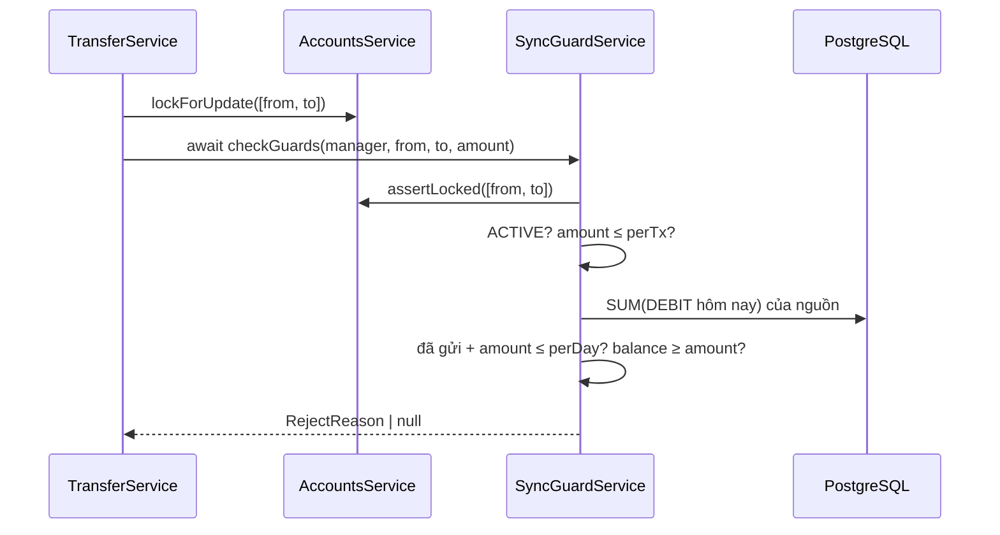

# DBS-82 · Sync guard bước 1: ACTIVE, hạn mức theo lần, thứ tự ưu tiên lý do từ chối

> **Status:** Implemented · **Vai:** Dev (ledger; #4 review theo ghi chú 12/10 trên board) · **Nhánh:** `feat/DBS-82-sync-guard` · **PR:** — · **Cập nhật:** 2026-11-08
>
> Techlead waiver: G1–G4 do agent tự duyệt theo yêu cầu của techlead; không có Dev khác (kể cả #4) review trước merge (BL-174); không có ảnh PNG, bằng chứng là `manual-test.txt` thô; domain review do chính agent làm, không dùng subagent (§6).

## 1. Bối cảnh

- **Task trên board:** Story, Tuần 3, Dev, ưu tiên Highest, Demo 1. **Expect:** «Mọi lệnh chuyển được kiểm đúng thứ tự trước khi ghi.»
- **DoD:**
  1. `checkGuards` trả đúng `RejectReason` theo thứ tự: `ACCOUNT_NOT_ACTIVE` (cả hai tài khoản, kể cả đích không tồn tại) → `LIMIT_PER_TX_EXCEEDED` (50.000.000đ, giả định) → `LIMIT_PER_DAY_EXCEEDED` → `INSUFFICIENT_FUNDS`.
  2. Hàm chỉ gọi sau khi đã khóa hai tài khoản; test gọi trong transaction có khóa; người gọi luôn `await`.
  3. AC-5.7 (đích LOCKED → REJECTED) xanh; mỗi lý do từ chối có test riêng và test thứ tự khi nhiều lý do cùng đúng.
  4. Giới hạn đọc từ `limits.config.ts`, không hằng số rải rác.
  5. PR đã merge vào main (CI xanh); Dev review; bảng «Đối chiếu test case» trong PR điền đủ.
  - Board: «Thiết kế: `checkGuards(manager, lockedFrom, lockedTo, amount): Promise<RejectReason | null>` là hàm async, người gọi phải await; chạy sau FOR UPDATE». Giá trị «giả định» đã chốt ở docs/02 §4, docs/03 §9–14 (cập nhật 11/10).
- **Phụ thuộc:** DBS-61 đã vào `main`.
- **Cột «Thực trạng» đã cũ.** Hạn mức lần/ngày và kiểm ACTIVE đã có từ #65, nhưng nằm trong hàm private `TransferService.refusal`, không phải `checkGuards`. Baseline `main` `505564d` (Node 24.11.1): lint, typecheck, build sạch; unit 1069/1069; `test:db` 652/652.
- **Đối chiếu DoD với `main`:**

| DoD | Hiện trạng | Việc task này làm |
|---|---|---|
| #1 thứ tự | Code: ACTIVE → **INSUFFICIENT_FUNDS** → PER_TX → PER_DAY. **Sai so với DoD và BRD** (BRD §6 bước 6 dòng 461, ledger brief, docs/03 §6.3 đều ghi lần → ngày → số dư); chỉ docs/03 §6.1 và bảng API (dòng 488) ghi «đủ tiền» trước | Đổi thứ tự trong code; sửa hai chỗ docs/03 còn lại; đổi TC-54-02 |
| #2 `checkGuards`, sau khóa, await | Không có hàm tên đó; không có gì ép «đã khóa» | Tách `SyncGuardService.checkGuards`; từ chối nếu hai tài khoản chưa được khóa trong transaction này (thêm `AccountsService.assertLocked`) |
| #3 AC-5.7, từng lý do, thứ tự | AC-5.7 có (TC-61-04); TC-54-01..05 phủ từng lý do qua HTTP nhưng không phủ thứ tự khi nhiều lý do cùng đúng | Thêm test thứ tự và test từng lý do ở mức hàm |
| #4 limits.config | Có (`this.limits.transfer`) | Giữ; thêm test quét hằng số |

- **Ngoài phạm vi:** lưu REJECTED đầy đủ và thông báo giống hệt cho đích không tồn tại/LOCKED (DBS-83); ranh giới nửa đêm (BL-154, giữ nguyên); rate limit (BL-155); guard bước 2 / fraud (task khác).
- **Backlog:** BL-154 cùng module/DoD: «Hợp đồng lưu từ chối đầy đủ thuộc DBS-83» → để DBS-83; phần ranh giới nửa đêm không thuộc DoD này, giữ.
- **Câu hỏi mở / quyết định ở G1 (agent tự duyệt):**
  1. **Đổi thứ tự lý do từ chối là đổi hành vi nhìn thấy từ API** (một lệnh vừa vượt hạn mức vừa thiếu tiền nay nhận `LIMIT_PER_TX_EXCEEDED` thay vì `INSUFFICIENT_FUNDS`). Agent chọn theo DoD + BRD (hai nguồn khớp nhau, chỉ code #65 lệch). Lead có thể phủ quyết khi đọc PR.
  2. Thêm một phương thức công khai vào `AccountsService` (`assertLocked`), cộng vào, không đổi phương thức cũ. Không đổi schema, `ErrorCode`, env, event.

## 2. Hành vi

`checkGuards` chạy trong transaction của `TransferService`, sau `lockForUpdate`, trước khi ghi bất cứ gì. Kết quả đầu tiên đúng thì trả về:

| Thứ | Điều kiện | Trả về |
|---|---|---|
| 1 | nguồn không `ACTIVE`, **hoặc** đích không có (không tồn tại, hoặc SYSTEM) **hoặc** không `ACTIVE` | `ACCOUNT_NOT_ACTIVE` |
| 2 | `amount > TRANSFER_LIMIT_PER_TX` (mặc định 50.000.000) | `LIMIT_PER_TX_EXCEEDED` |
| 3 | tổng ghi nợ hôm nay của nguồn (giờ Việt Nam) + `amount` > `TRANSFER_LIMIT_PER_DAY` (200.000.000) | `LIMIT_PER_DAY_EXCEEDED` |
| 4 | `balance` nguồn < `amount` | `INSUFFICIENT_FUNDS` |
| — | còn lại | `null` |

- Biên: `amount == perTx` qua; `perTx + 1` bị từ chối. `đã gửi + amount == perDay` qua; `+1` bị từ chối. `balance == amount` qua; `balance = amount − 1` bị từ chối.
- Lệnh vi phạm nhiều điều: chỉ lý do đứng trước được trả (ví dụ nguồn LOCKED, 60.000.000, thiếu tiền → `ACCOUNT_NOT_ACTIVE`; ACTIVE, 60.000.000, thiếu tiền → `LIMIT_PER_TX_EXCEEDED`).
- Gọi khi nguồn hoặc đích (nếu có) chưa được `lockForUpdate` trong transaction này, hoặc ngoài transaction → ném `AccountNotLockedError` / lỗi «cần transaction»; không bao giờ trả kết quả đoán.
- Ví dụ 422 (đổi so với trước): nguồn có 1.000đ, chuyển 60.000.000đ → `{"errorCode":"LIMIT_PER_TX_EXCEEDED","transferId":"…","status":422,…}` (trước: `INSUFFICIENT_FUNDS`).

## 3. Kiến trúc

- **Vị trí:** module `ledger`, role `api`. File mới `sync-guard.service.ts` (`SyncGuardService`); `transfer.service.ts` bỏ `refusal` và hằng `SENT_TODAY_SQL` (chuyển sang file mới) và gọi `await this.guard.checkGuards(...)`; `ledger.module.ts` đăng ký provider; `ledger/index.ts` export `SyncGuardService` để test dùng qua `@modules/ledger`; `accounts.service.ts` thêm `assertLocked`.
- **Interface:**

```ts
// ledger/sync-guard.service.ts
checkGuards(
  manager: EntityManager,
  lockedFrom: LockedAccount,
  lockedTo: LockedAccount | undefined,   // undefined: đích không tồn tại hoặc không phải tài khoản khách
  amount: Money,
): Promise<RejectReason | null>

// accounts/accounts.service.ts (cộng thêm)
assertLocked(ids: string[], manager: EntityManager): void   // ném AccountNotLockedError
```

  Người gọi (grep `refusal(`): chỉ `TransferService.transfer`. `DepositService` không dùng guard (SYSTEM bỏ qua hạn mức, ADR-09).
- **Dữ liệu:** đọc `ledger_entries` (tổng DEBIT hôm nay của nguồn, đã có index theo tài khoản); không ghi gì; không đổi schema.
- **Transaction:** nằm trong `TransactionService.run` của `TransferService`, sau khóa. `assertLocked` không truy vấn (đọc sổ khóa của `AccountsService` theo `QueryRunner`).
- **Giới hạn đọc từ** `limitsConfig` (`perTx`, `perDay` là `bigint`) **tại thời điểm gọi**, không sao chép vào trường của lớp.



- **Thay đổi cấp hệ thống:** docs/03 §6.1 (sơ đồ, dòng 205) và bảng API `/v1/transfers` (dòng 488); README `ledger`; mô tả Swagger của `transfers.controller.ts`.

## 4. Test cases tự động

PostgreSQL 17 thật; `test/db/sync-guard.db-spec.ts` gọi `checkGuards` trong transaction thật có khóa (`TransactionService.run` + `AccountsService.lockForUpdate`), số dư và «đã gửi hôm nay» tạo bằng API nạp tiền và chuyển tiền thật. Test HTTP nằm trong `customer-transfers.db-spec.ts`.

| ID | Truy vết | Lớp | Given · When · Then | Kết quả |
|---|---|---|---|---|
| TC-82-01 | DoD #3 | e2e Postgres | Nguồn LOCKED (sau đó đích LOCKED; đích `undefined`), mọi điều kiện khác cũng vi phạm | `ACCOUNT_NOT_ACTIVE` |
| TC-82-02 | DoD #3 | e2e Postgres | ACTIVE, `perTx + 1`, cũng vượt ngày và thiếu tiền | `LIMIT_PER_TX_EXCEEDED`; `perTx` đúng thì qua bước này |
| TC-82-03 | DoD #3 | e2e Postgres | ACTIVE, ≤ perTx, đã gửi + amount > perDay, cũng thiếu tiền | `LIMIT_PER_DAY_EXCEEDED`; đúng biên thì qua |
| TC-82-04 | DoD #3 | e2e Postgres | ACTIVE, trong hai hạn mức, balance < amount (biên `amount − 1`) | `INSUFFICIENT_FUNDS`; `balance == amount` → `null` |
| TC-82-05 | DoD #1, #3 | e2e Postgres | Bảng thứ tự: mọi tổ hợp «lý do đứng trước + các lý do sau cũng đúng» trả lý do đứng trước | khớp thứ tự §2 |
| TC-82-06 | DoD #2 | e2e Postgres | Gọi với tài khoản chưa khóa / khóa ở transaction khác / ngoài transaction | `AccountNotLockedError` / lỗi cần transaction; không trả lý do |
| TC-82-07 | DoD #2 | unit | Mọi lời gọi `checkGuards(` trong `src/` đứng sau `await`; hàm trả `Promise` | — |
| TC-82-08 | DoD #4 | unit + e2e | Không có hằng số hạn mức trong `src/modules/ledger/*.ts` (ngoài spec); đổi `limits.transfer.perTx/perDay` làm kết quả đổi theo | — |
| TC-82-09 | DoD #3, AC-5.7 | e2e HTTP | (TC-61-04, có sẵn) đích LOCKED → 422 `ACCOUNT_NOT_ACTIVE` đã lưu | `ACCOUNT_NOT_ACTIVE` |
| TC-82-10 | DoD #1 | e2e HTTP | (đổi TC-54-02) thiếu tiền **và** vượt hạn mức lần → 422 `LIMIT_PER_TX_EXCEEDED`; thiếu tiền trong hạn mức vẫn `INSUFFICIENT_FUNDS` (TC-61-02) | `LIMIT_PER_TX_EXCEEDED` |
| TC-82-11 | thêm | e2e Postgres | `AccountsService.assertLocked`: qua với id đã khóa, ném với id chưa khóa/ngoài transaction | `AccountNotLockedError` |
| Quy trình | DoD #5 | — | Merge, CI, Dev review | waiver |

## 5. Test thủ công

`node backend/scripts/manual-dbs82.cjs` (Docker, Node 24). App thật, JWT thật, Postgres 17.

| Bước | Việc làm | Kết quả mong đợi |
|---|---|---|
| M-82-01 | Nạp 1.000đ cho Vũ Thị Giang; Giang chuyển 60.000.000đ cho Bùi Văn Hải | 422 `LIMIT_PER_TX_EXCEEDED` (trước DBS-82: `INSUFFICIENT_FUNDS`); 1 transfer REJECTED; không bút toán |
| M-82-02 | Giang chuyển 500đ (thiếu tiền nhưng trong hạn mức) | 422 `INSUFFICIENT_FUNDS` |
| M-82-03 | Hải bị khóa (SQL), Giang chuyển 60.000.000đ | 422 `ACCOUNT_NOT_ACTIVE` (lý do đứng đầu) |
| M-82-04 | Nạp 250.000.000đ cho Giang; chuyển 4 × 50.000.000đ; rồi 1đ | 4 × 201; lệnh thứ năm 422 `LIMIT_PER_DAY_EXCEEDED` |
| M-82-05 | Đích không tồn tại, 60.000.000đ | 422 `ACCOUNT_NOT_ACTIVE` |
| cleanup | Dọn | `DBS-82 cleanup PASS` |

## 6. Domain review (AI)

**Reviewer:** chính agent (Sonnet 5.5), 2026-11-08, đọc `transfer.service.ts`, `limits.config.ts`, BRD §6/AC-5.6/5.7, ledger brief, ADR-04/08/09, docs/03 §6.1/§6.3/§7/§15. Không dùng subagent.

| # | Mức | Phát hiện | Xử lý |
|---|---|---|---|
| 1 | should-fix | Code #65 để `INSUFFICIENT_FUNDS` trước hạn mức, trái DoD và BRD | Đưa vào phạm vi, nêu rõ là đổi hành vi (G1 câu 1) |
| 2 | should-fix | Không gì ép guard chạy sau khóa; hạn mức ngày chỉ đúng khi nguồn đang bị khóa (AC-5.6) | `assertLocked` + TC-82-06 |
| 3 | should-fix | Nếu `checkGuards` bị gọi không `await`, `Promise` luôn truthy → mọi lệnh bị từ chối (hoặc ngược lại) | Rule eslint `no-floating-promises` đã bật; thêm TC-82-07 quét mã nguồn |
| 4 | minor | Truy vấn tổng ngày chạy cả với lệnh sẽ bị từ chối ở bước 1–2 | Guard trả sớm: ACTIVE và perTx không cần truy vấn |
| 5 | minor | `limits.transfer` đọc một lần ở constructor sẽ không phản ánh thay đổi trong test | Đọc tại lúc gọi |
| 6 | minor | `lockedTo` `undefined` gộp hai trường hợp (không tồn tại, SYSTEM) | Đúng ý (AC-5.8: không phân biệt); ghi ở §2/§3 |
| 7 | minor | Ranh giới nửa đêm chưa test (BL-154) | Ngoài phạm vi, giữ BL-154 |

Không có phát hiện blocking. Verdict tự đánh giá: APPROVE.

## 7. Kế hoạch triển khai

| Bước | File | Test viết trước | Kết quả đỏ | Lệnh chứng minh | Commit |
|---|---|---|---|---|---|
| 1 | `accounts.service.ts`, `test/db/sync-guard.db-spec.ts` (TC-82-11) | TC-82-11 | điền khi chạy | `npm --prefix backend run test:db -- --runInBand sync-guard` | `feat(accounts): assert that accounts are locked by the current transaction` |
| 2 | `sync-guard.service.ts`, `ledger.module.ts`, `index.ts`, `test/db/sync-guard.db-spec.ts`, `sync-guard.service.spec.ts` | TC-82-01..08 | điền khi chạy | như trên + `npm --prefix backend test -- sync-guard` | `feat(ledger): add SyncGuardService.checkGuards in the documented order` |
| 3 | `transfer.service.ts`, `customer-transfers.db-spec.ts` (TC-54-02 → TC-82-10) | TC-82-10 | điền khi chạy | `npm --prefix backend run test:db -- --runInBand customer-transfers` | `refactor(ledger): transfers use checkGuards; limits come before funds` |
| 4 | `manual-dbs82.cjs`, `screenshots/DBS-82/*` | M-82-01..05 | — | `node backend/scripts/manual-dbs82.cjs` | `test(ledger): add DBS-82 manual driver` |
| 5 | docs/03, README ledger, `transfers.controller.ts` mô tả, doc, index, BL-174 | — | — | `check-doc-links.mjs` | `docs(ledger): record DBS-82 evidence and the new reason order` |

Rủi ro: client đang dựa vào `INSUFFICIENT_FUNDS` cho lệnh vượt hạn mức sẽ thấy mã khác (chưa có client nào, API còn ở dev). Lùi: `git revert`, không có migration. Đột biến: đổi thứ tự hai bước trong `checkGuards` (TC-82-05 phải hỏng); bỏ `assertLocked` (TC-82-06 phải hỏng); thay `this.limits.transfer.perTx` bằng `50_000_000n` (TC-82-08 phải hỏng).

**Quyết định ở G3 (agent tự duyệt):** theo bảng trên.

## 8. Kết quả

- **Lệnh kiểm tra** (Node 24.11.1, `backend/`, commit code cuối `695f698` (đổi `transfer.service.ts`); SHA ở dòng đầu `manual-test.txt` là HEAD lúc chạy):

| Lệnh | Kết quả |
|---|---|
| `npm run lint:check`, `typecheck`, `build` | đạt (mã thoát 0) |
| `npm test -- --runInBand` | **1073/1073**, 66 suite (+4 ca `sync-guard.service.spec.ts`) |
| `npm run test:e2e -- --runInBand` | **148/148**, 14 suite (với `DATABASE_URL` tới Postgres 17 tạm) |
| `npm run test:db -- --runInBand` | **670/670**, 35 suite (toàn bộ) |
| `node scripts/manual-dbs82.cjs` | 5/5 bước + dọn dẹp đạt |

  0 test bị `.skip/.only/.todo`.

- **Đối chiếu test case:**

| ID | Test | Đạt? |
|---|---|---|
| TC-82-01 | `sync-guard.db-spec.ts` › `TC-82-01 …` (nguồn LOCKED, đích LOCKED, đích không tồn tại) | đạt. Đột biến hoán đổi thứ tự → hỏng |
| TC-82-02 | `TC-82-02 …` (perTx + 1; đúng perTx qua bước này) | đạt |
| TC-82-03 | `TC-82-03 …` (biên ngày: `== perDay` qua, `+1` bị từ chối) | đạt |
| TC-82-04 | `TC-82-04 …` (biên số dư) | đạt |
| TC-82-05 | `TC-82-05 …` (4 ca thứ tự khi nhiều lý do cùng đúng) | đạt. Đột biến "số dư trước hạn mức ngày" → 2 ca hỏng |
| TC-82-06 | `it refuses to answer for accounts this transaction has not locked` (3 ca) | đạt. Đột biến bỏ `assertLocked` → 3 ca hỏng |
| TC-82-07 | `sync-guard.service.spec.ts` (trả `Promise`; mọi lời gọi trong `src/` có `await`) | đạt |
| TC-82-08 | `sync-guard.service.spec.ts` (không có hằng 50.000.000/200.000.000 trong `ledger/`; quyết định trạng thái trước khi hỏi DB) và `sync-guard.db-spec.ts` (đổi limit → đổi kết quả) | đạt. Đột biến cứng hóa `perTx` → 3 ca DB + 1 ca unit hỏng |
| TC-82-09 | `customer-transfers.db-spec.ts` › `TC-61-04 …` (AC-5.7, có sẵn) | đạt |
| TC-82-10 | `customer-transfers.db-spec.ts` › `TC-82-10 the per-transfer limit is reported before insufficient funds` (thay TC-54-02). **Đỏ trước khi sửa:** `Expected "LIMIT_PER_TX_EXCEEDED"  Received "INSUFFICIENT_FUNDS"` | đạt |
| TC-82-11 | `sync-guard.db-spec.ts` › `AccountsService.assertLocked` | đạt |
| Quy trình | DoD #5 | chưa làm: Dev review (kể cả #4), BL-174 |

  12 ca/nhóm đạt đủ độ sâu, 0 đơn giản hóa. TC-82-01..08, 11 không đỏ riêng trước khi cài đặt vì `SyncGuardService` chưa tồn tại (lỗi biên dịch `Cannot find module`), nên "đỏ" là không chạy được; độ nhạy được chứng minh bằng ba đột biến.

- **Test thủ công** (`node backend/scripts/manual-dbs82.cjs`; output thô [manual-test.txt](screenshots/DBS-82/manual-test.txt)):

| Bước | Kết quả thật | Kết quả |
|---|---|---|
| M-82-01 | 60.000.000 khi số dư 1.000 → 422 `LIMIT_PER_TX_EXCEEDED` (trước DBS-82 là `INSUFFICIENT_FUNDS`, xem TC-82-10 đỏ); 1 transfer REJECTED, không bút toán | đạt |
| M-82-02 | 5.000 khi số dư 1.000 → 422 `INSUFFICIENT_FUNDS`; số dư vẫn 1.000 | đạt |
| M-82-03 | Đích LOCKED, 60.000.000, thiếu tiền → 422 `ACCOUNT_NOT_ACTIVE` | đạt |
| M-82-04 | 4 × 50.000.000 → 201; thêm 1đ → 422 `LIMIT_PER_DAY_EXCEEDED`; đích có 200.000.000 | đạt |
| M-82-05 | Đích không tồn tại, 60.000.000 → 422 `ACCOUNT_NOT_ACTIVE`, `to_account_id = NULL` | đạt |
| cleanup | JWKS, database tạm, container đã dọn | đạt |

  Seed SQL chỉ cho user/customer/tài khoản số dư 0 và trạng thái LOCKED của đích; tiền vào qua API nạp tiền.

- **Phạm vi so với §7:** khớp §7. Thêm `ledger/index.ts` (export `SyncGuardService`), `transfers.controller.ts` (mô tả Swagger), `docs/03` (§6.1, bảng API, bảng phiên bản v1.9) và README `ledger`.
- **Ảnh chụp:** không có (waiver); bằng chứng là `manual-test.txt`.
- **Lệch so với kế hoạch:** (1) TC-54-02 («thiếu tiền được báo trước hạn mức») bị đảo ý nghĩa thành TC-82-10; đây là thay đổi hành vi có chủ đích, đã nêu ở G1 câu 1. (2) Test thủ công không có bước riêng cho `assertLocked` (không có đường HTTP); kiểm bằng test tự động.
- **Để lead xem kỹ:** thứ tự mới đổi mã lỗi client nhận được cho lệnh vừa vượt hạn mức vừa thiếu tiền. Nếu muốn giữ thứ tự cũ, chỉ cần đổi thứ tự trong `checkGuards` và đảo TC-82-05/10, nhưng sẽ lệch BRD và DoD của board.
- **Bàn giao:** BL-174 (thêm PR này). BL-154 (nửa đêm giờ Việt Nam) giữ nguyên, phần «lưu từ chối đầy đủ» làm ở DBS-83.

## 9. Tài liệu đã cập nhật

`docs/03_HIGH_LEVEL_ARCHITECTURE.md` (sơ đồ §6.1, bảng API `/v1/transfers`, phiên bản v1.9), `backend/src/modules/ledger/README.md`, `docs/features/README.md`, `docs/BACKLOG.md` (BL-174). Không xóa dòng BL nào.
