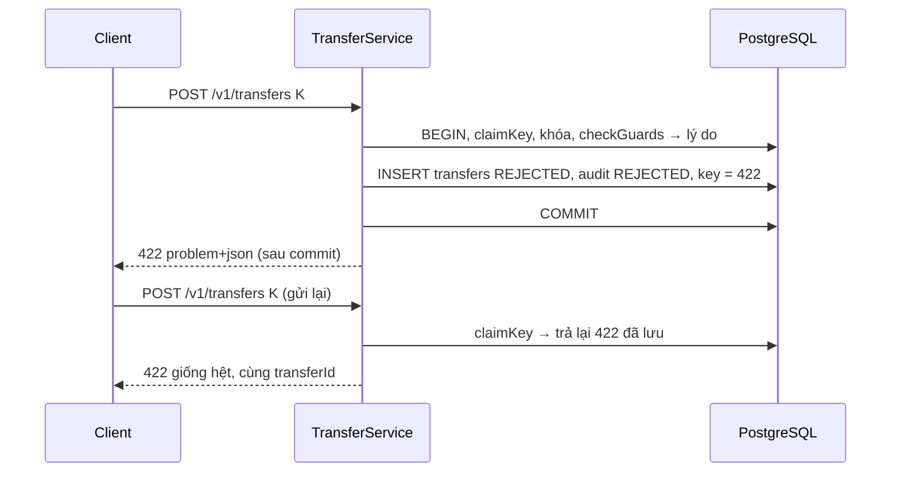

# DBS-83 · Lưu lệnh REJECTED cùng key, commit trước khi trả 422

> **Status:** Implemented · **Vai:** Dev · **Nhánh:** `feat/DBS-83-persist-rejected` · **PR:** [#73](https://github.com/Lawliet119/digital-banking-simulator/pull/73) · **Cập nhật:** 2026-11-08
>
> Techlead waiver: G1–G4 do agent tự duyệt theo yêu cầu của techlead; không có Dev khác review trước merge (BL-174); không có ảnh PNG, bằng chứng là `manual-test.txt` thô; domain review do chính agent làm, không dùng subagent (§6).

## 1. Bối cảnh

- **Task trên board:** Story, Tuần 3, Dev, ưu tiên Highest, Demo 2. **Expect:** «Từ chối vẫn có dấu vết và gửi lại cùng key trả đúng kết quả từ chối cũ.»
- **DoD:**
  1. `REJECTED` lưu `transfers` (`reject_reason` thuộc `RejectReason`), `idempotency_keys` và audit trong một transaction đã commit rồi mới trả 422 problem+json.
  2. Chuyển tới tài khoản không tồn tại → `REJECTED`/`ACCOUNT_NOT_ACTIVE` (`to_account_id` NULL), thông báo giống hệt khi tài khoản tồn tại nhưng LOCKED để không lộ sự tồn tại.
  3. Gửi lại cùng key trả đúng kết quả `REJECTED` cũ, không chấm lại.
  4. Không có bút toán và số dư không đổi cho lệnh `REJECTED` (AC-5.2, AC-5.7).
  5. PR đã merge vào main (CI xanh); Dev review; bảng «Đối chiếu test case» trong PR điền đủ.
- **Phụ thuộc:** DBS-79 (#69) và DBS-82 (#72) đã vào `main`.
- **Cột «Thực trạng» đã cũ.** «Hiện lệnh bị từ chối chỉ trả lỗi» không còn đúng: từ #61/#65, `TransferService` ghi transfer REJECTED, audit và kết quả của key rồi commit trước khi ném 422 (`outcome.reason` được ném **sau** `tx.run`). Baseline `main` `6cee396` (Node 24.11.1): lint, typecheck, build sạch; unit 1073/1073; `test:db` 670/670.
- **Đối chiếu DoD với `main`:**

| DoD | Hiện trạng | Khoảng trống task này lấp |
|---|---|---|
| #1 lưu ba nơi + commit trước 422 | Có (`assertRejected` trong `customer-transfers.db-spec.ts` đọc bằng kết nối khác sau 422). Test phủ `INSUFFICIENT_FUNDS`, `ACCOUNT_NOT_ACTIVE`, `LIMIT_PER_TX`; **`LIMIT_PER_DAY` chỉ kiểm mã trả về, chưa kiểm các dòng đã lưu**; không test nào so `reject_reason` với `REJECT_REASONS` | TC-83-01: cả bốn lý do, đủ các dòng, body chính xác |
| #2 đích không tồn tại giống hệt LOCKED | Lưu `to_account_id` NULL (TC-61-04); **không test nào so phản hồi** của ba trường hợp (không tồn tại, LOCKED, SYSTEM `funding`) | TC-83-02: so từng byte (trừ `transferId`, `correlationId`), cả khi số tiền vượt hạn mức |
| #3 gửi lại | Có cho INSUFFICIENT (TC-79-03/10); chưa có cho đích không tồn tại | TC-83-03 |
| #4 không bút toán, số dư không đổi | Có trong `assertRejected` (so tổng và số dư) | Gộp vào TC-83-01 cho cả bốn lý do |
| #5 | Quy trình | waiver |

- **Rủi ro thiết kế phát hiện (ngoài phạm vi, ghi BL-175):** `GET /v1/transfers/{id}` (UC-7, docs/03 §7, chưa có code) sẽ đọc `transfers.to_account_id`. Với lệnh REJECTED giá trị này là NULL khi đích không tồn tại nhưng là UUID khi đích LOCKED; nếu UC-7 trả hoặc dùng nó để phân quyền «người nhận», nó lộ sự tồn tại của tài khoản đích, đúng điều DoD #2 muốn tránh.
- **Ngoài phạm vi:** UC-7 (task riêng, BL-175); sự kiện `TransferRejected` (không có trong hợp đồng event); đồng hồ nửa đêm (BL-154).
- **Backlog:** BL-154 có dòng «Hợp đồng lưu từ chối đầy đủ thuộc DBS-83»: DoD này đã đạt bằng TC-83-01 nên sửa lại câu đó trong BL-154 (chỉ còn ý «ranh giới nửa đêm»).
- **Câu hỏi mở / quyết định ở G1 (agent tự duyệt):** (1) Không đổi hành vi sản phẩm; chỉ thêm bằng chứng, và sửa nếu test thấy lỗi. (2) Không thêm cột/ràng buộc DB: `transfers_reject_reason_check` và `(status = 'REJECTED') = (reject_reason IS NOT NULL)` đã có ở migration 1791849600000.

## 2. Hành vi (được chứng minh)

| # | Điều kiện | Kết quả |
|---|---|---|
| B1 | Lệnh vi phạm một trong bốn lý do | Một transaction ghi: `transfers` (`status = REJECTED`, `reject_reason = errorCode`, `to_account_id` theo B2), `idempotency_keys` (`response_code = 422`, `response_body` có `errorCode` và `transferId`), `audit_log` (`outcome = REJECTED`, `metadata = {id, reason}`); **commit**; rồi mới ném 422 `application/problem+json` |
| B2 | Đích không tồn tại, hoặc là SYSTEM `funding` | `to_account_id = NULL`; `errorCode = ACCOUNT_NOT_ACTIVE` |
| B3 | Đích tồn tại nhưng LOCKED | `to_account_id` = id đích; `errorCode = ACCOUNT_NOT_ACTIVE` |
| B4 | So B2 và B3 từ phía client | Cùng status, `errorCode`, `title`, `type`, `detail`, cùng bộ khóa JSON, cùng `Content-Type`; chỉ `transferId` và `correlationId` khác (mỗi lệnh có id riêng) — kể cả khi số tiền vượt hạn mức hay vượt số dư |
| B5 | Gửi lại cùng key (cùng body) | Cùng 422, cùng `transferId`, không dòng mới |
| B6 | Mọi lệnh REJECTED | Không có `ledger_entries`, không có `outbox_events`, không đổi `accounts.balance` |

422 mẫu (`application/problem+json`), giống hệt cho đích không tồn tại và đích LOCKED trừ hai trường định danh:

```json
{ "errorCode": "ACCOUNT_NOT_ACTIVE", "transferId": "…", "type": "about:blank", "title": "Unprocessable Entity", "status": 422, "detail": "Transfer rejected", "correlationId": "…" }
```

## 3. Kiến trúc

- **Vị trí:** chỉ test; không đổi code sản phẩm (trừ khi test phát hiện lỗi). File mới `backend/test/db/rejected-transfers.db-spec.ts`, `backend/scripts/manual-dbs83.cjs`.
- **Mã nguồn liên quan:** `TransferService.transfer` (nhánh `reason`: `insertTransfer` → `audit.record(REJECTED)` → `storeResult(422)` trong `tx.run`; `throw new UnprocessableEntityException(outcome.result)` ngoài `tx.run`), `LedgerPostingService.replay`, `SyncGuardService`.
- **Dữ liệu:** `transfers`, `idempotency_keys`, `audit_log`, `ledger_entries`, `outbox_events`, `accounts`. Ràng buộc DB đã có: `transfers_reject_reason_check`, `status ↔ reject_reason`, `status <> COMPLETED OR to_account_id IS NOT NULL`.
- **Ranh giới transaction:** một `TransactionService.run`; lỗi 422 ném sau commit; lỗi ghi bất kỳ → rollback toàn bộ và 500 (TC-61-08 có sẵn).



- **Thay đổi cấp hệ thống:** BL-154 (sửa câu), BL-175 (mới), `docs/features/README.md`.

## 4. Test cases tự động

PostgreSQL 17 thật, HTTP + JWT thật, `test/db/rejected-transfers.db-spec.ts`; sau mỗi ca kiểm tra bất biến sổ cái.

| ID | Truy vết | Lớp | Given · When · Then | `errorCode` |
|---|---|---|---|---|
| TC-83-01 | DoD #1, #4; AC-5.2, AC-5.7 | e2e Postgres | (`it.each` bốn lý do) lệnh vi phạm → 422 problem+json đúng bộ khóa; đọc từ kết nối khác ngay sau đó: 1 transfer REJECTED với `reject_reason` = `errorCode` ∈ `REJECT_REASONS`; key `response_code 422` chứa đúng `errorCode`/`transferId`; 1 audit REJECTED cùng `correlationId`; 0 bút toán; 0 outbox; số dư hai bên không đổi | cả bốn |
| TC-83-02 | DoD #2 | e2e Postgres | Đích không tồn tại, `funding`, LOCKED, với số tiền nhỏ và 60.000.000: phản hồi giống nhau trừ `transferId`/`correlationId`; `to_account_id` NULL, NULL, id đích | `ACCOUNT_NOT_ACTIVE` |
| TC-83-03 | DoD #3 | e2e Postgres | Đích không tồn tại: gửi lại cùng key (cả trước và sau khi có người nạp tiền cho nguồn) → cùng 422, cùng `transferId`, tổng dòng không đổi | `ACCOUNT_NOT_ACTIVE` |
| TC-83-04 | DoD #1 | e2e Postgres | Lệnh REJECTED bị cấm ghi lỗi giữa chừng không tồn tại một nửa: trigger lỗi ở audit khi từ chối → 500, không transfer, không key (có sẵn TC-61-08 biến thể từ chối) — dẫn chiếu, không viết lại | — |
| Quy trình | DoD #5 | — | Merge, CI, Dev review | waiver |

## 5. Test thủ công

`node backend/scripts/manual-dbs83.cjs` (Docker, Node 24). App thật, JWT thật, Postgres 17.

| Bước | Việc làm | Kết quả mong đợi |
|---|---|---|
| M-83-01 | Nạp 1.000.000 cho Mai Văn Khoa; chuyển 60.000.000 cho tài khoản không tồn tại, cho `funding`, cho một tài khoản LOCKED | Ba 422 `ACCOUNT_NOT_ACTIVE`, body giống hệt (trừ id); `to_account_id` NULL/NULL/id; in ra từng body |
| M-83-02 | Gửi lại key của lệnh đến tài khoản không tồn tại | 422 cùng `transferId`; số dòng không đổi |
| M-83-03 | Bốn lý do (LOCKED, vượt lần, vượt ngày, thiếu tiền) | Mỗi lý do 1 transfer REJECTED, 1 audit REJECTED, 1 key 422, 0 bút toán; số dư không đổi |
| M-83-04 | Gài trigger làm hỏng audit; chuyển (bị từ chối); gỡ trigger; gửi lại cùng key | 500 và không có transfer/key; sau đó 422 đã lưu một lần |
| cleanup | Dọn | `DBS-83 cleanup PASS` |

## 6. Domain review (AI)

**Reviewer:** chính agent (Sonnet 5.5), 2026-11-08, đọc `transfer.service.ts`, `ledger-posting.service.ts`, migration 1791849600000, `problem-details.filter.ts`, AC-5.2/5.7/5.8, docs/03 §6.1/§7. Không dùng subagent.

| # | Mức | Phát hiện | Xử lý |
|---|---|---|---|
| 1 | should-fix | Không test nào so phản hồi giữa đích không tồn tại và LOCKED | TC-83-02 |
| 2 | should-fix | `LIMIT_PER_DAY` chưa được kiểm các dòng đã lưu | TC-83-01 |
| 3 | should-fix | UC-7 sau này có thể lộ `to_account_id` NULL vs UUID | Ghi BL-175 |
| 4 | minor | Phản hồi 422 gồm `message` bị `RESHAPED_KEYS` loại và `detail` = «Transfer rejected» (chung) | Đúng ý; TC-83-02 khóa nội dung này |
| 5 | minor | Thời gian xử lý khác nhau (đích LOCKED bị khóa hàng, đích không tồn tại thì không) có thể là kênh phụ | Chấp nhận (chênh vài ms, nhiễu hơn mạng); ghi lại ở §8 |
| 6 | minor | «Commit trước khi ném» khó chứng minh chỉ bằng kết quả cuối | Đọc bằng kết nối khác ngay khi nhận 422; đột biến di chuyển `throw` vào trong `tx.run` làm TC-83-01 hỏng |

Không có phát hiện blocking. Verdict tự đánh giá: APPROVE.

## 7. Kế hoạch triển khai

| Bước | File | Test viết trước | Kết quả đỏ | Lệnh chứng minh | Commit |
|---|---|---|---|---|---|
| 1 | `test/db/rejected-transfers.db-spec.ts` | TC-83-01..03 | Dự kiến không đỏ (code đã đúng); kiểm chứng bằng đột biến | `npm --prefix backend run test:db -- --runInBand rejected-transfers` | `test(ledger): prove every refusal is stored before the 422 and hides the destination` |
| 2 | `scripts/manual-dbs83.cjs`, `screenshots/DBS-83/*` | M-83-01..04 | — | `node backend/scripts/manual-dbs83.cjs` | `test(ledger): add DBS-83 manual driver` |
| 3 | doc, index, `BACKLOG.md` (BL-154, BL-174, BL-175) | — | — | `check-doc-links.mjs` | `docs(ledger): record DBS-83 evidence` |

Đột biến cho bước 1: (a) ném 422 ngay trong `tx.run` (rollback theo lỗi) → TC-83-01..03 phải hỏng; (b) cho đích không tồn tại một `message` khác → TC-83-02 phải hỏng. Hoàn nguyên bằng `git checkout`.

Rủi ro: không có (chỉ thêm test). Lùi: `git revert`.

**Quyết định ở G3 (agent tự duyệt):** theo bảng trên.

## 8. Kết quả

- **Lệnh kiểm tra** (Node 24.11.1, `backend/`; không đổi code sản phẩm nên code cuối là `6cee396` của `main`; SHA đầu `manual-test.txt` là HEAD lúc chạy, `7025288`):

| Lệnh | Kết quả |
|---|---|
| `npm run lint:check`, `typecheck`, `build` | đạt (mã thoát 0) |
| `npm test -- --runInBand` | **1073/1073**, 66 suite |
| `npm run test:e2e -- --runInBand` | **148/148**, 14 suite (với `DATABASE_URL` tới Postgres 17 tạm) |
| `npm run test:db -- --runInBand` | **677/677**, 36 suite (toàn bộ) |
| `node scripts/manual-dbs83.cjs` | 4/4 bước + dọn dẹp đạt |

  0 test bị `.skip/.only/.todo`.

- **Đối chiếu test case** (`test/db/rejected-transfers.db-spec.ts`):

| ID | Test | Đạt? |
|---|---|---|
| TC-83-01 | `TC-83-01 the scenarios cover every RejectReason` và `TC-83-01 %s: stored in one committed transaction, then 422…` (4 lý do) | đạt. Đột biến ném 422 trong `tx.run` → 4 ca hỏng |
| TC-83-02 | `TC-83-02 a destination that does not exist, the funding account and a LOCKED account get one answer` | đạt. Đột biến đổi `message` cho đích không tồn tại → hỏng |
| TC-83-03 | `TC-83-03 a refusal to an unknown destination is replayed word for word…` | đạt (đột biến (a) cũng làm hỏng ca này) |
| TC-83-04 | dẫn chiếu `TC-61-08 rejected %s fault rolls back, retry persists422` (audit, key) | đạt (có sẵn, không viết lại) |
| Quy trình | DoD #5 | chưa làm: Dev review, BL-174 |

  7 ca mới (1 + 4 + 1 + 1) đạt đủ độ sâu, 0 đơn giản hóa. Không có bước đỏ trước khi viết test vì hành vi đã đúng từ #61/#65; độ nhạy được chứng minh bằng đột biến (6/7 ca hỏng với (a), 1/7 với (b)).

- **Test thủ công** (output thô [manual-test.txt](screenshots/DBS-83/manual-test.txt)):

| Bước | Kết quả thật | Kết quả |
|---|---|---|
| M-83-01 | 60.000.000 tới tài khoản không tồn tại, `funding`, tài khoản LOCKED → ba 422 với cùng `{"errorCode":"ACCOUNT_NOT_ACTIVE","type":"about:blank","title":"Unprocessable Entity","status":422,"detail":"Transfer rejected"}`; `to_account_id` = `[null, null, id đích]` | đạt |
| M-83-02 | Gửi lại key: 422 cùng `transferId`, không dòng mới | đạt |
| M-83-03 | LOCKED / vượt lần / vượt ngày / thiếu tiền: mỗi lý do 1 transfer REJECTED + 1 audit + 1 key, 0 bút toán, số dư không đổi | đạt |
| M-83-04 | Audit hỏng → 500, không còn gì; gỡ lỗi, cùng key → 422 đã lưu đúng một lần | đạt |
| cleanup | JWKS, database tạm, container đã dọn | đạt |

  Seed SQL chỉ cho user/customer/tài khoản số dư 0 và trạng thái LOCKED; tiền vào qua API nạp tiền.

- **Phạm vi so với §7:** khớp: `rejected-transfers.db-spec.ts`, `manual-dbs83.cjs`, doc, index, `BACKLOG.md` (BL-154 sửa, BL-174 thêm PR, BL-175 mới). Không đổi code sản phẩm.
- **Ảnh chụp:** không có (waiver); bằng chứng là `manual-test.txt`.
- **Lệch so với kế hoạch:** không có.
- **Ghi nhận:** (1) thời gian xử lý của đích LOCKED (khóa hàng) và đích không tồn tại khác nhau vài ms; không coi là kênh phụ cần chặn ở v1. (2) `transfers.to_account_id` NULL vs UUID vẫn phân biệt được ở tầng lưu; an toàn cho tới khi UC-7 đọc nó (BL-175).
- **Bàn giao:** BL-175 (UC-7 không được lộ `to_account_id` của lệnh REJECTED), BL-174 (thêm PR này), BL-154 (đã bỏ phần thuộc DBS-83).

## 9. Tài liệu đã cập nhật

`docs/features/README.md` (dòng DBS-83), `docs/BACKLOG.md` (sửa BL-154; thêm BL-175; BL-174 thêm PR). Không đổi docs/03 (hành vi đã mô tả đúng ở §6.1/§7). Không xóa dòng BL nào.
