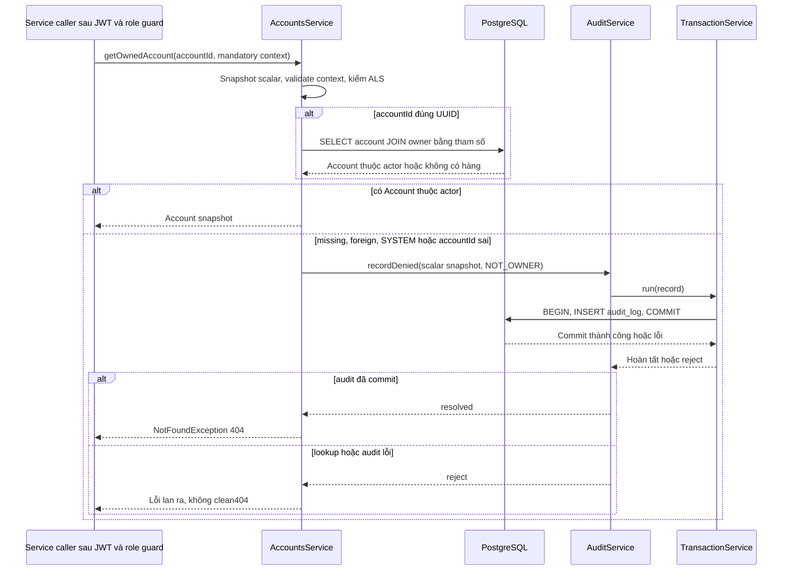
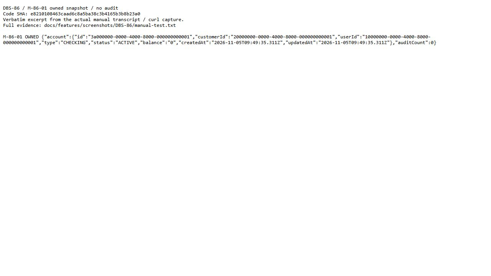
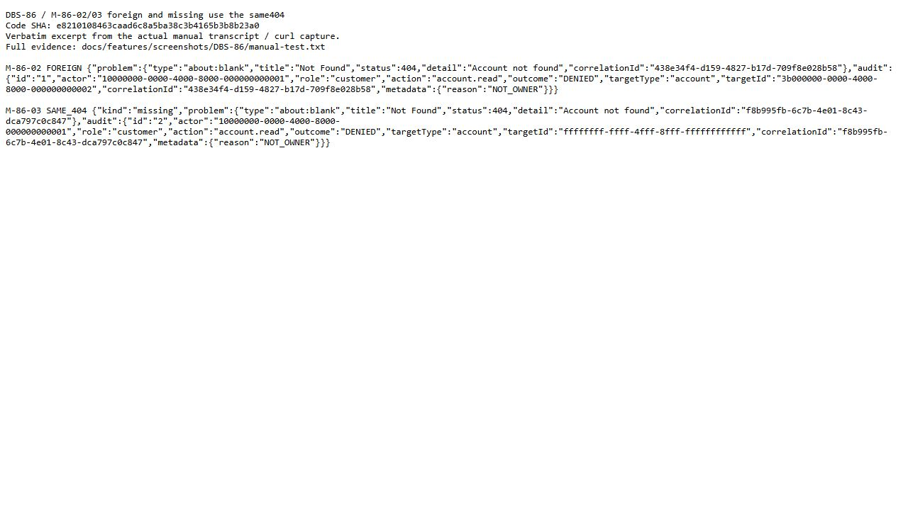
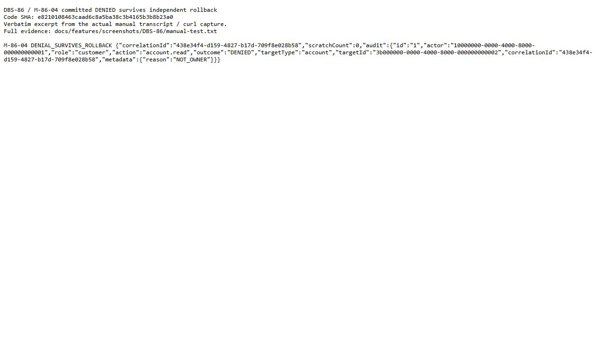
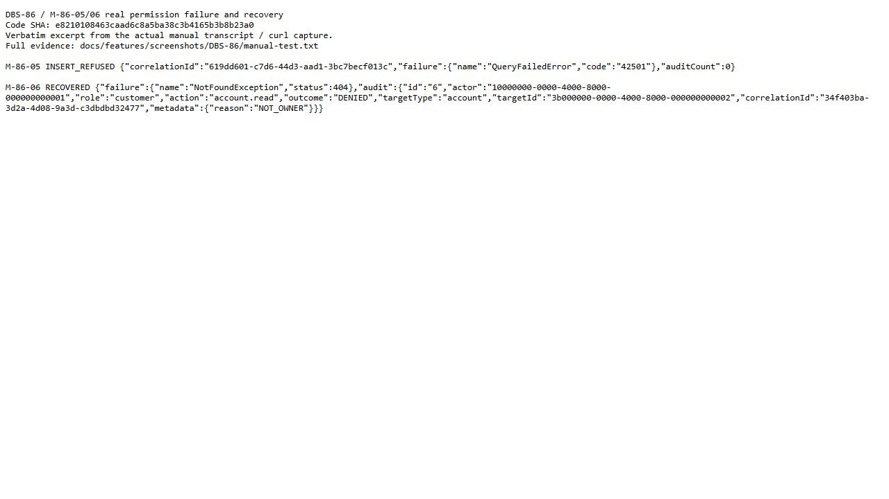
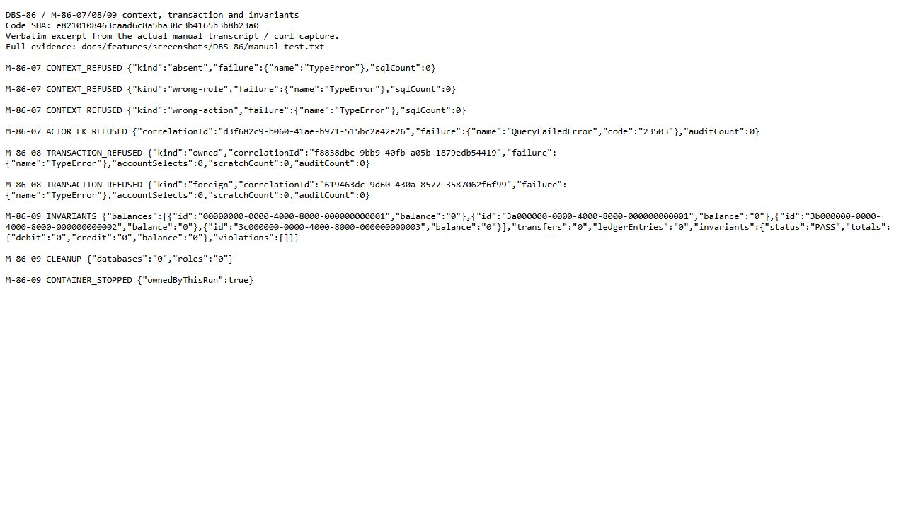

# DBS-86 · Kiểm tra sở hữu tài nguyên và audit DENIED

> **Status:** Implemented — G4 đã duyệt phạm vi service; HTTP integration và process DoD còn mở · **Vai:** Dev · **Dev review:** chưa phân công · **Nhánh:** `codex/DBS-86-resource-ownership` · **PR:** [#60](https://github.com/Lawliet119/digital-banking-simulator/pull/60) (Draft) · **Cập nhật:** 2026-11-06

## 1. Bối cảnh

### Ticket và nguồn yêu cầu

- **Board:** [DBS-86 trên bảng phân công](https://docs.google.com/spreadsheets/d/18IHrZShDoZDc6bgnsi__ATyd99aeJxe4x4TWQ5WTz_w/edit?gid=1395280002#gid=1395280002), Tuần 3 · Story · Dev · High · Deliverable / Demo: **Demo 4**.
- **Tóm tắt nguyên văn:** “Kiểm tra sở hữu mọi endpoint: không thuộc mình → 404 + audit DENIED”.
- **Status:** `In Progress` ở lượt đọc lại ngày 2026-11-04, trước 12:33 giờ Việt Nam. Lượt đầu của phiên làm việc trả `To Do`; agent chỉ đọc, không cập nhật board và không suy luận ai đã đổi trạng thái.
- **Thực trạng nguyên văn:** “Mới có getOwnedAccount (DBS-55); chưa áp cho mọi endpoint nhận accountId/transferId.”
- **Expect nguyên văn:** “Khách không bao giờ thấy hay chạm dữ liệu của người khác.”
- Đã lấy ticket và trạng thái phụ thuộc bằng `node .claude/skills/dbs-delivering-task/scripts/fetch-task.mjs DBS-86`; đọc riêng các ticket liên quan DBS-60/61/64/83/87/88/113. Board là snapshot; trạng thái `In Progress` không chứng minh code đã vào `main`.

**DoD nguyên văn:**

1. Mọi endpoint nhận accountId hoặc transferId kiểm sở hữu ở tầng service, không chỉ ở guard vai trò
2. AC-5.8: A chuyển tiền từ tài khoản của C → 404, không lộ thông tin C, có audit DENIED
3. Phản hồi 404 cho tài khoản không tồn tại và tài khoản của người khác giống hệt nhau
4. Test cho từng endpoint có tham số id
5. PR đã merge vào main (CI xanh); Dev review; bảng «Đối chiếu test case» trong PR điền đủ

**Tài liệu chi phối:** [docs/02](../02_REQUIREMENTS_AND_DOMAIN_MODEL.md) §2 FR-ID-04, §3 AC-5.8 và BR-10; [docs/03](../03_HIGH_LEVEL_ARCHITECTURE.md) §6.1, §6.3, §7, §12; [threat model](../security/threat-model.md) T11/T12; [database-design](../components/_shared/database-design.md) §4.1–4.2, §4.7; [ADR-04](../adr/0004-row-locking-read-committed.md), [ADR-06](../adr/0006-cognito-ecs-fargate.md), [ADR-09](../adr/0009-funding-system-account.md), [ADR-12](../adr/0012-redis-valkey-node.md); [accounts README](../../backend/src/modules/accounts/README.md), [identity README](../../backend/src/modules/identity/README.md), [ledger README](../../backend/src/modules/ledger/README.md), [DBS-55](DBS-55-accounts-service.md) R7 và [DBS-56](DBS-56-audit-service-record.md).

### Phụ thuộc: board và source thực tế

| Ticket | Status trên board ngày 2026-11-04 | Đối chiếu `main` |
|---|---|---|
| DBS-55 | Done | `AccountsService.getOwnedAccount(accountId, userId)` đã có, dùng internal `users.id`; đọc PostgreSQL bằng truy vấn account + customer + owner. Tài khoản thiếu, khác chủ, SYSTEM hoặc UUID sai đều ném cùng `NotFoundException('Account not found')`. Chưa có caller production |
| DBS-56 | Done | `AuditService.record(manager, input)` và `recordDenied(input)` đã có. Denial dùng transaction riêng, fail-closed; `recordDenied` từ chối chạy bên trong callback `TransactionService.run` đang mở |

Nhánh task đã fast-forward từ base cũ tới `origin/main` **`7f3b7002755cfdfb534a59463c5f7282077ec3b0`**; không có commit riêng hoặc thay đổi code trước G1.

### Đã có gì và khoảng trống đã kiểm tra

- `backend/src/modules/accounts/accounts.service.ts` có primitive ownership, cố ý **không ghi audit thay caller**; README accounts nêu rõ giới hạn này. `AccountsModule` hiện chỉ cung cấp service; module `ledger` chỉ có README.
- `AuditService.recordDenied` cung cấp phần ghi DENIED bền vững nhưng chưa có callsite ownership. Audit cần actor, role, action, target và correlationId đáng tin; chữ ký primitive hai tham số hiện tại không nhận đủ request context. Đây là điểm phải phối hợp với Dev làm endpoint, chưa thay chữ ký trong Phase 1.
- Inventory controller production ở base đã kiểm tra: chỉ `GET /health/live`, `GET /health/ready`, `GET /v1/identity/me`; không route nào nhận accountId/transferId. Không có endpoint hiện hữu để tái hiện AC-5.8 qua HTTP. Việc route chưa tồn tại không chứng minh ownership của route tương lai đã đạt.
- Callsite `getOwnedAccount` hiện tại chỉ nằm trong `test/db/accounts-service.db-spec.ts` và `test/manual/accounts-service.manual.ts`. Các test DBS-55 đã kiểm internal owner, 404 đồng nhất, SYSTEM, UUID sai và Cognito sub khác internal id. Chúng chưa chứng minh audit DENIED hay POST transfer thật.
- Phạm vi bảo vệ khách hàng không áp máy móc cho operator: [docs/03 §7](../03_HIGH_LEVEL_ARCHITECTURE.md#7-api-tổng-quan) cho phép operator tìm tài khoản khách, nạp tiền và khóa tài khoản. Kiểm sở hữu nguồn chuyển tiền khác với kiểm trạng thái tài khoản nhận: đích thiếu/LOCKED theo DBS-83 là REJECTED/422 `ACCOUNT_NOT_ACTIVE`, không đổi thành ownership 404.

### Các endpoint cần phối hợp và phần chưa thể kiểm chứng

| Endpoint hoặc luồng trong docs/03 | Ticket và status đã đọc | Hiện trạng base / bàn giao bắt buộc |
|---|---|---|
| `GET /v1/accounts`, `GET /v1/accounts/{id}` | DBS-64 **In Progress**; phụ thuộc DBS-63 In Progress, DBS-22 Done | Chưa có controller/service đọc nghiệp vụ. Dev DBS-64 tích hợp kiểm sở hữu ở service, lấy internal user từ JWT đã xác minh, bổ sung test cho từng đường đọc |
| `POST /v1/transfers`, `fromAccountId` | DBS-61 **In Progress**; phụ thuộc DBS-60 In Progress | Chưa có transfer flow. Dev DBS-61 kiểm nguồn trước transaction tiền; DENIED phải commit riêng trước 404. AC-5.8 HTTP chờ endpoint thật và dữ liệu nạp qua DBS-60 |
| `GET /v1/accounts/{id}/transactions`, `GET /v1/transfers/{id}` | DBS-87 **To Do**; phụ thuộc DBS-86 In Progress và DBS-61 In Progress | Chưa có history/status service. Dev DBS-87 kiểm account owner và sender/recipient ở service, trả cùng404 với missing/foreign, kiểm không lộ fraud fields. Không tạo service giả để nhận DoD endpoint |
| `POST /v1/operator/deposits` | DBS-60 **In Progress** | Operator được nạp cho khách khác; không áp quy tắc customer phải sở hữu tài khoản nhận. Kiểm vai trò và audit nghiệp vụ thuộc DBS-60 |
| `GET /v1/operator/accounts` | DBS-88 **To Do**; phụ thuộc DBS-86 In Progress và DBS-51 Done | Operator được tìm account khách theo policy riêng; không trả balance. Ownership customer không được chặn luồng này; audit tìm kiếm thuộc DBS-88 |
| `POST /v1/operator/accounts/{id}/lock`, `/unlock` | DBS-113 **To Do**; phụ thuộc DBS-88 To Do, DBS-56/57 Done | Quyền operator và audit mutation thuộc DBS-113; không yêu cầu operator là owner của account khách |
| Endpoint operator fraud có `transferId` | Thiết kế docs/03 §6.5, §7; chưa đọc ticket riêng | Không có controller ở base; việc kiểm quyền operator/BR-13 và audit sensitive reads được bàn giao task endpoint fraud, không áp sender/recipient policy của customer |

**Giới hạn của việc phối hợp:** đã đọc source và ticket hiện hành; chưa liên hệ Dev khác hoặc tạo issue vì không có ủy quyền gửi thông điệp ra ngoài và skill chưa cho gọi GitHub trước G3. G2 sẽ chốt contract service để bàn giao cho DBS-61/64/87. Nếu code endpoint hoặc PR khác đã sẵn trước khi triển khai, cần đối chiếu lại và thống nhất interface trước khi sửa cùng file.

### Baseline trên cùng SHA `main`

Baseline dùng source pristine tại `D:\UET_PROJECT\digital-banking-simulator`, cùng SHA với worktree task. Docker Desktop đã khởi động; `docker compose up -d` thành công. Dependency local ban đầu stale; `npm ci` đã đồng bộ đúng lockfile, không sửa package/dependency/source. Kết quả dưới đây là lượt sạch sau `npm ci`:

| Kiểm tra | Kết quả |
|---|---|
| `npm run lint:check` | Đạt, exit 0 |
| `npm run typecheck` | Đạt, exit 0 |
| `npm test -- --runInBand` | **54/54 suites, 820/820 tests đạt, 0 skipped**, exit 0; 60.704 s |
| `npm run test:e2e -- --runInBand` | **12 suites đạt / 1 suite lỗi; 134 tests đạt / 1 lỗi; 0 skipped**, exit 1; 110.491 s. Lỗi `dev-auth-bootstrap` ở control deployed-env: `spawnSync ETIMEDOUT` tại deadline 25 s; đã gặp trên pristine main ở cả trước và sau `npm ci`. Chưa xác định nguyên nhân, chưa nhận baseline xanh |
| `npm run test:db -- --runInBand --runTestsByPath test/db/accounts-service.db-spec.ts` | **1/1 suite, 45/45 tests đạt, 0 skipped**, exit 0; 3.823 s. Chạy nguyên spec hiện hữu trên PostgreSQL thật, gồm TC-55-11a/b/c và TC-55-12a/b |

Log baseline chung lưu ngoài source tại `C:\Users\Admin\.codex\tmp\dbs-103-86-20261104-g1`. Không sửa test inherited hoặc tăng timeout để che lỗi. Full `test:db` chưa chạy ở Phase 1; test ownership hiện hữu được chạy riêng, không thay kiểm thử endpoint chưa tồn tại.

**Chẩn đoán riêng, không sửa test:** chạy đúng fixture deployed-environment control của DBS-53 với deadline quan sát 60 giây. Tiến trình tự thoát mã 1 sau **41.615 giây**, có 5 lần báo kết nối DB thất bại, bản ghi `Application startup failed`, không có `invalidKeys` và không mở HTTP. Trong môi trường này, deadline 25 giây của test kết thúc trước khi quy trình retry DB hoàn tất. Kết quả này giải thích timeout đã quan sát, không thay kết quả E2E còn đỏ; xem `bootstrap-diagnostic.log` trong thư mục log nêu trên.

### Phạm vi giảm đề xuất cho G1

**Có thể làm có ích ngay:** hoàn thiện đường kiểm sở hữu tại service accounts hiện hữu, kèm audit DENIED bền vững/fail-closed và cùng 404 cho missing/foreign/SYSTEM; kiểm bằng PostgreSQL thật và driver thủ công gọi service thật. Giữ mọi thay đổi về số dư/bút toán ngoài task. Chốt context và interface với các caller ở G2 để khi DBS-61/64/87 thêm endpoint có thể dùng trực tiếp, không dựa riêng guard vai trò.

**Chưa thể nhận full DoD:** DoD #1/#2/#4 ở cấp endpoint và AC-5.8 HTTP cần code DBS-61/64/87. DBS-87/88 đang phụ thuộc DBS-86 trên board; phần primitive hoàn thành không tự làm ticket DBS-86 thành Done hoặc tự giải phóng dependency của các task đó. Nếu giữ phạm vi giảm, ghi rõ phần integration còn mở và điều kiện đóng, bàn giao trước khi bên nhận bắt đầu endpoint; nếu yêu cầu hoàn tất trọn ticket trong một lần thì cần đợi endpoint thật hoặc đưa task endpoint vào phạm vi riêng được duyệt.

### Backlog liên quan và ngoài phạm vi

| Gap đã đọc trong [BACKLOG](../BACKLOG.md) | Xử lý phạm vi ở G1 |
|---|---|
| BL-122: giao thức AccountsService → Ledger và source ownership404/DENIED | Nhận phần ownership nguồn + DENIED và đồng nhất 404. Giữ lock/apply, destination REJECTED, funding và E2E tiền cho DBS-60/61; không xóa toàn bộ row khi mới có primitive |
| BL-019: phần callsite audit sensitive read, registry, load pool, UC-8 và production roles | Nhận callsite denial ownership trong phạm vi giảm; API audit UC-8 đang do DBS-103 làm riêng. Registry text/action, load `recordDenied`, sensitive reads khác và grants production ngoài phạm vi, giữ mở |
| BL-132: `RolesGuard`403 chưa audit DENIED | Khác ownership404; giữ task audit/identity riêng, không sửa guard để kéo rộng scope |
| BL-002/003: deposit event và tài khoản SYSTEM ở flow chuyển tiền | Giữ cho DBS-60/61. Ownership primitive từ chối SYSTEM không thay được guard đích hoặc producer event |
| BL-008: lint tiền; BL-015: timing DB; BL-017: production DB-role proof | Ngoài phạm vi. Task không thêm luật lint, sửa harness hoặc schema/grants |
| BL-112/121: cooldown JWKS và timeout logging inherited | Ngoài phạm vi. Baseline hiện thêm timeout `dev-auth-bootstrap` được báo riêng, chưa kết luận cùng nguyên nhân với BL-121 |
| BL-129: phân loại lỗi pool; BL-130: audit provisioning; BL-133: guard lặp; BL-057/137: quy trình task cũ | Giữ ngoài phạm vi. Không nhận role-grant proof hoặc việc source đã có là bằng chứng CI/review/merge các task đó |

Không đổi ADR, schema, event contract, `ErrorCode`, biến môi trường, dependency, money rule, Redis, fraud source/holdout hoặc API nghiệp vụ của task khác. Chưa gửi message bên ngoài, commit, push, tạo PR, thay board hoặc merge.

### Câu hỏi / quyết định ở G1

1. **Phạm vi khi endpoint chưa có:** đề xuất duyệt phần service accounts + audit ownership trước, kèm bàn giao rõ DoD endpoint/AC-5.8 cho DBS-61/64/87 như trên. Kiểm thủ công dùng service thật trên PostgreSQL; các bước HTTP `POST /v1/transfers`, đọc account/history/status chưa chạy phải nêu đích danh ở G4 và ticket chưa được nhận hoàn tất full DoD. Phương án thay thế là đợi các endpoint thật trước khi làm DBS-86 trọn vẹn.
2. **Baseline còn đỏ trước code:** đề xuất giữ lỗi `dev-auth-bootstrap` ngoài scope hai ticket và ghi nguyên bằng chứng; sau G1 có thể tiếp tục thiết kế. Cần chốt cách xử lý lỗi nền trước khi triển khai production, theo yêu cầu không xây tiếp trên baseline đỏ của skill; chưa sửa test/timeout inherited.

**Quyết định ở G1:** người dùng trả lời **«duyệt g1»** ngày 2026-11-04 cho DBS-103 và DBS-86. Chấp nhận phạm vi giảm ở service accounts, audit DENIED độc lập/fail-closed và cùng 404; HTTP chuyển tiền/đọc account/history/status cùng DoD endpoint bàn giao DBS-61/64/87. Giữ policy operator và các phần ngoài phạm vi. Baseline E2E đỏ cho phép tiếp tục **thiết kế**; cần chốt cách xử lý trước implementation, không coi G1 là miễn baseline hoặc duyệt sửa harness. Chưa production code hoặc test mới.

## 2. Hành vi

### 2.1 Đường gọi và dữ liệu đáng tin

Đổi `getOwnedAccount(accountId, userId)` thành `getOwnedAccount(accountId, context)` với **context bắt buộc**, không overload hai tham số cũ, không context optional hoặc cờ tắt audit. `context.userId` là internal `users.id`; `role` lấy từ vai trò đã suy ra sau xác minh JWT, `correlationId` từ middleware server, `action` do code endpoint chọn từ danh sách đóng. Service không nhận body/header JWT thô, không dùng `X-Request-Id` làm correlationId.

Chỉ có ba action ownership của task này: `account.read`, `account.transactions`, `ledger.transfer`; chúng đều thuộc endpoint customer. Context bắt buộc `role: 'customer'`, runtime cũng chỉ chấp nhận giá trị này. Caller chỉ dựng context sau khi vai `customer` đã được xác minh và guard chấp nhận; token có nhiều nhóm vẫn chọn **customer vì policy của endpoint**, không lấy `roles[0]` hoặc role do client gửi. Context không cấp quyền dùng endpoint; policy operator vẫn độc lập và không gọi helper customer này. Không có quyền kế thừa từ admin.

Trước lần `await` đầu tiên, service đọc mỗi field context một lần, validate và tạo các scalar canonical riêng: UUID chữ thường, role/action thuộc allowlist. Snapshot accountId cùng thời điểm; SQL và audit dùng chính snapshot đó. Không spread/serialize context, không đọc lại object sau await, nên caller sửa object lúc SELECT đang chờ không đổi chủ thể hoặc correlation của audit.

### 2.2 Kết quả sở hữu

| Đầu vào / trạng thái | Kết quả |
|---|---|
| Context hợp lệ, account thuộc đúng internal user | Trả `Account` như hiện tại; `balance` vẫn string, thời gian vẫn `Date`, không trường fraud/PII. Không tạo audit SUCCESS từ primitive ownership; audit nghiệp vụ thành công thuộc caller |
| Context hợp lệ, account thuộc người khác, không tồn tại hoặc SYSTEM | Await đúng một `recordDenied` đã commit rồi mới ném `NotFoundException('Account not found')`. Không truy vấn riêng để phân biệt foreign với missing |
| Context hợp lệ, accountId sai dạng: `null`, rỗng, email, SQL injection, chuỗi dài hoặc không đúng UUID 36 ký tự | Không SELECT account; vẫn ghi DENIED rồi trả cùng 404. Audit dùng `target.id = 'invalid'` cố định, không lưu raw accountId |
| Account UUID hợp lệ viết hoa | Chuẩn hóa chữ thường trước query và audit; không làm khác policy |
| Account thuộc caller nhưng LOCKED | Ownership vẫn trả snapshot LOCKED như contract DBS-55; sync guard của ledger quyết định từ chối tiền, không đổi thành ownership404 |

Mọi denial tài nguyên có cùng shape NotFound hiện tại, không thêm `errorCode`, id của người khác hoặc dữ liệu phân biệt tồn tại. `ProblemDetailsFilter` vẫn tạo HTTP404 `application/problem+json`; correlationId mỗi request do server sinh có thể khác nhau, các trường còn lại phải bằng nhau. Không đổi enum `ErrorCode`.

Audit denial dùng dữ liệu mới dựng bằng scalar đã validate, không nhận metadata tự do:

```json
{
  "actor": "10000000-0000-4000-8000-000000000001",
  "role": "customer",
  "action": "account.read",
  "outcome": "DENIED",
  "target": { "type": "account", "id": "3b000000-0000-4000-8000-000000000002" },
  "correlationId": "86000000-0000-4000-8000-000000000001",
  "metadata": { "reason": "NOT_OWNER" }
}
```

`occurred_at`/id của dòng do DB cấp; actor là người gọi, target là UUID đã yêu cầu hoặc sentinel `invalid`. Không chép tên/email/Cognito sub/body/token/thông tin tài khoản đọc được vào audit. Cùng lý do `AuditReason.NOT_OWNER` cho missing/foreign/SYSTEM/malformed để không tạo oracle qua metadata.

### 2.3 Lỗi và transaction

| Điều kiện | Xử lý bắt buộc |
|---|---|
| Thiếu context, gọi bằng userId string kiểu cũ, UUID actor/correlation sai, role/action ngoài allowlist | Lỗi lập trình `TypeError` có thông báo cố định trước SQL; không echo input, không giả actor hệ thống, không trả 404 sạch. Qua filter hiện có là500, không ErrorCode mới |
| Actor UUID đúng dạng nhưng không có `users` tương ứng, ví dụ dùng Cognito sub thay internal id | Lookup không có account của actor; audit thật vi phạm FK (`23503`), lỗi lan ra và filter ra500 an toàn. Không giả DENIED thành công để giữ404. Ca user thiếu/Cognito sub của primitive cũ cần đổi expectation fail-closed khi nâng contract |
| Lookup SQL lỗi | Để nguyên lỗi lan ra, không catch thành missing/404, không ghi DENIED vì chưa xác định ownership. Filter dùng quy tắc lỗi DB hiện có; không nhận task này sửa BL-129 |
| INSERT/commit denial lỗi (`42501`, `23503`, timeout…) | Không ném404 sau lỗi; audit transaction rollback, lỗi lan ra. Loại lỗi tạm thời đã được classifier nhận mới ra503 + `SERVICE_TEMPORARILY_UNAVAILABLE`/`Retry-After`; lỗi khác ra500 |
| Gọi khi `activeTransactionContext.getStore() === true` | Lỗi lập trình với thông báo cố định **trước SELECT**, cả đường owned/denied; không mở connection audit thứ hai. Caller phải kiểm ownership trước `TransactionService.run` nghiệp vụ |

Không có retry mới, không bắt lỗi audit để tiếp tục, không gọi audit độc lập trong callback tiền. `recordDenied` giữ lớp chặn nested transaction sẵn có. ALS hiện chỉ nhận `TransactionService.run`/`withTransaction`; raw `BEGIN`/savepoint viết tay không được service phát hiện, nên caller không được dùng cách đó để bọc ownership. Không sửa transaction helper trong task này.

### 2.4 Ví dụ service và HTTP được bàn giao

Ví dụ gọi sau guard, context được code server dựng; đây là ví dụ contract, chưa là code triển khai:

```ts
await accounts.getOwnedAccount(accountId, {
  userId: currentUser.userId,
  role: 'customer', // endpoint đã yêu cầu customer, lấy vai đã xác minh
  action: 'account.read',
  correlationId: request.correlationId,
});
```

Với tài khoản không tồn tại hoặc thuộc khách khác, shape HTTP do filter hiện có dựng sẽ là:

```json
{
  "type": "about:blank",
  "title": "Not Found",
  "status": 404,
  "detail": "Account not found",
  "correlationId": "86000000-0000-4000-8000-000000000001"
}
```

Mẫu dựa trên `ProblemDetailsFilter` hiện có: field Nest `error`/`statusCode` bị reshape, không có `errorCode` khi NotFound không cấp mã. Không tạo route giả để chạy ví dụ. POST transfer của DBS-61 dùng `ledger.transfer` cho **nguồn** trước transaction; DBS-64 dùng `account.read`; history account của DBS-87 dùng `account.transactions`. TransferId sender/recipient vẫn do DBS-87 sở hữu, không dựng transfer helper giả trong task này.

## 3. Kiến trúc

### 3.1 Vị trí, interface và người gọi

Module accounts ở role `api`/`both`. `AccountsModule` import `AuditModule` qua `@modules/audit`; `AuditService` tiếp tục dùng `TransactionService` từ `DatabaseModule` global. Không sửa writer audit shared của DBS-103, không import sâu module khác. Không thêm dependency DI sang identity: role customer là literal của contract customer, còn việc suy vai từ token vẫn thuộc identity hiện có.

Chữ ký **hiện có**, đã đọc từ source:

```ts
AccountsService.getOwnedAccount(accountId: string, userId: string): Promise<Account>;
AuditService.recordDenied(input: Omit<AuditRecordInput, 'outcome'>): Promise<void>;
AuditService.record(manager: EntityManager, input: AuditRecordInput): Promise<void>;
TransactionService.run<T>(fn: (manager: EntityManager) => Promise<T>,
  options?: TransactionOptions): Promise<T>;
```

Chữ ký **đề xuất**, chỉ trong public API accounts:

```ts
type AccountOwnershipAction = 'account.read' | 'account.transactions' | 'ledger.transfer';
interface AccountOwnershipContext {
  readonly userId: string;
  readonly role: 'customer';
  readonly action: AccountOwnershipAction;
  readonly correlationId: string;
}
getOwnedAccount(accountId: string, context: AccountOwnershipContext): Promise<Account>;
```

TypeScript không chứng minh context đến từ JWT: caller chịu trách nhiệm tạo từ `@CurrentUser` và server correlationId, không bind DTO/body/query/header vào interface này. Runtime guard chỉ kiểm shape/allowlist và fail-closed, không thay xác minh JWT hoặc role guard. Constructor service thêm AuditService bắt buộc; không optional dependency/fallback service không audit.

Đã grep trước đổi export: `getOwnedAccount` chỉ được gọi ở `backend/test/db/accounts-service.db-spec.ts` và `backend/test/manual/accounts-service.manual.ts`; file DB spec còn `new AccountsService(fixture.source)` và ca Nest DI. `backend/test/support/accounts-service-probe.ts` cung cấp fixture dùng ở hai file đó. Cần cập nhật tất cả callsite/DI để dùng AuditService thật, context hợp lệ và expectation actor sai ở §2.3; không giữ overload cũ. Chưa có caller production. Interface được bàn giao DBS-61/64/87; nếu base có caller mới trước G3, quét và trình phần scope cần thêm.

### 3.2 Dữ liệu, truy vấn và ranh giới commit

- Đọc `accounts` JOIN `customers` theo `accounts.id` và `customers.user_id`, SQL parameterized như hiện tại; không đọc số dư từ Redis hoặc lock account để kiểm quyền.
- Chỉ ghi `audit_log` qua `recordDenied`: các cột actor_user_id, actor_role, action, outcome DENIED, target_type/account, target_id, correlation_id, metadata; schema/index/trigger/FK giữ nguyên. `users` chỉ được FK audit tham chiếu, không upsert/đổi identity tại đây.
- Không ghi accounts/balance/ledger/transfers/idempotency/outbox. Ownership success không mở transaction ghi; denial mở đúng một transaction audit riêng, commit hoàn tất trước khi caller nhận404. Nếu commit không xác nhận được, không trả404 sạch; không hứa exactly-once khi client gửi lại một request hoàn toàn mới sau lỗi mạng.
- Mỗi invocation snapshot riêng, không cache trạng thái context hoặc kết quả quyền; các request đồng thời không lẫn actor/correlation.



Tài liệu có fact đổi sau implementation: README accounts (chữ ký và audit), feature doc DBS-55 (addendum caller contract, giữ evidence lịch sử), docs/03 ownership, threat model T11/T12 chỉ nhận phần service đã kiểm, index features và BACKLOG. Không đổi ADR/contract event/money rule; các section HTTP chưa kiểm vẫn ghi giới hạn. §7 sẽ liệt kê file chính xác sau G2.

## 4. Test cases tự động

Các case DB dùng PostgreSQL thật qua harness hiện có, mỗi spec một DB `dbs_test_<random>` đã migrate. SQL seed chỉ users/customers/accounts metadata, bỏ cột balance để mặc định0. Không seed transfers/ledger/tiền; không mock AuditService, TransactionService hoặc DB để nhận kết quả denial/commit/rollback.

| ID | Truy vết | Lớp | Given · When · Then | ErrorCode / SQLSTATE |
|---|---|---|---|---|
| TC-86-01 | DoD1, FR-ID-04 | DB/service | Owner internal hợp lệ, account ACTIVE hoặc LOCKED, action hợp lệ → đúng Account snapshot; balance string0, Date giữ nguyên; không audit DENIED/SUCCESS tự phát, không fraud/PII field | Không lỗi |
| TC-86-02 | DoD2/3, AC-5.8, T11/T12 phần service | DB/service | A truy cập accountB của B → NotFound404 sau đúng1 audit đã thấy được từ connection độc lập; assert đủ actor/role/action/target/correlation/NOT_OWNER | 404; không ErrorCode mới |
| TC-86-03 | DoD3, T12 | DB + formatter hiện có | Foreign/missing/SYSTEM cùng context hợp lệ → raw NotFound shape bằng nhau; qua ProblemDetailsFilter có cùng body trừ server correlationId, không leak target/user/name/balance/SQL, errorCode absent; mỗi correlation đúng1 DENIED | 404 |
| TC-86-04 | DoD3, security input | DB/service | Resource id null/undefined/rỗng/email/injection/chuỗi dài/UUID sai → cùng404, không SELECT account, target sentinel `invalid`, đúng1 DENIED; raw input không có trong audit hoặc exception response | 404 |
| TC-86-05 | DoD1/3, security canonicalization | DB/service | UUID account/user/correlation viết hoa hợp lệ → cùng policy, query/audit UUID chữ thường; so alias/internal user không bị dùng như Cognito sub | Không lỗi hoặc404 theo owner |
| TC-86-06 | DoD2, T11 | DB/service | Denial thật đã commit, harness thực hiện một transaction scratch-table riêng rồi ném lỗi rollback → scratch row0, audit đúng1 vẫn thấy từ connection khác. Không gọi ownership bên trong callback transaction scratch | 404; lỗi scratch dự kiến |
| TC-86-07 | DoD2, fail-closed | DB/service | Role test NOSUPERUSER chỉ SELECT account/customer nhưng chưa có INSERT audit → foreign lookup thành công, INSERT bị từ chối thật, không404 và audit0; GRANT INSERT cho đúng role rồi gọi lại →404 và1 DENIED | 42501; recovery404 |
| TC-86-08 | DoD1, security context | Typecheck + DB/service | Thiếu context/chuỗi userId kiểu cũ, actor/correlation sai dạng, role/action ngoài allowlist → lỗi lập trình cố định trước SQL, không echo PII, không audit actor giả; compiler không chấp nhận signature cũ | TypeError, filter500 |
| TC-86-09 | DoD1/2, identity attribution | DB/service | UUID actor không tồn tại hoặc Cognito sub khác users.id → audit FK từ chối; không clean404, audit0, không tự provision hoặc actor null | 23503, filter500 |
| TC-86-10 | DoD2, fail-closed | DB/service | Role test mất SELECT account → lỗi SQL thật lan ra, không đổi thành denial404, audit0; không lấy dữ liệu tồn tại từ nhánh fallback | 42501, filter500 |
| TC-86-11 | DoD2, transaction boundary | DB/service | Trong callback TransactionService.run có scratch write, gọi owned/foreign/malformed từng case → bị chặn trước SELECT/audit, outer scratch rollback; không giữ connection audit thứ hai | Lỗi lập trình, filter500 |
| TC-86-12 | DoD1/2, context isolation | DB/service | Harness giữ ACCESS EXCLUSIVE lock trên accounts ở connection riêng; chờ SELECT ownership hiện waiting Lock trong pg_stat_activity rồi sửa object context/action và nhả lock → query/audit vẫn cùng snapshot actor/action/correlation ban đầu; không PII dù context có toJSON | 404;1 DENIED đúng snapshot |
| TC-86-13 | DoD2, concurrent isolation | DB/service |10 invocation foreign phát cùng lúc, mỗi context/correlation riêng →10 kết quả404,10 DENIED đúng mapping, không duplicate hoặc lẫn attribution; dùng barrier/Promise.all, không sleep | 404 mỗi invocation |
| TC-86-14 | DoD1, public API/DI | DB + unit import boundary | AccountsModule thật import writer audit; global fixture DB cung cấp DataSource/TransactionService thật; DI resolve và denial được insert thật; import public @modules/accounts/audit hợp lệ, deep import vẫn bị lint chặn | Không lỗi DI |
| TC-86-15 | DoD1/3, regression DBS-55 | DB/service | Chạy toàn spec accounts-service cũ sau cập nhật mandatorycontext/DI; giữ các ca lock/apply/invariant và committed-state read, đổi chỉ expectation invalid actor như §2.3; không mock money | Không đổi money error contract |
| Handoff-86-HTTP | DoD1/2/4, AC-5.8 đầy đủ | HTTP + PostgreSQL | DBS-61/64/87 bổ sung test từng endpoint hiện chưa có; transfer source foreign/missing→404+DENIED, history/transfer sender-recipient chống IDOR. Không đánh dấu case service là hoàn tất các case này | Chưa chạy: chờ endpoint thật |
| Quy trình | DoD5 | Quy trình | CI xanh trên HEAD, bảng TC đầy đủ, Dev khác review và người có thẩm quyền merge | Chưa đạt ở G2 |

TC-86-03 chỉ dùng formatter hiện có để đối chiếu body trên lỗi service thật; không tạo controller/HTTP route kiểm thử thay endpoint thiếu và không nhận guard/transport E2E đã đạt. TC-86-12 dùng PostgreSQL lock quan sát qua `pg_stat_activity` làm barrier, không delay thật/fake query trả row; lock fixture chỉ ở DB tạm và luôn nhả ở finally. TC-86-07/10 dùng role test tạo riêng, không chỉnh `dbs_api`/`dbs_worker` hoặc grants production; cleanup thu hồi đúng role đã tạo.

### Đối chiếu security checklist

| Yêu cầu | Điểm thực thi / case hoặc lý do không áp dụng |
|---|---|
| Đúng role ở endpoint | Không thêm endpoint ở phạm vi giảm. Context customer/action được kiểm ở service bằng TC-86-08; guard JWT/role và cách tạo context từ dữ liệu server được bàn giao DBS-61/64/87, chưa nhận HTTP guard đã đạt. |
| Ownership ở mọi account-scoped query, foreign trả404 | Truy vấn accounts/owner ở service; TC-86-01…05. TransferId và toàn bộ caller HTTP còn trong Handoff-86-HTTP. |
| Idempotency key theo user | Không áp dụng: primitive này không nhận idempotency key hoặc thực hiện chuyển tiền. Mỗi invocation denial là một lần truy cập được ghi riêng; TC-86-13 kiểm isolation. |
| REJECTED cùng transaction, DENIED độc lập | DENIED commit riêng qua AuditService, TC-86-02/06/07/11/13. Không tạo business REJECTED; phần đó thuộc flow chuyển/nạp tiền. |
| Khách không thấy fraud flags | Account snapshot chỉ có field accounts hiện có, TC-86-01/03; không JOIN risk/fraud. Response HTTP do caller tương lai kiểm thêm. |
| Lỗi/log không lộ nội bộ hoặc PII, có correlationId | Scalar snapshot, target sentinel và lỗi cố định; TC-86-03/04/08/09/10/12. Formatter/logging hiện có được giữ nguyên, không log raw context hoặc lỗi DB. |
| SQL parameterized | Giữ predicate SQL dùng tham số; TC-86-04 chặn hostile resource trước SELECT và TC-86-05 kiểm UUID canonical. Review đối chiếu truy vấn thật; không ghép value vào SQL. |
| TLS và secrets | Không đổi cấu hình TLS, kết nối production hoặc secret. Kế thừa kiểm tra config hiện có; role test chỉ ở temp DB, credential sinh khi chạy và không in/lưu, như TC-86-07/10 và M-86-05/06. Không nhận đây là acceptance TLS production mới. |

## 5. Test thủ công

Chạy driver dự kiến giữ trong `backend/test/manual/resource-ownership.manual.ts` bằng Nest context với **AccountsModule, AuditService, TransactionService và PostgreSQL thật**. Driver tự tạo DB `dbs_test_<random>` đã migrate; dùng Nguyễn An/Trần Bình, account balance mặc định0; SQL seed chỉ metadata. Nếu không có DATABASE_URL, dùng `startPostgresContainer()` hiện có để có PostgreSQL17/cổng động, rồi gán URL trong process trước tạo fixture; chỉ stop container do lượt này tạo. URL/credentials không được in vào transcript. Nếu cấp DATABASE_URL thì đó phải là server dev/test riêng cho việc tạo DB/role, không database ứng dụng dùng chung.

Lệnh dự kiến **Git Bash**, tại worktree task sau implementation trên commit cuối đổi code:

```bash
cd backend
set -euo pipefail
OUT=../docs/features/screenshots/DBS-86/manual-test.txt
mkdir -p ../docs/features/screenshots/DBS-86
git rev-parse HEAD > "$OUT"
npx cross-env NODE_ENV=test ts-node -r tsconfig-paths/register test/manual/resource-ownership.manual.ts all 2>&1 | tee -a "$OUT"
```

Driver không là Jest/unit test; operator chạy một lần, đọc output service/DB và xác nhận từng bước. Mỗi bước in action, status/type/SQLSTATE an toàn, correlationId và SELECT row/count thực tế; fail assertion thì exit1. Dọn DB/role/container/connection đúng lượt tạo trong finally, không truncate/delete bảng append-only hoặc dữ liệu server khác. Không in raw DB error, SQL credentials, token/Authorization. Mọi bước dưới đây **chưa chạy ở G2**.

| Bước | Thao tác thực trong driver `all` | Kết quả mong đợi |
|---|---|---|
| M-86-01 | Tạo fixture/Nest context; Nguyễn An gọi getOwnedAccount cho account mình bằng mandatorycontext/account.read; SELECT audit theo correlation | Account0 dạng string, snapshot không PII/fraud; audit count0, module DI thật hoạt động |
| M-86-02 | Nguyễn An gọi account Trần Bình; catch HttpException sau await; connection observer SELECT audit theo correlation và formatter body | 404 shape gốc, đúng1 DENIED đã commit với actor An/target account Bình/NOT_OWNER; không thông tin Bình trong body |
| M-86-03 | Gọi UUID không tồn tại, SYSTEM và resourceid email/injection; in body và SELECT target/metadata cho từng correlation | Cùng404; mỗi lần1 DENIED; UUID valid normalized, input sai chỉ target `invalid`, không raw text trong bảng |
| M-86-04 | Sau M02, mở transaction scratch-table riêng, INSERT input id rồi chủ động throw; connection observer SELECT scratch và audit M02 | Scratch0 sau rollback, audit M02 vẫn1; đây là chứng minh transaction audit độc lập, không phải transfer flow giả |
| M-86-05 | Tạo role login test riêng/NOSUPERUSER, SELECT accounts/customers nhưng chưa INSERT audit; khởi tạo service thật dưới role đó và gọi foreign | Lỗi42501, không clean404, audit0; chỉ in metadata lỗi an toàn |
| M-86-06 | GRANT INSERT audit cho đúng role M05 trên DB tạm; gọi foreign với correlation mới; quan sát từ connection khác | Recovery:404 và1 DENIED; finally dọn đúng role test, không chạm production grants |
| M-86-07 | Gọi context thiếu/role hoặc action không hợp lệ và actor UUID có dạng đúng nhưng không tồn tại | Lỗi TypeError cố định trước SQL hoặc23503 thật; không404 sạch/actor giả/audit row, không leak input |
| M-86-08 | Trong TransactionService.run ghi scratch rồi gọi owned và foreign riêng từng lần | Lỗi lập trình trước SELECT, scratch rollback, audit0; không mở nested denial transaction |
| M-86-09 | Kiểm balances/ledger/transfers trước-sau cùng shared `checkLedgerInvariants` thật; đóng context/fixture | Không đổi tiền, ledger/transfers không thêm; invariant PASS; DB/role/container do driver tạo được dọn, exit0 |
| M-86-HTTP-TRANSFER | POST /v1/transfers nguồn của người khác/không tồn tại; đối chiếu404/DENIED và số dư | **Chưa chạy, chờ DBS-61/60**; G4 phải chấp nhận đích danh, không nhận fullAC-5.8 |
| M-86-HTTP-ACCOUNT | GET account của người khác/không tồn tại qua token khách | **Chưa chạy, chờ DBS-64**; G4 phải chấp nhận đích danh |
| M-86-HTTP-HISTORY | GET account transactions và transfer status bằng người ngoài | **Chưa chạy, chờ DBS-87/61**; G4 phải chấp nhận đích danh |

Ảnh dự kiến lấy từ output thật: `01-owned.png` M01; `02-denied-same-404.png` M02/03; `03-denied-survives-rollback.png` M04; `04-fail-closed-recovery.png` M05/06; `05-context-transaction-invariants.png` M07–09. Chưa có ảnh/transcript ở G2. Raw output giữ ở `manual-test.txt` với SHA dòng đầu; nếu code đổi sau chạy thì chạy lại toàn bộ §5, không tái dùng ảnh/kết quả cũ làm evidence final.

## 6. Domain review (AI)

**Reviewer:** subagent độc lập `gpt-6-astra`, ngày 2026-11-04, không có lịch sử task · **Kết quả:** 0 phát hiện (blocking 0, should-fix 0, minor 0) · **Verdict: APPROVE** · [Trả lời nguyên văn](screenshots/DBS-86/domain-review.md).

Sau khi bổ sung bảng security checklist ở §4, cùng reviewer kiểm lại phần bổ sung và kết luận **0 phát hiện, Verdict: APPROVE**; [trả lời nguyên văn vòng 2](screenshots/DBS-86/domain-review-round2.md). Các test case vẫn là thiết kế, chưa có kết quả implementation.

| # | Mức | Phát hiện | Xử lý |
|---|---|---|---|
| — | — | Không có phát hiện đã xác minh cần sửa trong phạm vi G1 | Giữ thiết kế §2–§5; phần endpoint HTTP và full AC-5.8 vẫn là bàn giao, chưa xác nhận đã đạt |

**Quyết định ở G2:** người dùng trả lời **«duyệt g2»** ngày 2026-11-04 cho DBS-103 và DBS-86, sau hai lượt domain review APPROVE. Giữ thiết kế §2–§5 và các giới hạn HTTP đã duyệt ở G1. Bắt đầu Phase 3; chưa cho phép production code hoặc tự sửa test nền. Không coi G2 là ủy quyền commit/push/PR.

## 7. Kế hoạch triển khai

### 7.1 Điều kiện bắt đầu và baseline dùng chung

**Kế hoạch đã được duyệt G3 ngày 2026-11-05.** Cột đỏ trong bảng dưới giữ dự kiến lúc lập kế hoạch; command/output thực thi nằm ở §8. Local commit sau bước xanh đã được cho phép; chưa có quyền push/PR/board/merge.

P0 là điều kiện dùng chung do agent điều phối thực hiện trên nhánh `codex/DBS-103-86-baseline` trong worktree baseline riêng, trước khi hai nhánh feature bắt đầu code. Cần người dùng duyệt ở G3 việc sửa **duy nhất** `backend/test/dev-auth-bootstrap.e2e-spec.ts`: trong positive control production, đổi DATABASE_URL không truy cập thật được từ `db.internal` sang loopback `127.0.0.1:1`, ghi comment giải thích và bổ sung assert có startup-failure record/không HTTP listener. Giữ guard local-auth, NODE_ENV, TLS=true, kiểm `invalidKeys` absent, số retry và deadline25s; không sửa source/bootstrap/config hoặc tăng timeout.

Chẩn đoán ngoài repo đã quan sát control với duy nhất URL thay như trên tự thoát1 sau **11.660 giây**, có startup-failure/5 DB-retry, không invalidKeys và không mở HTTP. Chẩn đoán này **không** là full baseline xanh hoặc phê duyệt sửa test. Sau khi G3 cho phép, P0 phải chứng minh test mục tiêu và bốn baseline xanh trên shared SHA; agent điều phối mới fast-forward hai feature branch sạch tới **cùng SHA** đó. Không merge công việc DBS-103 vào DBS-86 hoặc ngược lại. Nếu P0 vẫn đỏ, dừng trước code feature và báo evidence; không tự mở rộng sang harness khác.

Các commit trong §7 chỉ là **đề xuất tên/nhóm thay đổi**. Theo AGENTS.md, cần người dùng cho phép **local commits** ở G3; chưa có phép thì không chạy git commit. Không push, tạo PR, liên hệ Dev khác hoặc sửa board theo việc duyệt kế hoạch. Manual final-SHA cần local code commit được cho phép; không bịa SHA của source chưa commit.

**Điều phối chung:** tên commit P0 thống nhất là `test(identity): make deployed auth control fail fast`. Điều phối viên cấp BL-ID mới tuần tự sau khi đọc main và cả hai nhánh ở Phase 5; cùng gap được cập nhật row hiện có. Bốn docs giao nhau (`docs/03_HIGH_LEVEL_ARCHITECTURE.md`, `docs/security/threat-model.md`, `docs/features/README.md`, `docs/BACKLOG.md`) được so diff để giữ đủ thay đổi mỗi task.

Sau khi hai feature xanh riêng, kiểm sự tương thích trong worktree tạm ngoài delivery bằng cách áp diff source/test đã duyệt của hai nhánh, rồi chạy targeted HTTP/PostgreSQL ownership và module/worker matrix. Không mở rộng allowlist, không merge vào main. Verification ghi hai SHA nguồn; lỗi tương tác cần test tái hiện và cách xử lý trong scope hoặc gate phụ.

### 7.2 Danh sách file được phép thay đổi sau G3

Path trong bảng tính từ gốc repo. “Mới” là chưa tồn tại ở base hiện tại; các file review đã được tạo khi G2 vẫn giữ nguyên raw content. File ngoài danh sách cần gate phụ, không tự thêm khi triển khai.

| ID | File chính xác | Trạng thái / mục đích |
|---|---|---|
| P0 | `backend/test/dev-auth-bootstrap.e2e-spec.ts` | **Chỉ khi G3 duyệt P0**, do nhánh baseline dùng chung sửa URL positive control/comment và assert startup-failure/no HTTP; không thuộc logic ownership |
| C1 | `backend/src/modules/accounts/account.types.ts` | Có sẵn; thêm AccountOwnershipAction/AccountOwnershipContext, không sửa kiểu tiền/snapshot hiện có |
| C2 | `backend/src/modules/accounts/index.ts` | Có sẵn; export hai type qua public boundary |
| C3 | `backend/src/modules/accounts/accounts.service.ts` | Có sẵn; context bắt buộc, scalar snapshot/validation, guard ALS, lookup hiện có và DENIED commit trước404 |
| C4 | `backend/src/modules/accounts/accounts.module.ts` | Có sẵn; import AuditModule công khai và inject writer thật |
| T1 | `backend/test/db/resource-ownership.db-spec.ts` | **Mới**; TC-86-01…14, PostgreSQL thật và formatter hiện có |
| T2 | `backend/test/db/accounts-service.db-spec.ts` | Có sẵn; chuyển mọi caller/constructor/DI sang contract mới, giữ regression primitive tiền; TC-86-15 |
| T3 | `backend/src/modules/accounts/accounts.exports.spec.ts` | Có sẵn; compile contract context bắt buộc và kiểm boundary public/deep import; không test tiền bằng mock |
| T4 | `backend/test/support/resource-ownership-probe.ts` | **Mới**; fixture dùng chung cho DB suite và manual: tái dùng createAccountsFixture, Nest/global DataSource và TransactionService thật, observer, role test riêng, lock barrier và cleanup |
| T5 | `backend/test/manual/accounts-service.manual.ts` | Có sẵn; chỉ migration caller/context/DI và expected actor lỗi theo contract mới; giữ các bước kiểm lock/apply hiện hữu |
| T6 | `backend/test/manual/resource-ownership.manual.ts` | **Mới**; driver thật thực thi M-86-01…09, báo ba bước HTTP đang chờ, exit theo assertion/cleanup |
| D1 | `backend/src/modules/accounts/README.md` | Chữ ký, trách nhiệm audit, context từ server, ALS limitation và handoff ledger |
| D2 | `docs/03_HIGH_LEVEL_ARCHITECTURE.md` | Cập nhật phần ownership/service và commit DENIED theo implementation; giữ API chưa có là thiết kế/bàn giao |
| D3 | `docs/security/threat-model.md` | T11/T12 chỉ dẫn evidence phần service; giữ HTTP/full AC-5.8 chưa kiểm |
| D4 | `docs/features/DBS-55-accounts-service.md` | Addendum contract caller hiện tại; giữ SHA/transcript và kết quả lịch sử, không viết lại evidence cũ |
| D5 | `docs/features/DBS-86-resource-ownership.md` | Kế hoạch, trạng thái gate, §8/§9, bảng TC/manual thật và các handoff |
| D6 | `docs/features/README.md` | Thêm DBS-86 với trạng thái và giới hạn đúng thực tế |
| D7 | `docs/BACKLOG.md` | Cập nhật phần gap thực sự xử lý; mọi HTTP/process DoD chưa đạt có row với điều kiện đóng; cấp BL-ID trống thật ở Phase 5 |
| E1 | `docs/features/screenshots/DBS-86/domain-review.md`, `domain-review-round2.md` cùng thư mục | Đã có từ G2; giữ raw reply nguyên văn |
| E2 | `docs/features/screenshots/DBS-86/tdd-red-green.txt` | **Mới**; command, đỏ đúng nguyên nhân, xanh và SHA; không raw credential/PII |
| E3 | `docs/features/screenshots/DBS-86/verification.txt` | **Mới**; baseline/shared SHA, full checks, regression manual cũ, diff/sweep và cleanup |
| E4 | `docs/features/screenshots/DBS-86/manual-test.txt` | **Mới**; raw output toàn §5, dòng đầu final code SHA, đã redact |
| E5 | `docs/features/screenshots/DBS-86/01-owned.png`, `02-denied-same-404.png`, `03-denied-survives-rollback.png`, `04-fail-closed-recovery.png`, `05-context-transaction-invariants.png` | **Mới**, đều ở cùng thư mục; ảnh chụp output thật của các bước §5 |

**Đọc/tái dùng nhưng không sửa:** `backend/test/support/accounts-service-probe.ts` (users/customers/accounts metadata và balance mặc định0); `temp-database.ts`, `postgres.container.ts`, `invariants.ts`/`invariants.sql` cùng thư mục; writer audit và public types/reason; transaction helper/service; ProblemDetailsFilter, correlation middleware và identity guards. Không sửa `backend/src/modules/index.ts`/role registration (DBS-103 tự đăng ký module HTTP riêng), module ledger/identity/risk, Jest config, package/lockfile, migration, schema hay skill script. Nếu helper cũ thực sự cần thay ngoài danh sách thì trình gate phụ trước.

### 7.3 Thứ tự thực hiện, test trước và lệnh chứng minh

Mọi lệnh npm dưới đây chạy từ `backend/`. Không có bước migration/controller/DTO/outbox vì không thuộc phạm vi giảm. Audit denial là transaction riêng trước404 theo §2, không được đổi thành audit trong transaction tiền để giống thứ tự của task ledger.

| Bước | File | Test viết trước | Đỏ dự kiến — **chưa chạy** | Lệnh chứng minh | Commit đề xuất, chưa được phép chạy |
|---|---|---|---|---|---|
| P0 · Sửa điều kiện baseline dùng chung nếu G3 cho phép | P0; source feature chưa đổi | Giữ negative local-auth tests hiện hữu; positive control vẫn kiểm invalidKeys absent, thêm startup-failure/no HTTP; lưu diagnostic pristine để đối chiếu | Baseline gốc đã có timeout ở §1; sau sửa URL, test phải tự kết thúc trong25s và vẫn thất bại startup vì DB, không phải validation. Full baseline chưa được chạy trên patch | `npm run test:e2e -- --runInBand --runTestsByPath test/dev-auth-bootstrap.e2e-spec.ts`; sau đó lint:check, typecheck, test, test:e2e đủ bốn lệnh | Nhánh shared: `test(identity): make deployed auth control fail fast` |
| P1 · Viết case và chuẩn bị caller/fixture trước production | T1–T5; E2 | Viết TC-86-01…14, cập nhật TC-86-15 và compile assertion về signature cũ; fixture dùng PG/AuditService/TransactionService thật. Chuyển caller test/manual cũ bằng mandatorycontext | Compile contract phải đỏ khi context/type export chưa có; sau wiring tối thiểu, chạy lại để ghi từng failure behavior: thiếu DENIED, thiếu guard/context hoặc snapshot. Không dùng lỗi thiếu module làm bằng chứng rollback đã được thử | `npm run typecheck`; `npm test -- --runInBand --runTestsByPath src/modules/accounts/accounts.exports.spec.ts`; `npm run test:db -- --runInBand --runTestsByPath test/db/resource-ownership.db-spec.ts test/db/accounts-service.db-spec.ts` | Không commit bộ đang đỏ; sẽ đi cùng production xanh ở P2 |
| P2 · Triển khai tối thiểu theo case đã viết | C1–C4; T1–T5 chỉ sửa sai fixture nếu có; E2 | Dùng các test P1, lần lượt contract/owned, DENIED/same404, invalid context, SQL failure/rollback, ALS, snapshot/concurrency và DI; giữ callback tiền nguyên vẹn | Trước mỗi nhánh behavior, lưu lỗi assertion thật tương ứng rồi mới sửa code. Nếu case đã xanh nhờ invariant sẵn có, ghi rõ là regression và không bịa một lần đỏ | Hai targeted suite DB và unit boundary như P1; `npm run typecheck` phải xanh cho **mọi** caller, không chỉ file test mới | `feat(accounts): audit ownership denials fail closed` cùng tests/fixture/caller migration sau xanh |
| P3 · Hoàn thiện driver thực hành | T6, T4 nếu chỉ trong phạm vi fixture; E2/E3 | Các behavior của driver đã có TC ở P1; thêm assertions §5 vào driver trước chạy, không tạo route hoặc transfer stub | Chưa chạy. Driver phải exit1 nếu row/count/status/cleanup sai; không ép đỏ bằng lỗi MODULE_NOT_FOUND, sleep hay tắt guard | Lệnh driver `all` ở §5; `npm run typecheck`; targeted DB+unit sau bất kỳ sửa fixture. T5 cũ chạy `npx cross-env NODE_ENV=test ts-node -r tsconfig-paths/register test/manual/accounts-service.manual.ts all` với DATABASE_URL test riêng được cấp ngoài transcript | `test(accounts): add ownership manual probe` nếu có thay đổi, sau mọi kiểm liên quan xanh |
| P4 · Full verification trước final manual | Tất cả source/test đã liệt kê; E3 | Toàn TC-86-01…15 và regression hiện có, không thêm case `.skip/.only/.todo`; kiểm số lượng case/skipped thật | Chưa chạy. Bất kỳ suite đỏ là chưa đạt; không dùng targeted xanh thay full suite. Lỗi mới quay lại test tái hiện rồi sửa trong scope hoặc xin gate phụ | `npm run lint:check`; `npm run typecheck`; `npm test -- --runInBand`; `npm run test:e2e -- --runInBand`; `npm run test:db -- --runInBand`; `npm run build` | Không tạo commit rỗng cho test run; chỉ commit sửa thật khi đã được phép |
| P5 · Manual final-SHA và ảnh | T5/T6 đã xanh, E3–E5 | M-86-01…09 đủ success/denied/rollback/SQL fail/recovery/context/invariants; chạy driver cũ làm regression. Không thay các bước HTTP bằng fixture giả | Chưa chạy. Assertion hoặc cleanup fail khiến toàn lượt chưa đạt; mọi source/test/driver sửa sau lượt này bắt buộc chạy lại toàn §5 trên final code SHA mới | Git Bash §5 (`pipefail`, SHA dòng đầu, `all` và `tee`); driver cũ T5 với server test riêng ngoài transcript; đọc query output thật và chụp đủ5ảnh | Chỉ code commit đã được phép trước manual. Không ghi SHA commit docs sau đó thành SHA đã test code |
| P6 · Docs/handoff/sweep và G4 | D1–D7, E1–E5 | Đối chiếu từng TC với test thật; mỗi M-step với output/ảnh; từng DoD chưa đạt với backlog | Không có red production mới; link lỗi hoặc evidence thiếu phải sửa trước G4, không đánh dấu đạt hộ | `node C:/Users/Admin/.codex/tmp/dbs-103-86-20261104-g3/check-doc-links-scoped.mjs`; `git diff --check`; `git diff --stat main...HEAD` và danh sách uncommitted/staged so với §7.2; kiểm từng ảnh/transcript thực tế | `docs(accounts): record ownership verification and handoffs` sau validation |

P1/P2 thực hiện vòng test đỏ → sửa tối thiểu → xanh theo từng nhóm case; không coi một lần lỗi compile chung là đủ evidence đỏ cho mọi hành vi. Những ca fail-closed cần giữ raw SQLSTATE từ **PG thật**, không chỉ mock “recordDenied đã được gọi”. Các unit compile/boundary không được dùng thay chứng minh transaction. Không thay tests cũ bằng ít case hơn để dễ xanh.

P4 chỉ chạy sau khi P0 đã xanh và tất cả thay đổi code/test/driver cuối cùng đã có; chạy lần lượt để giảm tải ảnh hưởng subprocess timing. Không lặp baseline nhiều lần để chọn một lượt xanh; lỗi/flaky có evidence phải báo nguyên trạng. Nếu P4 hoặc manual phát hiện bug, thêm test tái hiện rồi quay lại P2/P3; mọi thay đổi code sau P5 phải lặp P4 liên quan và toàn manual §5.

### 7.4 Plan sweep: DoD, case, giới hạn và tài liệu

| Nguồn cần bao phủ | Plan row / quyết định phạm vi |
|---|---|
| DoD1, FR-ID-04: ownership ở service | P1/P2: TC-86-01/05/08/12/14/15, mandatorycontext và no-old-overload. Không nhận mọi endpoint đã tích hợp; endpoint/transferId ở handoff dưới |
| DoD2, AC-5.8 phần service/T11 | P1/P2: TC-86-02/06/07/09/10/11/13; P5: M02/04/05/06/07/08. Commit audit rồi404, fail-closed bằng PG thật |
| DoD3: cùng404 và không lộ tài khoản | P1/P2: TC-86-03/04/05; P5: M02/03. Compare formatter thật, bỏ qua duy nhất correlationId do server sinh khác request |
| DoD4 và full AC-5.8 HTTP | **Handoff chưa hoàn tất**, P6 ghi TC handoff và M-86-HTTP-TRANSFER/ACCOUNT/HISTORY chưa chạy theo tên; DBS-61/64/87 chịu test từng endpoint sau tích hợp; tạo/cập nhật backlog trước G4 |
| DoD5: CI/PR/review/merge | P6 ghi process row và backlog, không tự push/PR/merge hoặc nhận local baseline thay CI xanh. Một Dev khác phải review |
| TC-86-01…05 | P1 viết trước; P2 core validation/query/audit/same404; P4 full suite; P5 M01…03 |
| TC-86-06…10 | P1 fixture role/observer/scratch và tests; P2 propagation; P4 DB suite; P5 M04…07. Credential role test không vào source/transcript |
| TC-86-11…15 | P1 ALS/snapshot lock/concurrent/DI/regression; P2 implementation; P4 tất cả suite; P5 M08/09 và driver cũ. Không bỏ test 10 invocation hoặc thay barrier bằng sleep |
| Security checklist8row ở §4 | P1/P2 kiểm attribution/input/parameterized SQL/no fraud/404; role guard/HTTP/idempotency/REJECTED/TLS production không thuộc helper và giữ đúng phần ngoài phạm vi đã ghi |
| §3 public symbol/callers/constructor | C1–C4 và T1–T5 ở P1/P2. Quét lại `getOwnedAccount`, `new AccountsService`, `AccountsModule` trước sửa; caller mới ngoài allowlist phải trình gate phụ |
| §3/§5 fixture accounts-service-probe | T4 tái dùng helper và temp DB hiện hữu, **không sửa** accounts-service-probe/temp-database/postgres-container/invariants. T2/T5 được port mandatorycontext và real audit DI |
| §5 chín bước manual, năm ảnh và final-SHA raw output | P3/P5/P6: đủ M01…09, E3/E4/E5; source đổi phải chạy lại. SQL chỉ seed input metadata, balance DEFAULT0; shared checker PASS và ledger/transfers không thêm |
| G2 review và Mermaid | E1 giữ raw hai review APPROVE; diagram §3 đã được agent điều phối render/kiểm. Nếu chỉnh diagram hoặc thiết kế thì review/validate lại phần đổi trước triển khai |
| BL-122 | P6 cập nhật phần source-owner audit đã chứng minh; giữ phần protocol lock/apply, destination REJECTED/funding và flow tiền cho DBS-60/61; không xóa toàn gap |
| BL-019 | P6 thêm nguồn task cho ownership callsite đã kiểm; UC-8 thuộc DBS-103. Registry chung, production grants, audit đọc nhạy cảm khác và tải pool giữ ngoài phạm vi |
| BL-132, BL-002/003/008/015/017, BL-112/121, BL-129/130/133, BL-057/137 | Giữ ngoài phạm vi như §1. P0 chỉ URL positive control DBS-53 nếu được duyệt, không nhận đã khắc phục BL-121 hoặc các lỗi nền khác |
| DBS-60/61/64/87/88/113 và operator fraud endpoints | P6 bàn giao contract caller. Không thêm endpoint/service/guard giả, không áp ownership customer vào operator lookup/deposit/lock; không tự chuyển DBS-86 Done hoặc giải phóng dependency87/88 |
| Reference docs có fact đổi | P6 D1/D2/D3/D4/D6/D7: service behavior thật; T11/T12 chỉ phần service; giữ docs/02 requirements, ADR và database-design/event-contract hiện có nguyên vẹn |
| Fraud wall, skills và dữ liệu không liên quan | Ngoài phạm vi đọc/sửa sealed fraud. Mọi search dùng `--glob '!**/load-tests/fraud-dataset/**'`; checker ngoài repo giữ logic gốc, chỉ thêm git pathspec exclude folder sealed. Không sửa script skill trong repo |

**Kết quả sweep:** 5/5 DoD có row; TC-86-01…15 có bước, lớp kiểm và lệnh; M-86-01…09 và5ảnh có bước. Ba bước HTTP/deferred, process DoD và từng gap không xử lý đều có handoff/out-of-scope rõ. Đã kiểm inventory source: không có production caller mới ở base7f3b700; chưa phát sinh file ngoài danh sách. Đây là kết quả **kiểm kế hoạch**, không phải test hoặc manual đã đạt. BL-ID mới chỉ cấp khi Phase5 đọc backlog hiện hành, không giữ một số giả định từ lúc lập kế hoạch.

**Kết quả kiểm inventory G3:** 28 path không trùng, gồm 14 tracked, 3 code/test mới, 3 tài liệu/review đã chuẩn bị và 8 evidence mới. Không thiếu file hiện có hoặc có file mới bất ngờ. Cả 8 hàng security checklist, 15 TC và 9 bước manual chính đã có tuyến xử lý; phần HTTP vẫn là bàn giao. Checker link/anchor/image có loại trừ fraud đã chạy: **191 files checked, 0 broken link(s)**; diff whitespace sạch. Đây là kiểm kế hoạch, chưa phải test implementation đã đạt.

### 7.5 Rủi ro, cách lùi và quyết định G3

- Mandatorycontext làm vỡ source của caller cũ: quét toàn caller trước sửa, port T2/T5 trong cùng thay đổi; nếu Dev khác đưa endpoint vào base thì cần thống nhất interface trước và xin gate phụ cho file mới, không thêm overload bypass audit.
- Audit tăng một transaction/connection trên denial: awaited và ngoài callback tiền; TC-86-07/11/13 chứng minh scope hiện tại. Không nhận đã benchmark pool/connection dưới tải production; phần đó vẫn BL-019.
- Role fail-closed/recovery chỉ sửa quyền của role test riêng trong DB tạm; tên role/DB có prefix kiểm tra và cleanup finally. Không động production roles, append-only data, schema hoặc grants của application.
- P0 có phạm vi test-only, cần G3 cho phép riêng và baseline chung xanh trước code. Nếu không được duyệt P0 hoặc baseline vẫn đỏ, dừng implementation; không tăng deadline hoặc sửa nhiều harness để qua cổng.
- Rollback không có migration: trước commit, chỉ lùi từng hunk thuộc task sau khi xác định không có thay đổi người dùng; sau commit, đề xuất một revert commit của task khi được cho phép, không reset hard, clean, xóa branch hoặc động dữ liệu. Revert toàn feature phải lùi đồng bộ service/type/module và caller để không giữ signature lệch. Denial rows đã ghi vẫn append-only và giữ nguyên.
- Manual không thể có final code SHA nếu chưa được phép local commit. G3 cần chốt quyền local commits để P5 có evidence đúng SHA; mọi quyền xuất bản vẫn riêng và chưa được cấp.

**Quyết định ở G3:** người dùng trả lời **«duyệt g3»** ngày 2026-11-05 cho cả hai task, gồm P0 test-only dùng chung và quyền tạo commit cục bộ sau các bước xanh. Không có quyền push/PR/board/merge. Đã bắt đầu P0; chỉ triển khai production sau khi baseline dùng chung xanh.

## 8. Kết quả

### 8.1 Code và mức hoàn tất

Code/test/driver cuối ở **`e8210108463caad6c8a5ba38c3b4165b3b8b23a0`**, gồm `66aa721` (`feat(accounts): audit ownership denials fail closed`) và `e821010` (`test(accounts): add ownership manual probe`). Hai commit cục bộ nối tiếp P0 dùng chung `b93ab08a17259d5051568fb739f46d655ed67a9f`, từ `origin/main` đã fetch `a9e607b0e6cd3d35869d57307d80d8fc8084d212`. Main chưa nhận code của task này; chưa push, PR, CI, Dev review hoặc merge.

Service đã nhận context bắt buộc, snapshot các scalar, kiểm allowlist/customer/UUID và chặn callback transaction trước SELECT. Owned ACTIVE/LOCKED trả snapshot; foreign/missing/SYSTEM/resource sai dạng ghi DENIED đã commit rồi trả cùng404. Lỗi lookup/writer/FK lan ra fail-closed. AccountsModule dùng AuditModule thật, các caller test/manual cũ đã port; primitive lock/apply giữ nguyên. Đây là phạm vi service được G1/G2/G3 duyệt; full DoD mọi endpoint và AC-5.8 HTTP vẫn chờ tích hợp.

**Chờ duyệt G4:** full DB Linux trên archive đúng final code SHA đã xanh: 19 suites/381 tests; manual service M01…09 trên final SHA và năm ảnh đã có. Hai lượt Windows vẫn thoát native trước số đếm và giữ BL-125. Kết quả từng môi trường được ghi riêng; HTTP còn ba bước chưa chạy, chưa có PR/CI/Dev review/merge và chưa nhận full AC-5.8 đã khép.

### 8.2 Kiểm tra tự động

Các lệnh npm chạy từ `backend/` trên source đã commit ở SHA nêu trên. Raw TDD được giữ ở [tdd-red-green.txt](screenshots/DBS-86/tdd-red-green.txt); raw baseline/final/integration/old-manual nằm trong [verification.txt](screenshots/DBS-86/verification.txt).

| Lệnh / phạm vi | Kết quả thật |
|---|---|
| `npm run lint:check` | Đạt, exit0 |
| `npm run typecheck` | Đạt, exit0 |
| `npm test -- --runInBand` | **55/55 suites, 827/827 tests**, 0 skipped, exit0; 55.554s |
| `npm run test:e2e -- --runInBand` | **13/13 suites, 135/135 tests**, 0 skipped, exit0; 95.398s |
| `npm run test:db -- --runInBand --runTestsByPath test/db/resource-ownership.db-spec.ts test/db/accounts-service.db-spec.ts` | **2/2 suites, 80/80 tests**, gồm 35 ownership mới và 45 regression DBS-55; 0 skipped, exit0; 4.918s; PostgreSQL thật |
| `npm test -- --runInBand --runTestsByPath src/modules/accounts/accounts.exports.spec.ts` | **1/1 suite, 2/2 tests**, 0 skipped, exit0; compile contract bắt buộc và public/deep import boundary |
| `npm run test:db -- --runInBand` — lượt Windows đầu trên final SHA | **Chưa đạt:** process exit `-1073740791` (`0xC0000409`), không có số đếm hoặc stack từ Jest. Không nhận 80 targeted tests là full DB xanh. Ba MaxListeners warnings cũng xuất hiện trên baseline chung đã xanh; chúng chưa chứng minh nguyên nhân crash |
| Full DB Windows chẩn đoán có `--verbose --logHeapUsage` và report flags | **Chưa đạt:** vẫn native exit `0xC0000409` trước số đếm/suite summary; report directory rỗng. Đây là lượt chẩn đoán riêng, không thay lượt đầu; [BL-125](../BACKLOG.md) giữ mở. Chưa có root-cause proof để kết luận OOM hoặc lỗi loader |
| `npm run test:db -- --runInBand` — Linux Node 24.15.0/npm 11.12.1 trên archive final SHA | **19/19 suites, 381/381 tests**, 0 skipped, exit 0; 162.615s. Chạy toàn DB suite với dependencies Linux cài bằng npm ci từ lockfile; source backend/docs xuất chính xác từ git archive SHA e821010, không dùng node_modules Windows. Đây là full DB local Linux, không phải full DB Windows hoặc GitHub CI |
| `npm run build` | Đạt, exit0 |
| Kiểm kết hợp DBS-103 + DBS-86 trong worktree tạm | Targeted HTTP audit + resource ownership: **2 suites, 77/77 tests**, 0 skipped, exit0; module/worker unit: **2 suites, 15/15 tests**, 0 skipped, exit0. Đây là bằng chứng tương thích có phạm vi, chưa thay full suite trên từng nhánh |

Baseline P0 trước code feature đã xanh lint/typecheck, 826 unit tests và135 E2E tests. Full DB trên shared P0 đạt **18 suites/346 tests**; kết quả nền đó không chứng minh full DB trên SHA mới đã chạy xong.

**Môi trường full DB Linux:** official image `node:24.15.0-bookworm-slim`, digest `sha256:4e6b70dd6cbfc88c8157ba19aa3d9f9cce6ba4703576d55459e45efcbc9c5f5d`; log thực in Node v24.15.0 và npm 11.12.1. Archive chứa backend/docs từ `e8210108463caad6c8a5ba38c3b4165b3b8b23a0`; npm ci cài dependency cho Linux và không sửa package/lockfile trong checkout. Raw run `86-linux-db-archive.txt` đã được ghép nguyên văn vào [verification](screenshots/DBS-86/verification.txt). Lượt Linux xanh kiểm được toàn 381 tests, đồng thời BL-125 tiếp tục theo dõi hai native crash Windows.

**Các lần chuẩn bị Linux chưa vào test:** mount backend read-only có junction node_modules Windows làm npm ci lỗi EROFS; lượt archive đầu sai cwd tạo tar không hợp lệ. Cả hai dừng trước Jest, không được tính là full DB đã chạy hoặc là lỗi test. Sau khi xuất archive bằng `git -C <worktree> archive` từ đúng worktree, dependency mới được cài và full suite nêu trên mới chạy. Không thay source/test/harness để lấy xanh.

**Test-first:** typecheck đỏ khi chưa có public context/mandatory constructor; sau wiring tối thiểu, suite ownership thật đỏ **30 fail/2 pass** vì thiếu DENIED, validation context, guard ALS hoặc snapshot attribution. Sau implementation, targeted hai suite đạt80/80. Fixture compile sai kiểu runner đã được sửa riêng; không dùng nó làm bằng chứng hành vi DB. Ba case UUID nối newline được thêm để giữ regression và đã xanh ngay với regex hiện hữu; không có sửa production hoặc bằng chứng đỏ được nhận cho ba case này. Không có `.skip`, `.only` hoặc `.todo` trong test của task. Lượt chạy có testNamePattern chỉ để kiểm regression đã báo15 ca lọc ra; full targeted cuối có0 skipped.

### 8.3 Đối chiếu test case

Các TC-86-01…14 dưới đây nằm trong [resource-ownership.db-spec.ts](../../backend/test/db/resource-ownership.db-spec.ts), dùng fixture Nest/PostgreSQL thật tại [resource-ownership-probe.ts](../../backend/test/support/resource-ownership-probe.ts). Kết quả “đạt” chỉ áp dụng độ sâu service đã duyệt trong §4.

| ID | Test / bằng chứng đã thực thi | Kết quả |
|---|---|---|
| TC-86-01 | `returns owned ACTIVE and LOCKED snapshots without writing audit`: đúng8field snapshot, balance string0, Date, audit0 | Đạt |
| TC-86-02 | `commits exactly one attributed DENIED before returning the foreign-account 404`: observer connection thấy đúng1 hàng và đủ actor/role/action/target/correlation/NOT_OWNER sau await lỗi | Đạt |
| TC-86-03 | `foreign, absent and SYSTEM accounts have identical safe raw and formatted 404s`: cùng raw shape và formatter body trừ correlation, errorCode absent, không leak target/profile/fraud/SQL | Đạt |
| TC-86-04 | `malformed resource … does not SELECT accounts and audits only the sentinel`: 8 inputs gồm null/undefined/rỗng/email/injection/chuỗi dài/UUID sai/UUID nối newline; không SELECT account, đúng1 denial target invalid | Đạt |
| TC-86-05 | `normalizes valid account, actor and correlation UUIDs once`: canonical SQL parameters, target và audit correlation chữ thường, policy owner/foreign giữ đúng | Đạt |
| TC-86-06 | `the committed denial survives a later independent scratch rollback`: scratch0 sau rollback, observer vẫn thấy audit1 đã commit trước transaction scratch | Đạt |
| TC-86-07 | `real INSERT refusal fails closed; granting INSERT recovers to 404 and one denial`: role thật SELECT được nhưng INSERT42501/audit0; GRANT đúng role rồi recovery404/audit1 | Đạt |
| TC-86-08 | `rejects invalid trusted context before any SQL`: 12 context sai gồm thiếu/kiểu cũ/actor/correlation/role/action và UUID nối newline; TypeError cố định, trace SQL không đổi. [Unit public contract](../../backend/src/modules/accounts/accounts.exports.spec.ts) khóa context bắt buộc/chữ ký cũ không biên dịch | Đạt |
| TC-86-09 | `a missing internal actor … is an audit FK failure, never a clean 404`: actor thiếu và Cognito sub khác users.id đều23503 với constraint audit_log_actor_user_id_fkey, audit0/users không tự provision | Đạt |
| TC-86-10 | `lookup permission errors propagate without a fallback denial`: mất SELECT account thực →42501, không clean404/audit0 | Đạt |
| TC-86-11 | `refuses ownership inside an active transaction before SELECT`: owned/foreign/malformed đều bị chặn trước SELECT/audit; scratch outer rollback0 | Đạt |
| TC-86-12 | `a PostgreSQL lock barrier proves scalar snapshots and no context serialization`: quan sát waiting Lock rồi sửa context, mỗi getter đọc1 lần, toJSON không gọi, audit giữ snapshot ban đầu | Đạt |
| TC-86-13 | `ten parallel denials keep exact per-invocation attribution`: 10 invocation cùng barrier, pool16, đúng10 lỗi404/10 DENIED với đủ mapping actor/action/correlation/target | Đạt |
| TC-86-14 | `resolves AccountsModule with real public Audit and Transaction providers`: Nest resolve class thật và denial insert thật; unit boundary giữ public import/deep import bị cấm | Đạt |
| TC-86-15 | Toàn [accounts-service.db-spec.ts](../../backend/test/db/accounts-service.db-spec.ts): giữ45 tests lock/apply/concurrency/invariant/committed-state read; actor malformed/Cognito sub port sang TypeError/FK theo contract hiện tại | Đạt |
| Handoff-86-HTTP | Từng endpoint account/history/status và nguồn transfer chưa có tại base; không dựng endpoint/transfer giả để nhận AC-5.8 | Chưa làm; DBS-64/87 theo BL-170, DBS-60/61 theo BL-122 |
| Quy trình DoD5 | Chưa push/PR/CI/Dev khác review/merge | Chưa đạt; BL-160 |

### 8.4 Manual và ảnh trên final SHA

[Driver ownership](../../backend/test/manual/resource-ownership.manual.ts) đã chạy đầy đủ `all` trên **`e8210108463caad6c8a5ba38c3b4165b3b8b23a0`**, service/Nest/PostgreSQL thật, **exit 0**. Dòng đầu [manual-test.txt](screenshots/DBS-86/manual-test.txt) đúng SHA này. Fixture dùng seed SQL cho users/customers/accounts metadata; balance do default0, không seed tiền, ledger hoặc transfer. Các preflight trước commit chỉ giữ trong TDD; bảng dưới là lượt final-SHA riêng.

Lệnh thực đã chạy bằng **Git Bash**, từ `backend/`:

```bash
set -euo pipefail
OUT=../docs/features/screenshots/DBS-86/manual-test.txt
git rev-parse HEAD > "$OUT"
npx cross-env NODE_ENV=test ts-node -r tsconfig-paths/register test/manual/resource-ownership.manual.ts all 2>&1 | tee -a "$OUT"
```

Mọi bước M01…09 được thực hiện bởi invocation `all` trên; mỗi bước tự assert kết quả và in query/output thật trong transcript.

| Bước §5 | Phản hồi thật rút gọn trên final SHA | Kết quả |
|---|---|---|
| M-86-01 · owned/module DI | Account của An có balance `"0"`, snapshot8field, auditCount0 | Đạt |
| M-86-02 · foreign404/DENIED | Problem404 không errorCode; server correlation `438e34f4-d159-4827-b17d-709f8e028b58`; observer thấy audit id1, actor An, target account Bình, outcome DENIED, reason NOT_OWNER | Đạt |
| M-86-03 · cùng404 | Missing/SYSTEM/email/injection đều cùng problem body trừ correlation. Audit ids2–5; malformed target `invalid`, reason NOT_OWNER; không lưu input thô | Đạt |
| M-86-04 · scratch rollback | ScratchCount0; audit id1 cùng correlation M02 vẫn hiện từ observer sau rollback riêng | Đạt |
| M-86-05 · INSERT fail-closed | QueryFailedError code42501, auditCount0, không NotFound404 sạch | Đạt |
| M-86-06 · recovery | Sau GRANT đúng role test: NotFound404 và audit id6/DENIED, correlation `34f403ba-3d2a-4d08-9a3d-c3dbdbd32477` | Đạt |
| M-86-07 · context/FK | Thiếu context, sai role/action đều TypeError/sqlCount0. Actor không có users →23503/auditCount0 | Đạt |
| M-86-08 · ALS/rollback | Cả owned/foreign trong callback transaction đều TypeError trước SELECT; accountSelects0, scratchCount0, auditCount0 | Đạt |
| M-86-09 · invariant/cleanup | Bốn account balance `"0"`; transfers0/ledgerEntries0; shared checker PASS, totals debit/credit/balance `"0"`, violations[]; catalog databases0/roles0 và owned container đã stop | Đạt |
| M-86-HTTP-TRANSFER | Chưa có POST transfer thật/dữ liệu nạp thật; chờ DBS-61/60, BL-122 | **Chưa chạy**, cần chấp nhận đích danh ở G4 |
| M-86-HTTP-ACCOUNT | Chưa có GET account thật; chờ DBS-64, BL-170 | **Chưa chạy**, cần chấp nhận đích danh ở G4 |
| M-86-HTTP-HISTORY | Chưa có account history/transfer status thật; chờ DBS-87/61, BL-170/122 | **Chưa chạy**, cần chấp nhận đích danh ở G4 |

[Driver DBS-55](../../backend/test/manual/accounts-service.manual.ts) đã chạy lại `all` trên cùng final source SHA, **exit 0**, với PostgreSQL17 tạm riêng: khóa theo thứ tự, hai transaction chéo, amount300000 và9007199254740993 giữ string/bigint, rollback về0, lỗi invariant/type/lock đúng contract, `updated_at` theo thứ tự commit và cleanup container thành công. Git Bash chạy wrapper `manual-55-regression.mjs`; wrapper truyền URL qua child environment, startPostgresContainer → spawn `node -r ts-node/register -r tsconfig-paths/register test/manual/accounts-service.manual.ts all` → stop trong finally. Exact launcher, source wrapper và raw output được giữ trong verification. M-55-06 vẫn in PENDING cho full ledger flow; việc còn thiếu thuộc DBS-60/61, không nhận là primitive tiền đã hoàn tất E2E.

**Ảnh:** đủ năm PNG dưới đây, đã mở kiểm. Chúng là browser capture từ local viewer hiển thị **trích nguyên văn transcript thật**, có SHA và path nguồn; không dựng terminal hay expected output. Chuyển capture JPEG sang PNG giữ nguyên pixel sau decode. Transcript/ảnh đã được kiểm không chứa token, Authorization, DB URL/password hoặc AWS account ID/ARN.











### 8.5 Phạm vi, lệch và bàn giao

Diff source/test từ P0 tới final code SHA gồm đúng10 file C1–C4/T1–T6 trong §7; không sửa schema, ErrorCode, env/dependency, audit writer, transaction helper hoặc primitive tiền. Hai commit code không chứa docs hoặc artifact người dùng. Docs/evidence đã đủ trong §7: inventory28path đúng allowlist, gồm11source/test/P0 đã commit và17docs/evidence staged;0file lạ hoặc workbook, source/test không đổi sau manual.

- P0 test-only và local commits được người dùng duyệt rõ ở G3 ngày2026-11-05. Baseline dùng chung xanh trước production code.
- Ba case newline là regression đã xanh sẵn; không có thay đổi validation ngoài contract được duyệt.
- Hai lượt full DB Windows native exit chưa rõ nguyên nhân được giữ nguyên evidence tại BL-125, gồm lượt chẩn đoán có flags và report directory rỗng. Full 19 suites/381 tests trên Linux là kết quả môi trường riêng; targeted/integration/manual hoặc Linux xanh chưa đóng gap Windows.
- **BL-122:** Dev DBS-60/61 tích hợp ownership nguồn trước transaction tiền, giữ destination REJECTED và protocol lock/apply; full AC-5.8/flow tiền còn mở.
- **BL-170:** Dev DBS-64/87 tích hợp mandatorycontext/ownership tại từng endpoint account/history/status, kiểm sender/recipient transfer và đồng nhất404+DENIED; chưa giải phóng dependency task chỉ từ primitive service.
- **BL-160:** người thực hiện và Dev reviewer bổ sung PR/bảng TC, CI trên HEAD, independent review và merge main. Local verification không phải GitHub CI.
- **BL-019:** denial ownership đã có callsite trong service; registry text/action/role, tải pool, các sensitive read khác và production grants còn mở. DBS-103 có nhánh riêng cho UC-8, chưa được nhận là đã vào main.

BACKLOG đã có BL-170 và BL-160 và cập nhật BL-019/122/125 cho đúng phần còn thiếu trên nhánh này; không xóa row backlog nào. Giữ các phần ngoài phạm vi §1, gồm BL-132, production DB-role proof và policy operator; chưa tự chuyển ticket Done hoặc chỉnh board.

**Tích hợp tài liệu khi hai PR được review/merge:** đã đối chiếu bốn diff dùng chung. Giữ đồng thời diagram/contract UC-8 của DBS-103 và ownership/transaction boundary của DBS-86 trong docs03; T22 cùng T11/T12 trong threat model; cả hai dòng feature index. BL-019 là cùng một row: khi hợp hai thay đổi, giữ API UC-8 và primitive DENIED đã có, chỉ giữ grants/full AC-8.1/registry/load/sensitive reads còn thiếu; không trả phần API đã xử lý về trạng thái thiếu. Giữ BL-143/144 và BL-170 và BL-160 không trùng ID. Đây là lưu ý cho Dev review/merge, chưa có merge main hoặc CI remote.

### Phê duyệt G4 và công bố ngày 2026-11-06

Đã push nhánh và mở [Draft PR #60](https://github.com/Lawliet119/digital-banking-simulator/pull/60). Chưa có bằng chứng CI xanh, Dev review hoặc merge; conflict với main mới vẫn chờ xử lý theo BL-160.

Người dùng trả lời **«duyệt g4»**, chấp nhận kết quả và từng giới hạn đã nêu trong bàn giao G4, cho phép push nhánh và mở Draft PR. Status chuyển thành **Implemented** cho phạm vi G1–G3; không đánh dấu toàn bộ DoD hoàn tất. Source/test giữ nguyên SHA đã chạy manual; chỉ sửa tài liệu sau G4.

Fetch trước công bố xác nhận `origin/main` đã tới `2df7d0a` (thêm DBS-60/62/77). `git merge-tree --write-tree --name-only --no-messages HEAD origin/main` phát hiện conflict ở: `backend/src/modules/accounts/README.md`, `backend/src/modules/accounts/accounts.module.ts`, `backend/test/db/accounts-service.db-spec.ts`, `docs/BACKLOG.md`, `docs/features/README.md`. Không rebase/merge source sau G4; kiểm thử đã lưu áp dụng cho source SHA và base `a9e607b` đã công bố, chưa chứng minh tích hợp với main mới. Dev xử lý conflict và chạy lại verification trước review/merge, theo BL-160. Hai PR vẫn cần giữ các thay đổi tài liệu dùng chung của cả hai task.

## 9. Tài liệu đã cập nhật

- [README accounts](../../backend/src/modules/accounts/README.md): public mandatorycontext, DENIED fail-closed, attribution, ALS boundary và handoff endpoint.
- [Addendum DBS-55](DBS-55-accounts-service.md#addendum-dbs-86--hợp-đồng-caller-hiện-tại): caller contract hiện tại, phần test/manual đã port và giới hạn bằng chứng mới; giữ nguyên SHA/transcript/kết quả lịch sử.
- [Kiến trúc](../03_HIGH_LEVEL_ARCHITECTURE.md#12-bảo-mật): mandatory ownership context, transaction boundary và phần endpoint còn bàn giao; không thay ADR.
- [Threat model](../security/threat-model.md): T11/T12 nhận bằng chứng service/formatter đã kiểm, giữ HTTP integration và global403 gap riêng.
- [Feature index](README.md): thêm DBS-86 với status Plan approved và phạm vi service.
- [BACKLOG](../BACKLOG.md): thêm BL-170 (endpoint ownership), BL-160 (process DoD); cập nhật BL-019/122/125. Không xóa backlog row nào.
- Feature này cập nhật G3, final code SHA, test mapping, manual9/9 và năm ảnh, tách native Windows gap với Linux full suite. Hai raw domain review tại §6 được giữ nguyên; TDD và manual transcript có evidence thực. [Verification](screenshots/DBS-86/verification.txt) đã ghép raw baseline/final/native diagnostics/Linux/integration và regression manual55; link checker197files/0broken, whitespace sạch.

## Checklist G4 · snapshot đã được duyệt ngày 2026-11-06

- [x] 15/15 TC của phạm vi service đã duyệt đạt đủ độ sâu, 0 đơn giản hóa; Handoff-86-HTTP và process DoD được ghi riêng là chưa hoàn tất.
- [x] Manual M-86-01…09 chạy trên final code SHA e821010, SHA ở dòng đầu transcript, exit0; đường owned/denied/failure/recovery đã chạy. Ba bước M-86-HTTP-TRANSFER/ACCOUNT/HISTORY chưa chạy được nêu đích danh để người dùng chấp nhận tại G4.
- [x] Đủ năm ảnh đúng allowlist, đã mở kiểm với raw transcript; transcript/ảnh không chứa token, Authorization, URL/password hoặc định danh AWS. Phương pháp browser capture nguyên văn output được nêu rõ ở §8.4.
- [x] Inventory28path/diff với main và17docs/evidence staged đúng §7;0path lạ, workbook hoặc secret; source/test giữ nguyên finalSHA đã manual.
- [x] Sáu lệnh verification đã chạy: lint/typecheck/build xanh, unit827/E2E135 xanh; full DB Linux381 xanh. Hai full DB Windows native crash được báo nguyên trạng, BL-125 còn mở; không nhận Linux thay Windows/CI.
- [x] Verification raw đã đủ; scoped link/image checker197files/0broken và whitespace sạch; docs giữ Plan approved đến khi G4 được duyệt.
- [x] Mọi DoD/handoff còn thiếu có BL-019/122/125/145/146 như §8.5; không có row được xóa, chưa PR/CI/Dev review/merge hoặc sửa board.

## Tích hợp khi merge vào `main` (2026-11-08)

`TransferService` (DBS-61) đã chuyển sang `getOwnedAccount(fromId, {userId, role: 'customer', action: 'ledger.transfer', correlationId})`: nguồn của người khác, không tồn tại hoặc SYSTEM nhận một dòng audit `DENIED` do `getOwnedAccount` ghi, `TransferService` không ghi lần hai. Nhánh đổi chủ giữa lúc chờ khóa (`SourceOwnershipChangedError`) vẫn ghi `DENIED` qua `deny()` với cùng action `ledger.transfer`. TC-61-03 đổi action kỳ vọng từ `transfer` sang `ledger.transfer`; BL-122 phần nguồn chuyển tiền do DBS-61 đã đóng. Kiểm: unit 1053/1053, `accounts-service`, `resource-ownership`, `customer-transfers` 110/110 trên PostgreSQL thật.
