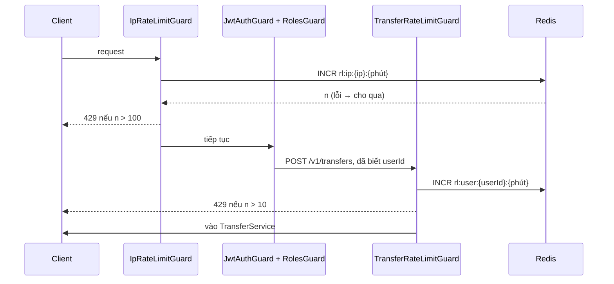

# DBS-89 · Rate limit: 10 lệnh chuyển/phút/khách và 100 yêu cầu/phút/IP bằng Redis

> **Status:** Implemented · **Vai:** Dev · **Nhánh:** `feat/DBS-89-rate-limit` · **PR:** — · **Cập nhật:** 2026-11-08
>
> Techlead waiver: G1–G4 do agent tự duyệt theo yêu cầu của techlead (`huyasuo1109@gmail.com`); không có Dev khác review trước merge; không có ảnh PNG, bằng chứng là output thô; domain review do chính agent làm, không dùng subagent (§6).

## 1. Bối cảnh

- **Task trên board:** Story, Tuần 3, Dev, ưu tiên High, Demo 4. **Expect:** «Chặn lạm dụng mà không biến Redis thành điểm chết duy nhất.»
- **DoD:**
  1. Giới hạn theo user (lệnh chuyển) và theo IP (mọi yêu cầu) qua adapter Redis; vượt → 429 + `RATE_LIMITED` + `Retry-After`.
  2. Redis chết hoặc chậm → fail-open, có test cho cả hai và metric `redis_fallback_total` tăng.
  3. `TRUST_PROXY_HOPS` xác định IP đúng khi sau ALB.
  4. Test e2e (Testcontainers) vượt/không vượt giới hạn.
  5. PR đã merge vào main (CI xanh); Dev review; bảng «Đối chiếu test case» trong PR điền đủ.
  - Board 11/10: giá trị đã chốt ở docs/02 §4, docs/03 §9–14, ADR-12: 10 lệnh chuyển/phút/khách, 100 yêu cầu/phút/IP; Redis chậm/chết thì fail-open.
- **Phụ thuộc:** DBS-76 (`libs/redis`: timeout 50 ms, circuit breaker, `RedisUnavailableError`, `redis_fallback_total`) và DBS-51 (`@Roles`, `CurrentUser`) đã vào `main`.
- **Đã có gì:** `RedisClient.incr(key, ttl)` (Lua `INCR` + `EXPIRE`); `limitsConfig.rateLimit.{transfersPerMinute, requestsPerIpPerMinute}` (env `RATE_LIMIT_*`, mặc định 10/100); `TRUST_PROXY_HOPS` → `app.set('trust proxy', n)` trong `app.setup.ts`; `ErrorCode.RATE_LIMITED`; `HealthModule` đã nạp `RedisModule`. **Chưa có** guard hay logic rate limit nào (kiểm: `grep -rn "rateLimit" backend/src` chỉ thấy config).
- **Baseline `main` `f95e428`:** lint, typecheck sạch; unit 1089/1089; e2e 148/148; `test:db` 722/722.
- **Backlog:** không có hàng cùng module/DoD ngoài BL-176.
- **Ngoài phạm vi:** WAF (tuần 6–8, hạ tầng); rate limit cho đăng nhập (Cognito lo); cấu hình cảnh báo CloudWatch cho `redis_fallback_total` (Platform).
- **Quyết định ở G1 (agent tự duyệt):**
  1. **Cửa sổ cố định theo phút.** Khóa `rl:{ip|user}:{id}:{phút epoch}`, `INCR` + `EXPIRE 60` (docs/03 R-1: «Counter theo cửa sổ, INCR + EXPIRE»). Lý do không dùng `RedisClient.incr` với một khóa duy nhất: `EXPIRE` chạy mỗi lần nên cửa sổ trượt mãi khi khách gửi đều đặn. Đánh đổi biết trước: cửa sổ cố định cho phép tối đa gấp đôi (cuối phút + đầu phút sau). Chấp nhận ở v1.
  2. **Hai tầng.** (a) `IpRateLimitGuard` là guard toàn cục, đăng ký **trước** `JwtAuthGuard`: đếm mọi yêu cầu theo IP kể cả chưa xác thực (đỡ tốn chi phí xác minh JWT khi bị tràn). (b) `TransferRateLimitGuard` gắn ở `POST /v1/transfers`, chạy sau JWT/Roles nên biết `userId` nội bộ; chặn trước mọi truy vấn DB.
  3. **Fail-open tuyệt đối.** Mọi lỗi từ Redis (`RedisUnavailableError`: `TIMEOUT`, `CIRCUIT_OPEN`, `UNAVAILABLE`, `COMMAND_FAILED`) hoặc lỗi bất ngờ trong bộ đếm → cho qua, ghi một dòng log cảnh báo chỉ có mã lý do (không khóa, không IP). `redis_fallback_total` đã tăng sẵn trong `RedisClient`. Redis chậm bị cắt ở 50 ms nên mỗi yêu cầu chỉ chậm thêm tối đa ~50 ms; breaker mở thì không chậm thêm.
  4. **IP lấy từ `request.ip`** (Express, theo `TRUST_PROXY_HOPS`); bỏ tiền tố `::ffff:`; `hops = 0` thì bỏ qua `X-Forwarded-For` (không giả mạo được). Khóa Redis chứa IP, TTL 60 giây; IP đã nằm trong log ALB nên không thêm dữ liệu mới, nhưng ghi ở §6.
  5. **Bỏ qua health.** `HealthController` gắn `@SkipRateLimit()`: ALB và probe gọi dày từ ít IP.
  6. **429** là `HttpException` với `errorCode: RATE_LIMITED`, `Retry-After` = số giây đến hết cửa sổ (1–60), qua `ProblemDetailsFilter` (RFC 7807). Yêu cầu bị chặn vẫn tăng bộ đếm.
  7. Thêm counter `rate_limited_total{scope}` (docs/03 §15 liệt kê «số request bị rate limit»). Không đổi schema, `ErrorCode`, env, event.

## 2. Hành vi

| Tầng | Khóa | Giới hạn mặc định | Áp cho |
|---|---|---|---|
| IP | `rl:ip:{ip}:{phút}` | 100 yêu cầu / phút | mọi route trừ `/health/*` (kể cả 401) |
| User | `rl:user:{users.id}:{phút}` | 10 yêu cầu / phút | `POST /v1/transfers` (kể cả phát lại cùng `Idempotency-Key`) |

- Yêu cầu thứ `limit` còn qua; thứ `limit + 1` trong cùng phút → `429`:

```json
{ "type": "about:blank", "title": "Too Many Requests", "status": 429, "detail": "Too many requests", "errorCode": "RATE_LIMITED", "correlationId": "…" }
```

  kèm header `Retry-After: 37` (giây đến hết phút). Sang phút kế tiếp bộ đếm mới bắt đầu.
- Lệnh chuyển bị chặn **không** tạo `transfers`, `idempotency_keys`, `audit_log` hay sự kiện (chặn trước DB).
- Redis chết / chậm / breaker mở → yêu cầu đi tiếp như không có giới hạn; `redis_fallback_total` tăng; Redis phục hồi thì giới hạn có hiệu lực lại ngay.
- Khách A bị chặn không ảnh hưởng khách B; IP X bị chặn không ảnh hưởng IP Y (khi `TRUST_PROXY_HOPS = 1`, IP là địa chỉ ngoài cùng bên phải của `X-Forwarded-For`, tức địa chỉ ALB thấy).

## 3. Kiến trúc

- **Vị trí:** `src/common/rate-limit/` (dùng bởi mọi module HTTP): `rate-limiter.ts` (`RateLimiter`), `rate-limit.metrics.ts`, `ip-rate-limit.guard.ts`, `transfer-rate-limit.guard.ts`, `skip-rate-limit.decorator.ts`, `rate-limit.module.ts` (`@Global`, nhập `RedisModule`), `client-ip.ts`. Sửa: `app.module.ts` (đăng ký `IpRateLimitGuard` trước `JwtAuthGuard` và nạp `RateLimitModule` khi `runsHttp()`), `health.controller.ts` (`@SkipRateLimit()`), `transfers.controller.ts` (`@UseGuards(TransferRateLimitGuard)` ở `POST`), `docs`.
- **Interface:**

```ts
class RateLimiter {
  /** Cho qua khi Redis lỗi. retryAfterSeconds luôn 1..60. */
  hit(scope: 'ip' | 'user', id: string, limit: number): Promise<{ allowed: boolean; retryAfterSeconds: number }>;
}
```

  Người gọi: hai guard. Dùng `RedisClient.incr`, `Clock` (`@common/clock`, DBS-84) cho mốc phút, `limitsConfig` đọc lúc gọi.
- **Dữ liệu:** chỉ Redis, không chạm PostgreSQL. Khóa có TTL 60 s.
- **Sơ đồ:**



- **Thay đổi cấp hệ thống:** docs/03 §9 (R-1: khóa, cửa sổ, thứ tự guard, `rate_limited_total`), §7 (`POST /v1/transfers` có thể 429), README `libs/redis` hoặc `common`.

## 4. Test cases tự động

Unit không cần Redis; e2e dùng Valkey + PostgreSQL 17 thật (Testcontainers) và proxy trễ có sẵn.

| ID | Truy vết | Lớp | Given · When · Then | Mã |
|---|---|---|---|---|
| TC-89-01 | DoD #1 | unit | `RateLimiter` với `RedisClient` giả: `limit` lần đầu cho qua, `limit + 1` bị chặn; khóa đúng dạng; cùng id khác phút → đếm lại; khác id/scope → độc lập | — |
| TC-89-02 | DoD #1 | unit | `retryAfterSeconds` bằng số giây đến hết phút (ví dụ 00:00:23.4 → 37; 00:00:59.9 → 1; 00:00:00.0 → 60) | — |
| TC-89-03 | DoD #2 | unit | `RedisUnavailableError` (cả bốn lý do) và lỗi bất ngờ → cho qua, không ném, log không chứa khóa/IP | — |
| TC-89-04 | DoD #3 | unit | `clientIp`: bỏ `::ffff:`, thiếu `ip` thì dùng địa chỉ socket | — |
| TC-89-05 | DoD #1 | e2e Valkey | IP: giới hạn 5; 5 yêu cầu qua, thứ 6 → 429 `RATE_LIMITED` + `Retry-After` 1..60, `application/problem+json`; đường dẫn không tồn tại (404) và 401 cũng được đếm | 429 |
| TC-89-06 | DoD #1 | e2e Valkey + PG | User: giới hạn 3; 3 lệnh chuyển thật `201`, lệnh thứ 4 → 429, **không** thêm dòng `transfers`/`idempotency_keys`/`audit_log`; khách khác vẫn chuyển được; đổi `Clock` sang phút kế → `201` | 429 / 201 |
| TC-89-07 | DoD #1 | e2e Valkey | `/health/live`, `/health/ready` không bị đếm (gọi 10 lần với giới hạn 5 vẫn 200) | 200 |
| TC-89-08 | DoD #3 | e2e Valkey | `TRUST_PROXY_HOPS = 0`: `X-Forwarded-For` thay đổi không tránh được giới hạn; `= 1`: hai IP khác nhau ở phần ngoài cùng bên phải có bộ đếm riêng, phần giả mạo bên trái không tách bộ đếm | 429 / 200 |
| TC-89-09 | DoD #2 | e2e Valkey | Redis **chết** (dừng container): yêu cầu vượt giới hạn vẫn qua, `redis_fallback_total` tăng; `/health/ready` degraded; lệnh chuyển `201` | 200 / 201 |
| TC-89-10 | DoD #2 | e2e Valkey | Redis **chậm** (proxy trễ 250 ms > timeout 50 ms): yêu cầu qua, `redis_fallback_total` tăng, mỗi yêu cầu chậm không quá ~1 giây | 200 |
| TC-89-11 | DoD #2 | e2e Valkey | Redis phục hồi: giới hạn lại có hiệu lực (sau khi breaker đóng) | 429 |
| TC-89-12 | thêm | e2e | `rate_limited_total{scope}` tăng đúng khi chặn; Swagger `POST /v1/transfers` có 429 | — |
| TC-89-13 | thêm | unit | Mọi route HTTP trong `src/` chịu giới hạn IP: kiểm cấu hình `AppModule` có `IpRateLimitGuard` đứng trước `JwtAuthGuard` | — |
| Quy trình | DoD #5 | — | Merge, CI, Dev review | waiver |

## 5. Test thủ công

`node backend/scripts/manual-dbs89.cjs` (Docker, Node 24): app thật, JWT thật, PostgreSQL 17 và Valkey 8 thật; giới hạn IP hạ xuống 8, giới hạn lệnh chuyển giữ nguyên 10 để thấy đúng giá trị mặc định.

| Bước | Việc làm | Kết quả mong đợi |
|---|---|---|
| M-89-01 | Nạp 10.000.000đ cho Vũ Thị Giang; Giang chuyển 10 lệnh 1.000đ cho Bùi Văn Hải | 10 × `201` |
| M-89-02 | Lệnh thứ 11 | `429 RATE_LIMITED`, `Retry-After` 1..60; không thêm `transfers` |
| M-89-03 | Khách Trần Thu Hà chuyển 1.000đ trong cùng phút | `201` |
| M-89-04 | 10 yêu cầu `GET /v1/accounts` cùng IP (giới hạn IP 8, đã dùng một phần ở các bước trên) | những yêu cầu vượt → `429`; `/health/live` luôn `200` |
| M-89-05 | Dừng Valkey; lặp lại một lệnh chuyển và 10 yêu cầu | không `429`, `201`/`200`; `redis_fallback_total` tăng |
| M-89-06 | Bật lại Valkey; đợi breaker đóng | giới hạn lại có hiệu lực |
| cleanup | Dọn | `DBS-89 cleanup PASS` |

## 6. Domain review (AI)

**Reviewer:** chính agent (Sonnet 5.5), 2026-11-08; đọc docs/03 §9 (R-1, fail-open), §13 (WAF), ADR-12, NFR-SEC-05, `libs/redis`, `app.setup.ts`, `jwt-auth.guard.ts`. Không dùng subagent.

| # | Mức | Phát hiện | Xử lý |
|---|---|---|---|
| 1 | blocking | `RedisClient.incr` đặt lại `EXPIRE` mỗi lần: dùng một khóa cố định thì cửa sổ trượt vô hạn, khách đều đặn 1 yêu cầu/10 giây sẽ bị chặn dù chỉ 6/phút | Khóa theo phút (quyết định 1); TC-89-01 |
| 2 | should-fix | Guard IP chạy sau JWT thì lũ yêu cầu không token vẫn tốn xác minh JWKS | Đăng ký trước `JwtAuthGuard` (quyết định 2); TC-89-13 |
| 3 | should-fix | `TRUST_PROXY_HOPS` sai làm mọi khách chung một IP (ALB) hoặc cho phép giả mạo IP | Dùng `request.ip` của Express; TC-89-08 |
| 4 | should-fix | Health bị đếm: ALB khóa chính nó | `@SkipRateLimit()`; TC-89-07 |
| 5 | should-fix | Một lỗi bất ngờ trong bộ đếm không được thành 500 | Bắt mọi lỗi, cho qua; TC-89-03 |
| 6 | minor | Khóa chứa IP (dữ liệu cá nhân nhẹ) vào Redis | TTL 60 s; IP đã có ở log ALB; ghi nhận, không băm vì cần debug được |
| 7 | minor | Cửa sổ cố định cho phép ~gấp đôi quanh ranh giới phút | Chấp nhận ở v1 (quyết định 1); WAF 1.000/5 phút ở biên bổ sung |
| 8 | minor | Phát lại cùng `Idempotency-Key` cũng đếm | Đúng ý: chống lạm dụng, không phân biệt |

Không có phát hiện blocking còn mở. Verdict tự đánh giá: APPROVE.

## 7. Kế hoạch triển khai

| Bước | File | Test viết trước | Kết quả đỏ | Lệnh chứng minh | Commit |
|---|---|---|---|---|---|
| 1 | `common/rate-limit/{client-ip,rate-limiter,rate-limit.metrics}.ts` + `.spec.ts` | TC-89-01..04 | điền khi chạy | `npm test -- rate-limit` | `feat(rate-limit): fixed-window counters over Redis that fail open (DBS-89)` |
| 2 | guards, decorator, `rate-limit.module.ts`, `app.module.ts`, `health.controller.ts`, `transfers.controller.ts`, `test/support/deposit-app.ts`, `test/support/rate-limit-stack.ts`, `test/services/rate-limit.services-spec.ts`, `.github/workflows/ci.yml` | TC-89-05..13 | điền khi chạy | `npm run test:services -- --runInBand --runTestsByPath test/services/rate-limit.services-spec.ts` | `feat(rate-limit): per-IP and per-customer limits with 429 and Retry-After (DBS-89)` |
| 3 | `scripts/manual-dbs89.cjs` | M-89-01..06 | — | `node backend/scripts/manual-dbs89.cjs` | `test(rate-limit): DBS-89 manual driver` |
| 4 | docs/03 §9/§7, README, doc này, index, BACKLOG | — | — | `check-doc-links.mjs` | `docs(rate-limit): record DBS-89 evidence` |

Rủi ro: guard toàn cục chặn nhầm (health đã loại; test 404/401 đếm); Redis lỗi không được làm hỏng API (TC-89-09/10). `app-guard.e2e-spec` nạp `AppModule` thật không có Redis: kỳ vọng fail-open tức thì (`enableOfflineQueue: false`). Lùi: `git revert`, không migration. Đột biến: fail-closed khi Redis lỗi (TC-89-09/10 hỏng); khóa không theo phút (TC-89-01 hỏng); đăng ký guard IP sau JWT (TC-89-13 hỏng); bỏ `@SkipRateLimit()` (TC-89-07 hỏng).

**Quyết định ở G3 (agent tự duyệt):** theo bảng trên.

## 8. Kết quả

- **Lệnh kiểm tra** (Node 24.22.2, `backend/`, commit code cuối `5f4bb13`; SHA ở dòng đầu `manual-test.txt`; sau đó chỉ sửa test `roles-app.e2e-spec.ts` và tài liệu):

| Lệnh | Kết quả |
|---|---|
| `npm run lint:check`, `typecheck`, `build` | đạt (mã thoát 0) |
| `npm test -- --runInBand` | **1111/1111**, 69 suite (+22 ca `rate-limiter.spec.ts`) |
| `npm run test:e2e -- --runInBand` (Postgres 17 tạm qua `DATABASE_URL`) | lần đầu **151/152**: `roles-app.e2e-spec.ts` TC-51-14 hỏng (xem Lệch); sau khi sửa, file đó **7/7**, toàn bộ 152/152 (+4 ca `rate-limit-wiring.e2e-spec.ts`) |
| `npm run test:db -- --runInBand` | **722/722**, 42 suite (không đổi: `startDepositApp` mặc định không nạp rate limit) |
| `npm run test:services` (`rate-limit` + `health-readiness`) | **13/13**, 2 suite (9 ca mới + 4 ca DBS-78) |
| `node scripts/manual-dbs89.cjs` | 5/5 bước + dọn dẹp đạt |

  0 test bị `.skip/.only/.todo`.

- **Đối chiếu test case:**

| ID | Test | Đạt? |
|---|---|---|
| TC-89-01 | `rate-limiter.spec.ts` › `TC-89-01` (5 ca: qua tới `limit`, chặn `limit + 1`, id/scope/phút độc lập, TTL 60, lệnh bị chặn vẫn đếm, không đều trong phút) | đạt |
| TC-89-02 | `TC-89-02` (6 mốc + quét 0..59,9 s: luôn 1..60) | đạt |
| TC-89-03 | `TC-89-03` (5 lý do `RedisUnavailableError`, lỗi bất ngờ, giá trị không phải `Error`, log chỉ có mã lý do, chỉ lần chặn mới đếm `rate_limited_total`). **Đột biến:** ném lại lỗi (fail-closed) → hỏng | đạt |
| TC-89-04 | `TC-89-04` (`clientIp`: bỏ `::ffff:`, rơi về socket, `unknown`) | đạt |
| TC-89-05 | `rate-limit.services-spec.ts` › `TC-89-05` (giới hạn 5: 4 yêu cầu 401 và 1 yêu cầu 404 vẫn đếm, thứ 6 → 429 `application/problem+json`, `Retry-After: 40`, sang phút kế → 401) | đạt |
| TC-89-06 | `TC-89-06` (3 lệnh `201`, lệnh 4 → 429; phát lại key cũ cũng 429; `transfers`/`idempotency_keys`/`audit_log`/`outbox_events` không đổi; khách khác `201`; phút kế `201`) | đạt |
| TC-89-07 | `TC-89-07` (`/health/live` × 10 và `/health/ready` không đếm). **Đột biến:** bỏ loại trừ health → hỏng | đạt |
| TC-89-08 | `TC-89-08` ×2 (hops=0: `X-Forwarded-For` giả không tránh được; hops=1: đếm theo địa chỉ ngoài cùng bên phải, phần giả mạo bên trái và `::ffff:` cùng một bộ đếm, client khác có bộ đếm riêng). **Đột biến:** bỏ `request.ip` → ca hops=1 hỏng | đạt |
| TC-89-09 | `TC-89-09` (dừng container Valkey: 3 yêu cầu và 3 lệnh chuyển với giới hạn 1 vẫn qua, `redis_fallback_total` tăng, `/health/ready` degraded). **Đột biến:** fail-closed → hỏng | đạt |
| TC-89-10 | `TC-89-10` (proxy trễ 250 ms > timeout 50 ms, giới hạn 1: 3 yêu cầu đều 401, mỗi yêu cầu < 1,5 s, metric tăng). **Đột biến:** fail-closed → hỏng | đạt |
| TC-89-11 | `TC-89-11` (sau khi hết trễ, giới hạn có hiệu lực lại trong ≤ 20 s, breaker `closed`) | đạt |
| TC-89-12 | `TC-89-12` (Swagger `POST /v1/transfers` có 429) và `rate_limited_total` đếm đúng ở TC-89-05 | đạt |
| TC-89-13 | `rate-limit-wiring.e2e-spec.ts` (guard toàn cục đúng thứ tự JWT, Roles, TransferRateLimit; `RateLimitModule` có ở api và không ở worker; chỉ `transfer` mang `@LimitTransfers()`) | đơn giản hóa: chứng minh bằng metadata của `AppModule` thay vì quan sát thứ tự thực thi, vì tầng IP là middleware chứ không còn là guard |
| Quy trình | DoD #5 | chưa làm: Dev review (BL-176) |

  12 ca/nhóm đạt đủ độ sâu, 1 đơn giản hóa (TC-89-13, lý do ở bảng).

- **Test thủ công** (output thô [manual-test.txt](screenshots/DBS-89/manual-test.txt)):

| Bước | Kết quả thật | Kết quả |
|---|---|---|
| M-89-01 | Giang nạp 10.000.000đ, 10 lệnh 1.000đ cho Hải trong một phút: 10 × 201 | đạt |
| M-89-02 | Lệnh 11: 429 `RATE_LIMITED`, `Retry-After: 60`, `transfers` và `audit_log` không đổi | đạt |
| M-89-03 | Trần Thu Hà chuyển cùng phút: 201 | đạt |
| M-89-04 | Giới hạn IP 20: 20 yêu cầu không token đầu → 401, yêu cầu thứ **21** → 429; 10 × `/health/live` đều 200 | đạt |
| M-89-05 | Dừng Valkey: 30 yêu cầu không token đều 401 (không 429), 12 lệnh chuyển của một khách (giới hạn 10) đều 201; `redis_fallback_total` 0 → 54 | đạt |
| cleanup | App, DB tạm, container Valkey và PostgreSQL đã dọn | đạt |

  Chưa chạy bằng tay: **Redis chậm** (chỉ có trong test tự động bằng proxy trễ, TC-89-10) và **hai task API sau ALB thật** (không có hạ tầng; BL-179).

- **Phạm vi so với §7:** khác kế hoạch ở cấu trúc: tầng IP là **middleware** (`ip-rate-limit.middleware.ts`) thay cho guard `IpRateLimitGuard`, không còn `@SkipRateLimit()`; thêm `limit-transfers.decorator.ts`, `rate-limited.exception.ts`, `test/rate-limit-wiring.e2e-spec.ts`, sửa một khẳng định trong `test/roles-app.e2e-spec.ts`, thêm một bước services vào `.github/workflows/ci.yml`.
- **Ảnh chụp:** không có (waiver); bằng chứng là `manual-test.txt`.
- **Lệch so với kế hoạch (tự duyệt, nêu để lead xem):** (1) **IP là middleware, không phải guard**: phát hiện khi chạy TC-89-05 rằng guard chỉ chạy với route khớp nên yêu cầu 404 không được đếm, trái «mọi yêu cầu» của DoD. §1 quyết định 2 và §3 phía trên mô tả bản đầu (guard); bản cuối là middleware và nằm trong docs/03 §9.1. (2) `request.path` trong middleware bị Express cắt theo điểm gắn, nên health lọt vào bộ đếm lần đầu; dùng `originalUrl`. (3) TC-51-14 (`roles-app.e2e-spec.ts`) khẳng định đúng hai guard toàn cục; sửa thành ba vì đó là thay đổi có chủ đích. (4) Lần chạy services đầu hỏng vì hai test dùng chung một phút (TC-89-06 dùng `minute + 61 s` rơi vào phút của TC-89-07); đã tách phút. (5) Spec của `RateLimiter` viết trước code; spec services viết trước guard (đỏ vì chưa biên dịch). Các ca TC-89-05..11 hỏng lần đầu vì (1), (2), (4), không vì lỗi hành vi giới hạn.
- **Để lead xem kỹ:** (a) cửa sổ cố định cho phép ~gấp đôi quanh ranh giới phút (BL-179); (b) khóa Redis chứa IP khách (TTL 60 s); (c) mỗi yêu cầu khi Redis hỏng ghi một dòng `WARN` (chỉ mã lý do): có thể ồn trong log khi Redis chết lâu, cần xem lại khi đặt cảnh báo; (d) các e2e dùng `AppModule` thật chạy khi không có Redis: fail-open ngay (`enableOfflineQueue: false`), không làm chậm.
- **Bàn giao:** BL-176 (thêm PR này), **BL-179** (cảnh báo metric, đo trên ALB/staging, cửa sổ trượt nếu cần). BL-155: bỏ phần rate limit, giữ phần thu hồi phiên.

## 9. Tài liệu đã cập nhật

`docs/03_HIGH_LEVEL_ARCHITECTURE.md` (§9.1 R-1, §7 dòng `POST /v1/transfers`, phiên bản v1.12), `backend/src/libs/redis/README.md`, `docs/features/README.md`, `docs/BACKLOG.md` (thêm BL-179, sửa BL-155 bỏ phần rate limit, thêm PR vào BL-176). Không xóa dòng BL nào.
