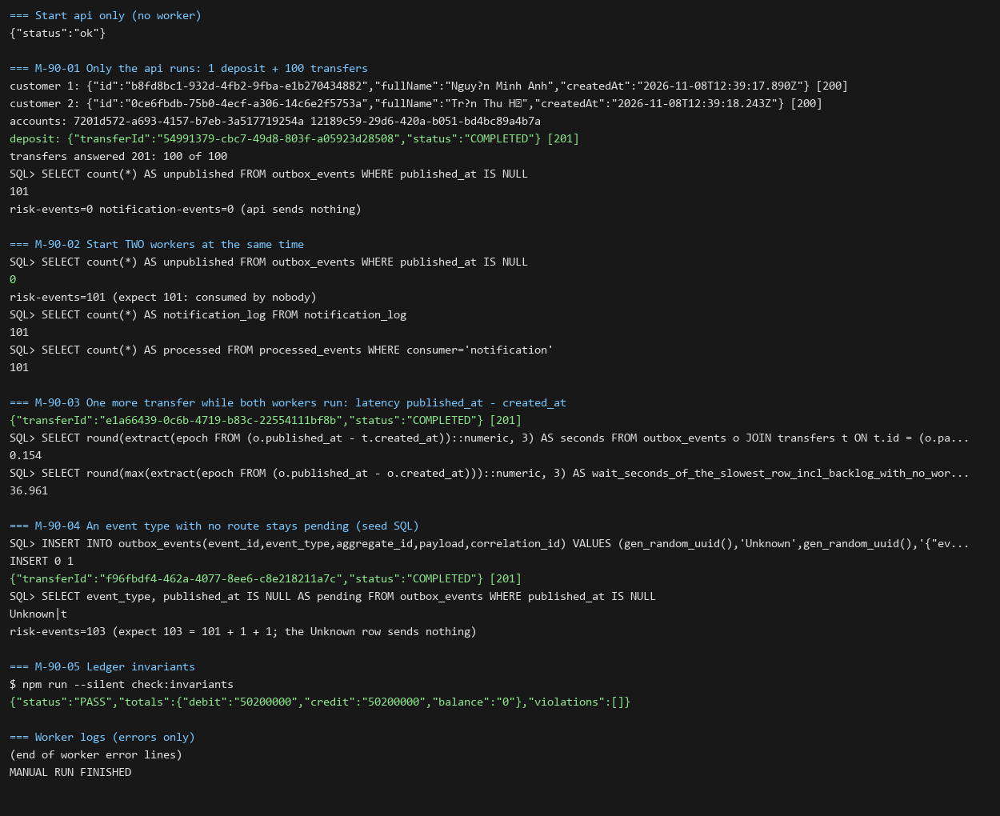

# DBS-90 · Outbox relay: lấy lô theo SKIP LOCKED, gửi theo bảng định tuyến, đánh dấu sau khi gửi

> **Status:** Implemented · **Vai:** Dev · **Nhánh:** `feat/DBS-90-outbox-relay` · **PR:** — · **Cập nhật:** 2026-11-08

> **Ghi chú quy trình:** phiên chạy bởi techlead (`Techlead waiver`, xem cuối §8). Các gate G1–G4 do agent duyệt thay theo yêu cầu của techlead; mỗi gate vẫn có tin nhắn riêng ở cuối §6, §7 và §8. Relay đã có code từ PR #65 (commit `1d75e18`); task này kiểm lại DoD bằng test và đóng các chỗ lệch.

## 1. Bối cảnh

- **Task trên board:** Story, Tuần 3, Demo/Deliverable P2, ưu tiên Highest. **Expect:** «Sự kiện đã commit chắc chắn tới đủ các queue cần nhận.»
- **DoD:**
  1. Relay chạy ở role worker: `SELECT … FOR UPDATE SKIP LOCKED` theo `outbox_unpublished_idx`, gửi mọi queue của sự kiện rồi mới set `published_at`; BEGIN/COMMIT của relay vẽ rõ trong tài liệu kiến trúc.
  2. Chu kỳ poll ≤ 1 giây; 2 worker chạy cùng lúc không gửi trùng lô (test).
  3. Chuyển tiền → đúng 1 message vào mỗi queue cần nhận (ElasticMQ trong Testcontainers).
  4. PR đã merge vào main (CI xanh); Dev review; bảng «Đối chiếu test case» trong PR điền đủ.
- **Phụ thuộc:** DBS-57 (OutboxWriter), DBS-77 (`libs/sqs`), DBS-40 (Testcontainers), DBS-61 (chuyển tiền): cả bốn đã có trên `main`.
- **Đã có gì:** `OutboxRelayService` và `OutboxRelayModule` (`backend/src/modules/outbox/`), bảng định tuyến `outbox-routing.ts`, `PollingLoop`, đăng ký ở `workerModules`, test `backend/test/services/outbox-relay.services-spec.ts` (TC-OBX-01..05, TC-NTF-01..03), sơ đồ relay ở `docs/03` §6 (dòng «Relay: BEGIN, SELECT … SKIP LOCKED») và bảng thành phần §10.
- **Baseline** (main `1b0a585`, Node 24.22.2): `lint:check` và `typecheck` đạt; unit 69 suite / 1129 test đạt; `outbox-relay.services-spec` 8/8.
- **Lệch giữa code và tài liệu tìm thấy ở G1:**

| # | Lệch | Xử lý |
|---|---|---|
| 1 | ADR-03 và `docs/03` §10 ghi **lô 100 sự kiện**, code dùng `BATCH_SIZE = 50` | đổi code sang 100 (nguồn đúng là ADR Accepted) |
| 2 | DoD 2 «chu kỳ poll ≤ 1 giây» chưa có test nào chứng minh | test relay tự chạy dưới `APP_ROLE=worker`; xuất hai hằng số để test khẳng định ≤ 1000 ms |
| 3 | DoD 3 «chuyển tiền → đúng 1 message mỗi queue»: TC-OBX-01 chèn sự kiện mẫu bằng SQL, không đi từ lệnh chuyển thật | test dùng API thật (nạp tiền + chuyển tiền) rồi relay |
| 4 | TC-OBX-02 («hai relay cùng lúc») vẫn xanh nếu hai lần chạy nối tiếp nhau; chưa có test «gửi hết rồi mới đánh dấu» | thêm test có cổng chặn trong `send` (TC-90-03, TC-90-04) |

- **Ngoài phạm vi (kèm nơi nhận):**
  - Relay chịu sự cố: kill giữa chừng, lỗi ở queue thứ hai của một sự kiện, `UPDATE`/`COMMIT` lỗi sau khi gửi, **sự kiện lỗi ở đầu hàng làm kẹt cả hàng** (`break` ở vòng gửi), giới hạn thời gian cho một lô (transaction mở qua tối đa 100 × 2 lần gọi SQS, chỉ có `idle_in_transaction_session_timeout` 60 s cắt): **DBS-91** (reviewer G2 phát hiện, chuyển sang đó).
  - Job dọn outbox 7 ngày (lô nhỏ, env): **DBS-92**.
  - Hạ tầng ECS worker, alarm tuổi outbox: BL-161, BL-051.
  - Giới hạn kích thước payload (SQS 256 KiB): BL-123 mục 2; sự kiện v1 có schema cố định, vài trăm byte.
  - `dbs_worker` có `DELETE` trên mọi dòng `outbox_events`, nên «không xóa dòng chưa gửi» chỉ do câu `WHERE` bảo vệ: **BL-180**.
- **Câu hỏi mở:** (1) Task đã được làm phần lớn ở #65 mà board ghi In Progress; đề xuất task này chốt phần còn lại (bốn chỗ lệch ở bảng trên). (2) Chuyển các lỗi sự cố sang DBS-91 như trên.
- **Quyết định ở G1** (agent duyệt thay techlead): chấp nhận cả hai đề xuất.

## 2. Hành vi

Relay chạy trong vòng lặp `PollingLoop` ở role `worker` (và `both`); role `api` không bật nó.

| # | Điều kiện | Kết quả |
|---|---|---|
| 2.1 | Có dòng `outbox_events` với `published_at IS NULL` và `event_type` có route | Một transaction: chọn tối đa **100** dòng `ORDER BY id … FOR UPDATE SKIP LOCKED`, gửi từng sự kiện tới **mọi** queue trong route, rồi `UPDATE … SET published_at = clock_timestamp()` cho các dòng đã gửi, COMMIT |
| 2.2 | `TransferCompleted` | gửi tới `risk-events` và `notification-events`, mỗi queue **một** message |
| 2.3 | `AccountStatusChanged` | chỉ `notification-events` |
| 2.4 | Lô đầy (100 dòng) | lặp ngay, không chờ |
| 2.5 | Lô chưa đầy hoặc rỗng | chờ **500 ms** rồi lặp (poll ≤ 1 giây theo `docs/03` §10) |
| 2.6 | Hai relay chạy cùng lúc | mỗi dòng chỉ một bên lấy được (`SKIP LOCKED`); tổng số gửi bằng số dòng |
| 2.7 | Một lần gửi lỗi giữa lô | hành vi hiện có, **giữ nguyên ở task này**: các sự kiện trước đó vẫn được đánh dấu đã gửi, sự kiện lỗi và phần sau ở lại đầu hàng; vòng lặp chờ 5 giây rồi thử lại. Cải tiến ở DBS-91 |
| 2.8 | Event type chưa có route | ở lại `published_at IS NULL`, không chặn các sự kiện khác (liên quan BL-010 về chính sách consumer) |

Message gửi đi: body là `payload` JSON của dòng; message attribute `eventType` và `correlationId`. Ví dụ body `TransferCompleted` (rút gọn): `{"eventId":"…","eventType":"TransferCompleted","type":"TRANSFER","transferId":"…","amount":"300000","fromBalanceBefore":"1000000",…}`. Giao hàng **at-least-once**: chết sau khi gửi, trước COMMIT thì gửi lại, cùng `eventId` (consumer chống trùng bằng `processed_events`).

## 3. Kiến trúc

- **Vị trí:** module `outbox`, role `worker`; file chính `outbox-relay.service.ts`, `outbox-routing.ts`, `outbox-relay.module.ts`; `PollingLoop` ở `common/utils/polling-loop.ts`.
- **Interface:** `OutboxRelayService.relayOnce(limit = RELAY_BATCH_SIZE): Promise<{ published: number; failure?: unknown }>`; hai hằng số mới xuất từ file service để test khẳng định NFR: `RELAY_BATCH_SIZE = 100` và `RELAY_IDLE_DELAY_MS = 500` (không xuất qua `index.ts`: TC-57-12 khóa API công khai của module; test import thẳng từ `outbox-relay.service`). `OUTBOX_ROUTES`, `SqsClient.send(queueUrl, body, attributes)` không đổi. Người gọi `relayOnce`: vòng lặp của service, `db-roles.db-spec.ts` (TC-ROLE-04), `outbox-relay.services-spec.ts`.
- **Dữ liệu:** `outbox_events` (`id bigserial`, `event_type`, `payload jsonb`, `published_at`), index `outbox_unpublished_idx ON (id) WHERE published_at IS NULL` phục vụ câu chọn. Role `dbs_worker`: `SELECT, DELETE` và `UPDATE (published_at)` (`infra/scripts/db-roles.sql`).
- **Ranh giới transaction:** đây là **ngoại lệ duy nhất** của quy tắc «không gọi SQS trong transaction» (CONTRIBUTING §5): transaction chỉ khóa hàng `outbox_events`, không đụng hàng tài khoản; `maxRetries: 0` (không dùng retry deadlock của `TransactionService`) và `idleInTransactionTimeoutMs = 60 s`. Hạn chế đã biết, xử lý ở DBS-91: không có giới hạn thời gian cho cả lô.
- **Sơ đồ:** đã có ở `docs/03` (sequence «Relay: BEGIN, SELECT … SKIP LOCKED … COMMIT»); giữ nguyên.
- **Test dựng thế nào:** `startDepositApp(db.url)` tạo `DataSource` riêng cho API; relay trong test dùng `DataSource` thứ hai của spec (hai kết nối độc lập, như hai tiến trình). Hai relay của TC-90-03 là hai instance trên hai `TransactionService` khác nhau.
- **Thay đổi cấp hệ thống:** `RELAY_BATCH_SIZE` 50 → 100 (khớp ADR-03), README outbox sửa số lô. Không đổi schema, env, `ErrorCode` hay event.

## 4. Test cases tự động

Tất cả ở `backend/test/services/outbox-relay.services-spec.ts` (PostgreSQL thật + ElasticMQ trong Testcontainers).

| ID | Truy vết | Lớp | Given · When · Then | `errorCode` |
|---|---|---|---|---|
| TC-90-01 | DoD 1 | integration | `TransferCompleted` và `AccountStatusChanged` → relay → `risk-events` nhận đúng 1 (chỉ transfer), `notification-events` nhận cả hai, dòng có `published_at` (đã có: TC-OBX-01) | — |
| TC-90-02 | DoD 1 | integration | type không route ở lại, không chặn sự kiện khác (đã có: TC-OBX-04) | — |
| TC-90-03 | DoD 2 | integration | **hai relay chồng nhau thật:** relay A bị giữ trong `send` bằng một cổng (barrier); khi A đang giữ khóa, relay B chạy trên kết nối khác và lấy các dòng **khác** với A; sau khi thả cổng, tổng 20 sự kiện, mỗi `eventId` đúng một message mỗi queue | — |
| TC-90-04 | DoD 1 | integration | **gửi hết rồi mới đánh dấu:** trong lúc relay A bị giữ ở `send` của sự kiện cuối, một phiên khác đọc thấy cả lô còn `published_at IS NULL`; sau khi thả cổng thì đều có `published_at` | — |
| TC-90-05 | DoD 2 | unit | `RELAY_IDLE_DELAY_MS ≤ 1000` và `RELAY_BATCH_SIZE = 100` | — |
| TC-90-06 | DoD 2 | integration | `APP_ROLE=worker`, `onApplicationBootstrap()`; chèn một sự kiện, **không gọi `relayOnce`** → trong 3 giây có `published_at` và 1 message ở mỗi queue cần nhận; sau `onApplicationShutdown()` chèn thêm một sự kiện → nó vẫn `published_at IS NULL` sau 1,5 giây (vòng lặp đã dừng) | — |
| TC-90-07 | DoD 2 | integration | `APP_ROLE=api` → bootstrap không bật vòng lặp (sự kiện vẫn chưa gửi sau 1,5 giây) | — |
| TC-90-08 | DoD 3 | integration (API thật) | seed khách + hai tài khoản; `POST /v1/operator/deposits` rồi `POST /v1/transfers`; relay dựng trên `DataSource` riêng. Đúng **2** `TransferCompleted` (`DEPOSIT`, `TRANSFER`); mỗi queue có đúng 1 message cho `transferId` của lệnh chuyển và 1 cho lệnh nạp; `relayOnce` lần hai gửi 0; `checkLedgerInvariants` PASS | — |
| TC-90-09 | DoD 3 | integration | lô đầy: 120 sự kiện, `relayOnce()` mặc định lấy đúng 100, lần sau 20 | — |
| Quy trình | DoD 4 | — | PR merge, CI xanh, review | — |

`APP_ROLE` được đặt và khôi phục trong `try/finally`; vòng lặp luôn `stop()` ở `finally`. `startDepositApp` không nạp `OutboxRelayModule`, nên các test bootstrap dựng `OutboxRelayService` trực tiếp.

## 5. Test thủ công

Điều kiện: Docker, từ thư mục gốc `docker compose up -d` (PostgreSQL, Valkey, ElasticMQ). Từ `backend/`: `cp env/.env.example env/.env.development`, `AUTH_MODE=local` trong file đó, `npm run auth:dev-keys`, `npm run migration:run`. Hai terminal: `npm run start:dev:api` và `npm run start:dev:worker`. Xóa sạch hai queue trước khi bắt đầu (giao diện ElasticMQ `http://localhost:9325`). Khách, tài khoản và tiền đi qua API: `POST /v1/customers/me`, `POST /v1/accounts` (hai tài khoản), `POST /v1/operator/deposits`. `AccountStatusChanged` chưa có endpoint tạo (lock/unlock chưa merge) nên chỉ được phủ bởi TC-90-01.

Cách đếm: `risk-events` không có consumer, đếm trên giao diện ElasticMQ (hoặc `aws sqs get-queue-attributes --endpoint-url http://localhost:9324`); `notification-events` do consumer thông báo của worker lấy ngay, nên đếm bằng `SELECT count(*) FROM notification_log` và `processed_events`.

| Bước | Việc làm | Kết quả mong đợi |
|---|---|---|
| M-90-01 | Dừng worker (Ctrl+C). Nạp 1 lần, chuyển 100 lần (vòng `curl`) bằng token customer | 201 mỗi lần; `SELECT count(*) FROM outbox_events WHERE published_at IS NULL` = 101; `risk-events` trống |
| M-90-02 | Bật **hai** worker cùng lúc (hai terminal, `PORT` khác nhau) | Trong vài giây không còn dòng chưa gửi; `risk-events` có đúng 101 message, mỗi `eventId` một lần; `notification_log` 101 dòng; lô 100 + 1 được chia giữa hai worker |
| M-90-03 | Một lệnh chuyển nữa khi cả hai chạy; đo `published_at - created_at` (SQL) | ≤ 1 giây |
| M-90-04 | `INSERT` bằng SQL một dòng outbox có `event_type = 'Unknown'` (seed SQL) | dòng ở lại `published_at IS NULL`, các sự kiện khác vẫn đi |
| M-90-05 | `npm run --silent check:invariants` | `PASS`, exit 0 |

Kịch bản sự cố (tắt ElasticMQ, kill worker) thuộc DBS-91.

## 6. Domain review (AI)

**Reviewer:** subagent general-purpose (model của phiên), 2026-11-08 · **Kết quả:** 12 phát hiện (blocking 0, should-fix 7, minor 5), verdict REVISE; đã sửa hoặc chuyển nơi nhận, không còn blocking · [trả lời nguyên văn](screenshots/DBS-90/domain-review.md)

| # | Mức | Phát hiện | Xử lý |
|---|---|---|---|
| 1 | should-fix | Transaction giữ qua tối đa 100 × 2 lần gọi SQS, không có hạn thời gian cho cả lô; lô 100 làm rủi ro gấp đôi | chuyển sang **DBS-91** (§1 Ngoài phạm vi) |
| 2 | should-fix | `break` ở lần gửi lỗi đầu tiên làm kẹt cả hàng; thiếu dòng BL | chuyển sang **DBS-91**; DBS-91 là nơi giải quyết và đóng việc |
| 3 | should-fix | TC-OBX-02 không chứng minh hai relay chồng nhau | đã sửa: TC-90-03 dùng cổng chặn |
| 4 | should-fix | Thiếu test «gửi hết rồi mới đánh dấu» (a); lỗi ở queue thứ hai (b) và `UPDATE` lỗi sau gửi (c) | (a) đã thêm TC-90-04; (b), (c) chuyển **DBS-91** |
| 5 | should-fix | Không đếm được `notification-events` vì consumer lấy ngay | đã sửa §5: đếm bằng `notification_log` |
| 6 | should-fix | M-90-04 vô nghĩa, thiếu biên 100/101 và đường không route | đã sửa §5; đường lỗi sang DBS-91 |
| 7 | should-fix | Kịch bản không chạy được như viết | đã sửa §5 |
| 8 | minor | Fixture `startDepositApp` không có relay; nạp + chuyển tạo 2 sự kiện | đã sửa §3, TC-90-08 |
| 9 | minor | Hằng số private; cách chứng minh vòng lặp đã dừng; `cleanupLoop` chạy ngay | đã sửa: xuất hằng số, kiểm bằng sự kiện chèn sau shutdown, `try/finally` |
| 10 | minor | Hai trích dẫn sai (NFR-FRD-01, BL-010) | đã sửa §2 |
| 11 | minor | `dbs_worker` có `DELETE` mọi dòng outbox | **BL-180** |
| 12 | minor | Thiếu BL id cho các bàn giao | đã nêu nơi nhận ở §1; **BL-180** cho DB-level delete |

**Quyết định ở G2** (agent duyệt thay techlead, 2026-11-08): duyệt thiết kế; không còn blocking.

## 7. Kế hoạch triển khai

| Bước | File | Test viết trước | Đỏ dự kiến | Lệnh chứng minh | Commit |
|---|---|---|---|---|---|
| 1 | `outbox-relay.service.ts` (xuất `RELAY_BATCH_SIZE`, `RELAY_IDLE_DELAY_MS`, đổi lô 50 → 100), `outbox-relay.services-spec.ts` | TC-90-05, TC-90-09 | `RELAY_BATCH_SIZE` chưa xuất; lô mặc định lấy 50 chứ không phải 100 | `npm run test:services -- --runInBand --runTestsByPath test/services/outbox-relay.services-spec.ts` | `fix(outbox): take 100 events per relay batch as ADR-03 says (DBS-90)` |
| 2 | spec | TC-90-03, TC-90-04 (cổng chặn trong `send`) | không đỏ ngay vì hành vi đã đúng; chứng minh có giá trị bằng **đột biến**: bỏ `SKIP LOCKED` làm TC-90-03 đỏ, đổi thứ tự (đánh dấu trước khi gửi) làm TC-90-04 đỏ; khôi phục | cùng lệnh | `test(outbox): prove two relays overlap and send precedes mark (DBS-90)` |
| 3 | spec (+ import `startDepositApp`) | TC-90-06, TC-90-07, TC-90-08 | không đỏ ngay (hành vi có sẵn); đột biến: bỏ `runsWorkers()` làm TC-90-07 đỏ | cùng lệnh | `test(outbox): relay runs by itself in the worker role and carries a real transfer (DBS-90)` |
| 4 | `backend/src/modules/outbox/README.md`, `docs/BACKLOG.md` (BL-180), `docs/features/README.md`, feature doc §8–§9, `manual-test.txt`, ảnh | — | — | `node .claude/skills/dbs-delivering-task/scripts/check-doc-links.mjs` | `docs(outbox): record DBS-90 evidence and hand-offs` |

**Rà soát DoD và giới hạn:** DoD 1 → TC-90-01, 02, 04; DoD 2 → TC-90-03, 05, 06, 07; DoD 3 → TC-90-08, 09; DoD 4 quy trình. Mọi chỗ lệch nêu ở §1 có hàng trong bảng; không có file nào ngoài bảng. **Rủi ro và cách lùi:** đổi lô 50 → 100 làm transaction của relay giữ lâu hơn (xử lý ở DBS-91); lùi bằng `git revert` bước 1. **Quyết định ở G3** (agent duyệt thay techlead, 2026-11-08): duyệt kế hoạch. Trạng thái → Plan approved.

## 8. Kết quả

- **Lệnh kiểm tra** (Node 24.22.2, PostgreSQL 17 và ElasticMQ thật):

```text
npm run lint:check && npm run typecheck && npm run format:check && npm run build   -> đạt
npm test                                         Test Suites: 69 passed | Tests: 1129 passed
npm run test:services (outbox-relay)             Tests: 15 passed, 15 total (trước task: 8)
npm run test:db (db-roles)                       Tests: 4 passed, 4 total
npm run test:e2e                                 Test Suites: 15 passed | Tests: 153 passed
node .claude/skills/dbs-delivering-task/scripts/check-doc-links.mjs   -> 0 link hỏng
```

  Không có `.skip`, `.only`, `.todo`.

- **Đối chiếu test case:**

| ID | Test (`test/services/outbox-relay.services-spec.ts`) | Đạt? |
|---|---|---|
| TC-90-01 | `TC-OBX-01 routes each event to every queue…` | đạt |
| TC-90-02 | `TC-OBX-04 an event type without a route stays pending…` | đạt |
| TC-90-03 | `TC-90-03 two relays really overlap…`. Đột biến: bỏ `SKIP LOCKED` → đỏ (`lock timeout`); đã khôi phục | đạt |
| TC-90-04 | `TC-90-04 messages are sent before any row is visible as published` | đạt (chứng minh không có dòng nào hiện là đã gửi khi 5 message đã ra; không tách được «UPDATE trước hay sau» trong cùng transaction vì chưa COMMIT thì phiên khác không thấy, nên đây là bằng chứng về thứ tự gửi và COMMIT) |
| TC-90-05 | `TC-90-05 the poll interval is within one second…` | đạt |
| TC-90-06 | `TC-90-06 in the worker role the relay runs by itself…` | đạt |
| TC-90-07 | `TC-90-07 in the api role the relay does not run`. Đột biến: bỏ `runsWorkers()` → đỏ; đã khôi phục | đạt |
| TC-90-08 | `TC-90-08 a real deposit and transfer reach each queue exactly once` | đạt |
| TC-90-09 | `TC-90-09 a full batch is 100 events…` | đạt |
| Quy trình | DoD 4 | chờ PR |

  9/9 case đạt đủ độ sâu, 0 đơn giản hóa (ghi chú ở TC-90-04 là giới hạn của kỹ thuật, không phải rút gọn).

- **Test thủ công** (api + **hai** worker là tiến trình `node dist/main.js` thật, PostgreSQL 17 và ElasticMQ của docker compose; chạy trên commit `0f3d249`, SHA ở dòng đầu [manual-test.txt](screenshots/DBS-90/manual-test.txt)):

| Bước | Phản hồi thật (rút gọn) | Kết quả |
|---|---|---|
| M-90-01 | nạp 201; 100 lệnh chuyển: `transfers answered 201: 100 of 100`; `unpublished = 101`; `risk-events=0 notification-events=0` | đạt |
| M-90-02 | bật hai worker: `unpublished = 0`; `risk-events=101`; `notification_log = 101`; `processed_events = 101` | đạt |
| M-90-03 | lệnh thứ 101: `published_at − created_at = 0,154 s` (lần chạy trước 0,289 s); dòng chờ lâu nhất 36,9 s chính là số tồn đọng lúc chưa có worker | đạt |
| M-90-04 | dòng `Unknown` (seed SQL) ở lại `pending = t`, lệnh chuyển kế tiếp vẫn đi: `risk-events=103` (101 + 1 + 1) | đạt |
| M-90-05 | `{"status":"PASS",…,"violations":[]}` | đạt |

  Lưu ý môi trường: tên khách tiếng Việt qua `curl` trên Windows bị hỏng ký tự trong output (`Nguy?n`); không liên quan DBS-90. Lần chạy đầu thất bại vì cấu hình của chính script (`LOG_LEVEL=info` không hợp lệ, worker không khởi động); đã sửa và chạy lại từ database mới; file chỉ chứa lần chạy cuối. Chưa chạy: kịch bản sự cố (tắt ElasticMQ, kill worker) thuộc DBS-91.

- **Phạm vi so với §7:** `git diff --stat main...HEAD` gồm `outbox-relay.service.ts`, `outbox-relay.services-spec.ts`, README outbox, BACKLOG, features README, feature doc và thư mục `screenshots/DBS-90/`; không có file ngoài kế hoạch.
- **Ảnh chụp:** ảnh dựng từ output thật của lần chạy cuối (không phải chụp màn hình terminal):



- **Lệch so với kế hoạch:** (1) `RELAY_*` không xuất qua `index.ts` như lúc đầu định xuất, vì TC-57-12 khóa API công khai; test import thẳng từ file service. Không đổi phạm vi. (2) TC-90-04 chứng minh thứ tự gửi–COMMIT chứ không thể phân biệt thứ tự UPDATE trong transaction (giải thích ở bảng trên).
- **Bàn giao:** DBS-91 nhận các ca sự cố (lỗi ở queue thứ hai, `UPDATE`/`COMMIT` lỗi sau khi gửi, sự kiện lỗi ở đầu hàng, giới hạn thời gian của lô); **BL-180** (DB-level bảo vệ «không xóa dòng chưa gửi»).

## 9. Tài liệu đã cập nhật

- `backend/src/modules/outbox/README.md`: lô 100 sự kiện.
- `docs/BACKLOG.md`: thêm **BL-180**.
- `docs/features/README.md`: dòng DBS-90.
- Không đổi ADR, `_shared`, env, `ErrorCode`, event, schema.

**Quyết định ở G4** (agent duyệt thay techlead, 2026-11-08): duyệt bàn giao; không có bước «chưa chạy» ngoài kịch bản sự cố đã chuyển sang DBS-91. Ảnh là ảnh dựng từ output thật, được chấp nhận thay cho ảnh chụp màn hình.
