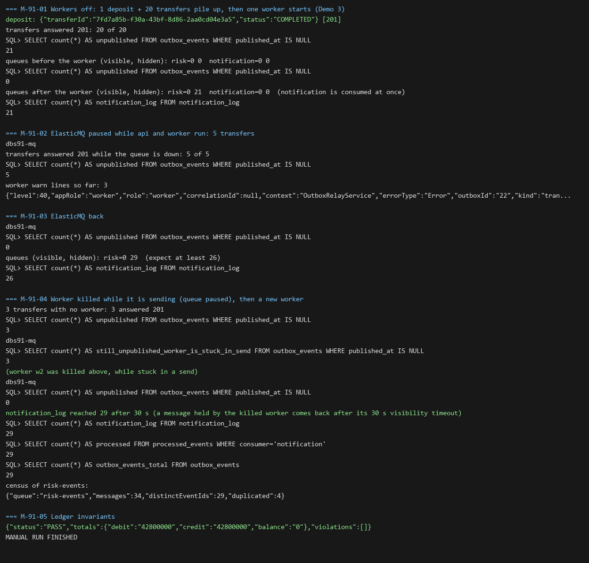

# DBS-91 · Relay chịu sự cố: chết giữa chừng thì gửi bù, không mất sự kiện

> **Status:** Implemented · **Vai:** Dev · **Nhánh:** `feat/DBS-91-relay-fault-tolerance` · **PR:** — · **Cập nhật:** 2026-11-08

> **Ghi chú quy trình:** phiên chạy bởi techlead (`Techlead waiver`). Các gate do agent duyệt thay theo yêu cầu của techlead; mỗi gate có đoạn «Quyết định» riêng ở §1, §6, §7 và §8.

## 1. Bối cảnh

- **Task trên board:** Task, Tuần 3, Demo 3, ưu tiên High. **Expect:** «Tắt hay kill relay không làm mất sự kiện; trùng được consumer chống.»
- **DoD:**
  1. Test: kill relay sau khi gửi và trước khi set `published_at` → bật lại gửi bù (trùng message, cùng `eventId`).
  2. Test: kill relay trước khi gửi → bật lại gửi đủ.
  3. Tắt cả worker, chuyển tiền N lần, bật lại → N sự kiện tới đủ queue.
  4. Ghi lại kết quả cho Demo 3.
  5. PR đã merge vào main (CI xanh); Dev review; bảng «Đối chiếu test case» trong PR điền đủ.
- **Phụ thuộc:** DBS-90 (relay, lô 100, test chồng nhau): đã merge (#91, `b7924dd`).
- **Đã có gì:** `OutboxRelayService.relayOnce` (một transaction, `SKIP LOCKED`, gửi từng sự kiện tới mọi queue của nó rồi `UPDATE published_at`), TC-OBX-03 (lỗi gửi giữa lô: dừng ngay tại sự kiện lỗi), `NotificationConsumer` chống trùng bằng `processed_events`.
- **Baseline** (`main` `b7924dd`, Node 24.22.2): lint, typecheck đạt; unit 1129/1129; `outbox-relay.services-spec` 15/15.
- **Lỗ hổng tìm thấy ở G1** (một phần từ domain review của DBS-90):

| # | Lỗ hổng | Hệ quả |
|---|---|---|
| 1 | Chưa có test nào giết relay thật (DoD 1, 2, 3) | chưa chứng minh «không mất sự kiện» |
| 2 | Vòng gửi `break` ngay ở lần lỗi đầu tiên | **một sự kiện lỗi tất định ở đầu hàng chặn mọi sự kiện sau nó**; mỗi lần poll lại thử đúng sự kiện đó (kèm chờ 5 giây) |
| 3 | Không có giới hạn thời gian cho cả lô: transaction giữ qua tối đa 100 × 2 lần gọi SQS, SDK không timeout; chỉ `idle_in_transaction_session_timeout` 60 s cắt | SQS chậm → PostgreSQL đóng phiên, `UPDATE`/`COMMIT` lỗi, cả lô gửi lại, relay không tiến |
| 4 | Chưa có test cho lỗi ở queue thứ hai của một sự kiện, cho `UPDATE`/`COMMIT` lỗi sau khi gửi, cho tắt êm (SIGTERM) giữa lô | hành vi at-least-once chỉ nằm trong tài liệu |

- **Ngoài phạm vi (kèm nơi nhận):**
  - Dọn outbox: DBS-92. Consumer risk và **chống trùng ở `risk-events`: DBS-111** (hiện chỉ consumer thông báo có `processed_events`; các bản trùng ở §2 đi vào `risk-events` chưa ai xử lý).
  - Hàng chờ cách ly bền vững cho sự kiện lỗi vĩnh viễn (cần cột/bảng mới): **BL-181**. Task này chỉ làm «gạt tạm trong bộ nhớ» (§2.4).
  - `stopTimeout` của ECS service worker (mặc định 30 s) và ngưỡng alarm tuổi outbox so với thời gian lô tối đa: **BL-182** (nối BL-161, BL-051).
  - Giới hạn kích thước payload (BL-123 mục 2); `dbs_worker` xóa được dòng chưa gửi (BL-180).
- **Câu hỏi mở:** (1) Phân loại lỗi gửi thành tạm thời và vĩnh viễn: đề xuất làm (§2.4), vì «dừng sau 3 lỗi liên tiếp» một mình không gỡ được kẹt đầu hàng. (2) Tham số `timeoutMs` tùy chọn cho `SqsClient.send` (không đổi hành vi hiện có, không đụng long polling): đề xuất làm. (3) Ngân sách lô 15 s (không 20 s) để cận trên 25 s < `stopTimeout` mặc định 30 s: đề xuất làm.
- **Quyết định ở G1** (agent duyệt thay techlead): chấp nhận cả ba.

## 2. Hành vi

Hằng số mới trong `outbox-relay.service.ts`: `RELAY_BATCH_BUDGET_MS = 15 000`, `RELAY_SEND_TIMEOUT_MS = 5 000`, `RELAY_MAX_TRANSIENT_FAILURES = 3`, `RELAY_PARK_BASE_MS = 30 000` (gấp đôi mỗi lần, tối đa 10 phút). `relayOnce(limit = RELAY_BATCH_SIZE, options: { budgetMs?, sendTimeoutMs?, now? } = {})` trả `{ published, failure?, truncated? }`; `failure` và `truncated` **chỉ có mặt khi có giá trị** (không bao giờ `false`/`undefined` tường minh), để các test `toEqual({ published: n })` hiện có vẫn đúng. `failure` là lỗi **cuối cùng** của lô.

| # | Tình huống | Kết quả |
|---|---|---|
| 2.1 | Tiến trình relay bị **kill (SIGKILL) sau khi đã gửi mọi message của lô, trước `UPDATE`/`COMMIT`** | Khi PostgreSQL nhận ra kết nối đã đóng (ngay khi hệ điều hành đóng socket của tiến trình chết; nếu máy hoặc mạng mất thì chậm nhất `idle_in_transaction_session_timeout` 60 s, lúc đó các worker khác chỉ thấy dòng bị khóa và bỏ qua), transaction bị hủy, dòng vẫn `published_at IS NULL`. Relay bật lại gửi **lại** cả lô: queue có **hai bản** của mỗi sự kiện, cùng `eventId`, cùng nội dung. Consumer thông báo chống trùng bằng `processed_events`; `risk-events` chưa có consumer (DBS-111) |
| 2.2 | Relay bị kill **trước khi gửi** | không message nào ra; bật lại gửi đủ, mỗi sự kiện một bản mỗi queue |
| 2.3 | Mọi worker tắt, N lệnh chuyển tiền diễn ra, bật worker | N sự kiện chuyển tiền (cộng sự kiện nạp) tới đủ queue cần nhận, không mất cái nào |
| 2.4 | Gửi một sự kiện lỗi | Phân loại bằng `$metadata.httpStatusCode` của AWS SDK: **vĩnh viễn** = 4xx trừ 429 (ví dụ tham số sai, message quá dài, queue không tồn tại); **tạm thời** = còn lại (timeout, mạng, 429, 5xx). Lỗi **vĩnh viễn**: sự kiện ở lại `published_at IS NULL`, được **gạt** khỏi các lần chọn kế tiếp trong bộ nhớ (id → thời điểm thử lại, 30 s rồi gấp đôi, tối đa 10 phút, tối đa 1000 id), relay đi tiếp, **không tính** vào giới hạn liên tiếp. Lỗi **tạm thời**: sự kiện ở lại, relay đi tiếp, **tính** vào giới hạn |
| 2.5 | `RELAY_MAX_TRANSIENT_FAILURES` (3) lỗi tạm thời **liên tiếp** (một lần gửi thành công làm bộ đếm về 0) | lô dừng ngay (không đốt cả lô × timeout); các sự kiện đã gửi trước đó vẫn được đánh dấu |
| 2.6 | Lỗi ở **queue thứ hai** của một sự kiện | sự kiện ở lại; bản đã vào queue đầu sẽ có thêm một bản ở lần sau (trùng, cùng `eventId`) |
| 2.7 | Một lần gửi quá `RELAY_SEND_TIMEOUT_MS` | tính là lỗi **tạm thời** (2.4, 2.5). SQS có thể đã nhận message dù client bỏ chờ, nên sự kiện đó cũng có thể trùng ở lần sau |
| 2.8 | Lô chạy quá `RELAY_BATCH_BUDGET_MS`, hoặc tiến trình nhận lệnh tắt (`onApplicationShutdown`) | không bắt đầu sự kiện mới, `COMMIT` những gì đã gửi, trả `truncated: true` (chỉ khi budget; tắt êm thì relay dừng hẳn). Cận trên thời gian một lô = budget + (số queue của sự kiện × timeout) = 15 + 2 × 5 = **25 s** < `idle_in_transaction_session_timeout` 60 s và < `stopTimeout` mặc định 30 s của ECS |
| 2.9 | Mất kết nối DB sau khi gửi (`UPDATE`/`COMMIT` lỗi) | `relayOnce` ném lỗi; vòng lặp ghi log và chờ 5 giây; lô gửi lại (như 2.1). Nếu lỗi này kéo dài, cả lô gửi lại mỗi 5 giây cho đến khi DB lành: được biết và nằm ở alarm tuổi outbox (BL-182) |
| 2.10 | Chính sách vòng lặp | Khi `published > 0` hoặc `truncated`: giữ nhịp bình thường (0 ms nếu lô đầy hoặc bị cắt, ngược lại 500 ms), kể cả khi có `failure` (chỉ ghi log `warn`). Chỉ khi **không gửi được sự kiện nào** và có `failure` thì ném để vòng lặp chờ 5 giây. Một sự kiện lỗi do đó không làm chậm các sự kiện lành xuống một lô mỗi 5 giây |
| 2.11 | Ghi log khi gửi lỗi | `warn` qua `safeErrorMetadata`, kèm `id` dòng outbox; không có payload, không có `error.message` |

Thứ tự gửi giữa các sự kiện không còn được bảo đảm khi có sự kiện lỗi; không consumer nào phụ thuộc thứ tự (`docs/03` §10).

## 3. Kiến trúc

- **Vị trí:** module `outbox` (`outbox-relay.service.ts`), `libs/sqs` (`SqsClient.send`), role `worker`.
- **Interface:** `SqsClient.send(queue, body, attributes = {}, options: { timeoutMs?: number } = {})` (tham số mới tùy chọn, `AbortSignal.timeout`; không truyền thì hành vi y như cũ; long polling của `receive` không đổi); `relayOnce` và `relayDelayMs(result)` (hàm thuần, xuất từ file service) như §2; `classifySendError(error): 'transient' | 'permanent'`. Người gọi `relayOnce`: vòng lặp, `outbox-relay.services-spec`, `db-roles.db-spec`. Người gọi `SqsClient.send`: relay, `NotificationConsumer` (DLQ), tests.
- **Dữ liệu:** không đổi. Câu chọn thêm điều kiện `AND id <> ALL($3::bigint[])` cho các id đang bị gạt; bảng, index và quyền không đổi.
- **Ranh giới transaction:** như DBS-90 (ngoại lệ duy nhất cho SQS trong transaction); thêm giới hạn thời gian ở §2.8.
- **Sơ đồ:** `docs/03` §6 giữ nguyên; §10 bổ sung hành vi khi lỗi và các tham số mới (ADR-03 không sửa: bảng tham số của nó là giá trị khởi đầu, các hằng mới ghi ở docs/03 §10 và README outbox).
- **Test kill thật:** `test/support/relay-crash-child.ts` dựng relay với `send` bọc: `before-send` in `READY <pid backend>` rồi treo trước lần gửi đầu; `after-send` gửi thật mọi message rồi in `READY` và treo trước khi relay `UPDATE`. Quy tắc khởi chạy: spawn trực tiếp `process.execPath -r ts-node/register -r tsconfig-paths/register` (không qua `npx` hay shell, vì `SIGKILL` trên Windows là `TerminateProcess` và không giết tiến trình con); chờ `READY` có hạn 60 s (ts-node khởi động lạnh), gom stderr để báo lỗi, `finally` luôn kill. DataSource của tiến trình con đặt `application_name = 'dbs91-relay-child'`; sau khi kill, test **chờ theo điều kiện** (không ngủ cố định, hạn 20 s) đến khi `pg_stat_activity` không còn phiên đó, rồi mới chạy relay mới.
- **Thay đổi cấp hệ thống:** `docs/03` §10, README outbox (cập nhật câu «Phải giữ» và JSDoc «Order is kept per run»). Không đổi schema, env, `ErrorCode`, event.

## 4. Test cases tự động

Ở `backend/test/services/outbox-relay-faults.services-spec.ts` (PostgreSQL và ElasticMQ thật), trừ khi ghi khác.

| ID | Truy vết | Lớp | Given · When · Then | `errorCode` |
|---|---|---|---|---|
| TC-91-01 | DoD 1 | integration (tiến trình thật) | 5 sự kiện; tiến trình con `after-send` gửi hết rồi bị SIGKILL; chờ phiên con biến mất; dòng còn `published_at IS NULL`; relay mới gửi lại; mỗi queue có đúng **2** bản mỗi `eventId`; consumer thông báo xử lý hết: `processed_events` và `notification_log` đúng 5 dòng | — |
| TC-91-02 | DoD 2 | integration (tiến trình thật) | 5 sự kiện; tiến trình con `before-send` bị SIGKILL; queue rỗng; relay mới gửi đủ, đúng **1** bản mỗi `eventId` mỗi queue | — |
| TC-91-03 | DoD 3 | integration (API thật) | không relay chạy; nạp 1 + chuyển 24 lần qua HTTP; bật relay ở role worker; trong 5 giây mọi dòng đã gửi; mỗi queue đúng 25 message, mỗi `eventId` một lần; `checkLedgerInvariants` PASS | — |
| TC-91-04 | §2.4 | integration | **4 sự kiện lỗi vĩnh viễn** (4xx) ở đầu hàng rồi 6 sự kiện lành: 6 sự kiện được gửi và đánh dấu trong **một** lần `relayOnce`; 4 sự kiện lỗi ở lại; lần gọi kế (chưa tới thời điểm thử lại, đồng hồ giả) không gọi `send` cho 4 id đó; qua mốc thử lại thì thử lại đúng 4 id và gạt lâu gấp đôi | — |
| TC-91-05 | §2.5 | integration | mọi lần gửi lỗi tạm thời, 20 sự kiện: đúng 3 lần gọi `send`, `published = 0`, 20 dòng chờ, `failure` có mặt | — |
| TC-91-06 | §2.5 | unit | bộ đếm về 0 khi gửi thành công: lỗi, lành, lỗi, lỗi **không** dừng lô; hai lỗi rồi lành rồi hai lỗi cũng không dừng | — |
| TC-91-07 | §2.6 | integration | queue thứ hai lỗi ở sự kiện giữa: sự kiện ở lại, queue đầu đã có bản; lần sau queue đầu có bản thứ hai cùng `eventId` | — |
| TC-91-08 | §2.7 | integration | máy chủ HTTP cục bộ không bao giờ trả lời (đóng bằng `closeAllConnections()` ở `finally`); `SqsClient.send(…, { timeoutMs: 200 })` từ chối trong ≤ 2 giây; relay với `sendTimeoutMs: 200` coi là lỗi tạm thời; máy chủ thứ hai nhận message rồi trả chậm: sự kiện bị tính lỗi dù message đã tới, và lần sau có bản trùng | — |
| TC-91-09 | §2.8 | integration | `send` chậm 150 ms, đồng hồ tiêm vào; `relayOnce(100, { budgetMs: 300 })` trên 5 sự kiện trả `truncated: true`, đã gửi ≥ 1 và < 5; chạy tiếp đến hết, không sự kiện nào mất hay trùng. Cùng lô vừa bị cắt vừa có lỗi: cả `truncated` và `failure` có mặt | — |
| TC-91-10 | §2.8 | integration | tắt êm: `onApplicationShutdown()` giữa lô (cổng chặn trong `send`): sự kiện đang gửi hoàn tất và được `COMMIT`, các sự kiện sau không được bắt đầu, vòng lặp dừng | — |
| TC-91-11 | §2.9 | integration | giữ relay ở lần gửi cuối bằng cổng; từ phiên khác `pg_terminate_backend` backend của relay; thả cổng: `relayOnce` ném lỗi; dòng còn chờ; relay mới gửi lại, queue có bản thứ hai của các sự kiện | — |
| TC-91-12 | §2.10 | unit | `relayDelayMs`: `{ published: 0 }` → 500; `{ published: 100 }` → 0; `{ published: 3, truncated: true }` → 0; `{ published: 2, failure }` → 500 (không 5 s); `{ published: 0, failure }` → ném | — |
| TC-91-13 | §2.11 | integration | gửi lỗi với message chứa chuỗi bí mật: log `warn` có `id` dòng, **không** có payload và không có chuỗi bí mật (spy logger) | — |
| TC-91-14 | §2.7 | unit | `SqsClient.send` không truyền `timeoutMs` không gắn `abortSignal` (hành vi cũ) | — |
| Quy trình | DoD 4, 5 | — | kết quả Demo 3 ghi ở §8; PR merge, CI xanh, review | — |

`TC-OBX-03` (đã có) cập nhật cho hành vi mới: sự kiện sau sự kiện lỗi vẫn được gửi.

## 5. Test thủ công

Điều kiện: Docker; PostgreSQL 17 (container riêng) và **một ElasticMQ riêng của task**:
`docker run -d --name dbs91-mq -p 9334:9324 -v "$PWD/infra/local/elasticmq.conf:/opt/elasticmq.conf:ro" softwaremill/elasticmq-native@sha256:e4580ab9ad1bd5cd37b4ba04911bc5ccc8cd2d9ab4de56ece65acee71c24e05c`. Biến môi trường cho api và worker: `SQS_ENDPOINT=http://localhost:9334`, `SQS_RISK_QUEUE_URL=http://localhost:9334/000000000000/risk-events`, `SQS_NOTIFICATION_QUEUE_URL=http://localhost:9334/000000000000/notification-events`, cộng `DATABASE_URL`, `AUTH_MODE=local`, `RATE_LIMIT_*` đủ lớn như DBS-90 §5. Từ `backend/`: `npm run migration:run`, `npm run auth:dev-keys`, `npm run build`, rồi `node dist/main.js` với `APP_ROLE=api` (PORT 3101) và `APP_ROLE=worker`. Khách, tài khoản, nạp và chuyển tiền bằng vòng `curl` như DBS-90. **Đếm `risk-events` theo từng `eventId`** bằng `npx ts-node -r tsconfig-paths/register test/manual/queue-census.ts <queue url>` (script nhận hết message với visibility timeout 0 và in số message, số `eventId` khác nhau, số `eventId` xuất hiện hơn một lần); `notification-events` do consumer thông báo lấy ngay nên đếm bằng `notification_log` và `processed_events`.

| Bước | Việc làm | Kết quả mong đợi |
|---|---|---|
| M-91-01 | Chỉ chạy `api`; nạp 1 và chuyển 20 lần; bật `worker` | 21 dòng chưa gửi → 0; `risk-events`: 21 message, 21 `eventId`, 0 trùng; `notification_log` 21 (kết quả Demo 3) |
| M-91-02 | Với `api` và `worker` chạy: `docker pause dbs91-mq`; chuyển 5 lần; đợi 20 giây | `published_at IS NULL` = 5 (sau 3 lần gửi quá hạn lô dừng); log worker báo lỗi gửi; API vẫn 201 |
| M-91-03 | `docker unpause dbs91-mq` (không mất dữ liệu queue) | trong vài giây 5 dòng được gửi; `risk-events` 26 message, không `eventId` nào thiếu |
| M-91-04 | Dừng worker; chuyển 3 lần; `docker pause dbs91-mq`; bật worker; khi log báo đang gửi (trong 5 giây trước timeout) kill cứng worker (`taskkill /F /PID`); `unpause`; bật worker mới | cuối cùng 0 dòng chưa gửi; mỗi `eventId` có mặt ≥ 1 lần trong `risk-events`; `notification_log` = đúng số sự kiện, không trùng. Đây là kịch bản «kill khi đang gửi (trước khi đánh dấu)» làm tay được. «Kill sau khi gửi hết, trước khi đánh dấu» không dựng được bằng tay một cách tất định; bằng chứng nằm ở TC-91-01 |
| M-91-05 | `npm run --silent check:invariants` | `PASS` |

## 6. Domain review (AI)

**Reviewer:** subagent general-purpose (model của phiên), 2026-11-08 · **Kết quả:** 16 phát hiện (blocking 2, should-fix 9, minor 5), verdict REVISE; đã sửa hoặc chuyển nơi nhận, không còn blocking · [trả lời nguyên văn](screenshots/DBS-91/domain-review.md)

| # | Mức | Phát hiện | Xử lý |
|---|---|---|---|
| 1 | blocking | «Dừng sau 3 lỗi liên tiếp» không gỡ kẹt đầu hàng: sự kiện lỗi vĩnh viễn vẫn đứng đầu `ORDER BY id LIMIT n` | đã sửa §2.4–2.5: phân loại lỗi, gạt sự kiện lỗi vĩnh viễn trong bộ nhớ, chỉ lỗi tạm thời tính vào giới hạn; TC-91-04/05/06; hàng chờ bền vững → **BL-181** |
| 2 | blocking | Test kill chạy relay mới ngay sau SIGKILL; PostgreSQL nhả khóa bất đồng bộ nên `SKIP LOCKED` bỏ qua dòng | đã sửa §3 và §4: `application_name` + chờ theo điều kiện đến khi phiên con biến mất |
| 3 | should-fix | Cận trên thời gian lô sai (còn 2 lần gửi mỗi sự kiện); tắt êm không được kiểm; `stopTimeout` | đã sửa §2.8 (cận 25 s, budget 15 s, cờ dừng), TC-91-10; `stopTimeout` → **BL-182** |
| 4 | should-fix | Một sự kiện lỗi làm vòng lặp chờ 5 giây cho mọi lô | đã sửa §2.10, TC-91-12 |
| 5 | should-fix | Chỉ consumer thông báo chống trùng; `risk-events` chưa có | đã sửa §1, §2.1; hand-off DBS-111 |
| 6 | should-fix | `truncated`/`failure` phải vắng mặt khi sai để `toEqual` hiện có đúng | đã sửa §2 |
| 7 | should-fix | Timeout vẫn có thể gây trùng; đếm vào giới hạn | đã sửa §2.7, TC-91-08 |
| 8 | should-fix | Thiếu TC: log, vòng lặp, bộ đếm, cùng lúc cắt và lỗi; nhãn sai | đã thêm TC-91-06, 09, 12, 13, 14; relabel |
| 9 | should-fix | M-91-03 sai: ElasticMQ trong bộ nhớ mất queue khi khởi động lại | đã sửa §5: dùng `docker pause/unpause` |
| 10 | should-fix | Cửa sổ kill giữa lô không bắt được bằng tay | đã sửa §5 M-91-04 (kill trong lúc ElasticMQ bị pause); phần «sau khi gửi» do TC-91-01 chứng minh |
| 11 | should-fix | Kịch bản không chạy được | đã sửa §5: lệnh `docker run`, biến môi trường, script đếm |
| 12 | minor | Cách spawn tiến trình con | đã sửa §3 |
| 13 | minor | Đóng kết nối máy chủ giả; đồng hồ tiêm | đã sửa TC-91-08/09 |
| 14 | minor | Base cũ; JSDoc, README, ADR-03 | đã rebase lên `b7924dd`; sửa JSDoc/README; ADR-03 không sửa (lý do ở §3) |
| 15 | minor | Mất máy/mạng: khóa giữ tới 60 s | đã thêm vào §2.1 |
| 16 | minor | Bàn giao thiếu nơi nhận | đã sửa §1: BL-181, BL-182, DBS-111, BL-180 |

**Quyết định ở G2** (agent duyệt thay techlead, 2026-11-08): duyệt thiết kế; không còn blocking.

## 7. Kế hoạch triển khai

| Bước | File | Test viết trước | Đỏ dự kiến | Lệnh chứng minh | Commit |
|---|---|---|---|---|---|
| 1 | `libs/sqs/sqs.client.ts`, `sqs.client.spec.ts` (hoặc spec cùng thư mục) | TC-91-14 | `send` chưa nhận tham số thứ tư; không có `abortSignal` | `npm test -- src/libs/sqs` | `feat(sqs): optional per-send timeout (DBS-91)` |
| 2 | `outbox-relay.service.ts` (`classifySendError`, `relayDelayMs`, bộ đếm lỗi tạm thời, gạt id, ngân sách lô, cờ dừng, `timeoutMs`, log), `outbox-relay.service.spec.ts` | TC-91-06, TC-91-12 (unit); TC-91-04, 05, 07, 08, 09, 10, 13 và cập nhật TC-OBX-03 (services) | hàm chưa tồn tại; `break` dừng lô ở lỗi đầu; không có `truncated`; sự kiện sau lỗi không được gửi | `npm run test:services -- --runInBand --runTestsByPath test/services/outbox-relay-faults.services-spec.ts test/services/outbox-relay.services-spec.ts` | `fix(outbox): relay keeps going past a failing event and bounds one batch (DBS-91)` |
| 3 | `test/support/relay-crash-child.ts`, spec (`TC-91-01`, `02`, `03`, `11`), `test/manual/queue-census.ts` | TC-91-01, 02, 03, 11 | các test này kiểm hành vi đã có (at-least-once): không đỏ ngay; **đột biến** chứng minh: đánh dấu `published_at` trước khi gửi làm TC-91-01 đỏ (mất sự kiện); khôi phục | cùng lệnh | `test(outbox): kill the relay for real, before and after the send (DBS-91)` |
| 4 | README outbox, `docs/03` §10, `docs/BACKLOG.md` (BL-181, BL-182), `docs/features/README.md`, feature doc §8–§9, `manual-test.txt`, ảnh | — | — | `node .claude/skills/dbs-delivering-task/scripts/check-doc-links.mjs` | `docs(outbox): record DBS-91 evidence and hand-offs` |

**Rà soát DoD:** DoD 1 → TC-91-01, 11; DoD 2 → TC-91-02; DoD 3 → TC-91-03; DoD 4 → §8 (M-91-01 là Demo 3); DoD 5 quy trình. Mọi lỗ hổng ở §1 có hàng trong bảng; không file nào ngoài bảng. **Rủi ro và cách lùi:** đổi `break` thành «đi tiếp» làm thay đổi hành vi sau lỗi (thứ tự không bảo đảm); lùi bằng `git revert` bước 2. Gạt id nằm trong bộ nhớ nên mất khi tiến trình khởi động lại (chỉ tốn thêm vài lần thử). **Quyết định ở G3** (agent duyệt thay techlead, 2026-11-08): duyệt kế hoạch. Trạng thái → Plan approved.

## 8. Kết quả

- **Lệnh kiểm tra** (Node 24.22.2, PostgreSQL 17 và ElasticMQ thật):

```text
npm run lint:check && npm run typecheck && npm run format:check && npm run build   -> đạt
npm test                                         Test Suites: 70 passed | Tests: 1135 passed
npm run test:services (faults + outbox-relay)    Tests: 27 passed (15 đã có + 12 mới)
npm run test:db (db-roles)                       Tests: 4 passed
npm run test:e2e                                 Test Suites: 15 passed | Tests: 153 passed
node .claude/skills/dbs-delivering-task/scripts/check-doc-links.mjs   -> 0 link hỏng
```

  Không có `.skip`, `.only`, `.todo`. `outbox-relay-faults.services-spec` chạy hai lần liên tiếp đều 12/12.

- **Đối chiếu test case:**

| ID | Test | Đạt? |
|---|---|---|
| TC-91-01 | `outbox-relay-faults` › `TC-91-01 killed after sending…` (tiến trình con, SIGKILL thật) | đạt |
| TC-91-02 | `TC-91-02 killed before sending…` | đạt |
| TC-91-03 | `TC-91-03 with every worker off the events pile up…` (25 sự kiện từ HTTP thật, `check` PASS) | đạt |
| TC-91-04 | `TC-91-04 permanently failing events at the head are parked…`. Đột biến: bỏ việc gạt → đỏ; đã khôi phục | đạt |
| TC-91-05 | `TC-91-05 when every send fails with a transient error…` | đạt |
| TC-91-06 | `outbox-relay-policy.spec.ts` › `TC-91-06 a successful send resets…` (và một ca dừng sau ba lỗi) | đạt |
| TC-91-07 | `TC-91-07 a failure on the second queue…` | đạt |
| TC-91-08 | `TC-91-08 a send that never answers…` và ca «message đã tới nhưng client bỏ chờ» | đạt |
| TC-91-09 | `TC-91-09 a batch over its time budget…`. Đột biến: bỏ kiểm ngân sách → đỏ; đã khôi phục | đạt |
| TC-91-10 | `TC-91-10 on shutdown the relay finishes…`. Đột biến: bỏ cờ dừng → đỏ; đã khôi phục | đạt |
| TC-91-11 | `TC-91-11 the database drops the relay connection…` (`pg_terminate_backend`) | đạt |
| TC-91-12 | `outbox-relay-policy.spec.ts` › `TC-91-12 the loop keeps its pace…` | đạt |
| TC-91-13 | `TC-91-13 a failed send is logged with the outbox id…` | đạt |
| TC-91-14 | `src/libs/sqs/sqs.client.spec.ts` › `TC-91-14 …` | đạt |
| Quy trình | DoD 5 | chờ PR |

  14/14 case đạt đủ độ sâu. **Giới hạn trung thực:** TC-91-01, 02, 03 và 11 kiểm hành vi at-least-once **đã có sẵn** của relay (transaction hủy khi chết), nên chúng không đỏ ngay khi viết và chưa được chứng minh bằng đột biến; giá trị của chúng là chứng minh bằng tiến trình bị kill thật chứ không bằng mô phỏng. Các case về hành vi **mới** (04, 05, 06, 09, 10, 12) đều viết trước và đã đỏ trước khi có code.

- **Test thủ công** (api + worker là tiến trình `node dist/main.js` thật, PostgreSQL 17, ElasticMQ **riêng** cổng 9334; trên commit `ad165f9`, SHA ở dòng đầu [manual-test.txt](screenshots/DBS-91/manual-test.txt)):

| Bước | Phản hồi thật (rút gọn) | Kết quả |
|---|---|---|
| M-91-01 (Demo 3) | không worker: nạp 1 + 20 chuyển (201 cả 21), `unpublished = 21`, queue trống; bật worker: `unpublished = 0`, `risk-events = 21`, `notification_log = 21` | đạt |
| M-91-02 | `docker pause` ElasticMQ, 5 chuyển tiền đều 201; sau 22 s `unpublished = 5`; log worker có 3 dòng `Outbox event could not be sent` (`kind: transient`, `outboxId`, không payload) | đạt |
| M-91-03 | `unpause`: `unpublished = 0`, `risk-events` 29 message trong khi chỉ có 26 sự kiện (các bản trùng do client bỏ chờ lúc queue treo), `notification_log = 26` | đạt (có bản trùng như thiết kế) |
| M-91-04 | worker 1 bị `taskkill /F`, 3 chuyển tiền, ElasticMQ bị pause, worker 2 bật: `unpublished = 3` (kẹt trong lúc gửi), worker 2 bị `taskkill /F`, `unpause`, worker 3 bật: `unpublished = 0`; `notification_log` đạt 29/29 sau 30 s (một message do worker bị kill giữ, quay lại sau visibility timeout); `processed_events = 29`; census `risk-events`: 34 message, 29 `eventId` khác nhau, 4 `eventId` trùng | đạt |
| M-91-05 | `{"status":"PASS",…,"violations":[]}` | đạt |

  Lưu ý: (1) lần chạy đầu của M-91-04 **không** giết được worker (`kill` của Git Bash không với tới `node.exe`: chuyển tiền vẫn được gửi ngay); đã phát hiện nhờ `unpublished = 0`, sửa script dùng `taskkill /F` theo PID Windows và chạy lại; file chỉ chứa lần chạy cuối. Việc này cũng cho thấy còn tiến trình `node dist/main.js` sót lại từ các lần chạy trước (kể cả của DBS-90): đã dừng hết; lần chạy thủ công của DBS-90 vẫn cho các con số đúng nhưng việc «hai worker» ở đó không được kiểm riêng từng worker. (2) Tên khách trong script dùng không dấu để tránh hỏng ký tự qua `curl` trên Windows. (3) «Kill sau khi gửi hết, trước khi đánh dấu» không dựng được bằng tay một cách tất định; bằng chứng là TC-91-01.

- **Phạm vi so với §7:** `git diff --stat main...HEAD` gồm `libs/sqs` (`sqs.client.ts`, `index.ts`, spec), `outbox-relay.service.ts`, `outbox-relay-policy.spec.ts`, `outbox-relay-faults.services-spec.ts`, `outbox-relay.services-spec.ts` (TC-OBX-03), `test/support/relay-crash-child.ts`, `relay-crash-name.ts`, `test/manual/queue-census.ts`, README outbox, `docs/03`, BACKLOG, features README, feature doc và `screenshots/DBS-91/`. File ngoài bảng §7: `relay-crash-name.ts` (hằng số dùng chung; import thẳng từ module con làm Jest chạy nó, xem Lệch).
- **Ảnh chụp:** dựng từ output thật của lần chạy cuối (không phải chụp màn hình terminal):



- **Lệch so với kế hoạch:** (1) thêm `test/support/relay-crash-name.ts`: ban đầu spec import hằng số từ `relay-crash-child.ts` làm Jest chạy luôn `main()` của tiến trình con. (2) `SendOptions` được xuất thêm từ `libs/sqs/index.ts`. Không đổi phạm vi.
- **Bàn giao:** **BL-181** (cách ly bền vững sự kiện lỗi vĩnh viễn), **BL-182** (`stopTimeout`, alarm tuổi outbox), DBS-111 (chống trùng ở `risk-events`: bản trùng đã được chứng minh có thật ở M-91-03/04), BL-180 và BL-123 mục 2 (đã có).

## 9. Tài liệu đã cập nhật

- `backend/src/modules/outbox/README.md`: hành vi khi lỗi và các giới hạn thời gian.
- `docs/03_HIGH_LEVEL_ARCHITECTURE.md` §10: hành vi khi lỗi, giới hạn thời gian của lô.
- `docs/BACKLOG.md`: thêm **BL-181**, **BL-182**.
- `docs/features/README.md`: dòng DBS-91.
- Không đổi ADR-03 (các hằng mới ghi ở docs/03 §10 và README), `_shared`, env, `ErrorCode`, event, schema.

**Quyết định ở G4** (agent duyệt thay techlead, 2026-11-08): duyệt bàn giao; ảnh dựng từ output thật được chấp nhận thay cho ảnh chụp màn hình; không có bước «chưa chạy».
