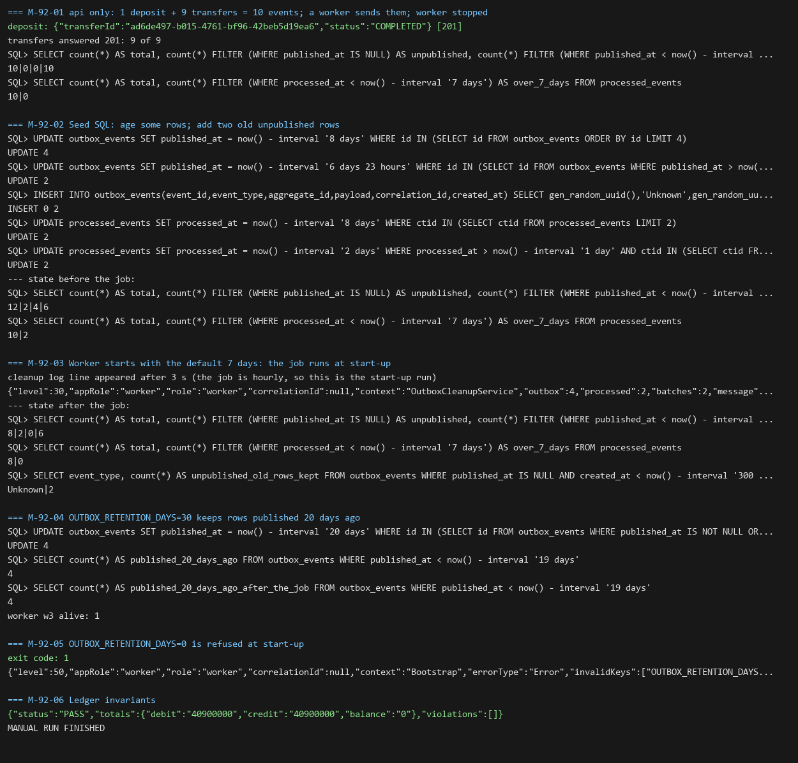

# DBS-92 · Job dọn outbox sau 7 ngày, không bao giờ xóa dòng chưa gửi

> **Status:** Implemented · **Vai:** Dev · **Nhánh:** `feat/DBS-92-outbox-cleanup` · **PR:** (xem PR của nhánh) · **Cập nhật:** 2026-11-08

> **Ghi chú quy trình:** phiên chạy bởi techlead (`Techlead waiver`). Các gate do agent duyệt thay theo yêu cầu của techlead; mỗi gate có đoạn «Quyết định» riêng ở §1, §6, §7 và §8.

## 1. Bối cảnh

- **Task trên board:** Task, Tuần 3, P2, ưu tiên Medium. **Expect:** «Bảng outbox không phình mãi.»
- **DoD:**
  1. Job theo lịch ở role worker xóa `published_at < now() − 7 ngày` theo lô nhỏ; dòng chưa gửi không bao giờ bị xóa (test).
  2. Dùng index dọn dẹp; không giữ khóa lâu.
  3. Cấu hình số ngày theo env; test.
  4. PR đã merge vào main (CI xanh); Dev review; bảng «Đối chiếu test case» trong PR điền đủ.
- **Phụ thuộc:** DBS-90 (relay): đã merge (#91); DBS-91 (#92).
- **Đã có gì:** `OutboxRelayService.deleteOldRows()` chạy mỗi giờ trong `cleanupLoop` của relay (#65): **một câu `DELETE` duy nhất** cho mọi dòng đã gửi quá 7 ngày, rồi một câu `DELETE` cho `processed_events`; số ngày là hằng 7 trong code; index `outbox_published_cleanup_idx` và `processed_events_processed_at_idx` đã có (migration DBS-25); `dbs_worker` có `SELECT, DELETE` trên cả hai bảng và `UPDATE (published_at)` trên `outbox_events`, **không** có `UPDATE` trên `processed_events` (`db-roles.sql`); test TC-OBX-05.
- **Baseline** (`main` `a10dad4`, Node 24.22.2): lint, typecheck đạt; unit 1135/1135; services outbox 27/27.
- **Lỗ hổng tìm thấy ở G1:**

| # | Lỗ hổng | Hệ quả |
|---|---|---|
| 1 | Một câu `DELETE` cho cả bảng: sau một đợt nghỉ của worker hay lần bật đầu có hàng triệu dòng, câu lệnh giữ khóa và WAL lâu và có thể quá `statement_timeout` (5 s) | vi phạm «theo lô nhỏ», «không giữ khóa lâu» |
| 2 | Số ngày là hằng trong code | vi phạm «cấu hình số ngày theo env» |
| 3 | Dọn `processed_events` dùng **cùng** hằng số với outbox | nếu hạ số ngày của outbox thì dedup mất hiệu lực sớm: `processed_events` phải sống lâu hơn DLQ 6 ngày (`docs/03` §10, DBS-73) để một sự kiện redrive từ DLQ không bị xử lý lại |
| 4 | Job nằm trong class relay; lỗi DB làm vòng lặp thử lại mỗi 5 giây (trước đây 1 giờ) | trộn hai việc; một lỗi bền (thiếu quyền, env sai) ghi log liên tục |
| 5 | Chưa có test cho ranh giới 7 ngày, lô nhỏ, khóa, plan dùng index, role `dbs_worker` | DoD 1–3 chưa được chứng minh |

- **Ngoài phạm vi:** bảo vệ ở tầng DB «không xóa dòng chưa gửi» (`dbs_worker` xóa được mọi dòng): **BL-180**; dọn `idempotency_keys` (task khác); alarm kích thước bảng và tuổi outbox: BL-161, BL-182; cấu hình autovacuum riêng cho `outbox_events`: ghi ở §3, không đổi trong task này.
- **Câu hỏi mở:** (1) Tách job thành `OutboxCleanupService` (không export qua `index.ts`, vì TC-57-12 khóa API công khai): đề xuất làm. (2) Hai biến môi trường mới: `OUTBOX_RETENTION_DAYS` (mặc định 7, 1–3650) và `PROCESSED_EVENTS_RETENTION_DAYS` (mặc định 7, **7–3650**: sàn 7 để không bao giờ ngắn hơn DLQ 6 ngày); đây là thay đổi env cần gate phụ, được duyệt ở G1.
- **Quyết định ở G1** (agent duyệt thay techlead): chấp nhận cả hai.

## 2. Hành vi

Job chạy ở role `worker` (và `both`), **ngay khi khởi động** rồi mỗi giờ; role `api` không chạy.

| # | Tình huống | Kết quả |
|---|---|---|
| 2.1 | Dòng `outbox_events` có `published_at < now() − OUTBOX_RETENTION_DAYS ngày` | bị xóa |
| 2.2 | `published_at >= now() − N ngày` | giữ (ranh giới: cách mốc 1 phút về hai phía) |
| 2.3 | `published_at IS NULL`, tuổi bất kỳ | **không bao giờ** bị xóa, vì điều kiện `published_at < mốc` không bao giờ khớp NULL (câu chọn còn đòi `published_at IS NOT NULL` để dùng được index một phần). Đây là bảo vệ ở tầng câu lệnh; chặn ở tầng DB là **BL-180** |
| 2.4 | Có nhiều hơn một lô dòng cần xóa | mỗi bảng xóa theo **lô 1000 dòng**, mỗi lô một transaction riêng (xong là nhả khóa) và nghỉ 25 ms giữa hai lô; chọn lô bằng `ORDER BY published_at LIMIT 1000 FOR UPDATE SKIP LOCKED` trên `outbox_published_cleanup_idx` |
| 2.5 | Mỗi bảng có **ngân sách riêng 200 lô** (200 000 dòng) cho một lần chạy | hết ngân sách mà lô cuối vẫn đầy thì trả `truncated` cho bảng đó (không `truncated` khi hết đúng lúc không còn gì); vòng lặp chạy lại sau 1 giây thay vì 1 giờ; outbox đầy không làm `processed_events` đói |
| 2.6 | Dòng `processed_events` có `processed_at < now() − PROCESSED_EVENTS_RETENTION_DAYS ngày` | bị xóa theo lô 1000. Không dùng `FOR UPDATE` (role `dbs_worker` không có `UPDATE` trên bảng này); để hai worker không giẫm nhau, mỗi lô lấy `pg_try_advisory_xact_lock` (không cần quyền); không lấy được khóa thì **bỏ qua bảng này trong lần chạy này** (có job khác đang dọn), không tính là «hết dòng» |
| 2.7 | Hai số ngày độc lập | đặt `OUTBOX_RETENTION_DAYS=1` không làm `processed_events` ngắn đi |
| 2.8 | Env sai: `OUTBOX_RETENTION_DAYS` ngoài 1–3650 hoặc không nguyên; `PROCESSED_EVENTS_RETENTION_DAYS` ngoài 7–3650 | ứng dụng từ chối khởi động (`ConfigValidationError`, theo `validation.schema.ts`); cận trên 3650 ngăn `make_interval` tràn ở lúc chạy |
| 2.9 | Lỗi DB giữa các lô | lỗi được log (`safeErrorMetadata`), `cleanOnce` ném lỗi; vòng lặp chờ **60 giây** rồi chạy lại (không 5 giây: lỗi bền như thiếu quyền không được ghi log mỗi 5 giây); các lô đã xong giữ nguyên |
| 2.10 | Tắt êm | `onApplicationShutdown` đặt cờ dừng; `cleanOnce` kiểm cờ **trước mỗi lô**, dừng giữa hai lô và trả `truncated` |
| 2.11 | Kết quả | `{ outbox, processed, batches, truncated? }` (số dòng đã xóa mỗi bảng); log `info` một dòng khi xóa được ít nhất một dòng (chỉ số lượng) |

## 3. Kiến trúc

- **Vị trí:** module `outbox`, role `worker`; file mới `outbox-cleanup.service.ts`, đăng ký trong `OutboxRelayModule` (đã nằm trong `workerModules`; thêm `ConfigModule.forFeature(limitsConfig)`). `OutboxRelayService` mất `cleanupLoop` và `deleteOldRows()`.
- **Interface:** `OutboxCleanupService(tx: TransactionService, @Inject(limitsConfig.KEY) limits)` (**không** `@Optional`: thiếu cấu hình phải lỗi chứ không lặng lẽ về 7); `cleanOnce(options?: { batchSize?, maxBatches?, pauseMs?, afterBatch? }): Promise<CleanupResult>`; `afterRun?: (result: CleanupResult | Error) => void` (mỗi lần chạy của vòng lặp, để test chờ lần chạy đầu mà không dùng `setTimeout`); hằng số `CLEANUP_EVERY_MS = 3 600 000`, `CLEANUP_BATCH_SIZE = 1000`, `CLEANUP_MAX_BATCHES = 200`, `CLEANUP_CONTINUE_MS = 1000`, `CLEANUP_ERROR_DELAY_MS = 60 000`, `CLEANUP_PAUSE_MS = 25`, và `PROCESSED_EVENTS_MIN_DAYS = 7` (ghi chú: phải lớn hơn thời gian giữ DLQ `message_retention_seconds` 518 400 s = 6 ngày ở `infra/terraform/envs/dev/base/sqs.tf`). Cấu hình: `limitsConfig.outbox = { retentionDays, processedEventsRetentionDays }`. Hai câu SQL của lô được **xuất thành hằng** (`OUTBOX_BATCH_SQL`, `PROCESSED_BATCH_SQL`) để test `EXPLAIN` đúng câu mà service chạy. Người gọi `relay.deleteOldRows()` hiện có: `outbox-relay.services-spec` (TC-OBX-05) và `db-roles.db-spec` (TC-ROLE-04): chuyển sang service mới.
- **Dữ liệu:** không đổi schema, index hay quyền. Dùng `outbox_published_cleanup_idx` và `processed_events_processed_at_idx`. `FOR UPDATE` trên `outbox_events` cần `UPDATE (published_at)`: `dbs_worker` có.
- **Ranh giới transaction:** mỗi lô một `TransactionService.run` (READ COMMITTED, retry deadlock mặc định); không gọi Redis, HTTP, SQS.
- **SQL một lô** (kết thúc bằng `SELECT count(*)` vì TypeORM trả `[rows, rowCount]` cho câu có thẻ lệnh DELETE nên `result.length` luôn bằng 2):

```sql
-- outbox
WITH doomed AS (
  SELECT id FROM outbox_events
  WHERE published_at IS NOT NULL AND published_at < now() - make_interval(days => $1)
  ORDER BY published_at LIMIT $2 FOR UPDATE SKIP LOCKED),
gone AS (
  DELETE FROM outbox_events WHERE id = ANY(ARRAY(SELECT id FROM doomed)) RETURNING 1)
SELECT count(*)::int AS count FROM gone

-- processed_events (sau SELECT pg_try_advisory_xact_lock($3, $4) trong cùng transaction)
WITH gone AS (
  DELETE FROM processed_events
  WHERE ctid = ANY(ARRAY(
    SELECT ctid FROM processed_events
    WHERE processed_at < now() - make_interval(days => $1)
    ORDER BY processed_at LIMIT $2))
  RETURNING 1)
SELECT count(*)::int AS count FROM gone
```

- **Autovacuum và phình bảng:** các dòng bị xóa nằm đầu `outbox_published_cleanup_idx`; relay cũng tạo dòng chết khi `UPDATE published_at`. Với mức ghi dự kiến (≈ 25 sự kiện/giây ở 120 RPS, khoảng 2 triệu dòng/ngày) autovacuum mặc định (20% dòng chết) đủ; nếu đo thấy chưa đủ thì đặt `autovacuum_vacuum_scale_factor` riêng cho `outbox_events` (hand-off BL-161/DBS-179). Nghỉ 25 ms giữa các lô và ngân sách 200 lô làm WAL và độ trễ replica không tăng đột biến.
- **Sơ đồ:** không cần (một thành phần).
- **Thay đổi cấp hệ thống:** hai env mới trong `validation.schema.ts`, `limits.config.ts`, `backend/env/.env.example`; `database-design` §10 và bảng index (đổi tên người gọi từ `OutboxRelay.deleteOldRows`); `docs/03` §10 (hàng Relay và SQS: số ngày do env, mặc định 7); README outbox. ADR-03 không sửa: «giữ 7 ngày» vẫn đúng với mặc định. Không đổi schema, `ErrorCode`, event.

## 4. Test cases tự động

Ở `backend/test/services/outbox-cleanup.services-spec.ts` (PostgreSQL thật) trừ khi ghi khác. Không dùng `setTimeout` để chờ job; hạn thời gian chỉ là cận trên của vòng chờ theo điều kiện.

| ID | Truy vết | Lớp | Given · When · Then | `errorCode` |
|---|---|---|---|---|
| TC-92-01 | DoD 1 | integration | đã gửi cách đây 7 ngày + 1 phút bị xóa; 7 ngày − 1 phút và hôm nay còn; dòng chưa gửi có `created_at` cách đây 400 ngày còn nguyên (bằng chứng hành vi; bảo vệ cứng ở tầng DB là BL-180) | — |
| TC-92-02 | DoD 1 | integration | 25 dòng cũ, lô 10 → 3 lô, tổng 25; `maxBatches: 2` → xóa 20, `truncated`; lần sau xóa 5; ngân sách riêng từng bảng: 25 dòng outbox và 25 dòng `processed_events` cũ với `maxBatches: 1`, lô 10 → mỗi bảng xóa 10 | — |
| TC-92-03 | DoD 2 | integration | một phiên của test giữ khóa `FOR UPDATE` trên một dòng cũ: `cleanOnce` xóa các dòng khác, **không chờ** (xong trong hạn `lock_timeout`), dòng bị khóa còn; sau khi nhả, lần sau xóa nó. Giữa hai lô (cổng `afterBatch`) phiên của job (nhận diện bằng `application_name`) không `idle in transaction` | — |
| TC-92-04 | DoD 2 | integration | 30 000 dòng đã gửi (cũ và mới) và 30 000 dòng `processed_events` sau `ANALYZE`: `EXPLAIN (FORMAT JSON)` của chính `OUTBOX_BATCH_SQL` (cả `DELETE`) và `PROCESSED_BATCH_SQL` dùng `outbox_published_cleanup_idx` / `processed_events_processed_at_idx`, không có `Seq Scan` trên bảng chính | — |
| TC-92-05 | DoD 3 | integration | `retentionDays=1`: đã gửi 2 ngày bị xóa trong khi `processed_events` 2 ngày còn; `processed_events` 8 ngày bị xóa; `retentionDays=30`: 20 ngày còn | — |
| TC-92-06 | DoD 3 | unit | `validateEnv`: mặc định 7 và 7; `OUTBOX_RETENTION_DAYS` = 0, 3651, 1.5, `abc` bị từ chối; `PROCESSED_EVENTS_RETENTION_DAYS` = 6, 3651 bị từ chối, 30 được chấp nhận; `limitsConfig` chuyển giá trị | `ConfigValidationError` |
| TC-92-07 | DoD 3 | unit (Nest DI) | `OutboxRelayModule` dựng bằng Nest với `OUTBOX_RETENTION_DAYS=30` trong môi trường: service nhận 30 qua DI, không phải mặc định | — |
| TC-92-08 | DoD 1 | integration | lịch: dưới `APP_ROLE=worker`, `onApplicationBootstrap()` → chờ `afterRun` → dòng cũ đã biến mất không cần gọi `cleanOnce`; `onApplicationShutdown()` dừng vòng lặp; dưới `APP_ROLE=api` không có lần chạy nào (`afterRun` không được gọi). `APP_ROLE` được khôi phục trong `finally` | — |
| TC-92-09 | DoD 1 | integration | hai `cleanOnce` đồng thời trên 3000 dòng outbox cũ: tổng đúng 3000, không lỗi; hai `cleanOnce` đồng thời trên 3000 dòng `processed_events` cũ: tổng đúng 3000, không lỗi khóa, và lần chạy tiếp theo không còn gì (không kết thúc sớm vì khóa) | — |
| TC-92-10 | §2.10 | integration | `afterBatch` gọi `onApplicationShutdown()`: không có lô nào chạy tiếp, kết quả `truncated` | — |
| TC-92-11 | §2.9 | integration | `TransactionService` bọc ném lỗi ở lời gọi thứ hai (xác định, không kill kết nối): lô đầu đã xóa giữ nguyên, `cleanOnce` ném lỗi, lần gọi sau xóa nốt phần còn lại | — |
| TC-92-12 | §2.9 | unit | vòng lặp dùng độ trễ lỗi 60 s (`CLEANUP_ERROR_DELAY_MS`), không phải 5 s | — |
| TC-92-13 | DoD 1, 2 | DB (role) | `cleanOnce` chạy bằng role `dbs_worker` (`db-roles.db-spec`): xóa dòng cũ cả hai bảng, giữ dòng chưa gửi, không `42501` | — |
| Quy trình | DoD 4 | — | PR merge, CI xanh, review | — |

`TC-OBX-05` và `TC-ROLE-04` được cập nhật để gọi service mới (hành vi giữ nguyên).

## 5. Test thủ công

Điều kiện: Docker; PostgreSQL 17 và ElasticMQ của docker compose hoặc riêng (như DBS-91 §5); từ `backend/`: `npm run migration:run`, `npm run auth:dev-keys`, `npm run build`; `node dist/main.js` với `APP_ROLE=api` (PORT 3101) và `APP_ROLE=worker`, `LOG_LEVEL=log` để thấy log của job. Tạo dữ liệu bằng API: khách, hai tài khoản, nạp 1 và chuyển 9 lần (10 sự kiện). **Seed SQL** (đầu vào của job, theo `task-kinds.md`): đổi tuổi của các dòng có sẵn.

| Bước | Việc làm | Kết quả mong đợi |
|---|---|---|
| M-92-01 | Chỉ `api`; tạo 10 sự kiện; bật `worker` để relay gửi hết rồi **dừng worker** | 10 dòng đã gửi |
| M-92-02 | Seed SQL: `published_at` của 4 dòng = 8 ngày trước, 2 dòng = 6 ngày 23 giờ trước, 4 dòng giữ nguyên (vừa gửi); chèn 2 dòng outbox **chưa gửi** (`event_type = 'Unknown'`, `created_at` 400 ngày trước); `processed_events`: 2 dòng 8 ngày, 2 dòng 2 ngày | trạng thái ban đầu ghi lại bằng `SELECT` |
| M-92-03 | Bật `worker` (mặc định 7 ngày) | ngay khi khởi động (không chờ một giờ): 4 dòng 8 ngày biến mất; còn 2 + 4 dòng đã gửi; 2 dòng chưa gửi `Unknown` còn (đây là bước chứng minh «không xóa dòng chưa gửi»); `processed_events` 8 ngày biến mất, 2 ngày còn; log `info` ghi số dòng đã xóa |
| M-92-04 | Dừng worker; seed lại 4 dòng `published_at` = 20 ngày trước; chạy worker với `OUTBOX_RETENTION_DAYS=30` | 4 dòng 20 ngày còn nguyên |
| M-92-05 | Chạy worker với `OUTBOX_RETENTION_DAYS=0` | ứng dụng không khởi động, log `invalidKeys: ["OUTBOX_RETENTION_DAYS"]` |
| M-92-06 | `npm run --silent check:invariants` | `PASS` |

Lịch **mỗi giờ** và việc chia **nhiều lô** không quan sát được bằng tay với 10 dòng; bằng chứng là TC-92-02, 08 và hằng `CLEANUP_EVERY_MS`.

## 6. Domain review (AI)

**Reviewer:** subagent general-purpose (model của phiên), 2026-11-08 · **Kết quả:** 16 phát hiện (blocking 0, should-fix 10, minor 6), verdict REVISE; đã sửa hoặc chuyển nơi nhận, không còn blocking · [trả lời nguyên văn](screenshots/DBS-92/domain-review.md)

| # | Mức | Phát hiện | Xử lý |
|---|---|---|---|
| 1 | should-fix | Đếm dòng đã xóa: TypeORM trả `[rows, rowCount]` cho câu DELETE | đã sửa §3: câu SQL kết thúc bằng `SELECT count(*)` |
| 2 | should-fix | `processed_events` không có SQL; hai worker giẫm nhau, lô kết thúc sớm | đã sửa §2.6, §3: SQL đầy đủ, `pg_try_advisory_xact_lock`, bỏ qua bảng khi không lấy được khóa; TC-92-09 |
| 3 | should-fix | Độ trễ lỗi 5 s; env không có cận trên | đã sửa §2.8, §2.9: 60 s, cận 3650; TC-92-06, 12 |
| 4 | should-fix | Không kiểm cờ dừng giữa các lô | đã sửa §2.10; TC-92-10 |
| 5 | should-fix | TC kill kết nối dễ chập chờn | đã sửa: `TransactionService` bọc ném lỗi ở lời gọi thứ hai (TC-92-11) |
| 6 | should-fix | Chờ lần chạy đầu bằng `setTimeout` | đã sửa §3: `afterRun`; TC-92-08 |
| 7 | should-fix | EXPLAIN chỉ câu chọn, SQL có thể trôi | đã sửa: xuất SQL thành hằng, `EXPLAIN (FORMAT JSON)` cả `DELETE`; TC-92-04 |
| 8 | should-fix | Cổng `afterBatch` kiểm trivially; khẳng định «relay không bị chặn» vô nghĩa | đã sửa TC-92-03: giữ khóa dòng và chứng minh bỏ qua, không chờ; bỏ khẳng định về relay |
| 9 | should-fix | `@Optional()` che lỗi cấu hình; thiếu test DI | đã sửa §3: bỏ `@Optional`; TC-92-07 |
| 10 | should-fix | Ngân sách 200 lô dùng chung bảng | đã sửa §2.5: mỗi bảng một ngân sách; TC-92-02 |
| 11 | minor | Autovacuum, WAL | đã sửa §3 (đoạn Autovacuum), nghỉ 25 ms giữa lô |
| 12 | minor | Điều kiện `IS NOT NULL` ở DELETE không phải phòng thủ | đã sửa §2.3, TC-92-01; BL-180 giữ nguyên |
| 13 | minor | Tùy chọn `now?` vô nghĩa | đã sửa: bỏ |
| 14 | minor | Sàn 7 ngày là hằng trần trụi | đã sửa §3: sàn 7 nằm ở `Joi.min(7)` của `validation.schema.ts` kèm ghi chú trỏ `sqs.tf` (hằng riêng trong service bị bỏ vì thừa) |
| 15 | minor | Tài liệu nói «7 ngày» cố định | đã sửa §3: `docs/03` §10, `database-design` §10; ADR-03 giữ nguyên vì mặc định vẫn 7 |
| 16 | minor | M-92-01 và M-92-02 trộn | đã sửa §5; ghi rõ lô nhiều do TC-92-02 chứng minh |

**Quyết định ở G2** (agent duyệt thay techlead, 2026-11-08): duyệt thiết kế; không còn blocking.

## 7. Kế hoạch triển khai

| Bước | File | Test viết trước | Đỏ dự kiến | Lệnh chứng minh | Commit |
|---|---|---|---|---|---|
| 1 | `validation.schema.ts`, `limits.config.ts`, `.env.example`, `validation.schema.spec.ts` | TC-92-06 | env chưa tồn tại | `npm test -- src/config` | `feat(config): retention days for outbox and processed events (DBS-92)` |
| 2 | `outbox-cleanup.service.ts` (+ spec đơn vị TC-92-12, TC-92-07), `outbox-relay.module.ts`, `outbox-relay.service.ts` (bỏ job), `outbox-relay.services-spec.ts` (TC-OBX-05 sang service mới), `db-roles.db-spec.ts` (TC-ROLE-04 + TC-92-13), `outbox-cleanup.services-spec.ts` (TC-92-01..05, 08..11) | tất cả TC trên | service chưa tồn tại; một câu `DELETE` xóa hết một lần (TC-92-02); lô cuối không tách | `npm run test:services -- --runInBand --runTestsByPath test/services/outbox-cleanup.services-spec.ts test/services/outbox-relay.services-spec.ts` và `npm run test:db -- --runInBand --runTestsByPath test/db/db-roles.db-spec.ts` | `feat(outbox): clean old outbox rows in small batches as its own job (DBS-92)` |
| 3 | `ci.yml` (bước chạy spec mới), README outbox, `docs/03` §10, `database-design` §10, BACKLOG, features README, feature doc §8–§9, `manual-test.txt`, ảnh | — | — | `node .claude/skills/dbs-delivering-task/scripts/check-doc-links.mjs` | `docs(outbox): record DBS-92 evidence` |

**Rà soát DoD:** DoD 1 → TC-92-01, 02, 08, 09, 10, 13; DoD 2 → TC-92-03, 04, 13; DoD 3 → TC-92-05, 06, 07; DoD 4 quy trình. Mọi lỗ hổng ở §1 có hàng trong bảng; không file nào ngoài bảng. **Rủi ro và cách lùi:** hai env mới (mặc định giữ hành vi cũ); `git revert` bước 2 khôi phục job cũ. Đột biến dự kiến: bỏ điều kiện lô (một câu xóa tất cả) làm TC-92-02 đỏ; bỏ khóa advisory làm TC-92-09 đỏ (hoặc kết thúc sớm); bỏ kiểm cờ dừng làm TC-92-10 đỏ. **Quyết định ở G3** (agent duyệt thay techlead, 2026-11-08): duyệt kế hoạch.

## 8. Kết quả

- **Lệnh kiểm tra** (Node 24.22.2, PostgreSQL 17 và ElasticMQ thật):

```text
npm run lint:check && npm run typecheck && npm run format:check && npm run build   -> đạt
npm test                                         Test Suites: 71 passed | Tests: 1151 passed
npm run test:services (outbox-relay + faults)    Tests: 27 passed
npm run test:db (outbox-cleanup + db-roles)      Tests: 15 passed (10 + 5)
npm run test:e2e                                 Test Suites: 15 passed | Tests: 153 passed
node .claude/skills/dbs-delivering-task/scripts/check-doc-links.mjs   -> 0 link hỏng
```

  Không có `.skip`, `.only`, `.todo`.

- **Đối chiếu test case:**

| ID | Test | Đạt? |
|---|---|---|
| TC-92-01 | `outbox-cleanup.db-spec` › `TC-92-01` (ranh giới 7 ngày ± 1 phút, dòng chưa gửi 400 ngày tuổi còn). Đột biến: bỏ `published_at IS NOT NULL` (xóa theo `COALESCE(published_at, created_at)`) → đỏ; đã khôi phục | đạt |
| TC-92-02 | `› TC-92-02` (lô 10, ngân sách 2 lô, ngân sách riêng từng bảng). Đột biến: lô nhân 1000 → đỏ; đã khôi phục | đạt |
| TC-92-03 | `› TC-92-03` (khóa dòng bằng kết nối riêng: job bỏ qua dòng, không chờ `lock_timeout`, không phiên `idle in transaction` giữa hai lô) | đạt |
| TC-92-04 | `› TC-92-04` (30 000 dòng mỗi bảng, `EXPLAIN (FORMAT JSON)` hai câu `DELETE`: có `outbox_published_cleanup_idx` / `processed_events_processed_at_idx`, không `Seq Scan`). Bắt được lỗi thật ở dạng `USING` cũ (xem §8, lệch kế hoạch) | đạt |
| TC-92-05 | `› TC-92-05` (hai số ngày độc lập) | đạt |
| TC-92-06 | `validation.schema.spec.ts`, `config.factories.spec.ts` (mặc định, từ chối `0`, `-1`, `1.5`, `abc`, `3651`; sàn 7 của `processed`) | đạt |
| TC-92-07 | `outbox-cleanup.service.spec.ts` (DI thật qua `ConfigModule`: 30/14 và mặc định 7/7) | đạt |
| TC-92-08 | `› TC-92-08` (role `worker` chạy ngay lúc khởi động, role `api` không) | đạt |
| TC-92-09 | `› TC-92-09` (hai job song song, 3000 dòng mỗi bảng: tổng đúng, không lỗi) | đạt |
| TC-92-10 | `› TC-92-10`. Đột biến: bỏ kiểm cờ dừng → đỏ; đã khôi phục | đạt |
| TC-92-11 | `› TC-92-11` (lỗi ở lô thứ hai, lô đầu vẫn mất) | đạt |
| TC-92-12 | `outbox-cleanup.service.spec.ts` (`CLEANUP_ERROR_DELAY_MS` ≥ 60 s) | đạt |
| TC-92-13 | `db-roles.db-spec` › `TC-92-13` (chạy bằng `dbs_worker`, không `42501`) | đạt |
| Quy trình | DoD 4 | chờ PR |

  `TC-OBX-05` và `TC-ROLE-04` đã chuyển sang gọi service mới, vẫn đạt. 13/13 case đạt đủ độ sâu. **Giới hạn trung thực:** TC-92-12 chỉ kiểm hằng số độ trễ lỗi đưa vào vòng lặp, không chờ thật 60 s.

- **Test thủ công** (api + worker là tiến trình `node dist/main.js` thật, PostgreSQL 17, ElasticMQ **riêng** cổng 9334; trên commit `4d057d5`, SHA ở dòng đầu [manual-test.txt](screenshots/DBS-92/manual-test.txt)):

| Bước | Phản hồi thật (rút gọn) | Kết quả |
|---|---|---|
| M-92-01 | nạp 1 + 9 chuyển (201 cả 10), worker gửi hết: `10|0|0|10` (tổng, chưa gửi, quá 7 ngày, trong 7 ngày); `processed_events` 10 | đạt |
| M-92-02 | seed: 4 dòng 8 ngày, 2 dòng 6 ngày 23 giờ, 2 dòng `Unknown` chưa gửi 400 ngày, 2 dấu `processed_events` 8 ngày: `12|2|4|6` và `10|2` | đạt |
| M-92-03 | worker mặc định: sau 3 s log `Outbox cleanup removed old rows` (`outbox: 4, processed: 2, batches: 2`); sau job `8|2|0|6`, `processed_events` `8|0`, 2 dòng `Unknown` chưa gửi còn nguyên | đạt |
| M-92-04 | `OUTBOX_RETENTION_DAYS=30`: 4 dòng 20 ngày còn 4 sau job, worker còn sống | đạt |
| M-92-05 | `OUTBOX_RETENTION_DAYS=0`: exit 1, `invalidKeys: ["OUTBOX_RETENTION_DAYS"]` | đạt |
| M-92-06 | `{"status":"PASS",…,"violations":[]}` | đạt |

  Lưu ý: lô nhiều và lịch mỗi giờ không quan sát bằng tay với 10 dòng; bằng chứng là TC-92-02, 08 và hằng `CLEANUP_EVERY_MS`, như đã ghi ở §5.

- **Phạm vi so với §7:** `git diff --stat main...HEAD` gồm `validation.schema.ts` (+spec), `limits.config.ts` (+spec), `.env.example`, `outbox-cleanup.service.ts` (+spec), `outbox-relay.module.ts`, `outbox-relay.service.ts` (bỏ job), `outbox-relay.services-spec.ts`, `db-roles.db-spec.ts`, `outbox-cleanup.db-spec.ts`, tài liệu và bằng chứng.
- **Ảnh chụp:** dựng từ output thật của lần chạy cuối (không phải chụp màn hình terminal):



- **Lệch so với kế hoạch:** (1) Dạng `DELETE … USING doomed` của §3 làm planner đọc tuần tự cả bảng (TC-92-04 đỏ khi chạy thử); đổi sang `id = ANY(ARRAY(SELECT id FROM doomed))` cho outbox và chọn theo `ctid` cho `processed_events` (dòng này không bao giờ bị UPDATE, nên `ctid` ổn định trong một transaction), cả hai giờ là Index Scan + Tid/PK Scan. (2) Không có bước CI riêng: job `test:db` đầy đủ đã chạy mọi spec trong `test/db`, bước riêng chỉ trùng lặp. (3) Hằng `PROCESSED_EVENTS_MIN_DAYS` bị bỏ, sàn 7 nằm ở `Joi.min(7)`. Không lệch phạm vi.
- **Bàn giao:** **BL-180** (bảo vệ ở tầng DB không cho `dbs_worker` xóa dòng chưa gửi) vẫn mở, không đổi; alarm kích thước bảng và tuổi outbox: BL-161, BL-182.

## 9. Tài liệu đã cập nhật

- `backend/src/modules/outbox/README.md`: job dọn riêng, lô, hai số ngày.
- `docs/03_HIGH_LEVEL_ARCHITECTURE.md` §10: hàng Relay nêu `OutboxCleanupService` và hai biến.
- `docs/components/_shared/database-design.md`: bảng index (nguồn truy vấn) và §10 vòng đời dữ liệu.
- `backend/env/.env.example`: `OUTBOX_RETENTION_DAYS`, `PROCESSED_EVENTS_RETENTION_DAYS`.
- `docs/features/README.md`: dòng DBS-92.
- Không đổi ADR-03 (mặc định vẫn 7 ngày), `ErrorCode`, event, schema. Không xóa dòng BACKLOG nào.

**Quyết định ở G4** (agent duyệt thay techlead, 2026-11-08): duyệt bàn giao; ảnh dựng từ output thật được chấp nhận thay cho ảnh chụp màn hình; không có bước «chưa chạy».
