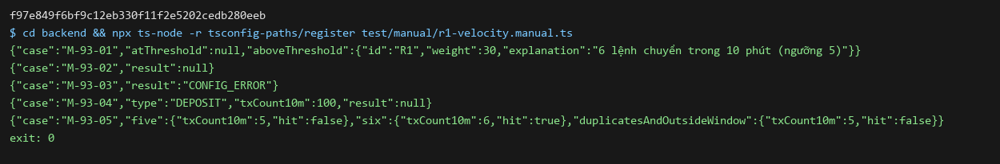

# DBS-93 · Luật R1 velocity

> **Status:** Implemented (R1 thuần + hàm đếm chuẩn; TC-93-05b còn chờ) · **Vai:** #4 Fraud · **Nhánh:** `feat/DBS-93-r1-velocity` · **PR:** [#87](https://github.com/Lawliet119/digital-banking-simulator/pull/87) · **Cập nhật:** 2026-11-08

## 1. Bối cảnh

### Task và định nghĩa hoàn thành trên board

DBS-93 là **Task**, tuần 3, ưu tiên Medium, trạng thái board `To Do`, deliverable P5. Expect: “R1 đúng và có test đầy đủ trước khi nối vào hạ tầng.”

Link người dùng gửi với `gid=1335529126` mở tab **Tuần 0**; các task Fraud nằm ở các tab tuần khác của cùng bảng. Khi đối chiếu có 28 task `DBS-*` thuộc #4 còn `To Do`; RSK-01/02/05/07 cũng `To Do`, RSK-08 `In Progress`. Không thể suy ra chúng đã hoàn thành từ PR adapter AI đã merge.

DoD DBS-93 trên board:

1. `rules/r1-velocity.rule.ts` là hàm thuần nhận số đếm từ FeatureProvider; explanation nêu số lệnh và ngưỡng.
2. Test: đúng ngưỡng (5 lệnh không kích hoạt, 6 lệnh kích hoạt), ngoài cửa sổ, cùng transferId hai lần không đếm đôi.
3. Chỉ chấm TRANSFER, bỏ DEPOSIT.
4. PR đã merge vào main (CI xanh); Dev review; bảng «Đối chiếu test case» trong PR điền đủ.

### Phụ thuộc và thực trạng

- DBS-59 là dependency trên board, `Done`: [khung risk](DBS-59-risk-module-skeleton.md) đã có `RiskRule`, `FeatureProvider` và kiểu `TransferEvent`. `RiskRule.evaluate` nhận `TransferEvent` đã thu hẹp về `TRANSFER`; consumer tương lai phải lọc `DEPOSIT` ở ranh giới runtime.
- `Features.txCount10m` là số do provider cung cấp, gồm giao dịch hiện tại. [OnlineFeatureProvider](../../backend/src/modules/risk/features/online-feature-provider.ts) và [OfflineFeatureProvider](../../backend/src/modules/risk/features/offline-feature-provider.ts) hiện chủ động báo lỗi chưa cấu hình; chạy thử trong snapshot `main` đều bị từ chối như vậy.
- [Guide §4.2](../components/risk/FRAUD_DETECTION_GUIDE.md#42-sáu-luật), [BRD FR-RSK-01/02](../BRD.md) và seed DBS-58 quy định đếm theo `occurredAt`, bao gồm giao dịch hiện tại, R1 kích hoạt khi `count > 5` với trọng số v1 là 30. Tham số phiên bản phải lấy từ cấu hình; không hardcode v1 làm cấu hình duy nhất.
- Chưa có luật R1, consumer hay scoring runtime. Adapter OpenAI Decisions chỉ là thành phần độc lập; [ADR-14](../adr/0014-fraud-rules-external-ai.md) được ghi Accepted, không tự bật AI cho dữ liệu thật.
- Chứng minh đúng cửa sổ và chống đếm trùng là trách nhiệm của các nguồn đặc trưng, không thể chứng minh bằng cách giả sẵn `txCount10m`: DBS-109/128 và DBS-112 phải có test tương ứng. Rule tự bỏ `DEPOSIT` (TC-93-04); việc consumer lọc trước khi gọi được xác minh ở DBS-111. Các phần này chưa được coi là đạt trong DBS-93.
- BL-041 theo dõi rule/scoring/provider/consumer và việc chưa có fraud end-to-end. BL-043/044/046/048/049/050/051 về provider, đánh giá, xử lý lỗi, migration và vận hành vẫn mở; không nhận chúng là đã xong bằng luật thuần.
- Script board `--next` chỉ nhận diện dependency dạng `DBS-*`; với DBS-111 phải tự kiểm RSK-01 và trạng thái thật, không coi script là bằng chứng migration đã hoàn tất.

### Baseline

- Nhánh được tạo từ `origin/main` tại `1b0a585`; kiểm thử chạy trên snapshot riêng, không thay đổi nhánh hoặc dữ liệu của người khác.
- Docker Compose PostgreSQL 17, Valkey và ElasticMQ chạy trong project riêng, cổng loopback cấp động.
- `npm ci --no-audit --no-fund`, `npm run lint:check`, `npm run typecheck`, `npm run build` và `npm test -- --runInBand`: đạt; unit 69 suite, 1.129 test.
- `npm run test:e2e -- --runInBand`: đạt 15 suite, 153 test. Job e2e + DB đầu tiên hết deadline tổng 360 giây khi DB chưa xong; sau đó chạy DB riêng với deadline dài hơn: đạt 42 suite, 724 test trong 375 giây. Suite riêng `test/db/fraud-schema.db-spec.ts` đạt 8/8 test.

### Phạm vi và giới hạn

Đây là **bước đầu tiên** trong yêu cầu hoàn thiện fraud, không thay thế toàn bộ yêu cầu. Bước này đề xuất làm R1 thuần, giải thích và các kiểm chứng thực sự thuộc R1. R2–R6, feature provider, scoring, migration decision, worker, tích hợp OpenAI, API review, đánh giá và P5 vẫn phải triển khai theo task/phụ thuộc riêng. Không sửa ledger, số dư, event contract, schema dùng chung, provider của Dev khác hoặc cấu hình cloud trong bước R1.

Các việc fraud khác trên board vẫn thuộc yêu cầu tổng thể:

- DBS-94/95/105/106/107: R2–R6; DBS-108: scoring; DBS-109/110: online features và cấu hình; RSK-01: decision migration; DBS-111/112: worker và review thứ tự/trùng sự kiện; RSK-02: tích hợp AI.
- DBS-128/132/133/211/212/161/162/168/169/170: offline features, export, đánh giá, cấu hình, freeze/holdout và ablation.
- DBS-129/130/131/160: API xem/review cờ, cách ly customer và API cấu hình.
- DBS-187/188/190: metric, alarm và báo cáo P5; RSK-05/07/08: quyền dữ liệu, đồng bộ tài liệu và bàn giao contract. RSK-03/04 thuộc Ops và RSK-06 thuộc Dev; không tự nhận phần vai khác đã hoàn thành.

Không đọc generator hoặc holdout bị niêm phong. Bộ tune theo DBS-127 chưa được giao tại `backend/data/fraud/`; ví dụ tổng hợp cỡ nhỏ có thể dùng cho kiểm thử chức năng nhưng không thay cho đánh giá độc lập.

### Câu hỏi G1

1. Cho phép bắt đầu theo thứ tự DBS-93 trước, sau đó tiếp tục các task còn lại để hoàn thiện fraud; không tuyên bố R1 hoàn thành đầy đủ cho đến khi chứng minh cửa sổ, dedup và loại DEPOSIT bằng provider/consumer thật. Đề xuất: đồng ý.
2. PR phải có Dev khác review và merge, CI xanh và đủ DoD trước khi task được đánh dấu Done. Agent không tự sửa trạng thái sheet; người quản lý board cập nhật theo bằng chứng. Đề xuất: giữ quy tắc này.

**Quyết định G1:** người dùng chọn “Duyệt G1” sau khi được trình phạm vi DBS-93 và các phụ thuộc của yêu cầu fraud tổng thể.

## 2. Hành vi

- R1 chỉ nhận một `TransferEvent` đã được consumer xác định là `type='TRANSFER'` và một `Features` có `txCount10m` là số lệnh từ cùng tài khoản nguồn, theo `occurredAt`, tính cả lệnh hiện tại một lần. Rule không tự đọc lịch sử và không tự đếm.
- `RuleParams` cho R1 nhận `enabled`, `weight` và `thresholds` gồm `maxTransfers`, `windowMinutes`. Seed DBS-58 tương ứng `{ enabled: true, weight: 30, thresholds: { maxTransfers: 5, windowMinutes: 10 } }`; task repository cấu hình phải ánh xạ chính xác từ các key cùng tên trong seed.
- Vì contract hiện chỉ có `txCount10m`, R1 chỉ hỗ trợ cửa sổ đúng **10 phút**. Cấu hình cửa sổ khác không được diễn giải như dữ liệu 10 phút. `maxTransfers` phải là số nguyên không âm; `weight` nguyên không âm trong miền PostgreSQL `int`; `txCount10m` phải là số nguyên an toàn dương vì đã gồm lệnh hiện tại. Dữ liệu/cấu hình sai ném lỗi, không âm thầm thành không có cờ; xử lý rollback/DLQ là trách nhiệm consumer theo ADR-14.
- Với tham số hợp lệ: tắt rule → `null`; bật và `txCount10m <= maxTransfers` → `null`; bật và lớn hơn ngưỡng → `{ id: 'R1', weight, explanation }`. Giải thích tiếng Việt chứa số lệnh, cửa sổ 10 phút và ngưỡng, không chứa ID hoặc dữ liệu khách.
- Không dùng thời gian hệ thống, SQL, Redis, mạng, event ID hoặc đầu vào AI. Rule chỉ chấm `TRANSFER`: sự kiện có `type` khác (`DEPOSIT`) trả `null` ngay từ đầu, **trước** khi đọc số đếm hay kiểm tra cấu hình, vì kiểu `TransferEvent` chỉ bảo vệ lúc biên dịch. Consumer DBS-111 vẫn phải lọc `DEPOSIT` trước khi gọi để khỏi đọc feature không cần; guard trong rule là lớp chặn thứ hai (bổ sung sau G4, xem §8).

## 3. Kiến trúc

`backend/src/modules/risk/rules/r1-velocity.rule.ts` hiện thực interface sẵn có `RiskRule`: `id='R1'` và `evaluate(event: TransferEvent, features: Features, params: RuleParams): RuleHit | null`. Trả hit hoặc null đồng bộ; lỗi dữ liệu/cấu hình được truyền lên caller. Rule là thành phần độc lập, chưa đăng ký trong `RiskModule` rỗng và chưa có caller production; `index.ts`, event contract, schema, ledger, queue, env và dependency không thay đổi.

Không có transaction hoặc gọi dịch vụ ngoài trong task này. Provider tương lai chịu trách nhiệm cửa sổ và dedup theo `transferId`; consumer chịu trách nhiệm bỏ `DEPOSIT`, lỗi/ack và DB. Các hành vi đó không được giả lập thành bằng chứng đã hoàn thành.

## 4. Test cases tự động

| ID | Truy vết | Lớp | Given → When → Then |
|---|---|---|---|
| TC-93-01 | DoD 1–2 | Unit | Ngưỡng 5 và cửa sổ 10 phút: 5 → null; 6 → hit R1 đúng weight, giải thích có count, cửa sổ và ngưỡng |
| TC-93-02 | DoD 1 | Unit | Tắt rule với count 6 → null; đổi maxTransfers và weight hợp lệ → ngưỡng/hit dùng cấu hình, không dùng hằng số v1 |
| TC-93-03 | ADR-14 cấu hình nền và feature | Unit | Count không phải số nguyên an toàn dương; ngưỡng/weight sai kiểu hoặc ngoài miền; cửa sổ khác 10 phút → lỗi rõ ràng thay vì null/hit sai |
| TC-93-04 | DoD 3 | Unit | Sự kiện `type: 'DEPOSIT'` lọt tới rule với count 6 hoặc 100 → `null`; `TRANSFER` cùng count vẫn có hit; `DEPOSIT` với count không hợp lệ (0) → `null`, không ném lỗi. Việc consumer lọc `DEPOSIT` do DBS-111 kiểm riêng |
| TC-93-05a | DoD 2: cửa sổ và trùng | Unit | `countTransfersInWindow` (`features/velocity-count.ts`, hàm thuần định nghĩa nghĩa của `txCount10m`): cửa sổ `(occurredAt − 10 phút, occurredAt]`, cận dưới loại trừ; giao dịch đúng 10 phút trước và 11 phút trước không đếm; cùng `transferId` hai lần và việc giao lại chính lệnh hiện tại không đếm đôi; giao dịch sau `occurredAt` không đếm; đầu vào sai ném lỗi. Nối vào R1: 5 lệnh trong cửa sổ không cờ, lệnh thứ 6 có cờ, bản trùng và lệnh ngoài cửa sổ không đẩy qua ngưỡng |
| TC-93-05b | DoD 2 trên nguồn thật | Tích hợp provider tương lai | DBS-109/128/112 chứng minh provider Redis/SQL/offline cho **cùng kết quả** với hàm chuẩn trên dữ liệu thật; chưa thực hiện |
| TC-93-06 | DoD 4 | Quy trình | CI, Dev khác review và merge thực tế; không tính là đạt trước khi xảy ra |

Không có `errorCode` HTTP hay thay đổi tiền/số dư trong rule thuần. Kiểm quyền endpoint, transaction và customer isolation thuộc task worker/API, không áp dụng vào rule độc lập.

## 5. Test thủ công

Sau khi hiện thực, driver `backend/test/manual/r1-velocity.manual.ts` dùng một event `TRANSFER` tổng hợp và Features đầy đủ để gọi chính class rule. Chạy từ `backend/`:

```bash
npx ts-node -r tsconfig-paths/register test/manual/r1-velocity.manual.ts
```

| Bước | Hành động trong driver | Kỳ vọng |
|---|---|---|
| M-93-01 | Cấu hình v1, count 5 và 6 | In null cho 5; hit R1 cho 6, weight 30 và explanation nêu số, cửa sổ, ngưỡng |
| M-93-02 | Tắt rule với count 6 | In null |
| M-93-03 | Bật rule nhưng cấu hình cửa sổ 15 phút | In trạng thái lỗi rõ ràng, không tạo hit |
| M-93-04 | Event `type: 'DEPOSIT'` với count 100 | In `null` |
| M-93-05 | Đếm bằng `countTransfersInWindow`: 4 lệnh trong cửa sổ + lệnh hiện tại; thêm lệnh thứ 6; rồi thêm bản trùng, lệnh đúng 10 phút và 11 phút trước | `5 → hit=false`, `6 → hit=true`, `5 → hit=false` |

Driver chỉ dùng dữ liệu tổng hợp trong bộ nhớ, không gọi OpenAI, không sửa DB hoặc ledger. Vì provider chưa tồn tại, M-93-05 chỉ chứng minh hàm đếm chuẩn và việc nối vào luật; chưa chứng minh Redis/SQL thật, đó là TC-93-05b. M-93-04 chỉ chứng minh rule tự bỏ `DEPOSIT`, không chứng minh consumer lọc.

## 6. Domain review

Reviewer độc lập `openai-codex/gpt-6.1-sol`: **0 blocking, 0 should-fix, 0 minor; Verdict: APPROVE** cho phạm vi R1 thuần. Reviewer xác nhận kiểm tra cửa sổ 10 phút khớp `txCount10m`, mapping key seed được ghi rõ và lỗi fail-closed theo ADR-14; test cửa sổ/dedup/DEPOSIT qua provider/consumer vẫn là phần chưa hoàn thành. [Phản hồi nguyên văn](screenshots/DBS-93/domain-review.md).

**Quyết định G2:** người dùng chọn “Duyệt G2” sau review độc lập và khi được thông báo các kiểm chứng provider/consumer còn thiếu.

## 7. Kế hoạch triển khai

| Bước | File / việc | Test trước và kết quả đỏ cần quan sát | Chứng minh | Commit |
|---|---|---|---|---|
| 0 | Cài dependency theo lockfile hiện tại trong `backend/`; khởi tạo dịch vụ test cô lập khi cần | Baseline main ở §1 đã chạy trên snapshot sạch; không đổi lockfile | `npm ci --no-audit --no-fund` | Không commit dependency cài đặt |
| 1 | `backend/src/modules/risk/rules/r1-velocity.rule.spec.ts` | TC-93-01/02/03 chạy đỏ trước implementation: `TS2307` không tìm thấy `./r1-velocity.rule` | `npm test -- --runInBand src/modules/risk/rules/r1-velocity.rule.spec.ts` | Chưa commit khi đỏ |
| 2 | `backend/src/modules/risk/rules/r1-velocity.rule.ts` | Implement ít nhất để các case hành vi, cấu hình và lỗi đã viết xanh; không thêm caller giả | Chạy lại suite bước 1; `lint:check`, `typecheck` | Commit code sau bước 3 |
| 3 | `backend/test/manual/r1-velocity.manual.ts` | Driver gọi rule thật với input tổng hợp, kiểm M-93-01/02/03; không claim feature provider thật | `npx ts-node -r tsconfig-paths/register test/manual/r1-velocity.manual.ts` | `feat(risk): implement R1 velocity rule` sau xanh |
| 4 | Kiểm chứng trên commit cuối đổi code | Unit toàn bộ; e2e và DB thật trên PostgreSQL/Valkey/ElasticMQ cô lập; không mở generator/holdout niêm phong. Chạy lại M-93-01/02/03, lưu SHA đầu file `docs/features/screenshots/DBS-93/manual-test.txt`, output đã lọc và ảnh terminal thật | `lint:check`, `typecheck`, `build`, `npm test`, `test:e2e`, `test:db`; manual §5 | Không sửa code sau manual nếu chưa chạy lại |
| 5 | Feature doc này; `backend/src/modules/risk/README.md`, `docs/features/README.md`, `docs/BACKLOG.md`; review và evidence trong `docs/features/screenshots/DBS-93/` | Đối chiếu từng DoD/TC, ghi riêng provider window/dedup, consumer DEPOSIT và Dev review/merge chưa đạt; giữ các BL chưa giải quyết và liên kết bằng chứng | Kiểm link trong phạm vi không chạm dataset niêm phong; đối chiếu file và G4 | `docs(risk): record DBS-93 verification` sau G4 hoặc theo quy trình được duyệt |

### Rà soát kế hoạch

- Đã rà từng DoD DBS-93: TC-93-01/02/03 có test; cửa sổ/dedup và `DEPOSIT` cần provider/consumer thật ở DBS-109/128/111/112, không thay bằng mock hay tuyên bố đạt; CI/review/merge là điều kiện quy trình.
- Đã rà R1/ADR-14: dùng `occurredAt` qua feature contract, cửa sổ 10 phút, cấu hình và lỗi nền fail-closed. Không đụng sáu luật khác, storage, AI, môi trường production hoặc dữ liệu khách. Các task còn lại của yêu cầu fraud tiếp tục theo phụ thuộc sau DBS-93.
- Không thay đổi symbol export, cấu trúc `RiskRule`/`Features`, event schema, database schema, env, package hay ADR. Không thêm caller giả hoặc gửi dữ liệu thật tới OpenAI.
- Chỉ stage đúng các tệp của kế hoạch; kiểm credential trước commit. Không đưa dữ liệu đánh giá, credential hay các tệp ngoài phạm vi lên PR.
- Rủi ro: `txCount10m` chỉ hỗ trợ cửa sổ 10 phút; cấu hình khác phải lỗi chứ không cho kết quả sai. Rollback thay đổi code bằng revert commit sau khi người duyệt đồng ý, không can thiệp dữ liệu.

**Quyết định G3:** người dùng chọn “Duyệt G3” sau khi được trình kế hoạch test trước, hiện thực và kiểm chứng R1.

## 8. Kết quả và bàn giao

- Rule được commit ở `4651c3d`; commit cuối đổi driver kiểm thủ công là `290dd4e9443e0dd042dfa3bccc807ac1ff76c2b6` (giữ kiểm nội dung bắt buộc, không ghim câu chữ); commit code mới nhất là `f97e849` (hàm đếm chuẩn, trên guard `DEPOSIT` ở `30328ce`). Test trước implementation đỏ `TS2307` thiếu rule; sau implementation suite R1 đạt **21/21**; sau hai bổ sung sau G4 (bên dưới) R1 đạt **23/23** và hàm đếm chuẩn **10/10**.
- `lint:check`, `typecheck`, `build`: đạt. Unit toàn bộ: **70 suite, 1.150 test**; e2e: **15 suite, 153 test**; DB: **42 suite, 724 test** trên Docker project riêng; không có test bị skip trong output. E2e bắt đầu trước khi driver manual được chỉnh assertion, nhưng code rule không đổi; driver được chạy lại trên commit cuối.
- M-93-01..05: đạt, chạy lại trên commit code cuối `f97e849`; [output thô](screenshots/DBS-93/manual-test.txt). Không có credential hoặc dữ liệu khách trong bằng chứng.
- Tự review code: đối chiếu ranh giới 5/6, rule tắt, ngưỡng/trọng số từ params, miền số nguyên và từ chối cửa sổ khác 10 phút; không có I/O trong `evaluate`. Review thiết kế độc lập ở §6 không thay thế Dev review PR.
- Link: checker repo chạy với danh sách giới hạn 4 Markdown đã sửa, **4 file, 0 link lỗi**; kiểm riêng 173 link và anchor trong bốn file này cũng không thấy lỗi. Đây không phải kiểm toàn repo; không truy cập dataset niêm phong.
- Đối chiếu phạm vi: diff code từ `origin/main` gồm đúng rule, unit spec và driver manual; tài liệu/evidence gồm các file đã liệt kê ở §7, không có thay đổi ledger/event/schema.



| Case | Kết quả / giới hạn |
|---|---|
| TC-93-01/02/03 | Đạt trên suite unit R1; kiểm so sánh ngưỡng, rule tắt, cấu hình, giá trị lỗi và explanation |
| TC-93-04 | Đạt trên suite unit R1 (2 ca, đỏ trước khi thêm guard) và M-93-04. Phần consumer lọc `DEPOSIT` vẫn chưa có (DBS-111, BL-041) |
| TC-93-05a | Đạt: `velocity-count.spec.ts` 10/10 (ba đột biến: cận dưới đóng, bỏ cận trên, bỏ dedup, đều làm test đỏ) và M-93-05 |
| TC-93-05b | **Chưa kiểm trên nguồn thật**: provider chưa triển khai; DBS-109/128/112, BL-041 |
| TC-93-06 | CI remote, Dev khác review và merge chưa có; BL-183 |

Không có bằng chứng fraud end-to-end, chất lượng phát hiện hay tích hợp OpenAI từ task R1. Các task còn lại của yêu cầu tổng thể và các phụ thuộc dữ liệu/Ops được giữ ở §1; không thay chúng bằng mock.

**Bổ sung sau G4 (2026-11-08, techlead yêu cầu sửa mọi DoD sửa được):** thêm guard `type !== 'TRANSFER' → null` vào `R1VelocityRule` để đạt DoD 3, hai ca TC-93-04 viết trước (đỏ: 2 failed) rồi xanh, thêm M-93-04 vào driver và chạy lại cả bốn bước thủ công trên commit `30328ce`; unit toàn `src/modules/risk` 150/150, `lint:check`, `typecheck` đạt. Không đổi hợp đồng `RiskRule`, event, schema. DoD 2 (cửa sổ, dedup) không nằm trong luật nhận số đếm; xử lý ở bổ sung thứ hai bên dưới. DoD 4 (Dev khác review) là quy trình, chưa đạt.

**Bổ sung thứ hai sau G4 (cùng ngày, techlead hỏi vì sao DoD 2 không sửa được):** DoD 2 sửa được một phần. Thêm `features/velocity-count.ts` (`countTransfersInWindow`) định nghĩa chuẩn của số đếm: cửa sổ kết thúc ở `occurredAt`, cận dưới loại trừ, đếm theo `transferId` khác nhau, lệnh hiện tại đúng một lần. Test viết trước (đỏ `TS2307`), `src/modules/risk` 160/160, driver có thêm M-93-05, chạy lại 5 bước thủ công. **Hai lưu ý:** (1) đây là quyết định thiết kế mới: cận dưới loại trừ (đúng 10 phút trước thì ngoài cửa sổ) vì guide không nêu; nếu Redis `ZCOUNT` hay SQL của provider chọn khác thì sửa một nơi cho khớp. (2) Hàm chưa có nơi gọi trong production; nó là bản chuẩn để provider phải khớp (offline provider DBS-128 có thể dùng trực tiếp), không phải bằng chứng rằng Redis/SQL thật đếm đúng (TC-93-05b).

**Quyết định G4:** người dùng chọn “Duyệt G4”, chấp nhận nêu rõ TC-93-05 (cửa sổ/dedup qua provider thật; ban đầu cả TC-93-04 DEPOSIT runtime và phần chuẩn của TC-93-05, đã đạt ở hai phần bổ sung trên) và việc chưa kiểm link toàn repo. PR chỉ bàn giao R1 thuần; các phần còn lại của yêu cầu fraud vẫn mở.

## 9. Tài liệu đã cập nhật

- `backend/src/modules/risk/README.md`: trạng thái R1 và ADR-14, giới hạn runtime.
- `docs/features/README.md`: index DBS-93.
- `docs/BACKLOG.md`: cập nhật BL-041 với handoff provider/consumer và nguồn DBS-93; thêm BL-183 theo dõi CI/review/merge.
- Feature doc này, review thiết kế, output và ảnh test thủ công.
