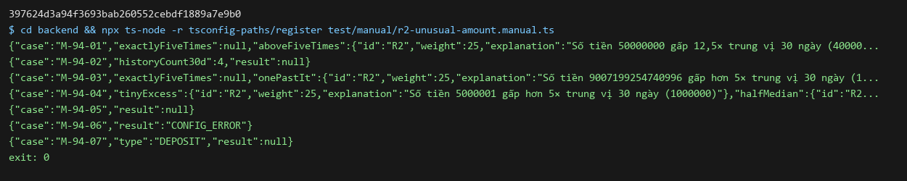

# DBS-94 · Luật R2 số tiền bất thường: > 5× trung vị 30 ngày, cần ≥ 5 lệnh lịch sử

> **Status:** Implemented · **Vai:** #4 Fraud · **Nhánh:** `feat/DBS-94-r2-amount` · **PR:** — · **Cập nhật:** 2026-11-08

> **Ghi chú quy trình:** phiên chạy bởi techlead (`Techlead waiver`). Các gate do agent duyệt thay theo yêu cầu của techlead; mỗi gate có đoạn «Quyết định» riêng.

## 1. Bối cảnh

- **Task trên board:** Task, Tuần 3, ưu tiên Medium, Deliverable P5, vai #4 Fraud. **Expect:** «R2 đúng, kể cả khi thiếu lịch sử.»
- **DoD:**
  1. Hàm thuần nhận median và n từ FeatureProvider; n < 5 thì bỏ qua (không kích hoạt).
  2. Test: đúng 5× (không kích hoạt) và vượt 5×, n = 4 bỏ qua, số tiền lớn dạng bigint.
  3. explanation nêu số tiền, bội số và trung vị.
  4. PR đã merge vào main (CI xanh); Dev review; bảng «Đối chiếu test case» trong PR điền đủ.
- **Phụ thuộc:** DBS-59 (Done, [khung risk](DBS-59-risk-module-skeleton.md)): `RiskRule`, `Features`, `TransferEvent`. R1 ([DBS-93](DBS-93-r1-velocity.md)) đã merge và là khuôn: luật là class `implements RiskRule`, ném lỗi khi dữ liệu hoặc cấu hình sai, bỏ qua `DEPOSIT`.
- **Đã có gì:** `Features.medianAmount30dTimes2` là **hai lần** trung vị chính xác (chuỗi số nguyên đồng), `null` khi `historyCount30d < 5`; `historyCount30d` là số lệnh chuyển hoàn tất **trước** `occurredAt` ([feature-provider.ts](../../backend/src/modules/risk/features/feature-provider.ts)). Hai lần trung vị để trung vị của số lượng chẵn (trung bình hai số giữa, có thể `.5`) vẫn là số nguyên, không dùng số thực. Seed DBS-58 cho R2: `{ enabled: true, weight: 25, medianMultiplier: 5, historyDays: 30, minHistory: 5 }` ([migration](../../backend/src/database/migrations/1792713600000-CreateFraudStorage.ts)). Guide §4.2: `amount > 5 × trung vị`, tiền và trung vị là bigint/numeric, không `Number`. `ai/feature-projection.ts` (FRAUD-API-02) đã có chính sách riêng cho cùng `Features`; R2 giữ tương thích ở chỗ đã nêu ở §2.
- **Baseline** (`main` `1e12939`, Node 24.22.2): `lint:check`, `typecheck` đạt; unit 73 suite, 1184 test.
- **Ngoài phạm vi:** provider tính trung vị và `historyCount30d` (SQL trong guide §4.2, DBS-109 online, DBS-128 offline); consumer, scoring, đọc cấu hình phiên bản từ DB và ánh xạ key seed sang `thresholds` (task cấu hình); R3–R6. Bằng chứng trung vị đúng (số chẵn, lệnh bị loại khỏi lịch sử) thuộc provider.
- **Câu hỏi mở:** (1) `medianMultiplier`: số dương, tối đa 2 chữ số thập phân, ≤ 1000, so sánh bằng bigint đã nhân 100 (cho phép `v2` học ngưỡng như 3,5 mà R2 không ném lỗi ở mọi event): đề xuất đồng ý (sửa sau review #6). (2) `minHistory` nhận số nguyên ≥ 5 vì provider đã trả `null` dưới 5, nên cấu hình nhỏ hơn 5 không thể thực hiện và phải lỗi chứ không lặng lẽ thành 5: đồng ý. (3) `historyDays` chỉ nhận đúng 30, cùng lý do với cửa sổ 10 phút của R1. (4) Chính sách thiếu lịch sử: `historyCount30d < minHistory` thì bỏ qua **trước** khi nhìn trung vị (đúng chữ DoD và pseudocode guide); đủ lịch sử mà trung vị `null` là provider hỏng nên ném lỗi (như `ai/feature-projection.ts`).
- **Quyết định ở G1** (agent duyệt thay techlead): chấp nhận cả bốn.

## 2. Hành vi

`R2UnusualAmountRule.evaluate(event, features, params)` trả `RuleHit | null`, đồng bộ, thuần (không SQL, Redis, giờ hệ thống).

1. **Chỉ chấm `TRANSFER`.** `event.type` khác `TRANSFER` trả `null` ngay đầu hàm, trước mọi kiểm tra khác (như R1).
2. **Cấu hình** (`params`): `enabled` boolean; `weight` nguyên trong `[0, 2147483647]`; `thresholds.medianMultiplier` số hữu hạn trong `(0, 1000]` có tối đa 2 chữ số thập phân (v1 là 5); `thresholds.historyDays` đúng số `30`; `thresholds.minHistory` số nguyên an toàn ≥ 5. Sai kiểu (chuỗi `'30'`), thiếu key hay ngoài miền thì ném `Error`, kể cả khi rule tắt (cùng chính sách fail-closed của R1). Thông báo lỗi không lặp lại giá trị đầu vào.
3. **Dữ liệu cố định:** `event.amount` qua `parsePositiveMoney` (chuỗi đồng canonical, bigint, ≤ `MONEY_MAX`); `historyCount30d` số nguyên an toàn ≥ 0. Sai thì ném lỗi.
4. **Đủ lịch sử?** `historyCount30d < minHistory` → `null` (bỏ qua, không phải lỗi), **không đọc trung vị**, kể cả khi trung vị có giá trị (provider được phép tính sớm).
5. **Trung vị:** từ đây `historyCount30d ≥ 5`, nên `medianAmount30dTimes2` phải là chuỗi (`typeof string`) khớp `/^[1-9][0-9]*$/`, với `2 ≤ giá trị ≤ 2 × MONEY_MAX` (tiền là đồng nguyên nên trung vị ≥ 1; cận trên 20 chữ số nên không dùng `parsePositiveMoney`). `null` hay sai định dạng thì ném lỗi: provider hỏng không được âm thầm thành «không cờ».
6. **So sánh bằng bigint, không số thực:** gọi `m100 = medianMultiplier × 100` (số nguyên, tính chính xác), kích hoạt khi `200 × amount > m100 × medianAmount30dTimes2` (tương đương `amount > multiplier × trung vị`). Đúng bằng thì **không** kích hoạt.
7. **Kết quả:** `{ id: 'R2', weight, explanation }`. Explanation tiếng Việt, số không có dấu ngăn nghìn, **dấu phẩy thập phân**: `Số tiền {amount} gấp {bội}× trung vị 30 ngày ({trung vị})`. `bội100 = floor(200 × amount / medianAmount30dTimes2)` (bigint), hiển thị là `bội100 / 100` bỏ số 0 thừa nhưng giữ số 0 đứng giữa (`12`, `10,5`, `10,05`). Nếu `bội100 ≤ m100` (vượt rất ít) thì ghi `gấp hơn {medianMultiplier}×` để không bao giờ hiện một con số không vượt ngưỡng cho một cờ. Trung vị hiển thị là `medianAmount30dTimes2 / 2`, có `,5` khi lẻ. Không chứa ID hay dữ liệu khách.
8. Ví dụ: `amount = 50000000`, `medianAmount30dTimes2 = "8000000"`, `historyCount30d = 12` → `Số tiền 50000000 gấp 12,5× trung vị 30 ngày (4000000)`, weight 25.

## 3. Kiến trúc

- **Vị trí:** module `risk`; file mới `backend/src/modules/risk/rules/r2-unusual-amount.rule.ts` (+ `.spec.ts`), driver `backend/test/manual/r2-unusual-amount.manual.ts`. Không đăng ký vào `RiskModule`, không đổi `index.ts`, `rule.ts`, `Features`, event, schema, env, dependency. Chưa có caller production (consumer DBS-111).
- **Interface:** `class R2UnusualAmountRule implements RiskRule { readonly id = 'R2'; evaluate(event: TransferEvent, features: Features, params: RuleParams): RuleHit | null }`. Dùng `parsePositiveMoney` và `MONEY_MAX` từ `@common/money`.
- **Dữ liệu / transaction:** không có.
- **Sơ đồ:** không cần (một thành phần).
- **Thay đổi cấp hệ thống:** README module risk (trạng thái R2). Không đổi ADR, `_shared`. Guide §4.2 (pseudocode `${amount/median}`) sẽ lệch định dạng: ghi ở BACKLOG (H6).

## 4. Test cases tự động

Trung vị 1 000 000 tức `medianAmount30dTimes2 = "2000000"`; cấu hình v1 `{ weight 25, medianMultiplier 5, historyDays 30, minHistory 5 }` nếu không nói khác.

| ID | Truy vết | Lớp | Given · When · Then |
|---|---|---|---|
| TC-94-01 | DoD 2 | unit | Số tiền đúng 5 000 000 → `null`; 5 000 001 → hit R2 weight 25 |
| TC-94-02 | DoD 2 | unit | Trung vị lẻ `"2000001"` (1 000 000,5): 5 000 002 → `null` (5× = 5 000 002,5); 5 000 003 → hit. Không làm tròn |
| TC-94-03 | DoD 1, 2 | unit | `historyCount30d` 4 với median `null` và số tiền cực lớn → `null`; 4 với median có giá trị → `null` (bỏ qua trước); 5 với median → được đánh giá (biên dưới, hit khi vượt); `minHistory` 7: count 6 → `null`, count 7 → đánh giá; count 5 với median `null` → **lỗi**; count 8 với median `null` → **lỗi** |
| TC-94-04 | DoD 2 (bigint) | unit | Median `"3602879701896398"` (1 801 439 850 948 199), 5× = 9 007 199 254 740 995: đúng bằng → `null`; 9 007 199 254 740 996 → hit (chỉ ca +1 làm số thực sai); M2 chính nó > 2^53 (`"18446744073709551612"`, bội số cấu hình 1): `MONEY_MAX` → hit, M2 `"18446744073709551614"` → `null`; `MONEY_MAX` với M2 `"2"` → hit, explanation đủ 19 chữ số |
| TC-94-05 | DoD 3 | unit | Explanation đúng từng chuỗi: ví dụ §2.8 (`12,5`); 5 000 001 và 5 009 999 → `gấp hơn 5×`; 5 010 000 → `5,01`; 10 050 000 → `10,05`; 10 500 000 → `10,5`; 12 000 000 → `12`; M2 `"3"` amount 8 → `5,33` và trung vị `1,5`; bội số cấu hình 1 với tỉ lệ 1,004 → `gấp hơn 1×`; bội số 3,5 hiển thị `3,5` |
| TC-94-06 | DoD 1 | unit | Rule tắt → `null`; bội số 3 và weight 12 được dùng thay seed; bội số 3,5 chính xác: trung vị 1 000 000, 3 500 000 → `null`, 3 500 001 → hit |
| TC-94-07 | fail-closed | unit | Ném lỗi, cả khi rule tắt: weight −1, 1,5, NaN, Infinity, 2147483648 (2147483647 được nhận); `medianMultiplier` 0, −1, NaN, Infinity, `'5'`, 1000,01, 1,005 (3 chữ số thập phân), 2^53; `historyDays` 15 và `'30'`; `minHistory` 4, 5,5, `'5'`; thiếu `thresholds` và thiếu từng key riêng lẻ; `historyCount30d` −1, 1,5, NaN, `'6'`; trung vị (khi count ≥ 5) `''`, `'1'`, `'0'`, `'1.5'`, `'-2'`, `'007'`, `'abc'`, số `4`, `undefined`, `"18446744073709551615"` (từ chối), chuỗi 40 chữ số (từ chối), `"18446744073709551614"` (nhận); `amount` `'0'`, `''`, `'-5'`, `'007'`, `' 5'`, `'1e3'`, `'9223372036854775808'`, số `5`; thông báo lỗi không chứa giá trị đầu vào |
| TC-94-08 | khuôn R1 | unit | Sự kiện `DEPOSIT` với dữ liệu hợp lệ hoặc hỏng (median sai, count −1) → `null`, không ném |
| Quy trình | DoD 4 | — | CI xanh, bảng đối chiếu trong PR; Dev khác review: chưa có (BL) |

Không có `errorCode` HTTP, không đổi tiền hay số dư.

## 5. Test thủ công

Driver `backend/test/manual/r2-unusual-amount.manual.ts` gọi chính class rule với event và `Features` tổng hợp (không DB, không mạng). Từ `backend/`: `npx ts-node -r tsconfig-paths/register test/manual/r2-unusual-amount.manual.ts`.

| Bước | Việc làm | Kết quả mong đợi |
|---|---|---|
| M-94-01 | Cấu hình v1; trung vị 4 000 000; số tiền 20 000 000 rồi 50 000 000 | `null`; hit R2, weight 25, `gấp 12,5×` |
| M-94-02 | `historyCount30d = 4`, median `null`, số tiền 50 000 000 (mức tối đa mỗi lệnh) | `null` |
| M-94-03 | Trung vị 1 801 439 850 948 199: số tiền 9007199254740995 rồi 9007199254740996 | `null`; hit |
| M-94-04 | Trung vị 1 000 000: số tiền 5 000 001; trung vị lẻ `"2000001"` số tiền 5 000 003 | `gấp hơn 5×`; hit với trung vị `1000000,5` |
| M-94-05 | Rule tắt với số tiền vượt xa | `null` |
| M-94-06 | Cấu hình `historyDays: 15` | lỗi cấu hình, không hit |
| M-94-07 | Event `DEPOSIT` | `null` |

Chỉ dữ liệu tổng hợp trong bộ nhớ. Không chứng minh trung vị đúng trên dữ liệu thật: đó là việc của provider (DBS-109/128).

## 6. Domain review (AI)

**Reviewer:** subagent general-purpose (model của phiên), 2026-11-08 · **Kết quả:** 10 phát hiện (blocking 1, should-fix 5, minor 4) và 6 bàn giao, verdict REVISE; đã sửa hoặc chuyển nơi nhận, không còn blocking · [trả lời](screenshots/DBS-94/domain-review.md)

| # | Mức | Phát hiện | Xử lý |
|---|---|---|---|
| 1 | blocking | Median `null` với count ≥ 5 bị bỏ qua lặng lẽ | đã sửa §2.4–2.5: ném lỗi; TC-94-03 |
| 2 | should-fix | Median có giá trị với count < 5 bị ném lỗi, trái chữ DoD | đã sửa §2.4: bỏ qua trước khi đọc median; TC-94-03 |
| 3 | should-fix | Kiểm median thiếu `typeof`, cận trên, cận dưới | đã sửa §2.5 (`2 ≤ M2 ≤ 2×MONEY_MAX`); TC-94-07 |
| 4 | should-fix | Lời «số thực sai cả hai» sai; thiếu ca M2 > 2^53 | đã sửa TC-94-04 |
| 5 | should-fix | Thiếu ca biên định dạng explanation | đã sửa TC-94-05 |
| 6 | should-fix | Bội số chỉ nguyên: `v2` học 3,5 sẽ làm R2 ném lỗi | đã sửa §2.2, §2.6: tối đa 2 chữ số thập phân; TC-94-06; việc kiểm lúc ghi phiên bản chuyển task cấu hình (H4) |
| 7 | minor | Dấu chấm thập phân mơ hồ | đã sửa §2.7: dấu phẩy |
| 8 | minor | Thiếu ca fail-closed | đã sửa TC-94-07, TC-94-03 |
| 9 | minor | Tham chiếu §8 chưa có | đã sửa: thêm §6–§8 |
| 10 | minor | Kịch bản thủ công thiếu ca rủi ro | đã sửa §5: thêm M-94-04, 05; 1 tỷ đổi thành 50 000 000 |
| H1–H6 | bàn giao | provider phát M2 canonical (H1), `Features` nêu cửa sổ (H2), consumer bắt lỗi từng luật (H3), config ánh xạ key và kiểm lúc ghi (H4), căn chỉnh `feature-projection` (H5), sửa guide §4.2 (H6) | một dòng BACKLOG (§8) |

**Quyết định ở G2** (agent duyệt thay techlead, 2026-11-08): duyệt thiết kế; không còn blocking.

## 7. Kế hoạch triển khai

| Bước | File | Test viết trước | Đỏ dự kiến | Lệnh chứng minh | Commit |
|---|---|---|---|---|---|
| 1 | `rules/r2-unusual-amount.rule.spec.ts` | TC-94-01..08 | `TS2307` thiếu module | `npm test -- src/modules/risk/rules/r2` | không commit khi đỏ |
| 2 | `rules/r2-unusual-amount.rule.ts` | — | — | cùng lệnh, `lint:check`, `typecheck`; kiểm đột biến (cận so sánh, bỏ nhân 200, bỏ kiểm count) | `feat(risk): implement R2 unusual-amount rule (DBS-94)` |
| 3 | `test/manual/r2-unusual-amount.manual.ts` | — | — | chạy driver, SHA vào `manual-test.txt`, ảnh | cùng commit |
| 4 | feature doc §8–§9, README risk, `docs/features/README.md`, `docs/BACKLOG.md` | — | — | `check-doc-links.mjs`, `lint`, `typecheck`, `build`, `npm test`, `test:e2e` | `docs(risk): record DBS-94 verification` |

**Rà soát DoD:** DoD 1 → TC-94-03, 06; DoD 2 → TC-94-01, 02, 03, 04; DoD 3 → TC-94-05; DoD 4 quy trình. Không file nào ngoài bảng. **Rủi ro và cách lùi:** hàm thuần chưa có caller, revert commit là đủ.

**Quyết định ở G3** (agent duyệt thay techlead, 2026-11-08): duyệt kế hoạch.

## 8. Kết quả

- **Lệnh kiểm tra** (Node 24.22.2):

```text
npm run lint:check && npm run typecheck && npm run format:check && npm run build   -> đạt
npm test                                         Test Suites: 74 passed | Tests: 1295 passed
npm run test:e2e                                 Test Suites: 15 passed | Tests: 153 passed
node .claude/skills/dbs-delivering-task/scripts/check-doc-links.mjs   -> 0 link hỏng
```

  Không có `.skip`, `.only`, `.todo`. Lần chạy e2e đầu tiên báo 2 suite lỗi vì thiếu `DATABASE_URL` trỏ vào Postgres test (`password authentication failed`), không phải lỗi code; chạy lại với biến này đạt 15/15.

- **Đối chiếu test case:** toàn bộ ở `src/modules/risk/rules/r2-unusual-amount.rule.spec.ts` (111 case sau khi bung `it.each`).

| ID | Test | Đạt? |
|---|---|---|
| TC-94-01 | `TC-94-01 triggers strictly above 5x…`. Đột biến `<=` thành `<`: 6 test đỏ | đạt |
| TC-94-02 | `TC-94-02 keeps a half median exact…` | đạt |
| TC-94-03 | ba test `TC-94-03` (bỏ qua dưới 5, `minHistory` 7, median `null` với 5 và 8 dòng là lỗi). Đột biến bỏ kiểm số dòng: 2 test đỏ | đạt |
| TC-94-04 | hai test `TC-94-04` (5× đúng bằng và +1; M2 > 2^53; `MONEY_MAX`). Đột biến so sánh bằng `Number`: 1 test đỏ | đạt |
| TC-94-05 | `TC-94-05 explains amount …` (8 chuỗi chính xác) và ca bội số cấu hình. Đột biến luôn hiện con số: 3 test đỏ | đạt |
| TC-94-06 | ba test `TC-94-06` (tắt, bội số 3 và weight 12, bội số 3,5). Đột biến bỏ nhân 2 (200→100): 18 test đỏ | đạt |
| TC-94-07 | các `TC-94-07` (weight, thresholds 24 ca × enabled true/false, `historyCount30d`, median 11 ca, amount 9 ca, không lặp lại giá trị đầu vào) | đạt |
| TC-94-08 | `TC-94-08 never scores a DEPOSIT…`. Đột biến bỏ guard: 1 test đỏ | đạt |
| Quy trình | DoD 4 | chờ PR; Dev khác review chưa có (BL-183) |

  8/8 case đạt đủ độ sâu. Mọi đột biến đã khôi phục (`cp` bản sao, kiểm lại 111 xanh).

- **Test thủ công** (driver chạy class rule thật bằng `ts-node`, trên commit `397624d`; SHA ở dòng đầu [manual-test.txt](screenshots/DBS-94/manual-test.txt)):

| Bước | Phản hồi thật (rút gọn) | Kết quả |
|---|---|---|
| M-94-01 | 20 000 000 → `null`; 50 000 000 → hit R2 weight 25, `gấp 12,5× trung vị 30 ngày (4000000)` | đạt |
| M-94-02 | `historyCount30d = 4`, median `null` → `null` | đạt |
| M-94-03 | 9007199254740995 → `null`; 9007199254740996 → hit, `(1801439850948199)` | đạt |
| M-94-04 | 5 000 001 → `gấp hơn 5×`; trung vị lẻ → `(1000000,5)` | đạt |
| M-94-05 | rule tắt → `null` | đạt |
| M-94-06 | `historyDays: 15` → `CONFIG_ERROR` | đạt |
| M-94-07 | `DEPOSIT` → `null` | đạt |

- **Phạm vi so với §7:** `git diff --stat main...HEAD` gồm `r2-unusual-amount.rule.ts` (+spec), driver manual, README risk, `docs/features/README.md`, `docs/BACKLOG.md`, feature doc và bằng chứng. Không file nào ngoài kế hoạch; không đổi `rule.ts`, `Features`, event, schema.
- **Ảnh chụp:** dựng từ output thật của lần chạy cuối (không phải chụp màn hình terminal):



- **Lệch so với kế hoạch:** (1) khi bung `it.each` spec có 111 case thay vì con số ước lượng ở §4; không đổi phạm vi. (2) Thêm quy tắc kiểm `thresholds` thiếu key riêng lẻ và `enabled` không phải boolean theo review #8. Không lệch phạm vi.
- **Bàn giao cho vai khác:** **BL-184** (sáu mục H1–H6 từ review: provider phát median canonical, comment `Features`, consumer bắt lỗi từng luật, config ánh xạ key và kiểm lúc ghi, căn chỉnh `feature-projection`, sửa guide §4.2) và **BL-183** (Dev khác review PR luật fraud, đã cập nhật để gồm PR này). Provider tính trung vị đúng trên dữ liệu thật vẫn thuộc DBS-109/128: R2 chưa có bằng chứng end-to-end.

## 9. Tài liệu đã cập nhật

- `backend/src/modules/risk/README.md`: trạng thái R2.
- `docs/features/README.md`: dòng DBS-94.
- `docs/BACKLOG.md`: thêm **BL-184**, sửa **BL-183** (gồm PR R2, PR #87 đã merge).
- Không đổi ADR, `_shared`, env, `ErrorCode`, event, schema. Guide §4.2 lệch định dạng explanation: ghi ở BL-184 (H6), chưa sửa vì ngoài phạm vi của rule.

**Quyết định ở G4** (agent duyệt thay techlead, 2026-11-08): duyệt bàn giao; ảnh dựng từ output thật được chấp nhận thay cho ảnh chụp màn hình; không có bước «chưa chạy».
