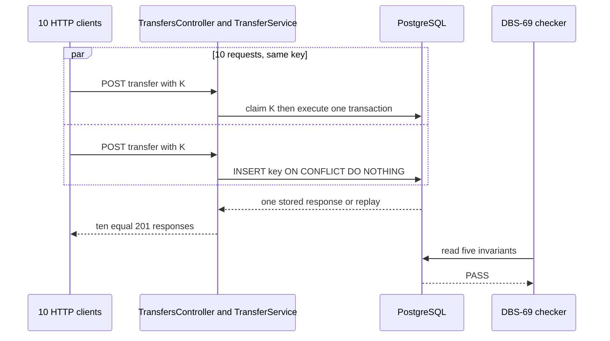
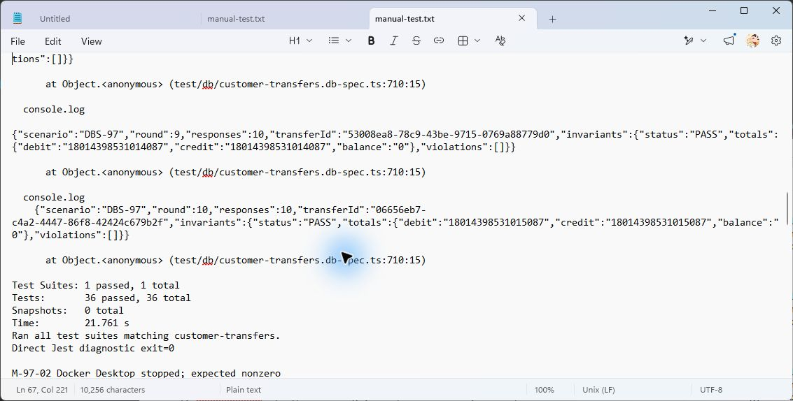
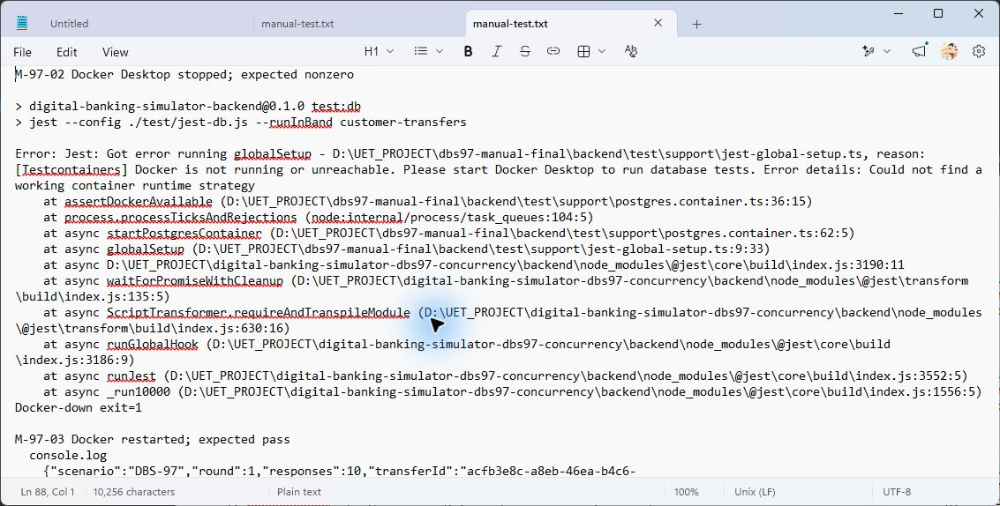
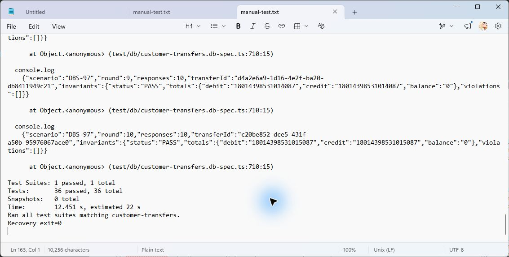

# DBS-97 · Test đồng thời: request trùng song song trên Postgres thật

> **Status:** Implemented · **Vai:** Dev · **Nhánh:** `test/DBS-97-duplicate-request-concurrency` · **PR:** [#84](https://github.com/Lawliet119/digital-banking-simulator/pull/84) · **Cập nhật:** 2026-11-08

## 1. Bối cảnh

- **Task trên board:** Story, Tuần 3, Demo **2**. **Expect:** Chứng minh được gửi trùng không bao giờ trừ tiền hai lần.
- **DoD:**
  1. AC-5.4: 10 request cùng key chạy song song bằng `Promise.all` thật → 1 giao dịch, 2 bút toán, 10 phản hồi giống nhau.
  2. AC-5.3 và AC-5.5 xanh.
  3. Sau mỗi test chạy DBS-69: Nợ = Có, tổng số dư = 0, không tài khoản khách âm.
  4. Chạy 10 lần liên tiếp trong CI không flaky; test đỏ-xanh bất thường được điều tra như lỗi đồng thời, không retry cho qua.
  5. Kịch bản Demo 2 (các bước, lệnh, kết quả mong đợi) ghi ở `load-tests/README` hoặc `04-test-cases.md`.
  6. PR đã merge vào main (CI xanh); Dev review; bảng «Đối chiếu test case» trong PR điền đủ.
- **Phụ thuộc:**
  - DBS-79 — board Done; thực tế `main` đã có [TC-79-01/02/07/08](../../backend/test/db/customer-transfers.db-spec.ts) và feature doc [DBS-79](DBS-79-idempotency-replay.md). TC-79-07 đã dùng `Promise.all` cho 10 request một key, kiểm 1 transfer/2 bút toán/10 body giống nhau; TC-79-01/02 phủ replay và key dùng sai body.
  - DBS-69 — board Done; [`checkLedgerInvariants`](../../backend/test/support/invariants.ts) được gọi trong `afterEach` của suite chuyển tiền và kiểm đủ các bất biến.
  - DBS-39 — board Done; [harness database tạm](../../backend/test/support/temp-database.ts) và Testcontainers/Postgres thật có trong repo, nhưng hiện không chạy được vì Docker daemon tắt.
- **Đã có gì:**
  - Nội dung board “chưa có test đồng thời” đã lạc hậu so với source hiện tại: các assertion cốt lõi của DoD #1–3 có sẵn ở TC-79, không nên sao chép một test cùng hành vi chỉ để đổi mã ticket.
  - Tuy nhiên, [`load-tests/README.md`](../../load-tests/README.md) mới liệt kê kịch bản `duplicate`, chưa có các bước/lệnh/kết quả Demo 2; source hiện có cũng chưa ghi rõ 10 batch liên tiếp là bằng chứng riêng của DBS-97.
  - **Baseline backend:** sau `npm ci`, `npm run lint:check` đạt; `npm run typecheck` đỏ sẵn trên `main` ở `src/scripts/manual-smoke.dbs50.ts:147` (JWK không gán được `JwksKey`); `npm test` đạt **69 suites, 1129/1129 tests**. `docker compose up -d` thất bại vì Docker Desktop daemon không chạy, nên `test:e2e`/`test:db` với Postgres thật chưa được chạy và không được coi là xanh.
- **Ngoài phạm vi:** không đổi `TransferService`, idempotency schema, khóa/ràng buộc, event, audit, OpenAPI, `ErrorCode`, money rule hoặc thêm retry. Không thay Postgres thật bằng mock/SQLite và không khai báo xanh khi Docker chưa sẵn sàng.
- **Câu hỏi mở:**
  1. **Phạm vi tối thiểu chống trùng.** Đề xuất: giữ các assertion TC-79 hiện có, bổ sung duy nhất phần còn thiếu của DBS-97 — 10 batch thật, mỗi batch 10 request `Promise.all`, kiểm bất biến sau từng batch và ghi Demo 2 tái chạy được — thay vì tạo test trùng lặp.
  2. **Docker/Postgres.** Đề xuất: chỉ đi tới G2 khi bạn xác nhận Docker Desktop có thể được bật; không có Docker thì DoD #1–4 không thể được chứng minh theo yêu cầu.
  3. **Sai khác board/repo.** Đề xuất: ghi rõ trong feature doc rằng core evidence đã có từ DBS-79 và chỉ nhận phần evidence thiếu vào ticket này; không tự đổi trạng thái board.

**Quyết định ở G1 (2026-11-08):** người dùng trả lời «duyệt G1». Dùng phạm vi bổ sung bằng chứng tối thiểu, không clone TC-79; Docker/Postgres vẫn là điều kiện bắt buộc trước Phase 4 và không được thay bằng mock.

## 2. Hành vi

### 2.1 Mười batch request trùng thật

Dữ liệu cố định: A được nạp `1000000` đồng, B bắt đầu `0`; mỗi batch chuyển `1000` đồng, thử sai key bằng amount `2000`. Sau 10 batch A còn `990000`, B có `10000`; không vượt hạn mức lần/ngày hiện hành.

1. Mỗi batch tạo một `Idempotency-Key` UUID mới cho cùng một customer/source/destination đã được cấp tiền qua API nạp tiền thật. Khởi tạo **10** HTTP `POST /v1/transfers` cùng body và cùng key bằng một `Promise.all` duy nhất; không `sleep`, không tuần tự hóa và không retry test khi có lỗi.
2. Mỗi batch phải nhận đúng 10 response `201` có body bằng nhau; cùng tham chiếu một `transferId`. PostgreSQL phải có thêm đúng 1 `transfers COMPLETED`, 2 `ledger_entries`, 1 `audit_log`, 1 `outbox_events` và 1 `idempotency_keys`; source chỉ giảm một lần và destination chỉ tăng một lần.
3. Ngay sau batch, gửi lại cùng key/cùng body một lần: trả `201` với body đã lưu, không có row hoặc thay đổi balance mới (AC-5.3). Gửi lại cùng key nhưng amount khác: trả `422 IDEMPOTENCY_KEY_REUSED`, không có row hoặc thay đổi balance mới (AC-5.5).
4. Sau từng batch gọi `checkLedgerInvariants(db.runner)`: trạng thái `PASS`, không vi phạm Nợ/Có, tổng số dư, số dư khách và cặp bút toán. `afterEach` hiện có vẫn là lớp kiểm độc lập cuối test.
5. Một batch không hoàn thành trước deadline chẩn đoán thì fail ngay; deadline chỉ phát hiện treo, không tạo retry. Mọi `500`, `503`, body khác nhau, thêm row hoặc invariant fail là lỗi đồng thời cần điều tra.

Ví dụ response thành công:

```json
{ "transferId": "a1b2c3d4-1111-4222-8333-123456789abc", "status": "COMPLETED" }
```

Ví dụ dùng sai key:

```json
{ "errorCode": "IDEMPOTENCY_KEY_REUSED", "correlationId": "..." }
```

## 3. Kiến trúc

- **Vị trí:** thêm các case `TC-97-01…03` vào `backend/test/db/customer-transfers.db-spec.ts`; cập nhật `load-tests/README.md` bằng kịch bản Demo 2. Không thay đổi `TransferService`, `LedgerPostingService`, controller, DTO hoặc migration.
- **Interface dùng:** test chỉ dùng helper đã có `startDepositApp(databaseUrl)`, `seedDepositTarget(runner)`, HTTP `POST /v1/operator/deposits` để seed tiền, HTTP `POST /v1/transfers`, và `checkLedgerInvariants(runner)`. Không cung cấp exported API mới.
- **Dữ liệu:** database tạm migrated thật của Testcontainers; mỗi batch có key mới. Không có `INSERT/UPDATE` trực tiếp cho balance, transfers, ledger, audit, outbox hoặc idempotency key.
- **Ranh giới transaction:** không đổi. Đường thật là claim key `INSERT ... ON CONFLICT DO NOTHING` → lock account theo id → guard → transfer/double entry/audit/outbox/response trong một `TransactionService.run`; replay đọc response đã commit. Test không mở transaction nghiệp vụ, không gọi Redis/SQS trong transaction.
- **Sơ đồ:**



- **Thay đổi cấp hệ thống:** ghi lệnh/demo local ở `load-tests/README.md`; không đổi docs/03, database design, event contract, ADR, threat model hoặc public API. Cột T7 của threat model được coi là evidence của DBS-97 chỉ sau test Postgres thật xanh.

## 4. Test cases tự động

| ID | Truy vết (DoD / AC) | Lớp | Given · When · Then | `errorCode` mong đợi |
|---|---|---|---|---|
| TC-97-01 | DoD #1, #3, #4; AC-5.4 | integration–e2e Postgres thật | Customer A có tiền, B active; lặp 10 batch, mỗi batch `Promise.all` 10 POST cùng key → 10×201 body bằng nhau; đúng footprint 1/2/1/1/1, balance đổi đúng một lần, checker PASS sau từng batch | — |
| TC-97-02 | DoD #2; AC-5.3 | integration–e2e Postgres thật | Sau một batch TC-97-01, gửi lại cùng key/body → 201 body lưu y hệt, counts/balance không đổi | — |
| TC-97-03 | DoD #2; AC-5.5 | integration–e2e Postgres thật | Sau một batch thành công, gửi lại K với amount khác → 422, counts/balance không đổi | `IDEMPOTENCY_KEY_REUSED` |
| TC-97-04 | DoD #4 | integration–e2e Postgres thật | Mỗi batch có deadline chẩn đoán; không retry response đỏ. Đột biến cục bộ dùng 10 key khác nhau phải làm TC-97-01 fail footprint/balance thay vì xanh giả | — |
| TC-97-05 | DoD #5 | docs | Link check và README kiểm bước setup/lệnh/kết quả Demo 2; không gọi k6 chưa tồn tại | — |
| Quy trình | DoD #6 | — | CI xanh, Dev review, merge và bảng đối chiếu PR thực hiện sau G4, không nhận đã đạt trước thời điểm đó | — |

## 5. Test thủ công

Điều kiện: Node 24, checkout sạch, dependency qua `npm ci`, Docker Desktop daemon chạy. Đây là task test/harness nên phải chứng minh vừa đường chạy thật vừa việc Docker không sẵn sàng **fail loudly**; dừng Docker Desktop cần thực hiện/đồng ý của người vận hành vì ảnh hưởng môi trường chung.

Cả M-97-01/02/03 chạy trong Git Bash với `env -u DATABASE_URL npm run test:db -- --runInBand customer-transfers`. Unset chỉ trong process con, không sửa env file: globalSetup bắt buộc đi qua Testcontainers thay vì vô tình dùng PostgreSQL bên ngoài Docker. Ghi log container PostgreSQL 17 khởi tạo ở đường thành công; khi Docker tắt phải fail ngay globalSetup.

| Bước | Việc làm (lệnh hoặc thao tác) | Kết quả mong đợi |
|---|---|---|
| M-97-01 | Từ `backend/`, chạy `npm run test:db -- --runInBand customer-transfers` với Docker daemon chạy | TC-97-01…03 và checker PG thật xanh; transcript ghi suite/test count, không token/JWT |
| M-97-02 | Sau khi người vận hành dừng Docker Desktop, chạy lại chính lệnh DB test | Testcontainers/DB connection fail với lỗi rõ ràng và exit khác 0; không có `.skip` hoặc PASS giả |
| M-97-03 | Bật lại Docker Desktop, chạy lại M-97-01 | Suite xanh lại; chứng minh test không phụ thuộc state lỗi/máy tạm |

## 6. Domain review (AI)

**Reviewer vòng 1:** subagent độc lập gpt-6-luna · 2 finding: 0 blocking, 1 should-fix, 1 minor · Verdict REVISE · [raw reply](screenshots/DBS-97/domain-review.md).

| # | Mức | Phát hiện | Xử lý |
|---|---|---|---|
| 1 | should-fix | DATABASE_URL external có thể làm Docker-down vẫn xanh | Đã chốt `env -u DATABASE_URL` cho cả ba bước manual để ép Testcontainers. |
| 2 | minor | Amount/funding chưa xác định có thể vướng hạn mức hợp lệ | Đã chốt funding 1000000, amount 1000 và sai key amount 2000; tổng chuyển 10000. |

**Reviewer vòng 2:** subagent độc lập gpt-6-astra · 0 finding (0 blocking, 0 should-fix, 0 minor) · **Verdict: APPROVE** · [raw reply vòng 2](screenshots/DBS-97/domain-review-round-2.md).

## 7. Kế hoạch triển khai

**G2:** người dùng trả lời «duyệt g2», duyệt §2–§5. Status Design approved; chờ G3.

| Bước | File | Test viết trước | Kết quả đỏ | Lệnh chứng minh (backend/) | Commit dự kiến, chỉ tạo khi được cho phép |
|---|---|---|---|---|---|
| 0 | Không sửa file: npm ci tại worktree; Docker/PG17 thật; baseline | Lint/typecheck/unit/e2e/db/build hiện hữu | Base typecheck đỏ TS2322 manual-smoke.dbs50.ts:147; prerequisite cần xử lý trước test mới | npm ci; npm run lint:check; npm run typecheck; npm test -- --runInBand; npm run test:e2e -- --runInBand; npm run test:db -- --runInBand; npm run build | — |
| 1 | backend/test/db/customer-transfers.db-spec.ts | Mở rộng TC-79-07 thành evidence TC-97-01…03 theo 10 round, giữ tên/truy vết TC-79; mỗi round dùng key mới, 10 request cùng key, replay/mismatch và checker; không tạo ca trùng chức năng. Body/count/balance assert sau mỗi bước; timeout HTTP hữu hạn, không retry | Hành vi đã có nên có thể xanh ngay; chứng minh độ nhạy bằng đột biến test fixture: 10 key khác nhau phải làm footprint/balance fail, sau đó hoàn nguyên đúng hunk | npm run test:db -- --runInBand customer-transfers | test(ledger): repeat duplicate bursts and prove exact replay |
| 2 | load-tests/README.md | TC-97-05: Demo2 có setup PG17, lệnh chạy, dữ liệu 1000000/1000 và kết quả 10 round/checker; CI job db hiện chạy toàn bộ file nên chạy đủ 10 round ngay trong một CI run | Chưa chạy; không cần sửa workflow | npm run test:db -- --runInBand customer-transfers; link checker | docs(test): document duplicate request demo |
| 3 | docs/features/DBS-97-duplicate-request-concurrency.md; docs/features/screenshots/DBS-97/{domain-review.md,domain-review-round-2.md,red-green.txt,manual-test.txt,verification.txt,01-bursts.png,02-docker-down.png,03-recovery.png,plan-sweep.txt}; docs/features/README.md; docs/BACKLOG.md | M-97-01/02/03 trong clone/worktree sạch khi đã được phép lưu commit; env -u DATABASE_URL ép Testcontainers, Docker down thất bại rõ rồi recovery; toàn bộ TC | Chưa chạy; không tuyên bố 10 round local là CI evidence | Full baseline và targeted suite, git diff --check, script check-doc-links.mjs | docs(test): record concurrency and manual evidence |

**Rủi ro/cách lùi:** money test dùng PG17 và nạp API thật; nếu timeout/race phải điều tra, không retry đến xanh. Không tắt Docker khi chưa được người vận hành đồng ý ở action-time. Nếu không thể làm M02, ghi chưa chạy, đề nghị G4 chấp nhận theo tên. Giữ body/errorCode assertion sẵn của TC79; không hạ độ sâu. Revert commit của task khi được phép hoặc hoàn đúng hunk task trước commit.

**Plan sweep:** DoD #1/#2/#3 → bước1; #4 → 10 round trong suite CI db sẵn, cần URL CI sau khi được cho phép push; #5 → bước2; #6 → bước3/handoff Dev review/merge. TC-97-04 mutation có bước1; TC-97-05 có bước2; M01…03 có bước3. BL-127 chỉ nhận phần checker trong suite này, các load/scheduler khác còn ngoài phạm vi; BL-125 crash harness, BL-155 revoke/cache, BL-174 review PR cũ, BL-177 lệch clock không giải quyết trong task này. Không đổi production code/schema/env/guard/retry.

## 8. Kết quả

**G3:** người dùng trả lời «duyệt g3», chấp nhận kế hoạch cùng đề xuất sửa baseline và commit local; không cấp quyền push/PR. Phase 4 đang thực hiện.

**Đề xuất prerequisite xin duyệt cùng G3:** thêm duy nhất `backend/src/scripts/manual-smoke.dbs50.ts` vào allowlist trước bước0, đổi lời gọi `fixture.setKeys([publicJwk])` thành object copy `fixture.setKeys([{ ...publicJwk }])` để TypeScript suy luận object tương thích index signature. Không sửa guard hay logic xác thực. Test đỏ là typecheck TS2322 đã chạy; chứng minh xanh bằng typecheck và chạy script smoke hiện có. Chỉ thực hiện nếu G3 chấp nhận đề xuất này; nếu không, chờ baseline được sửa bởi task khác. Thay đổi tương đương ở ba nhánh được ghi rõ dependency baseline, không giả là tính năng của ticket.

**Quyền git hiện tại:** G3 đã chấp nhận commit local; sau đó người dùng trả lời «thực hiện đi» cho đề xuất push ba nhánh, mở ba Draft PR và kiểm chứng CI Linux. Quyền này đã được thực hiện ở PR #84; G4 chưa duyệt, PR giữ Draft, không merge hoặc đổi board.

**Code cuối:** 85617e6. Targeted 10round×10request đạt; full customer-transfers đạt36/36 không skip khi chạy từ PowerShell. Unit toàn bộ 69suites/1129tests đạt, lint/typecheck/build xanh.

| Case | Evidence | Kết quả |
|---|---|---|
| TC-97-01/02/03 | TC-79-07 mở rộng; manual-test.txt | Đạt trên PG thật ở lượt chạy thành công: mỗi batch 10response đồng nhất, footprint1/2/1/1/1, replay/mismatch không ghi thêm, checkerPASS |
| TC-97-04 | red-green.txt | Đột biến 10key khác nhau làm fail body/transferId, sau đó hoàn đúng hunk |
| TC-97-05 | load-tests/README.md | Demo2 có lệnh/data/result và scope CI/local |
| DoD CI/review/merge | BL-192 | Chưa có CI run thật/PR |

**Manual:** checkout sạch detached tại code cuối (D:/UET_PROJECT/dbs97-manual-final); dependency dùng junction tới node_modules cùng lockfile. M-97-01 bằng npm/Git Bash hai lần thoát127, không đủ báo cáo (một lượt đến round4); chưa đạt theo đúng lệnh gốc. Chạy diagnostic gọi node/Jest trực tiếp trên cùng checkout đạt36/36, 10round checkerPASS, exit0; không nhận là đã giải thích hoặc sửa exit127. M-97-02/03 đang chờ cửa sổ dừng Docker sau các run đang chạy. [Raw manual](screenshots/DBS-97/manual-test.txt), [mutation](screenshots/DBS-97/red-green.txt).

**Ảnh manual:** đã chụp từ cửa sổ Notepad riêng đang mở raw `manual-test.txt` trên code cuối; không sửa nội dung transcript hoặc lấy dữ liệu cửa sổ khác. Đây là ảnh xem lại output thực đã lưu, không phải lượt chạy mới. Diagram chưa có visual-render QA.







**Bàn giao:** BL-192 theo dõi cả exit127 chưa rõ nguyên nhân, manual/CI thật/Dev review/merge/ảnh. Không xóa BL-125 harness chỉ vì có một run xanh. Chưa push/PR/board.

### Kiểm chứng CI Linux sau khi mở Draft PR

Các ghi chú “chưa push/PR/CI” ở trên là snapshot trước lần cho phép này. [PR #84](https://github.com/Lawliet119/digital-banking-simulator/pull/84) đã có [CI run 42467336590](https://github.com/Lawliet119/digital-banking-simulator/actions/runs/42467336590) trên head `dae60059eee8c7bb43437de4dcc6660956e05f68`: lint, typecheck, unit, e2e, db, build đều success (6/6), không rerun/retry workflow.

DB 42 suites / 724 tests; E2E chính 15 suites / 153 tests; các bước Testcontainers/service tiếp theo 5 + 2 + 5 + 8 + 3 + 4 + 9 tests; tất cả đạt, không skip. Log DB có đúng 10 vòng DBS-97, mỗi vòng 10 response, invariants PASS và violations [].

DoD 10 vòng liên tiếp trên CI đã có evidence. M-97-01 theo npm/Git Bash vẫn chưa hoàn tất; recovery direct node/Jest được giữ là khác launcher. BL-192 tiếp tục theo dõi Windows exit127, Dev review/merge và ba PNG; không coi CI xanh là đã sửa lỗi Windows.

Code không đổi sau manual; các commit sau run CI trên chỉ sửa hồ sơ/evidence và bổ sung đủ 3 PNG đã định ở §7. Các ghi chú thiếu PNG trước đó được thay bằng ảnh thật ở trên; không còn ảnh thiếu. Diff file vẫn khớp §7. Status giữ Plan approved để trình G4.

**Sau rebase (techlead review PR #84, 2026-11-09):** rebase lên `main` `18f93dc`; `customer-transfers.db-spec` chạy lại trên PostgreSQL 17 thật: 36/36 test đạt (gồm TC-79-07/TC-97-01..03), lint và typecheck sạch. `BL-182` của PR bị đánh lại thành `BL-192` vì main đã dùng `BL-182`; dòng DBS-97 trong `docs/features/README.md` được gộp vào bảng chính (trước đó nằm trong bảng thứ hai có header riêng). Bằng chứng `manual-test.txt` và ba ảnh là của lượt trước rebase (code test không đổi).

### Quyết định G4 · 2026-11-08

Người dùng trả lời «duyệt g4» trực tiếp cho đề nghị bàn giao kèm các giới hạn đã nêu. G4 được duyệt; trạng thái chuyển Implemented cho phạm vi đã bàn giao và cho phép chuyển PR #84 sang ready for review. Những ghi chú giữ Draft/Plan approved phía trên là lịch sử trước quyết định này. Không có quyền merge hoặc sửa board.

Chấp nhận M-97-01 chưa hoàn tất bằng npm/Git Bash và dùng diagnostic/recovery direct node/Jest ở M-97-03 làm evidence thay thế; lỗi launcher Windows exit127 chưa rõ nguyên nhân tiếp tục ở BL-192, không coi đã sửa. Chấp nhận diagram chưa visual-render QA; Dev review/merge vẫn chưa thực hiện.

Trước G4, [CI run 42468365868](https://github.com/Lawliet119/digital-banking-simulator/actions/runs/42468365868) đã xác minh head `019eb3b466ea2e6a0dc5fcb04ce0191fffa7543a`: cả sáu job lint/typecheck/unit/e2e/db/build success, attempt 1. Lần ghi nhận G4 này chỉ sửa tài liệu; không thay code sau manual. Các giới hạn được chấp nhận không đồng nghĩa đã được khắc phục hoặc đã merge/nộp P2.

## 9. Tài liệu đã cập nhật

**Cập nhật manual cuối:** người dùng đã cho phép dừng/bật Docker Desktop. M97-02 chạy qua npm ở checkout sạch, Docker thực sự dừng → lỗi globalSetup Testcontainers và exit1 (đúng mong đợi). Sau restart/daemon29.5.2, M97-03 gọi cùng Jest trực tiếp qua node (đã ghi khác launcher) đạt36/36, 10round/checkerPASS, exit0. Lỗi127 trước đó chưa được giải thích; không nhận recovery xanh là đã sửa. E2E nhánh97 thử nhưng wrapper thoát127 không summary; unit/lint/typecheck/build xanh. Bước M01 theo đúng npm launcher vẫn chưa coi hoàn tất.

Đã cập nhật feature doc/index/BACKLOG và evidence theo §7; load-tests README; thêm BL-192.
