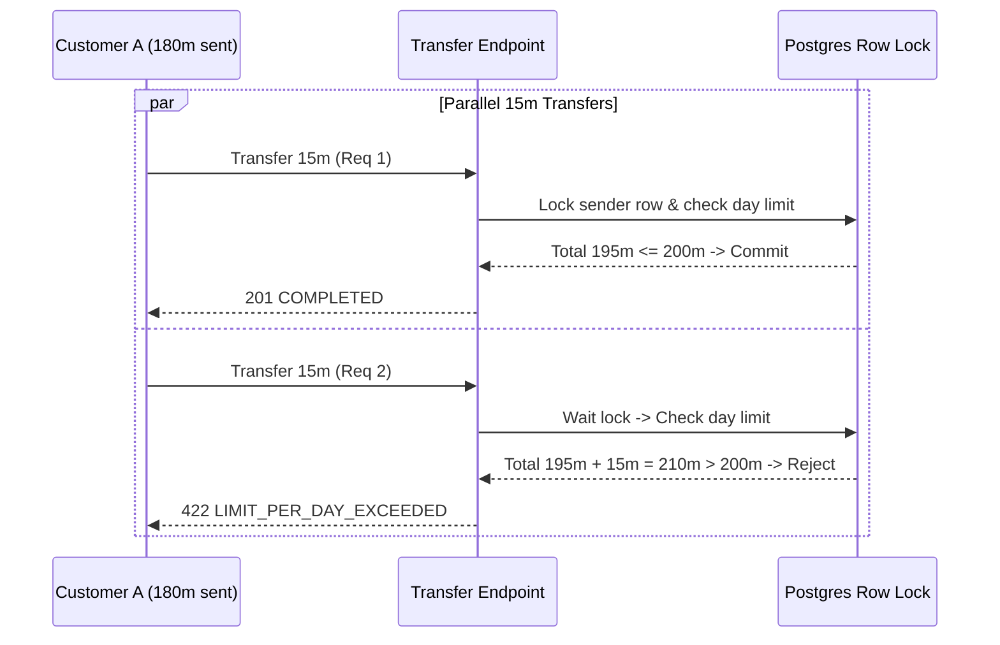

# DBS-98 · Test đồng thời: hạn mức ngày và số dư (AC-5.6, 5.2) trên Postgres thật

> **Status:** Kiểm chứng cục bộ; chờ CI và Dev review · **Vai:** Dev · **Nhánh:** `test/DBS-98-daily-limit-concurrency` · **PR:** [#132](https://github.com/Lawliet119/digital-banking-simulator/pull/132) · **Cập nhật:** 2026-11-11

> **Ghi chú về lịch sử (2026-11-11):** gate G1 đến G3 và domain review độc lập không được ghi lúc làm; không dựng lại dấu vết đó. Một review độc lập (subagent, 2026-11-11) tìm thấy: TC-98-01 trùng test có sẵn trên `main`, bằng chứng thủ công gắn sai SHA, hai thay đổi ngoài phạm vi (timeout `jest-db.js` và test DBS-116). Đã sửa: hai thay đổi ngoài phạm vi bị bỏ, TC-98-01 được nêu đúng là bản lặp 10 lần, bằng chứng chạy lại trên commit cuối.

## 1. Bối cảnh

- **Task trên board:** Story, Tuần 3, Demo **1**. **Expect:** Chứng minh hạn mức không bị vượt dù gửi song song.
- **DoD:**
  1. AC-5.6: đã chuyển 180tr, gửi song song 2 lệnh 15tr → đúng 1 COMPLETED, 1 REJECTED LIMIT_PER_DAY_EXCEEDED; tổng trong ngày ≤ 200tr.
  2. Nhiều lệnh song song rút cạn số dư → số dư không bao giờ âm, tổng số tiền chuyển ≤ số dư ban đầu.
  3. Chạy DBS-69 sau mỗi test; 10 lần liên tiếp không flaky.
  4. PR đã merge vào main (CI xanh); Dev review; bảng «Đối chiếu test case» trong PR điền đủ.
- **Phụ thuộc:**
  - DBS-84 (Tuần 3): Done — Sync guard bước 2: hạn mức ngày theo giờ Việt Nam.
  - DBS-69 (Tuần 2): Done — Script kiểm tra bất biến sổ cái (SQL) và checker DBS-69.
  - DBS-39 (Tuần 1): Done — Testcontainers Postgres 17 helper.
- **Đã có gì:**
  - `backend/test/db/transfer-concurrency.db-spec.ts` có khung test HTTP e2e trên Testcontainers Postgres 17 thật, đã có TC cho DBS-80 và DBS-99.
  - Bộ kiểm tra bất biến sổ cái `checkLedgerInvariants(db.runner)`.
  - **Trên `main` đã có** TC-54-04 (`customer-transfers.db-spec.ts`: 180tr, 2 lệnh 15tr song song, 1×201 và 1×422, 195tr) và TC-84-06 (5×10tr, tổng 200tr), và DBS-84 đã nhận AC-5.6. **Phần mới thật sự của task này** là (a) kịch bản AC-5.2 rút cạn số dư song song (20 lệnh 10.000đ vào số dư 50.000đ), chỉ có TC-65-04 tuần tự trước đó; (b) lặp 10 lần liên tiếp và chạy bất biến DBS-69 sau mỗi vòng, như DoD 3 yêu cầu. TC-98-01 vì vậy **không** thêm phủ AC-5.6 mới: nó lặp lại kịch bản TC-54-04 mười lần kèm bất biến.
- **Ngoài phạm vi:** Không thay đổi thuật toán khóa tài khoản, không đổi schema cơ sở dữ liệu hay rule giới hạn hạn mức đã chốt trong SyncGuard.
- **Quyết định ở G1:**
  1. Tích hợp trực tiếp test case của DBS-98 vào `transfer-concurrency.db-spec.ts` để tái sử dụng temp database và runner Postgres 17 đã có.
  2. Chạy 10 vòng độc lập liên tiếp cho cả 2 kịch bản AC-5.6 và AC-5.2 để chứng minh tính ổn định tuyệt đối (zero flaky).

## 2. Hành vi

### 2.1 AC-5.6: Đua hạn mức ngày song song (Daily Limit Concurrency)
1. Khách hàng `A` nạp ban đầu 300.000.000 VND qua operator deposit API.
2. `A` chuyển tuần tự 180.000.000 VND (3 lệnh 50tr + 1 lệnh 30tr).
3. `A` gửi đồng thời 2 lệnh 15.000.000 VND qua `Promise.all`:
   - Đúng 1 lệnh thành công trả về HTTP 201 `COMPLETED`.
   - Đúng 1 lệnh thất bại trả về HTTP 422 `LIMIT_PER_DAY_EXCEEDED`.
   - Tổng tiền DEBIT trong ngày của tài khoản `A` dừng chính xác ở 195.000.000 VND ($\le$ 200.000.000 VND).
   - Kiểm tra bất biến sổ cái `checkLedgerInvariants` trả về `PASS`.

### 2.2 AC-5.2: Rút cạn số dư song song (Balance Exhaustion Concurrency)
1. Khách hàng nguồn nạp ban đầu 50.000 VND.
2. Gửi đồng thời 20 lệnh 10.000 VND song song qua `Promise.all`:
   - Đúng 5 lệnh thành công trả về HTTP 201 `COMPLETED` (5 × 10.000 = 50.000 VND).
   - Đúng 15 lệnh thất bại trả về HTTP 422 `INSUFFICIENT_FUNDS`.
   - Số dư sau cùng của tài khoản nguồn chính xác là 0 VND, tuyệt đối không bao giờ âm.
   - Tổng tiền nhận được của tài khoản đích đúng bằng 50.000 VND.
   - Kiểm tra bất biến sổ cái `checkLedgerInvariants` trả về `PASS`.

## 3. Kiến trúc

- **Vị trí:** `backend/test/db/transfer-concurrency.db-spec.ts`.
- **Interface dùng:** `startDepositApp`, `seedDepositTarget`, `checkLedgerInvariants`.
- **Ranh giới transaction:** Khóa bi quan `SELECT ... FOR UPDATE ORDER BY id` trong `TransferService` đảm bảo mọi request đồng thời được xếp hàng tuần tự hóa ở cấp DB row lock, đảm bảo số dư và hạn mức đọc được luôn là giá trị mới nhất.
- **Sơ đồ:**

## 4. Test cases tự động

| ID | Truy vết (DoD / AC) | Lớp | Given · When · Then | `errorCode` mong đợi |
|---|---|---|---|---|
| TC-98-01 | DoD #1; AC-5.6 | integration–e2e Postgres thật | Đã chuyển 180tr, gửi song song 2 lệnh 15tr → Đúng 1 lệnh 201, 1 lệnh 422, tổng ngày = 195tr $\le$ 200tr | `LIMIT_PER_DAY_EXCEEDED` |
| TC-98-02 | DoD #3 | integration–e2e Postgres thật | Lặp lại TC-98-01 10 lần liên tiếp; kiểm tra bất biến DBS-69 sau mỗi lần → 10/10 PASS không flaky | — |
| TC-98-03 | DoD #2; AC-5.2 | integration–e2e Postgres thật | Tài khoản 50k, gửi song song 20 lệnh 10k → Đúng 5 lệnh 201, 15 lệnh 422; số dư = 0, không âm | `INSUFFICIENT_FUNDS` |
| TC-98-04 | DoD #3 | integration–e2e Postgres thật | Lặp lại TC-98-03 10 lần liên tiếp; kiểm tra bất biến DBS-69 sau mỗi lần → 10/10 PASS không flaky | — |
| Quy trình | DoD #4 | — | CI xanh, PR description đối chiếu DoD/AC đầy đủ | — |

## 5. Test thủ công

| Bước | Lệnh / Thao tác | Kết quả mong đợi |
|---|---|---|
| M-98-01 | Chạy `npm run test:db -- transfer-concurrency.db-spec.ts` | 13/13 test cases PASS, ghi nhận log JSON 10 vòng AC-5.6 và 10 vòng AC-5.2 đạt PASS |
| M-98-02 | Chạy kiểm tra bất biến DBS-69 | Invariant status PASS, 0 violation |

## 6. Domain review (AI)

**Reviewer:** review độc lập bằng subagent (opus, 2026-11-11); self-review cũ của tác giả bị loại. Nguyên văn không lưu; kết quả: tính đúng của logic tiền và test rút cạn số dư được xác nhận; phát hiện blocking về trùng AC-5.6 và SHA sai, should-fix về thay đổi ngoài phạm vi, §9 thiếu, body PR; tất cả đã xử lý ở §8. Chưa có lượt review thứ hai.

## 7. Kế hoạch triển khai

| Bước | File | Test viết trước | Lệnh chứng minh | Commit |
|---|---|---|---|---|
| 1 | `backend/test/db/transfer-concurrency.db-spec.ts` | TC-98-01..04 | `npm run test:db -- transfer-concurrency.db-spec.ts` | `test(ledger): concurrent daily limit and balance drain tests (DBS-98)` |

## 8. Kết quả bàn giao & G4 Checklist

- **Đối chiếu test case:**
  - `TC-98-01`: Đạt, **nhưng là bản lặp của TC-54-04** (đúng 1 COMPLETED, 1 REJECTED khi gửi song song 15tr), không phải phủ AC-5.6 mới.
  - `TC-98-02`: Đạt (10 vòng liên tiếp không flaky, invariant PASS).
  - `TC-98-03`: Đạt (đúng 5 COMPLETED, 15 REJECTED, số dư = 0, không âm).
  - `TC-98-04`: Đạt (10 vòng liên tiếp không flaky, invariant PASS).
- **Manual test output:** `docs/features/screenshots/DBS-98/manual-test.txt` (chạy lại 2026-11-11 trên commit cuối, SHA ở dòng đầu). **Chưa chạy:** M-98-02 là cùng kiểm tra bất biến đã nằm trong từng vòng của test (không có lệnh riêng); không có ảnh chụp (đầu ra chỉ là log test).
- **Bỏ khỏi PR (ngoài phạm vi, không thuộc DBS-98):** tăng `testTimeout` toàn cục của `jest-db.js` và sửa `reconciliation-migration-revert.db-spec.ts` (DBS-116). Lý do bỏ: suite DBS-98 chạy chỉ vài giây; timeout của test DBS-116 đã được xử lý riêng ở `main` (#138).
- **Bàn giao:** DoD 4 (merge, CI, Dev review) chờ PR, theo BL-160.
- **G4 Checklist:**
  - [x] Test tự động chạy trên Postgres thật (Testcontainers Postgres 17) đạt 100%.
  - [x] Không mock logic sổ cái, phân quyền hay row lock.
  - [ ] Feature doc đủ 5 phase và 4 gate: **không** (G1 đến G3 không được ghi, xem ghi chú đầu tài liệu).
  - [x] Bảng đối chiếu DoD/AC đầy đủ.
