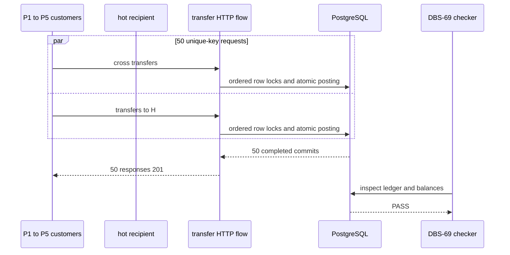
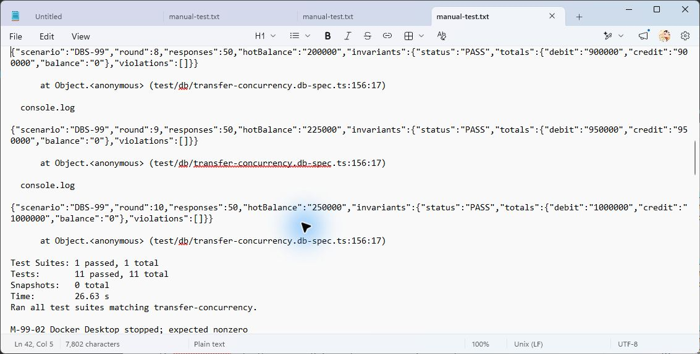
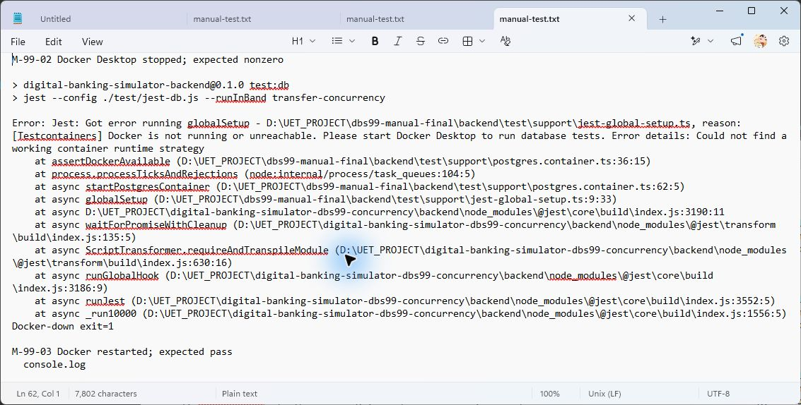
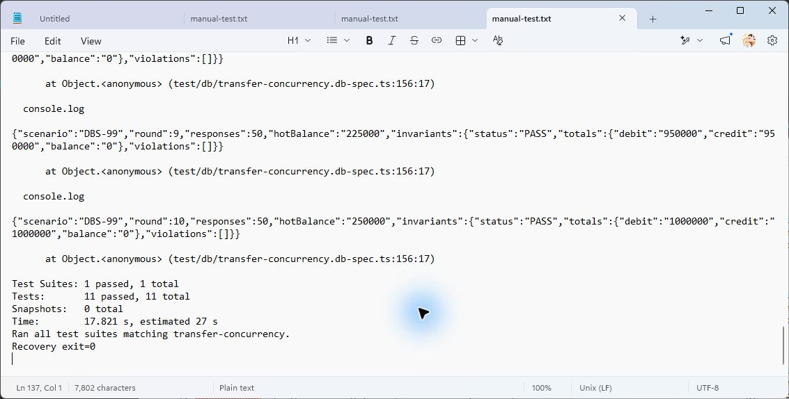

# DBS-99 · Test đồng thời: chuyển chéo và tài khoản nóng

> **Status:** Implemented · **Vai:** Dev · **Nhánh:** `test/DBS-99-concurrent-transfers` · **PR:** [#85](https://github.com/Lawliet119/digital-banking-simulator/pull/85) · **Cập nhật:** 2026-11-08

## 1. Bối cảnh

- **Task trên board:** Story, Tuần 3, Demo **1**. **Expect:** Bằng chứng tự động cho Demo 1 (concurrent transfer).
- **DoD:**
  1. AC-5.9: ít nhất 50 luồng chuyển chéo giữa nhiều khách, một tài khoản nhận rất nhiều lệnh; kết thúc: tổng Nợ = tổng Có, tổng số dư = 0, không tài khoản khách âm, không deadlock treo.
  2. Điều khiển đồng thời bằng worker/`Promise.all` thật, không sleep.
  3. Kịch bản Demo 1 ghi ở `load-tests/README` hoặc `04-test-cases.md`; 10 lần liên tiếp không flaky.
  4. PR đã merge vào main (CI xanh); Dev review; bảng «Đối chiếu test case» trong PR điền đủ.
- **Phụ thuộc:**
  - DBS-80 — board Done; `main` có [test khóa/retry/timeout](../../backend/test/db/transfer-concurrency.db-spec.ts), [manual driver](../../backend/scripts/manual-dbs80.cjs) và [feature doc](DBS-80-lock-order-retry-timeouts.md). Đây là bằng chứng cho khóa theo thứ tự, retry deadlock và timeout, không thay cho tình huống nhiều khách → tài khoản nóng.
  - DBS-69 — board Done; [checker bất biến](../../backend/test/support/invariants.ts) đã có và phải chạy sau business money test.
  - DBS-39 — board Done; harness Testcontainers/Postgres thật tồn tại, nhưng Docker daemon hiện tắt nên chưa thể chạy suite.
- **Đã có gì:**
  - [TC-61-06](../../backend/test/db/customer-transfers.db-spec.ts) và DBS-80 đã kiểm chuyển chéo ở quy mô nhỏ/đối đầu; [BL-156](../BACKLOG.md) xác định rõ phần còn thiếu là nhiều khách chuyển đồng thời vào một tài khoản nhận rất nhiều lệnh.
  - [`load-tests/README.md`](../../load-tests/README.md) mới có một dòng `hot-account`, chưa có kịch bản Demo 1 tái chạy được.
  - **Baseline backend:** sau `npm ci`, `npm run lint:check` đạt; `npm run typecheck` đỏ sẵn trên `main` ở `src/scripts/manual-smoke.dbs50.ts:147` (JWK không gán được `JwksKey`); `npm test` đạt **69 suites, 1129/1129 tests**. `docker compose up -d` thất bại vì Docker Desktop daemon không chạy, nên `test:e2e`/`test:db` với Postgres thật chưa được chạy và không được coi là xanh.
- **Ngoài phạm vi:** không đổi thuật toán khóa, `TransactionService`, retry/deadlock response, schema, event, audit, API, `ErrorCode`, dependency hay quy tắc tiền. Không tạo số dư bằng SQL; fixture phải đi qua luồng nạp tiền hiện có.
- **Câu hỏi mở:**
  1. **Quy mô và độ ổn định.** Đề xuất: 10 batch độc lập, mỗi batch ít nhất 50 transfer thật bằng `Promise.all` giữa nhiều khách, gồm một đích nóng; mọi request phải kết thúc trong timeout rõ ràng và checker DBS-69 chạy sau mỗi batch. Cách này thỏa cả “≥50 luồng” và “10 lần liên tiếp”, không dùng `sleep`.
  2. **Demo 1.** Đề xuất: thêm hướng dẫn chạy DB suite/dữ liệu/kết quả mong đợi vào `load-tests/README.md`, sau đó xóa BL-156 nếu test phủ đúng toàn bộ gap.
  3. **Docker/Postgres.** Đề xuất: chỉ đi tới G2 khi bạn xác nhận Docker Desktop có thể được bật; không có Docker thì không thể chứng minh task tiền này theo DoD.

**Quyết định ở G1 (2026-11-08):** người dùng trả lời «duyệt G1». Phương án 10 batch × ít nhất 50 transfer, Demo 1 trong `load-tests/README.md` và xử lý BL-156 khi evidence đủ được duyệt; Docker/Postgres thật vẫn là điều kiện bắt buộc trước Phase 4.

## 2. Hành vi

### 2.1 Burst nhiều khách và một đích nóng

1. Fixture tạo năm khách nguồn `P1…P5` và một khách nhận nóng `H`; mỗi `P` nhận `100000` đồng qua `POST /v1/operator/deposits`, `H` bắt đầu 0. Không seed balance, transfer, ledger hoặc audit bằng SQL.
2. Mỗi batch dựng đúng 50 request độc lập, key UUID riêng: với `r = 0…4` và `i = 0…4`, tạo `Pᵢ → P(i+1 mod 5)` amount `1000` (25 lệnh chéo; mỗi P vừa gửi vừa nhận đúng 5 lần), rồi tạo năm lệnh `Pᵢ → H` cho mỗi `r` (25 lệnh nóng; mỗi P gửi H đúng 5 lần). Tất cả được khởi tạo một lần qua `Promise.all`; không có `sleep`, worker giới hạn hay retry để làm test xanh.
3. Mỗi request phải trả `201 { transferId, status: "COMPLETED" }`; 50 `transferId` là khác nhau. Sau batch, delta chính xác là +50 transfer, +100 ledger line, +50 audit, +50 outbox và +50 idempotency key; mỗi P giảm `5000`, H tăng `25000`. Sau 10 batch, mỗi P còn `50000`, H có `250000`; chuyển chéo luôn cân bằng theo từng P.
4. Chạy mười batch độc lập liên tiếp trên cùng database tạm. Sau từng batch, `checkLedgerInvariants` phải `PASS`/không có violation; deadline chẩn đoán biến một deadlock treo thành failure rõ ràng, không retry request lỗi.
5. Bất cứ `500`, `503`, response khác 201, transferId trùng, count/balance lệch hoặc invariant fail đều làm case đỏ để điều tra; không coi retry ở service là pass-through của test.

Ví dụ một request:

```json
{
  "fromAccountId": "11111111-1111-4111-8111-111111111111",
  "toAccountId": "99999999-9999-4999-8999-999999999999",
  "amount": "1000"
}
```

## 3. Kiến trúc

- **Vị trí:** thêm `TC-99-01…04` vào `backend/test/db/transfer-concurrency.db-spec.ts`, vì file này đã dùng flow transfer HTTP/Postgres thật và checker DBS-69; cập nhật phần Demo 1 của `load-tests/README.md`; xóa `BL-156` chỉ khi tất cả tiêu chí đã được chứng minh.
- **Interface dùng:** `startDepositApp(databaseUrl)`, `seedDepositTarget(runner)`, token customer do fixture ký, endpoint nạp/chuyển tiền thật và `checkLedgerInvariants(runner)`. Không thêm interface/exported symbol, không mock `TransferService`, PostgreSQL hay lock.
- **Dữ liệu:** mỗi request mang `Idempotency-Key` duy nhất. Số dư mọi peer đủ lớn cho 10 batch; amount là string VND `"1000"`. Query SQL trong test chỉ đọc counts/balance/invariant sau HTTP commit.
- **Ranh giới transaction:** giữ nguyên pipeline accepted trong TransferService: claim key → khóa source/target `FOR UPDATE ORDER BY id` → guard → 2 bút toán + balance + audit + outbox + response trong một transaction retryable. Test chạy qua HTTP nên kiểm cả controller, ownership/customer JWT, service và Postgres thực; không có Redis/HTTP/SQS trong callback.
- **Sơ đồ:**



- **Thay đổi cấp hệ thống:** `load-tests/README.md` ghi Demo 1 local/CI evidence; [threat model T6](../security/threat-model.md) chỉ đổi trạng thái evidence nếu testcase Postgres thật xanh. Không đổi schema, event contract, OpenAPI, ADR, ErrorCode, dependency hay giới hạn lock/transaction của production.

## 4. Test cases tự động

| ID | Truy vết (DoD / AC) | Lớp | Given · When · Then | `errorCode` mong đợi |
|---|---|---|---|---|
| TC-99-01 | DoD #1; AC-5.9 | integration–e2e Postgres thật | P1…P5 funded `100000` qua deposit API, H active; một `Promise.all` gồm năm vòng Pᵢ→P(i+1 mod 5) + năm vòng Pᵢ→H → đủ 50×201, 50 id khác nhau, delta transfer/line/audit/outbox/key = 50/100/50/50/50, từng P −5000 và H +25000 | — |
| TC-99-02 | DoD #1, #3; AC-5.9 | integration–e2e Postgres thật | Thực hiện TC-99-01 mười batch độc lập liên tiếp → mọi batch kết thúc trong deadline, không deadlock treo, không retry test | — |
| TC-99-03 | DoD #1; AC-5.9; T6 | integration–e2e Postgres thật | Sau từng batch và `afterEach`, gọi checker DBS-69 → Nợ=Có, account balance khớp sổ, tổng 0, không khách âm, cặp COMPLETED hợp lệ | — |
| TC-99-04 | DoD #2 | integration–e2e Postgres thật | Đột biến cục bộ đổi các key thành cùng một hoặc bỏ một request khỏi burst phải làm count/balance/transferId assertion fail; test không dùng `sleep`/retry để vượt qua | — |
| TC-99-05 | DoD #3 | docs | Demo 1 ghi setup, lệnh DB suite, quan sát 10×50 và checker; link checker xanh; BL-156 chỉ bị xóa khi TC-99-01…03 đạt | — |
| Quy trình | DoD #4 | — | CI, Dev review, merge và bảng đối chiếu PR chỉ hoàn tất sau G4; không đánh dấu sớm | — |

## 5. Test thủ công

Điều kiện: Node 24, checkout sạch, dependency qua `npm ci`, Docker Desktop daemon chạy. Task test/harness phải chứng minh Docker bị tắt dẫn đến fail rõ; việc dừng Docker Desktop tác động môi trường chung nên chỉ làm khi người vận hành đồng ý hoặc tự thao tác.

Cả M-99-01/02/03 chạy trong Git Bash bằng `env -u DATABASE_URL npm run test:db -- --runInBand transfer-concurrency`. Unset chỉ trong process con ép globalSetup đi qua Testcontainers. Khi Docker-down, phải fail trong globalSetup; khi Docker-up, ghi bằng chứng PostgreSQL 17 container được tạo. Không dùng external DATABASE_URL để kiểm tuyên bố Docker-down.

| Bước | Việc làm (lệnh hoặc thao tác) | Kết quả mong đợi |
|---|---|---|
| M-99-01 | Từ `backend/`, chạy `npm run test:db -- --runInBand transfer-concurrency` khi Docker chạy | TC-99-01…03 chạy trên Postgres thật; transcript có 10 batch, 50 transfer/batch và checker PASS, không token/JWT |
| M-99-02 | Người vận hành dừng Docker Desktop; chạy lại cùng lệnh | Testcontainers/DB connection fail rõ với exit khác 0, không `.skip` hay PASS giả |
| M-99-03 | Bật Docker Desktop trở lại; chạy lại M-99-01 | Suite xanh sau khôi phục; chứng minh script không che lỗi Docker hay phụ thuộc state cũ |

## 6. Domain review (AI)

**Reviewer:** subagent độc lập gpt-6-luna · 0 finding (0 blocking, 0 should-fix, 0 minor) · **Verdict: APPROVE** · [raw reply](screenshots/DBS-99/domain-review.md). Đây là review thiết kế; test/manual chưa chạy.

**Review vòng 2:** subagent độc lập gpt-6-astra, kiểm cả cập nhật ép Testcontainers ở §5 · 0 finding (0 blocking, 0 should-fix, 0 minor) · **Verdict: APPROVE** · [raw reply vòng 2](screenshots/DBS-99/domain-review-round-2.md).

## 7. Kế hoạch triển khai

**G2:** người dùng trả lời «duyệt g2», duyệt §2–§5. Status Design approved; chờ G3.

| Bước | File | Test viết trước | Kết quả đỏ | Lệnh chứng minh (backend/) | Commit dự kiến, chỉ tạo khi được cho phép |
|---|---|---|---|---|---|
| 0 | Không sửa file: npm ci worktree, Docker và baseline PG17 | Baseline lint/typecheck/unit/e2e/db/build | Base typecheck đỏ TS2322 manual-smoke.dbs50.ts:147; cần xử lý trước test mới | npm ci; npm run lint:check; npm run typecheck; npm test -- --runInBand; npm run test:e2e -- --runInBand; npm run test:db -- --runInBand; npm run build | — |
| 1 | backend/test/db/transfer-concurrency.db-spec.ts; backend/test/support/deposit-app.ts | TC-99-01…03: tạo test 10×50 như §2, HTTP timeout hữu hạn, counts/ID/balance/checker sau từng batch. Fixture thêm tùy chọn poolMax cho riêng test (mặc định vẫn30, case99 dùng60 để pool lớn hơn50); kiểm trường hợp default để caller hiện hữu giữ cấu hình | Test bằng chứng có thể xanh ngay vì service có sẵn; TC99-04 phải đỏ khi đổi fixture thành shared key hoặc bỏ request, rồi hoàn lại đúng hunk đột biến | npm run test:db -- --runInBand transfer-concurrency; npm run test:db -- --runInBand customer-transfers | test(ledger): prove fifty-way transfers to a hot account |
| 2 | load-tests/README.md; docs/BACKLOG.md; docs/security/threat-model.md | TC-99-05: Demo1 nêu 5peer/1hot, 100000 funding, 10×50, exact balances và invariant; chỉ xóa BL-156 sau TC01…03 xanh. T6 chỉ ghi evidence AC5.9, không nhận AC5.6/DBS98 đã xong | Chưa chạy | Targeted suite + link checker | docs(test): document hot account demo and close BL-156 |
| 3 | docs/features/DBS-99-concurrent-transfers.md; docs/features/screenshots/DBS-99/{domain-review.md,domain-review-round-2.md,red-green.txt,manual-test.txt,verification.txt,01-hot-account.png,02-docker-down.png,03-recovery.png,plan-sweep.txt}; docs/features/README.md; docs/BACKLOG.md | M-99-01/02/03 trên clone/worktree sạch sau khi được phép lưu commit; Docker down fail loudly và recovery, env -u DATABASE_URL; full verification, raw counters/checker | Chưa chạy, không retry flaky | Full baseline + targeted suite; git diff --check; script check-doc-links.mjs | docs(test): record hot account concurrency evidence |

**Giới hạn fixture:** poolMax là test-only option, không thêm env hay nới production validation. Giữ lock/statement timeout production mặc định; 503 trong test phải điều tra, không nâng timeout để làm xanh. Database max_connections phải đủ cho60 kết nối ứng dụng + runner, chạy suite in-band. Đây là số request thật đồng thời; không dùng sleep/limited worker.

**Rủi ro/cách lùi:** giữ seed qua deposit API và UUID key riêng. Đột biến chỉ sửa fixture/test, không nới ràng buộc. Docker-down ảnh hưởng môi trường chung nên vẫn chờ đồng ý action-time hoặc ghi chưa chạy ở G4. Revert commit task sau khi có quyền commit, hoặc hoàn hunk task; không xóa database ngoài database tạm harness đã tạo.

**Plan sweep:** DoD #1/#2 → bước1, #3 → bước1/2/3 (10 round chạy trong CI db hiện hữu, CI thật chỉ xác nhận sau push được phép), #4 → bước3 và Dev review/merge bên ngoài. TC99-01…05/M01…03 đủ hàng; BL-156 xử lý trọn nếu test xanh. BL-127 ngoài suite này, BL-125 harness crash, BL-155 revocation, BL-174 review cũ và BL-177 clock vẫn ngoài phạm vi. Không đổi transaction/guard/money rule/schema/event/ErrorCode/env/dependency hay workflow CI.

## 8. Kết quả

**G3:** người dùng trả lời «duyệt g3», chấp nhận kế hoạch cùng đề xuất sửa baseline và commit local; không cấp quyền push/PR. Phase 4 đang thực hiện.

**Đề xuất prerequisite xin duyệt cùng G3:** thêm duy nhất `backend/src/scripts/manual-smoke.dbs50.ts` vào allowlist trước bước0, đổi lời gọi `fixture.setKeys([publicJwk])` thành object copy `fixture.setKeys([{ ...publicJwk }])` để TypeScript suy luận object tương thích index signature. Không sửa guard hay logic xác thực. Test đỏ là typecheck TS2322 đã chạy; chứng minh xanh bằng typecheck và chạy script smoke hiện có. Chỉ thực hiện nếu G3 chấp nhận đề xuất này; nếu không, chờ baseline được sửa bởi task khác. Thay đổi tương đương ở ba nhánh được ghi rõ dependency baseline, không giả là tính năng của ticket.

**Quyền git hiện tại:** G3 đã chấp nhận commit local; sau đó người dùng trả lời «thực hiện đi» cho đề xuất push ba nhánh, mở ba Draft PR và kiểm chứng CI Linux. Quyền này đã được thực hiện ở PR #85; G4 chưa duyệt, PR giữ Draft, không merge hoặc đổi board.

**Code cuối:** 0f0e0cb. Full transfer-concurrency đạt11/11 không skip, gồm 10round×50transfer và các test DBS80 cũ. Unit toàn bộ69suites/1129tests đạt. Lint/typecheck/build xanh sau sửa lint. Full DB regression đã khởi chạy nhưng bị dừng để giảm tải/điều tra host; không ghi là pass.

| Case | Evidence | Kết quả |
|---|---|---|
| TC-99-01/02/03 | transfer-concurrency.db-spec.ts; manual-test.txt | Đạt 10round đủ50×201, IDs/counts/balance đúng, checkerPASS từng round, cuối H250000 mỗiP50000 |
| TC-99-04 | red-green.txt | Đột biến bỏ1request làm fail49/50, hoàn đúng hunk rồi suite11/11 xanh |
| TC-99-05 | load-tests/README.md / BACKLOG / threat modelT6 | Demo1 đầy đủ; BL-156 đã được giải quyết bởi PG thật; T6 chỉ nhận phầnAC5.9 |
| DoD CI/review/merge | BL-193 | Lúc viết: chưa có run CI/PR/review thật. Cập nhật 2026-11-14 (kiểm bằng `gh`): [PR #85](https://github.com/Lawliet119/digital-banking-simulator/pull/85) đã merge ngày 2026-11-09, 6 job CI xanh; GitHub không có review của người khác tác giả. Dev khác review còn ở BL-193 |

**Manual:** checkout sạch detached tại D:/UET_PROJECT/dbs99-manual-final trên code cuối, dependency junction cùng lockfile. M-99-01 chạy qua Git Bash/PG17 Testcontainers đạt11/11, 10×50/invariants trong transcript. M-99-02/03 chờ cửa sổ dừng Docker sau run đang chạy; người dùng đã cho phép thao tác dừng/bật. [Raw manual](screenshots/DBS-99/manual-test.txt), [mutation](screenshots/DBS-99/red-green.txt).

**Sau rebase (techlead review PR #85, 2026-11-09):** rebase lên `main` `18f93dc`; `transfer-concurrency.db-spec` chạy lại trên PostgreSQL 17 thật: 11/11 test đạt (10 round × 50 transfer), lint, typecheck và link checker sạch. `BL-183` của PR bị đánh lại thành `BL-193` vì main đã dùng `BL-183`; dòng DBS-99 trong `docs/features/README.md` được gộp vào bảng chính; xung đột ở `BL-155` giải quyết bằng bản của main (đã nêu DBS-113) và vẫn xóa `BL-156`. Bằng chứng manual và ba ảnh là của lượt trước rebase (code test không đổi).

**Ảnh manual:** đã chụp từ cửa sổ Notepad riêng đang mở raw `manual-test.txt` trên code cuối; không sửa nội dung transcript hoặc lấy dữ liệu cửa sổ khác. Đây là ảnh xem lại output thực đã lưu, không phải lượt chạy mới. Diagram chưa có visual-render QA.







**Bàn giao:** BL-193 cho CI/Dev review/merge/ảnh; BL-156 đã xóa, không coi correctness local là load benchmark hay nghiệm thu AWS. Chưa push/PR/board.

### Kiểm chứng CI Linux sau khi mở Draft PR

Các ghi chú “chưa push/PR/CI” ở trên là snapshot trước lần cho phép này. [PR #85](https://github.com/Lawliet119/digital-banking-simulator/pull/85) đã có [CI run 42467337611](https://github.com/Lawliet119/digital-banking-simulator/actions/runs/42467337611) trên head `4152f16f478025885bad7a638a57502696f3a349`: lint, typecheck, unit, e2e, db, build đều success (6/6), không rerun/retry workflow.

DB 42 suites / 725 tests; E2E chính 15 suites / 153 tests; các bước Testcontainers/service tiếp theo 5 + 2 + 5 + 8 + 3 + 4 + 9 tests; tất cả đạt, không skip. Log DB có đúng 10 vòng DBS-99, mỗi vòng 50 response, invariants PASS, violations [], hotBalance cuối 250000.

CI Linux đã xác minh full DB/E2E và 10×50 liên tiếp. M-99-03 dùng direct node/Jest thay launcher npm, được ghi rõ trong raw manual. BL-193 còn Dev review/merge và ba PNG; BL-156 đã giải quyết.

Code không đổi sau manual; các commit sau run CI trên chỉ sửa hồ sơ/evidence và bổ sung đủ 3 PNG đã định ở §7. Các ghi chú thiếu PNG trước đó được thay bằng ảnh thật ở trên; không còn ảnh thiếu. Diff file vẫn khớp §7. Status giữ Plan approved để trình G4.

### Quyết định G4 · 2026-11-08

Người dùng trả lời «duyệt g4» trực tiếp cho đề nghị bàn giao kèm các giới hạn đã nêu. G4 được duyệt; trạng thái chuyển Implemented cho phạm vi đã bàn giao và cho phép chuyển PR #85 sang ready for review. Những ghi chú giữ Draft/Plan approved phía trên là lịch sử trước quyết định này. Không có quyền merge hoặc sửa board.

Chấp nhận M-99-03 recovery dùng direct node/Jest thay npm, như raw manual đã ghi. Chấp nhận diagram chưa visual-render QA; Dev review/merge tiếp tục ở BL-193. BL-156 đã giải quyết.

Trước G4, [CI run 42468369983](https://github.com/Lawliet119/digital-banking-simulator/actions/runs/42468369983) đã xác minh head `50c90f78b54201a2a7d1f431b7c29a6640861958`: cả sáu job lint/typecheck/unit/e2e/db/build success, attempt 1. Lần ghi nhận G4 này chỉ sửa tài liệu; không thay code sau manual. Các giới hạn được chấp nhận không đồng nghĩa đã được khắc phục hoặc đã merge/nộp P2.

## 9. Tài liệu đã cập nhật

**Cập nhật manual cuối:** người dùng cho phép dừng/bật Docker. M99-02 npm trên checkout sạch fail ở globalSetup Testcontainers khi Docker thực sự dừng, exit1 đúng mong đợi. Docker được bật lại và compose postgres/valkey/elasticmq được khôi phục. M99-03 gọi Jest trực tiếp qua node, đạt11/11, đủ10×50 và checkerPASS, exit0. Ghi nhận thay launcher, không đổi code kiểm thử. Full DB/E2E toàn nhánh99 chưa có kết quả xanh; các số11/11 chỉ là suite liên quan.

Đã cập nhật feature doc/index/BACKLOG và evidence theo §7; load-tests README và threat modelT6; xóa BL-156, thêm BL-193.
