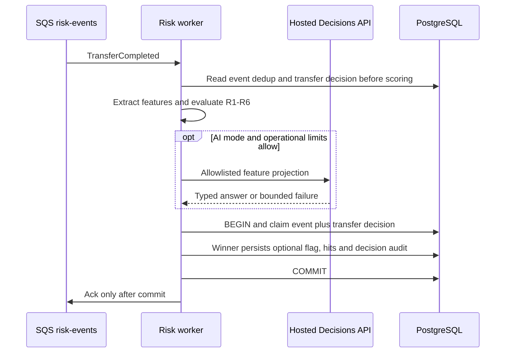

# FRAUD-API-01 · Fraud không tự train model: quyết định kiến trúc API AI

> **Status:** Implemented · **Loại:** docs-only, chưa triển khai backend fraud · **Vai:** #4 Fraud · **Review:** domain/plan đã APPROVE; review bổ sung còn ba điểm mở (§8.6), chưa ready · **Nhánh:** `docs/FRAUD-API-01-rules-external-ai` · **PR:** đang chuẩn bị Draft · **Cập nhật:** 2026-10-24

## 1. Bối cảnh

### 1.1 Yêu cầu và mã task

Task nội bộ do người dùng yêu cầu tạo trong phiên làm việc, không phải mã DBS trên sheet và không biểu thị việc board đã được cập nhật. Người dùng đã chọn tách task/PR cho việc bỏ tự train model và dùng API. Agent không sửa sheet, không tự tạo issue hoặc gọi GitHub trước G3.

**Expect:** Giữ sáu luật R1–R6 và ranh giới giao tiếp với các module khác; thay hướng tự train/đóng gói/chạy model bằng dịch vụ AI hosted để giảm phần vận hành ML. Không khẳng định API tốt hơn khi chưa đo.

PR đầu tiên là quyết định kiến trúc và kế hoạch chuyển đổi. Không mô tả PR tài liệu là đã triển khai toàn bộ fraud; các task implementation phải có phạm vi và gate riêng.

### 1.2 DoD đề xuất cho PR này

1. Có ADR mới cho phương án không tự train/deploy model, nêu rõ phần quyết định nào của [ADR-08](../adr/0008-fraud-detection-architecture.md) được đề xuất thay thế. Không viết lại quyết định Accepted cũ thành lịch sử khác; cập nhật liên kết trạng thái khi phương án thay thế được duyệt.
2. Phân định phần giữ nguyên: R1–R6 thuần, `TransferCompleted`, queue hiện có theo thiết kế, transaction chuyển tiền, quyền operator/customer, khả năng chạy baseline không phụ thuộc API.
3. Chốt vai trò của API và quyền tạo cờ; phân biệt điểm rule, đánh giá AI, nguồn tạo cờ và bằng chứng. Không giả kết luận AI thành rule hit, không tự coi probability là xác suất gian lận đã calibration, không cộng thẳng probability vào score.
4. Ghi rõ tác động dự kiến tới risk, schema fraud nếu cần, cấu hình/secret, kết nối ra ngoài, chi phí, dữ liệu được gửi, audit và xử lý khi nhà cung cấp không khả dụng. Không hứa mọi phần khác không chịu ảnh hưởng.
5. Có tiêu chí đánh giá độc lập trên dữ liệu được phép dùng: baseline đối chứng, ngân sách cảnh báo, recall, latency, lỗi và chi phí. Không dùng generator hoặc nhãn holdout; không bịa số đo hoặc coi mock là kết quả API thật.
6. Có bảng đối chiếu task hiện tại: giữ, thay thế hoặc cần quản lý board điều chỉnh; có lộ trình implementation theo dependency, không yêu cầu người khác viết lại ledger/outbox vì đổi nhà cung cấp AI.
7. Hoàn tất AI domain review, đối chiếu tài liệu liên quan, kiểm tra link và bằng chứng; PR chỉ chứa thay đổi thuộc phạm vi task, không chứa API key. PR sẵn sàng review chỉ sau G4; agent không merge.

### 1.3 Hiện trạng và phụ thuộc

| Thành phần | Bằng chứng | Ý nghĩa |
|---|---|---|
| Quyết định hiện tại | ADR-08: `v1` rule-only bắt buộc, `v2` học tham số thuộc phạm vi chính, `v3` ONNX có điều kiện | Bỏ toàn bộ train/học tham số và dùng API là thay đổi quyết định, không phải hoàn thành nguyên DoD cũ |
| Module risk | [README source](../../backend/src/modules/risk/README.md); runtime `modulesForRole` trả api/both chỉ `HealthModule`, worker rỗng | Chưa có fraud end-to-end để chuyển đổi hay đo hiệu quả |
| Contract sẵn có | [Event types](../../backend/src/common/events/event-types.ts), [money](../../backend/src/common/money/money.ts), view `v_transfer_facts` trong [migration 2](../../backend/src/database/migrations/1791849600000-CreateTransfersLedgerIdempotency.ts) | Tái sử dụng, không tự sửa để khớp prompt |
| Task sẵn sàng | Script board `--next Fraud` chỉ trả DBS-59, To Do, không dependency | Có thể làm contract risk bằng task riêng; không đưa vào PR tài liệu này |
| Spike hiện tại | DBS-212 là spike ONNX; DBS-211 và DBS-133 To Do, DBS-36 In Progress | Không đổi tên việc gọi API thành đã đạt DoD spike ONNX |
| Hạ tầng nghiệp vụ còn thiếu | Chưa có implementation risk consumer, Redis/SQS adapters, audit/auth/ledger/outbox services tại source đã rà soát | Tài liệu phải phân biệt thiết kế đích với chức năng đã tồn tại; không tạo stub thay task khác |
| Backlog liên quan | [BL-010](../BACKLOG.md): chính sách consumer khi event type chưa biết; [BL-011](../BACKLOG.md): producer kiểm schema trong transaction | Ngoài phạm vi PR tài liệu này; vẫn phải được tính vào task consumer/outbox trước nghiệm thu end-to-end |

Baseline tài liệu trên bản checkout sạch của commit `d158296`: `83 files checked, 0 broken link(s)`, exit 0. Bản checkout được tạo bằng temporary detached worktree, đã gỡ sau khi kiểm tra.

Kiểm thử thủ công cho task docs-only: không áp dụng thao tác nghiệp vụ; kiểm tra link và đọc đối chiếu contract là bằng chứng phù hợp. Chưa chạy kiểm chứng nhà cung cấp và không tuyên bố có số liệu chất lượng/hiệu năng API.

### 1.4 Ngoài phạm vi

- Không viết production code, thêm dependency, env var, migration hay sửa event/ErrorCode trong PR này.
- Không tự train model, đọc generator/holdout, dùng tài khoản API để gọi tính phí hoặc gửi dữ liệu ra ngoài trong phase này.
- Không triển khai thay các task Redis/SQS/audit/auth/ledger/outbox còn thiếu; không tạo mock để tuyên bố luồng thật đã chạy.
- Không sửa board, push main, merge PR; AI review không thay review của Dev hoặc gate của người dùng.

### 1.5 Quyết định G1

1. Duyệt phạm vi task nội bộ `FRAUD-API-01`: PR đầu tiên docs/architecture, sau đó implementation theo các task riêng. Mã này không phải số issue trên sheet.
2. Cho phép thiết kế ADR thay thế hướng học tham số/ONNX bằng hosted API, giữ R1–R6 baseline và ranh giới ledger/outbox. Quyết định cụ thể về provider, scoring, schema và API gating chỉ được chốt tại G2; chưa sửa ADR Accepted ở G1.

G1 đã được người dùng duyệt trong phiên làm việc: tiếp tục task tài liệu/kiến trúc, tự thực hiện và tổ chức review độc lập. Yêu cầu duyệt tự động không thay cho G2, G3 hoặc G4; chưa được phép viết production code, push hay tạo PR.

## 2. Hành vi đề xuất

### 2.1 Phạm vi thay quyết định

Đề xuất ADR-14 `0014-fraud-rules-external-ai.md` thay phần học tham số bắt buộc và phần ONNX của ADR-08: không train Logistic Regression/GBDT, không Python pipeline, không model artifact hoặc native runtime. Giữ R1–R6 baseline và đánh giá định lượng; ngưỡng cấu hình có thể chọn thủ công trên tập tune, không gọi đó là model training. ADR-14 chỉ thành Accepted sau duyệt nhóm; trước đó tài liệu tham chiếu phải ghi đây là đề xuất, không tuyên bố ADR-08 đã bị thay.

Chọn một nhà cung cấp đầu tiên: OpenAI Decisions, `POST /v1/decisions`, model hiện được guide công bố là `gpt-6-luna`. [Guide chính thức](https://developers.openai.com/api/docs/guides/decisions) ghi API public beta; chưa có benchmark fraud. Jev là phương án so sánh, không triển khai thêm adapter hay tự chuyển nhà cung cấp khi lỗi. Không hứa alias model là snapshot bất biến.

### 2.2 Baseline và tín hiệu AI

Hai mode cấu hình bất biến: `rule_only` (seed mặc định) và `rules_with_external_ai` (chỉ bật sau gate chất lượng, dữ liệu và vận hành). Không duy trì alias `ml_tuned_rules`/`hybrid_onnx` trong implementation mới nếu ADR thay thế được chấp nhận; mọi tài liệu/caller phải cutover cùng task liên quan.

- Chỉ `TRANSFER` được chấm; `DEPOSIT` ghi dedup theo hợp đồng consumer rồi ack, không gọi AI.
- R1–R6 và miễn trừ `sameOwner` không đổi; lịch sử theo `occurredAt`, R3/R6 dùng snapshot. Lỗi API không thay đổi feature hoặc kết quả rule.
- `ruleScore = sum(ruleHits.weight)`. `aiContribution = ai.weight` khi có câu trả lời hợp lệ với `p >= ai.threshold`; còn lại bằng 0. Không dùng `100*p`, không gọi số p là xác suất gian lận đã được calibration.
- `score = ruleScore + aiContribution`; ngưỡng `MEDIUM`/`HIGH` giữ theo phiên bản cấu hình (baseline 40/70). AI chỉ cộng, không trừ hoặc xóa cờ của rule. Cấu hình phải kiểm tra trọng số nguyên không âm và tổng điểm tối đa vừa PostgreSQL `int`; `ai.threshold` hữu hạn, thuộc `(0,1]`. Khi bật AI, threshold, weight, rubric và model là bắt buộc, không có giá trị mặc định được tự động đưa vào vận hành.
- Mỗi lệnh TRANSFER mới ở mode AI được đánh giá tối đa một lần trong mỗi lần consumer xử lý; không lọc trước theo ruleScore để tránh tự bỏ qua giao dịch ngoài tầm rule. Chính sách giới hạn đồng thời/ngân sách có thể bỏ phần AI và trả baseline, phải có metric phân biệt. Chưa chốt giá trị quota/time budget khi chưa đo; tính năng không được bật nếu thiếu các giới hạn vận hành đã được Ops duyệt.

Ví dụ **chỉ để kiểm tra công thức, không phải cấu hình khuyến nghị**: `ai.threshold=0.9`, `ai.weight=40`. R6 một mình được 30 điểm: khi API lỗi hoặc p=0.89 thì LOW, không cờ; khi p=0.9 thì tổng 70, HIGH. Không rule nào kích hoạt và p=0.95 thì tổng 40, MEDIUM. `ruleScore=70` luôn có cờ HIGH dù API trả p=0.01. Phần AI phải được hiển thị riêng, không ghi thành R1–R6.

AC-9.1 hiện nói chỉ R6 là có cờ, mâu thuẫn baseline R6=30 và ngưỡng 40. Đề xuất sửa fixture/acceptance thành giao dịch có R6 và một luật đủ để vượt ngưỡng, không tự tăng trọng số R6; phải ghi vào bảng chuyển đổi và xin duyệt ở G2.

### 2.3 Dữ liệu và câu hỏi gửi API

Chỉ gửi object allowlist do risk dựng: `amount`, `fromBalanceBefore` (chuỗi tiền canonical), tuổi tài khoản tính từ snapshot, `sameOwner`, số lệnh 10 phút/1 giờ, số lịch sử/trung vị 30 ngày, số phút từ giao dịch ngược (null nếu không có), số người nhận mới 1 giờ và số người nhận khác nhau 24 giờ. Số đếm/tuổi là giá trị số hữu hạn; median phải biểu diễn chính xác, không dùng floating-point để so rule. Không gửi UUID giao dịch/user/tài khoản, `correlationId`, thời điểm tuyệt đối, tên, email, ghi chú, `scenario`, nhãn hoặc toàn bộ lịch sử.

Một predicate tên `needs_operator_review`, rubric cố định có hash: đánh giá mẫu giao dịch đã chuyển xong có dấu hiệu đáng xem xét; phân biệt hành vi hợp lệ như chuyển giữa tài khoản cùng chủ, không đoán dữ liệu không được cung cấp. Đây là đánh giá bổ sung, không phải công cụ quyết định tài chính tự động hoặc bằng chứng chắc chắn có gian lận. Input không chứa free text người dùng; rubric tách khỏi dữ liệu. Provider trả typed answer, không được yêu cầu chain-of-thought hay tự tạo bằng chứng.

Allowlist giảm dữ liệu tiết lộ nhưng không làm các số liệu giao dịch hết nhạy cảm. Chỉ gửi dữ liệu tổng hợp trong spike; dữ liệu khác cần nhóm duyệt điều kiện nhà cung cấp, retention và quyền gửi. Không khẳng định ZDR áp dụng mặc định cho tài khoản. Không log body, secret hoặc header Authorization; chỉ metric trạng thái, thời gian, token khi nhà cung cấp có trả và mã lỗi nội bộ đã rút gọn.

### 2.4 Lỗi, thời gian và quyết định bất biến

Adapter phải từ chối câu trả lời thiếu/nhân đôi tên, sai type, refusal, p không hữu hạn hoặc ngoài [0,1]. Timeout, HTTP 401/402/429/5xx, lỗi kết nối hoặc response sai đều cho `aiContribution=0`; không retry API trong một lần xử lý và không đổi nhà cung cấp. Có deadline hủy request; giới hạn concurrency và ngân sách được ghi rõ trong gate triển khai, không giữ tài nguyên DB trong thời gian chờ.

Mode AI phải có `ai.maxAdmissionDelayMs` và `ai.requestTimeoutMs` nguyên dương, được duyệt trong ngân sách vận hành trước khi bật. Ghi thời điểm monotonic khi chọn snapshot cấu hình; ngay trước khi gửi request kiểm lại thời gian đã trôi. Quá `maxAdmissionDelayMs` thì không gửi và ghi UNAVAILABLE với contribution=0. Request đã gửi có deadline `requestTimeoutMs`, không giữ slot chờ vô hạn. Đây là giới hạn nội bộ risk, không thay TTL cấu hình dùng chung.

Không đẩy DLQ chỉ vì API lỗi; vẫn commit baseline và trạng thái AI không khả dụng. Lỗi SQL/audit thì rollback, không ack và để queue retry theo ConsumerBase. Một event được giao lại có thể gọi API lại nếu lần trước chưa commit; không hứa exactly-once billing hay kết quả model giống nhau. Trước khi lấy cấu hình/chấm lại/gọi AI phải kiểm bản ghi `risk_decisions` theo `transfer_id`, không chỉ dedup eventId. Quyết định đã commit ở bất kỳ mode nào, kể cả rule-only LOW, đều được dùng lại nếu cùng transfer tới với eventId khác sau khi đổi cấu hình/model; không tạo cờ hoặc assessment mới. Sự kiện trễ/đảo thứ tự giữ cùng feature/rule trong phạm vi đã chốt, không hứa nhà cung cấp trả cùng p ở mọi lần gọi.

## 3. Kiến trúc và tác động

### 3.1 Ranh giới

RiskModule vẫn ở `sharedModules`; consumer chỉ có lifecycle khi `runsWorkers()`. `RiskRule.evaluate(event, features, params): RuleHit | null` và `FeatureProvider.extract(event): Promise<Features>` giữ theo thiết kế hiện tại, chưa có symbol runtime mới để đổi caller. API adapter là thành phần nội bộ của risk, không được module khác gọi.

Luồng đề xuất, chưa phải source đã tồn tại:

1. Validate event theo `@common/events`; giữ chính sách JSON/schema/DLQ và UNKNOWN_EVENT_TYPE của BL-010 trong task consumer.
2. Kiểm dedup event đã commit và `risk_decisions(transfer_id)`. Nếu quyết định transfer đã có thì dùng kết quả cũ, ghi nhận dedup của event mới nếu cần, không chấm lại hoặc gọi AI. Nếu chưa có, lấy một rule-set version và feature point-in-time; chạy các rule thuần.
3. Nếu mode AI và đủ quota/deadline, gọi provider bên ngoài transaction; kết quả hoặc trạng thái fallback trở thành dữ liệu đầu vào bất biến cho bước ghi.
4. Trong `TransactionService.run`: claim `processed_events`, rồi `INSERT risk_decisions (...) ON CONFLICT (transfer_id) DO NOTHING RETURNING transfer_id` cho mọi TRANSFER ở cả hai mode, kể cả LOW hoặc fallback. Claim event thua thì không ghi dữ liệu phụ; claim transfer thua thì chỉ commit dedup cho event mới, dùng quyết định cũ, không tạo cờ/hits/audit-create trùng. Claim transfer thắng mới ghi cờ/hits nếu score đủ và audit quyết định, cùng transaction. Ack sau commit; không Redis/HTTP/SQS trong callback có retry.
5. Khóa duy nhất của `risk_decisions` được chia sẻ giữa mọi worker/mode và tồn tại dù không có cờ. Hai worker đua trước commit có thể gọi provider hai lần, nhưng PostgreSQL chỉ cho một quyết định/cờ commit; rollback của bên thắng cho phép bên còn lại claim theo semantics ON CONFLICT. Test thực phải chứng minh case cùng event, khác event cùng transfer, khác mode và rollback, không suy luận từ mock.



### 3.2 Dữ liệu risk: thay đổi có chủ đích

**Không sửa schema trong PR này.** Đề xuất implementation sau thêm một bảng risk-owned `risk_decisions`, PK/FK `transfer_id` tới transfers, tồn tại cho mọi TRANSFER đã xử lý ở cả hai mode, không phụ thuộc có cờ hay không. Đây vừa là claim theo transfer vừa là bản ghi quyết định bất biến, không thêm bảng assessment riêng. Các trường bắt buộc: `event_id` đầu tiên, `rule_set_version`, `mode`, `rule_score`, allowlisted feature snapshot, `ai_status` (`DISABLED`, `SUCCEEDED`, `UNAVAILABLE`, `REFUSED`, `INVALID_RESPONSE`, `BUDGET_EXHAUSTED`), `ai_applied_weight >= 0`, thời điểm quyết định. Provider/model/rubric hash/input hash bắt buộc ở mode AI; null ở rule-only. `probability` và provider request id nullable theo trạng thái; model thực tế chỉ lưu nếu response cung cấp. Rule-only bắt buộc status DISABLED, p null, weight=0; mode AI không được DISABLED. SUCCEEDED phải có p hữu hạn [0,1], weight theo policy; các status khác p null và weight=0. Lưu bản chiếu feature đủ replay rule/policy và hash payload AI; không lưu response thô.

`fraud_rule_hits` vẫn chỉ R1–R6, mỗi dòng chỉ chứa phần rule. Cờ phải tham chiếu quyết định cùng transfer/version; **bất biến mới đề xuất:** `fraud_flags.score = risk_decisions.rule_score + risk_decisions.ai_applied_weight`, với `risk_decisions.rule_score = sum(fraud_rule_hits.weight)` khi có cờ. LOW không có cờ/hits nhưng vẫn có quyết định và snapshot. Đây là thay đổi so với invariant cũ; cập nhật database-design, ADR và test cùng cutover. Không giả AI thành rule. Bản ghi quyết định append-only, không sửa/xóa bằng dbs_api/dbs_worker; quyền đọc chỉ theo nhu cầu review/audit, không cấp cho customer. Các cột AI của quyết định được chiếu thành `aiAssessment` trong response operator, không thành một nguồn quyết định thứ hai.

GET chi tiết cờ của operator giữ `score`, `riskLevel`, `hits` nhưng thêm `aiAssessment` riêng; baseline trả null. `hits` không còn tự cộng thành total nếu có AI, client phải dùng `score` hoặc cộng thêm `aiAssessment.appliedWeight`. Ví dụ phần bổ sung: `{"status":"SUCCEEDED","provider":"openai","model":"gpt-6-luna","probability":0.95,"appliedWeight":40,"explanation":"Đánh giá AI bổ sung đạt ngưỡng cấu hình; đây không phải kết luận gian lận."}`. Không mô tả câu này là suy luận/giải thích nội tại của model; số liệu feature được hiển thị như bằng chứng độc lập.

UC-10 review một lần và HTTP 409 `FLAG_ALREADY_REVIEWED` không đổi. Toàn bộ assessment và provenance bị loại khỏi API/notification customer. Chưa có frontend/client source dùng payload risk; Dev làm giao diện/API risk phải được thông báo về phép cộng điểm mới, không tuyên bố contract risk không đổi.

### 3.3 Tác động và chuyển task

| Phần | Giữ / thay đổi | Bàn giao |
|---|---|---|
| Ledger, event, outbox, queue | Giữ payload, queue, sync guard, transaction chuyển tiền | Không yêu cầu Dev thay code vì đổi AI; dependency gốc vẫn phải hoàn thành |
| DBS-58/59, 93–112 | Giữ rule/contracts; bổ sung thiết kế assessment và invariant ở task migration/scoring/consumer | Không tự sửa DoD trên board; người quản lý phân lại phần mở rộng |
| DBS-128–133, 160, 162, 168–170 | Giữ provider, review, đánh giá, parity và freeze; thêm provenance/rubric/model/request capture | Offline dùng cùng policy tổng hợp; API không gọi trong CI acceptance tất định |
| DBS-161, 211–215 | Đề xuất bỏ nghĩa vụ học model/train/ONNX; thay bằng spike API, allowlist, policy, integration và failure test | Chỉ đổi phạm vi sau ADR được nhóm chấp nhận; không gắn kết quả API vào DoD ONNX cũ |
| Dataset | Vẫn giao tune có nhãn và holdout sau freeze, không cần pipeline train model của Fraud | Không đọc generator/holdout sớm; không yêu cầu thêm trường ngoài contract đã thống nhất |
| Ops | Credential secret, HTTPS egress theo ADR-10, quota, concurrency, ngân sách và alarm lỗi/cost | Không thêm tài nguyên/secret/env hay gọi tính phí trong PR tài liệu này |
| DBS-187/188/190 | Giữ metric cảnh báo, alarm, P5; tách nguồn rule/AI, ghi cả lúc fallback | Báo cáo tác động đã đo, không gọi p là accuracy |

Đề xuất tên tài liệu tham chiếu cần cutover ở Phase 4 sau G3: ADR-14 mới và index, trạng thái liên kết ADR-08, risk concept/architecture/guide, database-design §4.8/§8, docs/03 §15, yêu cầu AC-9.1/phần mô tả ML, roadmap Task 6 và feature index. Đây là các file kế hoạch, chưa sửa quyết định Accepted.

### 3.4 Gate bật AI, không train

Không cần train, nhưng cần test từ dữ liệu tổng hợp/tune độc lập. Chọn rubric/threshold/weight trên tune, tách khách theo thiết kế, không dùng nhãn làm feature. So baseline và baseline+API trên cùng input; đóng băng config, code, model identifier và rubric hash trước holdout. Capture request hash/typed response và kết quả policy để audit; replay capture là kiểm tra code, không phải lời hứa tái lập live model.

Giữ mục tiêu recall >=70% trên năm kịch bản mục tiêu và <=20 cờ/1.000 TRANSFER; báo cáo riêng ngoài tầm. Muốn bật AI phải baseline đã đạt ngân sách cảnh báo và baseline+AI không vượt ngân sách đó; chính sách chỉ cộng không thể cứu baseline đang báo quá nhiều. Yêu cầu AI cải thiện recall ít nhất 5 điểm phần trăm trên customer-grouped validation của tune tại cùng ngân sách; nếu không đạt, không bật và ghi kết quả no-go. Không lấy ngưỡng từ holdout, không chọn phiên bản mặc định theo holdout.

Gate vận hành: đo end-to-end p95 giao dịch→cờ <5 giây tại 120 RPS, cả API khỏe và fallback; xác nhận quota/concurrency/cost trong ngân sách Ops duyệt, deadline nhỏ hơn SQS visibility dành cho xử lý và không làm hết pool. Chưa có số đo hoặc credential thì ghi chưa kiểm chứng, AI tiếp tục tắt. API public beta hoặc model drift không vượt gate thì giữ baseline, không coi requirement đã được chứng minh bằng mock. Nhóm phải duyệt điều kiện dữ liệu và service usage trước khi bật.

### 3.5 Luận chứng kỹ thuật và giao thức đánh giá

**Câu hỏi nghiên cứu:** với cùng đặc trưng point-in-time và cùng giới hạn khối lượng cảnh báo, dịch vụ đánh giá pretrained có giúp baseline R1–R6 phát hiện thêm gian lận đủ đáng để trả chi phí và chấp nhận dependency mạng hay không? Đóng góp của đồ án là kiến trúc, policy, dữ liệu/đánh giá độc lập, audit và vận hành; không nhận phần huấn luyện model của nhà cung cấp là công việc của nhóm. Dùng pretrained API không miễn chứng minh chất lượng. Chọn threshold/rubric/weight trên tune vẫn là lựa chọn tham số dựa trên dữ liệu và phải công bố, dù không fit hoặc fine-tune model.

| Đối chứng | Mục đích | Quyền trong hệ thống |
|---|---|---|
| B0: R1–R6 | Baseline tất định, số liệu trước khi thêm AI | Có thể tạo cờ theo cấu hình |
| B1: tín hiệu API riêng trên cùng feature | Phân tích AI có thông tin bổ sung hay chỉ lặp lại luật | Chỉ phân tích offline, không là mode bỏ rule khi vận hành |
| B2: R1–R6 + API theo policy §2.2 | Đo lợi ích thực của kiến trúc đề xuất so với B0 | Chỉ được bật sau các gate §3.4 |

Một lần đánh giá API được capture và dùng chung cho B1/B2; không gọi riêng hai lần rồi coi hai kết quả là cùng điều kiện. Mỗi record đối chiếu có local transfer key, feature/input hash, rule-set version, rubric hash, model identifier, thời gian gọi, typed answer/status và kết quả B0/B1/B2. Local key không gửi cho provider. Không dùng replay của response cũ để báo latency hoặc giá live mới. B1 không dùng nhãn làm input, cũng không được tạo bằng cách đưa tên kịch bản cho model.

Tập tune do Dev dataset giao được chia nhóm khách hàng cho phần chọn cấu hình và phần validation; chỉ dùng phần chọn cấu hình để đổi rubric/threshold/weight. Đóng băng danh sách ứng viên trước khi đo validation, báo cả ứng viên đã thử; nếu tiếp tục chọn lại dựa trên validation thì phải công bố validation đã thành tune, không giữ tuyên bố đánh giá độc lập cho nó. Holdout cuối vẫn được giữ riêng, chỉ giao sau freeze và chạy một lần cho tất cả phiên bản đã chốt.

So sánh theo cặp trên cùng giao dịch: TP/FP/FN/TN, precision/recall/F1, số cờ trên 1.000 TRANSFER, recall theo kịch bản, hard negatives, số cờ AI bổ sung đúng/sai và các ca bỏ sót không cải thiện. Bootstrap theo cụm khách hàng với cùng cụm cho B0/B2 để báo khoảng tin cậy 95% của chênh recall; công bố seed và số lần resample. Gate tăng ít nhất 5 điểm phần trăm ở §3.4 là chênh điểm ước lượng; khoảng tin cậy phải loại trừ 0 trước khi tuyên bố lợi ích có bằng chứng. Nếu số ca gian lận quá ít hoặc khoảng tin cậy không phân biệt được thì kết luận chưa đủ bằng chứng, không hạ gate hoặc bỏ các kịch bản xấu.

Không so accuracy chung để kết luận thắng: dữ liệu khoảng 1% gian lận khiến mô hình luôn trả bình thường vẫn có accuracy cao. Không gọi `probability`/`confidence` là precision. Khi chọn ngưỡng API dựa trên thứ hạng điểm, không tuyên bố đã calibration xác suất; muốn nêu calibration phải đo riêng trên nhãn validation chưa dùng chọn cấu hình.

Gate vận hành phải đo cả baseline và B2 trên cùng mức tải, ghi queue age, thời gian feature, thời gian provider, thời gian ghi DB và end-to-end; báo tỷ lệ fallback/timeout/429, tỷ lệ giao dịch thực sự được API đánh giá và số lời gọi trùng do rollback/race. Chi phí trên 1.000 TRANSFER tính cả lượt gọi thử lại giữa các lần xử lý, không chỉ lượt thành công; dùng usage/billing thực nếu có, còn ước tính theo giá công bố phải gắn nhãn ước tính và nêu token assumptions. Đo tải mạng không làm thay đổi số tiền, trạng thái transfer hoặc cấu hình cloud của người khác.

Nêu thẳng giới hạn khi bảo vệ: dữ liệu tổng hợp không chứng minh hiệu quả trên ngân hàng thật; chưa có baseline model được train trong đồ án nên không kết luận thắng LightGBM/XGBoost; alias/model có thể đổi và replay chỉ tái hiện policy trên response đã lưu; provider lỗi thì mất phần phát hiện bổ sung; gắn cờ sau commit không thu hồi được tiền đã chuyển. Cờ AI là gợi ý để operator xem xét, không phải chứng cứ gian lận hoặc lời giải thích nhân quả của model.

### 3.6 Cam kết giới hạn ảnh hưởng

Không chỉnh ledger, accounts, event payload, outbox routing, ErrorCode hoặc quyền customer để phục vụ API AI. Không tự nhận hoàn thành các task phụ thuộc hoặc tạo guard/adapter giả. Mọi thay đổi production vào env/dependency/schema/quyền DB phải có gate riêng trong task implementation; người phụ trách Ops xác nhận ngân sách và secret trước bật AI. Thay đổi risk detail payload/invariant đã nêu ở §3.2 phải được báo cho Dev làm giao diện/API risk; không lấy lý do chưa có caller runtime để bỏ thông báo.

Công tắc chuyển về baseline là rule-set version mới chọn `rule_only`, không sửa phiên bản cũ hoặc xóa decision đã commit. Đây **không phải** lệnh dừng egress tức thì: `cfg:risk:latest` có TTL 60 giây theo thiết kế hiện tại, nên worker còn cache cũ vẫn có thể chọn mode AI trong thời gian truyền cấu hình. Giao dịch lấy snapshot sau khi worker thấy phiên bản mới dùng baseline; xử lý đã chọn phiên bản AI có thể gọi hoặc hoàn tất theo phiên bản cũ, và lưu đúng version đó.

Khi kho cấu hình/TTL hoạt động theo hợp đồng và worker tiếp tục phục vụ, lời gọi mới theo cấu hình AI cũ bị giới hạn bởi 60 giây cộng `ai.maxAdmissionDelayMs` kể từ khi phiên bản rule-only được tạo. Request đã gửi có thể kết thúc muộn hơn, tối đa thêm `ai.requestTimeoutMs` ở phía client; hủy client không bảo đảm provider đã hủy xử lý hoặc không tính phí. Nếu kho cấu hình không đáp ứng hợp đồng thì không tuyên bố SLA truyền cấu hình này đã đạt. Các con số admission/timeout chưa được đo thì AI không được bật. Thay đổi tức thì về secret/egress cần quy trình Ops riêng, không tự sửa cloud hoặc dừng worker dùng chung.

Quyết định đã commit giữ nguyên kết quả/provenance. Chuyển mode là cách quay về baseline mà không thay ledger/outbox, không phải lời hứa giữ nguyên recall hoặc dừng chi phí tức thì. Test phải chứng minh cả cache cũ, event đang lấy feature và request đã gửi.

## 4. Kiểm chứng và test cases

PR này docs-only: không tạo test đọc source để ghim wording, không viết mock API rồi báo đạt chức năng. Các case sau là tiêu chí review/kiểm tra tài liệu; các test runtime ghi cột riêng để bàn giao, không được tính đã chạy trong PR này.

| ID | Truy vết | Kiểm chứng trong PR này | Test runtime phải có ở task implementation |
|---|---|---|---|
| TC-FRAUD-API-01 | DoD 1, 6 | Đối chiếu ADR mới/cũ và bảng task; không ghi quyết định đề xuất thành đã Accepted | Không áp dụng |
| TC-FRAUD-API-02 | DoD 2, AC-9.1 | So predicate/điểm/mốc thời gian R1–R6 và fixture AC-9.1 | Ca biên 5/6 lệnh, median n=4/5, 24h, 10 triệu, 90%, sameOwner, bigint trên 2^53 |
| TC-FRAUD-API-03 | DoD 3 | Tính tay bốn ví dụ §2.2; so invariant mới và response operator | Boundary p ngay dưới/bằng threshold; API thấp không hủy cờ rule; tổng rule+AI bằng score, không tạo hit R1–R6 giả |
| TC-FRAUD-API-04 | DoD 4 | Đối chiếu allowlist và quyền DB/API, không gửi raw IDs/free text | Input projection không lộ ID/nhãn; mọi endpoint/notification customer không chứa assessment (AC-10.2) |
| TC-FRAUD-API-05 | DoD 4 | Đọc đầy đủ nhánh lỗi, transaction và giới hạn retry | Timeout/abort, 401/402/429/5xx, refusal, malformed/NaN/out-of-range/missing/duplicate answer, budget exhausted đều giữ baseline và audit trạng thái |
| TC-FRAUD-API-06 | DoD 2, AC-9.2 | Review race và provenance của quyết định commit đầu | Hai worker song song, cùng event và khác event cùng transfer, khác mode; chỉ một risk_decision và tối đa một cờ. Rule-only LOW commit trước, đổi sang AI rồi nhận eventId khác cùng transfer: không gọi provider/không tạo cờ hay assessment mới. Rollback SQL/audit không ack; race có rollback kiểm trên PostgreSQL thật. |
| TC-FRAUD-API-07 | DoD 5 | So mục tiêu chất lượng, freeze/holdout và giới hạn tái lập | Replay capture tất định; live API riêng có quyền gọi, số đo latency/cost/quality; Redis lạnh/chậm và feature parity không suy từ mock |
| TC-FRAUD-API-08 | DoD 7 | Kiểm link checkout sạch, feature index, domain review và phạm vi file | Không áp dụng |
| TC-FRAUD-API-09 | AC-10.1, DoD 2 | Xác nhận không thay đường review/role và ErrorCode | Hai review song song chỉ một thành công; lần sau 409 FLAG_ALREADY_REVIEWED; sai role bị từ chối theo contract identity |
| TC-FRAUD-API-10 | DoD 4, 6 | Đối chiếu TTL 60 giây, admission deadline và in-flight policy | Dùng clock/TTL inject được: tạo rule-only khi cache còn AI; event đã chọn AI chỉ được gửi trong maxAdmissionDelayMs; sau bound không có lời gọi mới theo version cũ; request đang chạy chỉ giữ timeout hữu hạn; quyết định lưu đúng version và không làm thay đổi transfer |
| Quy trình | DoD 7 | G2/G3/G4, Dev review, CI/PR | Agent không merge hoặc sửa board |

Security: ownership/guard/audit/SQL/TLS nghiệp vụ không được sửa trong PR docs. Yêu cầu triển khai vẫn giữ truy vấn tham số hóa, review+audit cùng transaction, cấm customer xem risk, không log secret/PII; runtime chứng minh ở TC-04/05/06/09. Chưa có quyền hoặc công cụ tương ứng phải nêu ở G1 của task implementation, không dựng guard giả.

## 5. Kiểm tra thủ công

Không có đường runtime mới trong task docs-only. Không thêm demo giả, không gọi provider tính phí hoặc dùng dữ liệu nhạy cảm; không tuyên bố case runtime §4 đạt.

| Bước | Thao tác khả dụng | Kết quả mong đợi |
|---|---|---|
| M-FRAUD-API-01 | Đọc ADR, database-design, risk architecture và bảng §3.3 song song | Mỗi quyết định bị thay có nơi cập nhật; ledger/event contract không đổi |
| M-FRAUD-API-02 | Tính tay các ví dụ §2.2, thử p=0.89, p=0.9 và trường hợp provider không khả dụng | Không cộng xác suất trực tiếp; API thấp/lỗi không hủy cờ baseline; hit và assessment giải thích đúng nguồn |
| M-FRAUD-API-03 | Kiểm chứng định dạng link bằng `node .claude/skills/dbs-delivering-task/scripts/check-doc-links.mjs` trên checkout sạch có nội dung PR | Exit 0; không link/anchor/file thiếu |
| M-FRAUD-API-04 | Đối chiếu feature index, ADR index, trạng thái đề xuất và bảng handoff với nội dung PR | Không tuyên bố API đã tích hợp hoặc chỉ số live đã đạt |

Lệnh runtime/manual API và concurrency thuộc task implementation sau khi dependency sẵn sàng, không được đánh dấu hoàn thành trong PR này.

## 6. Domain review độc lập

**Reviewer:** agent chuyên trách `reviewer`; model identifier không được công cụ công bố, không tự suy đoán. **Vòng 1:** 1 blocking, 0 should-fix, 0 minor, verdict REVISE; [phản hồi nguyên văn](screenshots/FRAUD-API-01/domain-review-round-1.md). **Vòng 2:** 0 phát hiện, verdict APPROVE; [phản hồi nguyên văn](screenshots/FRAUD-API-01/domain-review.md). **Vòng 3** (luận chứng đánh giá và giới hạn ảnh hưởng): 0 blocking, 1 should-fix, 0 minor, verdict REVISE; [phản hồi nguyên văn](screenshots/FRAUD-API-01/domain-review-round-3.md). **Vòng 4:** 0 phát hiện, verdict APPROVE; [phản hồi nguyên văn](screenshots/FRAUD-API-01/domain-review-round-4.md).

| # | Mức | Phát hiện | Xử lý |
|---|---|---|---|
| 1 | blocking | Rule-only LOW chưa có claim theo transfer, có thể bị AI chấm lại qua eventId mới sau đổi mode | Đã sửa §§2.4, 3.1, 3.2 và TC-06: bảng `risk_decisions` cho mọi TRANSFER/mode, kể cả LOW; kiểm trước API, claim PK cùng transaction và giữ quyết định đầu |
| 2 | should-fix | Công tắc chuyển baseline chưa nêu cache TTL và lời gọi đang chạy, có thể bị hiểu sai là dừng egress ngay | Đã sửa §§2.4, 3.6 và TC-10: TTL 60 giây, admission budget, timeout hữu hạn, không hứa provider hủy hoặc ngừng tính phí tức thì; không dừng worker chung |

Reviewer đã kiểm tra lại các phần sửa và tác động liên quan. Không còn blocking chưa xử lý. Phê duyệt domain review không thay phê duyệt G2 của người dùng hoặc chấp thuận ADR của nhóm.

Kiểm chứng đã chạy ở Phase 2: driver tính công thức cho 5 ca (p dưới/bằng threshold, AI-only, baseline HIGH và API unavailable), kết quả đúng ví dụ §2.2; đây chỉ là kiểm tra số học tài liệu, không phải fraud runtime. `mmdc` đã render thành công một sequence diagram sau lần sửa cuối; artifact kiểm tra tạm đã được dọn. Chưa gọi provider, chưa có số đo chất lượng/latency/cost thực.

Kiểm link cho snapshot sạch gồm commit nền và năm file task hiện tại: `88 files checked, 0 broken link(s)`, exit 0. Temporary worktree kiểm chứng đã được dọn; không stage hoặc commit để chạy kiểm tra này.

**Quyết định G2:** người dùng đã duyệt bằng phản hồi “duyệt, chốt” sau bản thiết kế và domain review cuối. Chốt thiết kế ở §§2–§5, bao gồm rule-only mặc định, API bổ sung có gate, risk_decisions mọi mode, dữ liệu allowlist và giới hạn truyền cấu hình. Đây không phải chấp thuận G3/G4 hoặc tự đổi trạng thái ADR của nhóm. Không commit/push/tạo PR theo yêu cầu hiện tại.

## 7. Kế hoạch thực hiện và review plan

### 7.1 Phạm vi thực hiện sau G3

Task này chỉ hoàn thiện **bộ tài liệu quyết định kiến trúc**, không viết module fraud hoặc tự nhận các task backend còn thiếu. Không tạo plan thứ hai ở thư mục khác; §7 là nguồn kế hoạch duy nhất cho task này. Kế hoạch G3 ban đầu giữ local; người dùng đã cho phép tạo nhánh mới, commit và mở PR sau G4, được ghi tại §8.6. Không sửa board.

ADR-14 mới mang trạng thái **Proposed** để nhóm review; ADR-08 vẫn Accepted cho tới khi nhóm chấp nhận quyết định thay thế. Không sửa nội dung hoặc gắn Superseded vào ADR-08 trong task này. Các tài liệu thiết kế risk phải nhận diện rõ “phương án API được đề xuất bởi ADR-14, chưa triển khai”, không trộn claim runtime với thiết kế. Không có shim hay alias mode cũ trong thiết kế implementation mới; nội dung train/ONNX còn lại ở ADR-08 chỉ là quyết định cũ đang chờ thay, không hướng dẫn thực hiện nhánh API.

Mọi bước dưới là docs-only; “test viết trước” là checklist đối chiếu TC/DoD trước sửa, không tạo test ghim source hoặc wording. Không có red runtime hay commit để ghi: cột tương ứng ghi không áp dụng hoặc chưa chạy, không bịa kết quả.

### 7.2 Các bước và file

| Bước | File tạo/sửa | Kiểm chứng trước sửa và kết quả đỏ | Việc thực hiện | Lệnh/bằng chứng sau sửa | Commit |
|---|---|---|---|---|---|
| P1 | Tạo `docs/adr/0014-fraud-rules-external-ai.md`; sửa `docs/adr/README.md` | TC-01/03/05/07/10: so ADR-08 với thiết kế G2; red runtime không áp dụng | Ghi bối cảnh, 3 lựa chọn (rules-only, tự train, rules+API), quyết định Proposed, không train, policy cộng điểm, risk_decisions, dữ liệu/chi phí/rollout và gate định lượng. Index có ADR-14 Proposed và liên kết đề xuất thay phần ML của ADR-08, không đổi trạng thái ADR-08 | Đọc đối chiếu §2/§3 và kiểm link sau P7 | Không commit |
| P2 | Sửa `docs/components/risk/01-concept-brief.md`, `02-architecture.md`, `FRAUD_DETECTION_GUIDE.md`, `backend/src/modules/risk/README.md` | TC-02–07/09/10: checklist rules/snapshot/roles, claim transfer mọi mode, AI tắt mặc định; không có test runtime | Chuẩn hóa phương án đích Proposed: R1–R6 thuần, provider nội bộ, gọi API ngoài transaction, decision trước flag, response operator tách AI, fallback và TTL/admission. Thay hướng dẫn train/ONNX bằng liên kết lịch sử ADR-08 và đề xuất ADR-14; giữ file verified-against-code là chưa có implementation | Đối chiếu kiểu/field với event/money hiện có, đánh dấu rõ Proposed; render từng sơ đồ bị chạm bằng `mmdc` | Không commit |
| P3 | Sửa `docs/components/_shared/database-design.md` | TC-03/04/06/10: so các bảng/quyền/retention/migration, ghi rõ phần schema là đề xuất chưa áp dụng | Mô tả schema proposed risk_decisions, trạng thái/nullability, claim PK mọi mode/LOW, FK/version và invariant score mới. Đồng bộ ERD/count/ownership, vai trò đọc/INSERT/append-only, retention của decision cùng vòng đời risk, thứ tự migration và bảng ràng buộc. Không viết migration hoặc đổi schema thực | Đối chiếu §4.8, §5, §6, §8, §9, §11 và mọi bảng tổng hợp liên quan; render ERD nếu sửa; kiểm link P7 | Không commit |
| P4 | Sửa `docs/02_REQUIREMENTS_AND_DOMAIN_MODEL.md`, `docs/03_HIGH_LEVEL_ARCHITECTURE.md` | TC-01/02/03/04/06/09: kiểm AC-9.1 và các sequence/ERD/API; không ghi test AC đã chạy | Sửa fixture AC-9.1 thành R6 cùng một luật đủ ngưỡng theo G2; phân biệt baseline và API Proposed. Đồng bộ mô tả scoring, sequence risk/dedup/decision, ERD/domain mapping, operator detail, bảng API nếu chứa field liên quan, Redis TTL, dữ liệu gửi ra ngoài, chi phí/token và bảng ADR. Giữ nguyên event, ledger transaction, ErrorCode và yêu cầu customer không thấy cờ | Đọc đối chiếu các đoạn đã đổi, render mọi diagram bị chạm, sweep literal tại P7 | Không commit |
| P5 | Sửa `docs/superpowers/plans/2026-10-02-master-roadmap.md` | TC-01/07: so Task 6, timeline và scope đã chốt, không sửa lịch/task khác | Thể hiện phương án chuyển đổi Proposed, task giữ/thay và dependency implementation; bỏ nghĩa vụ train khỏi riêng phương án API, không tuyên bố sheet đã được cập nhật hay task backend đã hoàn thành | Đối chiếu bảng chuyển đổi §3.3 và trạng thái ADR; kiểm link P7 | Không commit |
| P6 | Sửa `docs/BACKLOG.md`, `docs/features/README.md`, feature doc hiện tại; lưu raw `docs/features/screenshots/FRAUD-API-01/plan-review.md` và `plan-review-round-1.md` | TC-08 và quy trình: từng DoD/handoff có nơi ghi, không giấu phần chưa chạy | Feature index nhận mã nội bộ, không giả mã board. Backlog ghi mọi nhóm handoff §7.4, gồm contract API/giao diện risk, cùng điều kiện đóng; nối nguồn vào dòng có sẵn nếu trùng. Feature doc §8/§9 ghi kết quả thực, bên nhận bàn giao, bằng chứng đã thông báo hoặc trạng thái chưa thông báo và file đã đổi; lưu nguyên văn review plan, không tự tính AI review là review Dev/CI/merge | Đối chiếu tất cả DoD và TC; mọi hạn chế có dòng BL hoặc lý do trong §8 | Không commit |
| P7 | Không thêm production file/test; chỉ cập nhật bằng chứng §8/§9 | Checklist TC-01–10, M-01–04; baseline không có test runtime mới | Kiểm toàn bộ tài liệu task trên checkout sạch gồm nội dung local, không stage; render diagram; chạy các kiểm tra số học đã định nghĩa; kiểm không có secret trong phạm vi file chuẩn bị bàn giao. Báo riêng mọi test runtime chưa chạy | `node .claude/skills/dbs-delivering-task/scripts/check-doc-links.mjs`, `mmdc`, driver số học và đối chiếu manual theo §5; lưu output rút gọn không credential | Không commit |

### 7.3 Sweep phạm vi và giới hạn

| Mục bắt buộc/điểm hạn chế | Nơi thực hiện hoặc lý do ngoài phạm vi |
|---|---|
| DoD 1: ADR mới, quyết định Accepted cũ | P1; ADR-08 giữ nguyên, index chỉ liên kết phương án Proposed |
| DoD 2: rules/event/queue/transaction/roles | P2/P4; `backend/src/common/events/**`, ledger/outbox/accounts/identity và queue config không sửa |
| DoD 3: score/provenance, no fake hit | P1/P2/P3/P4, TC-03/06; có cờ AI-only nên không tuyên bố mọi cờ có hit R1–R6 |
| DoD 4: PII/security/cost/quota/deadline | P1/P2/P3/P4; config/env/dependency/Terraform thực ngoài phạm vi, cần task implementation/Ops |
| DoD 5: tune/validation/holdout và no-go | P1/P2/P5; chỉ lập giao thức, không đọc generator/holdout, không bịa số đo |
| DoD 6: task chuyển đổi và giao việc | P5/P6; không sửa board hoặc đổi DoD task ONNX bằng kết quả API |
| DoD 7: review, link, bằng chứng và quy trình | P6/P7; AI review không thay review Dev. Commit/PR/CI remote chưa thực hiện theo yêu cầu giữ local |
| Rule-only LOW nhận lại transfer ở mode AI | P2/P3/P4; risk_decisions claim chung, TC-06. Không dựng ConsumerBase giả |
| TTL 60 giây và lời gọi đang chạy | P1/P2/P4, TC-10; không hứa dừng egress tức thì hoặc dừng worker dùng chung |
| Median/tiền bigint, feature parity, Redis lạnh/đảo thứ tự | P2 ghi điều kiện; code/provider và runtime tests thuộc task kế tiếp, không thay phép tính money |
| Khẳng định không tốn token/không đổi schema/chỉ có 6 nhóm giải thích | P2/P3/P4 sửa trong thiết kế API; mô tả baseline/ADR-08 cũ phải có nhãn rõ thay vì giữ claim áp dụng cho API |
| Database ERD/count/quyền/retention/migration list | P3, vì risk_decisions là bảng đích mới. Không sửa migration users/transfers có sẵn |
| Root README, docs/README, docs/01 | Không có hướng dẫn train/ONNX phải chuyển trong sweep hiện tại; giữ nguyên nếu nội dung không bị fact thay đổi. Nếu phát hiện claim cần sửa, xin gate mở phạm vi trước |
| Feature docs/screenshots DBS-20/21/22/24/35 | Bằng chứng task cũ, giữ nguyên; không viết lại lịch sử |
| ADR-01–13, event contract và glossary | Giữ nguyên nội dung; các quyết định nền vẫn dùng. ADR index dẫn tới ADR-14 mới; không đảo quyết định đã Accepted bằng sửa cũ |

Sweep ban đầu đã đối chiếu các literal `ONNX`, `ml_tuned_rules`, `hybrid_onnx`, học/huấn luyện, không tốn token, tổng weight, risk_rule_sets/fraud_rule_hits trong các file P1–P5. Phải sweep lại nội dung đã sửa ở P7, phân biệt lịch sử ADR-08 với hướng dẫn đích; không xóa `v2` của giao dịch REVERSAL hoặc cú pháp `stateDiagram-v2` chỉ vì trùng chuỗi.

### 7.4 Handoff và lộ trình implementation kế tiếp

Các dòng BL mới dùng số trống tiếp theo tại thời điểm P6, không đặt trước số để tránh xung đột. Mỗi nhóm có điều kiện đóng cụ thể:

- **Quyết định và board:** nhóm/Dev review ADR-14; người quản lý cập nhật phạm vi DBS-161/211–215 và các task mở rộng. Đóng khi trạng thái quyết định và DoD task đã được nhóm xác nhận; không tự nhận người dùng duyệt G2 là cả nhóm Accepted.
- **Risk core/data:** bắt đầu DBS-59, rule/scoring và migration risk theo dependency; bổ sung risk_decisions, claim mọi mode và invariant; không yêu cầu sửa ledger/event/outbox. Đóng khi migration và consumer thực chứng minh TC-02/03/06/09/10, không dựa mock.
- **API/giao diện risk:** bàn giao cho Dev nhận task UC-10/API chi tiết cờ hoặc giao diện operator: `score` là tổng chuẩn; `hits` chỉ R1–R6; `aiAssessment` hiển thị riêng và baseline trả null. P6 tạo dòng BL riêng; §8 ghi bên nhận và bằng chứng đã thông báo/xác nhận cách hiển thị. Nếu chưa gửi do giữ local thì ghi chưa thông báo, không coi đã bàn giao. Đóng khi Dev xác nhận contract và task implementation chứng minh UI/API không tự cộng riêng hits thành tổng sai, kể cả AI-only và baseline null; không thêm code giao diện trong task này.
- **Shared dependency:** ConsumerBase, audit, auth, Redis/SQS và producer kiểm schema vẫn theo task hiện tại. BL-010/011 giữ nguyên, chỉ thêm nguồn nếu thực sự có cùng việc thiếu; đóng theo điều kiện hiện có.
- **Provider/Ops/data:** credential an toàn, service usage/data permission, quota, deadline/concurrency/ngân sách và egress; adapter dùng allowlist, không log secret, không retry API trong transaction. Đóng khi smoke/live failure và giới hạn thực được kiểm chứng trên task riêng; không tự cấp quyền hoặc đổi cloud.
- **Dataset/evaluation:** tune độc lập, holdout sau freeze, B0/B1/B2 và capture; giữ generator/nhãn kín. Đóng khi có kết quả nguồn truy được, gate chất lượng/vận hành được đánh giá và ghi no-go nếu không đạt.
- **Publish/human review:** kết quả local chưa có commit/PR/CI remote và review Dev. Đóng khi người dùng cho phép xuất bản trở lại và một Dev review theo quy trình; không tạo PR trong khi cấm commit.

Một smoke API độc lập trên dữ liệu tổng hợp có thể được đề xuất ở task/provider investigation sau khi credential mới có trong môi trường và phạm vi gọi trả phí được duyệt. Nó không phải điều kiện để tuyên bố task tài liệu đã có implementation. Không tái sử dụng credential từng dán trong chat hoặc ghi vào file. Test API/quality/load chưa chạy phải được ghi “chưa chạy”, không biến thành mock để đóng DoD.

### 7.5 Rủi ro và cách lùi

Không có migration, runtime deployment hoặc thay đổi tiền để rollback. Nếu chưa được nhóm chấp nhận, ADR-14 ở Proposed, không bật API và ADR-08 giữ trạng thái. Nếu tài liệu chưa đồng bộ, sửa đủ trong cùng task trước bàn giao; không trình một thiết kế đích với invariant mâu thuẫn. Với thay đổi ngoài danh sách P1–P7 hoặc giảm độ sâu case phải xin gate phụ. Nếu người dùng muốn bỏ thay đổi local, chỉ hoàn tác các phần agent tạo và sau khi xác nhận; không dùng reset/clean toàn repo.

### 7.6 Kết quả sweep và review kế hoạch

Sweep §7.3 đã bao phủ 7 DoD, 10 TC và các file/giới hạn của thiết kế G2; các phần code/infra/dataset/publish ngoài phạm vi đều có lý do và nhóm handoff, không bị tính là đã triển khai. ADR-08 giữ nguyên, ADR-14 chỉ Proposed; không thay ledger/event/outbox hoặc tự nhận đã bàn giao khi chưa thông báo.

**Reviewer:** agent chuyên trách `reviewer`, model identifier không được công cụ công bố. Vòng đầu: 0 blocking, 1 should-fix, 0 minor; [phản hồi nguyên văn](screenshots/FRAUD-API-01/plan-review-round-1.md), verdict REVISE. Đã bổ sung handoff API/giao diện risk và bằng chứng thông báo vào P6/§7.4. Vòng kiểm tra lại: 0 phát hiện; [phản hồi nguyên văn](screenshots/FRAUD-API-01/plan-review.md), `Verdict: APPROVE`.

Không còn phát hiện plan review chưa xử lý. Kết quả này không thay G3 hoặc review Dev. Không commit/push/tạo PR.

Kiểm link Phase 3 trên checkout sạch gồm commit nền và bảy file tài liệu/review local: `90 files checked, 0 broken link(s)`, exit 0. Checkout tạm đã được dọn; không stage/commit để kiểm tra. Không có runtime/API test mới trong Phase 3.

**Quyết định G3:** người dùng đã duyệt thực hiện kế hoạch P1–P7 bằng phản hồi ngay sau G3. Tiếp tục giữ local, không stage/commit/push/tạo PR. Phê duyệt toàn bộ từ trước không thay G4 hoặc chấp thuận ADR của nhóm. Đã bắt đầu task tài liệu; không viết production code.

## 8. Kết quả và bàn giao

### 8.1 Phạm vi đã thực hiện

Đã hoàn tất nội dung tài liệu P1–P6 theo kế hoạch: ADR-14 Proposed; đồng bộ risk, requirements/HLA, schema đích, roadmap, index và backlog. **Không có production code, migration, dependency/env hoặc tài nguyên cloud mới trong task này.** ADR-08 giữ nguyên Accepted; nhóm chưa chấp nhận quyết định thay thế. G4 ban đầu giữ local; trạng thái review bổ sung và quyền xuất bản mới ở §8.6.

Snapshot bàn giao G4 trên nền `d158296`: chưa có commit mới, 11 file tracked với 688 dòng thêm/472 dòng bớt và 8 file task/ADR/review chưa track, tổng phạm vi 19 file thuộc P1–P6. Khi chuẩn bị xuất bản, nhánh mới được tạo từ `origin/main` tại `7ce5a23`; nội dung mới của nhóm được giữ và backlog fraud đổi ID tránh trùng (§8.6). Những bước triển khai runtime trong §4 là yêu cầu cho task sau, không được tính hoàn thành ở đây.

### 8.2 Kiểm chứng đã chạy

| Kiểm chứng | Kết quả quan sát | Giới hạn |
|---|---|---|
| Link checker trên checkout sạch gồm nội dung local của 19 file | `91 files checked, 0 broken link(s)`, exit 0 | Kiểm file/anchor tương đối, không đo chất lượng AI |
| Render các sơ đồ đã sửa bằng Mermaid CLI/Chrome | 14/14 diagram exit 0 | Không phải screenshot một ứng dụng fraud đã chạy |
| Rà soát credential trong toàn bộ 19 file thuộc task | 0 mẫu credential | Không phải chứng nhận an toàn toàn repo hoặc nhà cung cấp |
| Driver số học và helper money hiện tại | 7 ca policy; đúng biên 90% bằng bigint và số tiền trên 2^53 | Không phải unit/integration test của fraud chưa được viết |
| Review độc lập bộ tài liệu sau tích hợp, trước review bổ sung | 0 phát hiện, `Verdict: APPROVE` tại thời điểm đó | Không thay review Dev; review bổ sung ở §8.6 đã tìm thấy các điểm còn mở |
| API thật, consumer fraud end-to-end, load, holdout | **Chưa chạy** | Ngoài task tài liệu, theo BL-024/026/027; SQL probe cô lập ở §8.6 không thay runtime consumer |

Link checker chạy bằng `node .claude/skills/dbs-delivering-task/scripts/check-doc-links.mjs` trong snapshot sạch của commit nền và nội dung local, không commit để tạo snapshot. Các checkout/render artifact tạm đã được dọn.

Danh sách render: database-design #1; requirements #4; HLA #1/#2/#6/#8/#10/#11/#14; risk architecture #1; fraud guide #1/#3/#4; feature doc #1. Index là thứ tự fence Mermaid trong từng file. Mermaid CLI nhận nguyên diagram qua stdin (`-i -`), ghi SVG vào checkout tạm với Chrome config riêng và nền transparent; không sửa sơ đồ chỉ để render pass.

Driver đã chạy từ `backend/`:

```bash
node -r ts-node/register -r tsconfig-paths/register -e 'const assert=require("node:assert/strict"); const {parsePositiveMoney,parseBalance,formatMoney}=require("./src/common/money"); const cases=[{name:"R6 only, AI below threshold",r:30,p:0.89,w:40,t:0.9,total:30},{name:"R6 plus AI at threshold",r:30,p:0.9,w:40,t:0.9,total:70},{name:"AI-only MEDIUM",r:0,p:0.95,w:40,t:0.9,total:40},{name:"Baseline HIGH preserved",r:70,p:0.01,w:40,t:0.9,total:70},{name:"API unavailable",r:30,p:null,w:40,t:0.9,total:30},{name:"Invalid probability",r:65,p:NaN,w:40,t:0.9,total:65},{name:"Upper probability boundary",r:0,p:1,w:40,t:0.9,total:40}]; for(const c of cases){const valid=typeof c.p==="number"&&Number.isFinite(c.p)&&c.p>=0&&c.p<=1; const total=c.r+(valid&&c.p>=c.t?c.w:0); assert.equal(total,c.total); console.log(c.name+": "+total+" "+(total>=70?"HIGH":total>=40?"MEDIUM":"LOW"));} const balance=parseBalance("10000000000000000"); const at=parsePositiveMoney("9000000000000000"); const below=parsePositiveMoney("8999999999999999"); assert.equal(at*100n>=balance*90n,true); assert.equal(below*100n>=balance*90n,false); assert.equal(formatMoney(parsePositiveMoney("9007199254740993")),"9007199254740993"); console.log("Exact 90% boundary and money above 2^53 preserved by current money helpers."); console.log("Documentation arithmetic smoke only; no fraud implementation, provider or quality benchmark exercised.");'
```

Output:

```text
R6 only, AI below threshold: 30 LOW
R6 plus AI at threshold: 70 HIGH
AI-only MEDIUM: 40 MEDIUM
Baseline HIGH preserved: 70 HIGH
API unavailable: 30 LOW
Invalid probability: 65 MEDIUM
Upper probability boundary: 40 MEDIUM
Exact 90% boundary and money above 2^53 preserved by current money helpers.
Documentation arithmetic smoke only; no fraud implementation, provider or quality benchmark exercised.
```

Không chạy build/lint/unit/e2e/DB suite: loại task docs-only có baseline link check, không đổi executable code. Không thêm hoặc skip test để có kết quả xanh; không báo số test runtime pass/skipped khi chưa chạy suite.

### 8.3 Đối chiếu test case và manual

| TC | Kiểm chứng trong task tài liệu | Trạng thái runtime |
|---|---|---|
| TC-01 | Đạt: ADR mới Proposed, ADR-08 vẫn Accepted, bảng chuyển task và giới hạn được ghi | Không áp dụng |
| TC-02 | Đạt phạm vi tài liệu: luật/snapshot/tiền giữ nguyên, fixture AC-9.1 là R3+R6=65 MEDIUM | Chưa chạy test fraud boundaries; BL-024/029 |
| TC-03 | Đạt số học và đối chiếu schema/provenance: contribution riêng, không fake hit | Chưa có scoring/DB implementation; BL-024 |
| TC-04 | Đạt review thiết kế allowlist/quyền và không lộ risk cho customer | Chưa có security test runtime; BL-024/026 |
| TC-05 | Đã đối chiếu lỗi provider/deadline/fallback; rule-engine failure còn mở ở §8.6 | Chưa có failure test provider thật; BL-026/029 |
| TC-06 | SQL claim đã được probe cô lập (§8.6), không thay consumer test | Chưa có concurrency/rollback test của consumer fraud; BL-024/031 |
| TC-07 | Đạt giao thức độc lập, capture/replay và gate chất lượng/vận hành | Chưa có dataset/API/load results; BL-027 |
| TC-08 | Đạt index, raw review, link và phạm vi tài liệu tại G4 | Xuất bản đã được cho phép; CI/review Dev chưa hoàn tất; BL-028 |
| TC-09 | Đã đối chiếu review một lần/role; CHECK baseline còn lỗi ở §8.6 | Chưa có API review concurrency/authorization test; BL-024/030 |
| TC-10 | Đạt review TTL/admission/in-flight, không hứa kill tức thì | Chưa có clock/TTL/provider runtime test; BL-024/026 |

| Manual | Kết quả | Bằng chứng |
|---|---|---|
| M-01 | Đạt phạm vi tài liệu | Review độc lập đã đối chiếu ADR/schema/risk/system; ledger/event/outbox không có thay đổi runtime |
| M-02 | Đạt số học | Driver và output §8.2; không coi dữ liệu p giả định là response provider thật |
| M-03 | Đạt | 91 file, 0 link lỗi trên snapshot sạch |
| M-04 | Đạt phạm vi tài liệu | Feature/ADR index, trạng thái Proposed; handoff fraud đã đổi thành BL-023–031 sau khi cập nhật main, không nhận implementation hoặc benchmark đã hoàn tất |

Task docs-only: screenshot và SHA của commit đổi code không áp dụng; không có code mới hoặc manual-test.txt giả. Bằng chứng text nằm tại §8.2 và §8.6, không dùng ảnh mock của ứng dụng.

### 8.4 Review độc lập sau tích hợp

Reviewer chuyên trách `reviewer`, model identifier không được công cụ công bố. Kết quả nguyên văn:

```text
|#|Severity (blocking / should-fix / minor)|File/section|Finding|Evidence|Fix|
|---|---|---|---|---|---|

Verdict: APPROVE
```

Hai lượt review ở thời điểm tích hợp ban đầu trả `Verdict: APPROVE` như nguyên văn trên. Domain và plan review giữ nguyên tại §6/§7.6. **Review bổ sung sau G4 đã tìm thấy ba điểm còn mở tại §8.6; không dùng verdict cũ để kết luận hiện không còn lỗi.** Các review không kiểm chứng consumer fraud hoặc request provider thật.

### 8.5 Bàn giao và DoD còn phụ thuộc

| BL | Bên nhận theo vai/task | Trạng thái/điều kiện còn thiếu |
|---|---|---|
| BL-023 | Fraud, một Dev review, nhóm và người quản lý board | Đã chuẩn bị hồ sơ; chưa có bằng chứng nhóm Accepted ADR-14 hoặc đổi DoD sheet |
| BL-024 | Fraud và Dev nhận risk core/data/shared dependency | Chưa triển khai; task riêng phải chứng minh migration/consumer/rules/audit/auth thật, không dựng stub; phụ thuộc trigger bàn giao ở BL-021 |
| BL-025 | Dev nhận API UC-10/giao diện operator, phối hợp Fraud | Đã ghi contract trong tài liệu; **chưa thông báo/xác nhận với người nhận bên ngoài phiên làm việc**; UI phải dùng score tổng và assessment riêng |
| BL-026 | Fraud và Platform & Ops | Chưa cấp/kiểm chứng điều kiện provider, giới hạn vận hành và smoke thật; không tự sửa cloud hoặc gửi dữ liệu |
| BL-027 | Fraud, Dev dataset/quality, Platform & Ops | Chưa chạy tune/validation/holdout/load/metric/alarm; chỉ có giao thức và gate |
| BL-028 | Người thực hiện và một Dev độc lập | Người dùng đã cho phép commit/PR; CI remote/review Dev chưa hoàn tất; giữ Draft khi còn điểm thiết kế mở |
| BL-029 | Fraud và Dev consumer | Rule fault có thể dẫn tới decision LOW thiếu nhưng bất biến; cần chốt policy trước implementation/ready |
| BL-030 | Dev migration risk và API review | CHECK review baseline cho phép thiếu reviewer hoặc thời gian; sửa ở task riêng, không nhận là đã sửa trong PR này |
| BL-031 | Fraud, Dev migration và Platform & Ops | Chưa chốt writer compatibility/rollback khi bật FK decision; không áp SQL mẫu như migration rollout hoàn chỉnh |

Các dòng trên đã có trong [BACKLOG](../BACKLOG.md). BL-010/011 và BL-021 là dependency của nhóm, giữ nguyên. G4 đã duyệt phạm vi tài liệu ban đầu; review bổ sung không được tính là đã giải quyết các điểm mở. Implemented chỉ là trạng thái task tài liệu, không phải backend fraud, PR ready hoặc chấp thuận ADR của nhóm.

### 8.6 Review bổ sung và xuất bản

**Quyền xuất bản:** sau G4, người dùng yêu cầu tạo nhánh khác, commit và mở PR. Quyền này thay giới hạn giữ local ở các mốc G1–G4 trước đó, không cho phép merge, sửa board, đổi ADR Accepted hoặc triển khai runtime. PR giữ Draft để thảo luận các điểm dưới đây.

**Đồng bộ main:** đã fetch `origin/main` từ `d158296` lên `7ce5a23`, gồm DBS-25/26/27/39. Giữ nội dung upstream của database-design, feature index và BL-015–022; chuyển sáu handoff fraud từ BL-015–020 sang BL-023–028. Phản hồi review nguyên văn trước đó là bằng chứng lịch sử, không sửa lại theo ID mới. Migration/schema outbox, audit và trigger ba bảng đã có trên main; risk consumer, provider và migration risk vẫn chưa có trong phạm vi này.

| Phát hiện còn mở | Bằng chứng quan sát | Xử lý và giới hạn |
|---|---|---|
| P2: rule lỗi nhưng tiếp tục phần còn lại có thể đóng băng LOW thiếu | Trace giả lập R3 lỗi, R6=30; PostgreSQL giữ decision 30 và claim khác eventId không tạo decision/cờ mới | BL-029; chưa có consumer để inject rule fault thật; cần sửa policy trước implementation/ready |
| P2 baseline: CHECK review cho phép thiếu một trường | PostgreSQL cô lập chấp nhận non-OPEN với reviewed_by NULL hoặc reviewed_at NULL riêng lẻ | BL-030; lỗi có sẵn trong schema baseline, chưa sửa trong đề xuất này |
| P2 rollout: FK mới không tương thích writer baseline | PostgreSQL 17.11: thêm FK trên dữ liệu cờ cũ hoặc writer cũ ghi cờ sau mở rộng đều lỗi `23503`, constraint `fraud_flags_decision_fk` | BL-031; dữ liệu cũ đã có handoff ở database-design, nhưng thứ tự writer/FK và rollback floor chưa chốt; không phải lỗi database production hiện tại |

Kiểm chứng SQL trên PostgreSQL cô lập, không host port, không volume dự án; fixture SQL chỉ phục vụ constraint/claim, không ghi số dư hoặc ledger entries và không chứng minh luồng chuyển tiền. DDL baseline/proposed compile; 20 probe CHECK và 4 probe FK/PK cho kết quả mong đợi; hai race claim quan sát bên còn lại chờ rồi thắng/thua theo commit/rollback. Hai probe rollout trả lỗi FK như trên. Container đã dừng/dọn. Đây không phải migration triển khai, consumer/audit/role test hoặc đánh giá provider.

Smoke helper runtime hiện hữu: registry api/both chỉ HealthModule, worker rỗng; config API chấp nhận không có AI key hoặc queue URLs; mẫu event TRANSFER/DEPOSIT được validator chấp nhận. Không khởi động Nest app, gọi provider, chạy holdout hoặc load test.

Ranh giới tài nguyên chưa được chứng minh bằng load: risk chia sẻ worker với relay/notification, PostgreSQL/Redis với hệ thống. Queue riêng không cách ly CPU/memory/pool; không tuyên bố consumer khác không thể bị chậm. Trước enable phải đối chiếu gate fraud với SLO chuyển tiền, đọc dữ liệu, tuổi outbox/queue và pool theo BL-026/027.

**Kiểm trước xuất bản trên nền main mới:** snapshot chỉ gồm `7ce5a23` và đúng 19 file Markdown trong index cho kết quả `99 files checked, 0 broken link(s)`, exit 0. Danh sách staged khớp allowlist 19 file; quét nội dung không thấy mẫu credential hoặc conflict marker. Backlog không trùng ID và giữ nguyên mọi dòng backlog/feature của upstream. Không chạy lại backend suite vì payload chỉ là tài liệu; CI remote chưa được nhận là xanh.

## 9. Tài liệu đã cập nhật

- [ADR-14](../adr/0014-fraud-rules-external-ai.md): quyết định mới Proposed; [ADR index](../adr/README.md): liên kết, đếm và trạng thái; không sửa ADR-08.
- [Risk concept](../components/risk/01-concept-brief.md), [architecture](../components/risk/02-architecture.md), [guide](../components/risk/FRAUD_DETECTION_GUIDE.md), [README source risk](../../backend/src/modules/risk/README.md): thiết kế đích, rule/API/provenance, vận hành và đánh giá.
- [Database design](../components/_shared/database-design.md): schema Proposed, claim/invariant/quyền/retention/migration; không có migration thực.
- [Requirements](../02_REQUIREMENTS_AND_DOMAIN_MODEL.md), [HLA](../03_HIGH_LEVEL_ARCHITECTURE.md): fixture AC-9.1, mô hình/sequence/API/provider boundary, chi phí và trạng thái đề xuất.
- [Roadmap](../superpowers/plans/2026-10-02-master-roadmap.md): Task 6 chuyển đổi Proposed, không đổi sheet hoặc task nhóm khác.
- [Backlog](../BACKLOG.md): sáu handoff fraud đổi thành BL-023–028 để không trùng main; thêm BL-029–031 cho review bổ sung, giữ nguyên các dòng của nhóm; [feature index](README.md): mã nội bộ và Implemented cho task docs-only, chưa ready.
- Feature doc này và 6 phản hồi nguyên văn ở `screenshots/FRAUD-API-01/`: domain vòng 1/2/3/4, plan vòng 1/2. Không có screenshot runtime.

**Quyết định G4:** người dùng đã duyệt bàn giao task tài liệu bằng phản hồi “duyệt” sau thông điệp G4. Quyền commit/PR được cấp sau đó tại §8.6; giữ ADR-14 Proposed, PR Draft và BL-023–031 mở, không thay review Dev hoặc sự chấp thuận ADR của nhóm.
