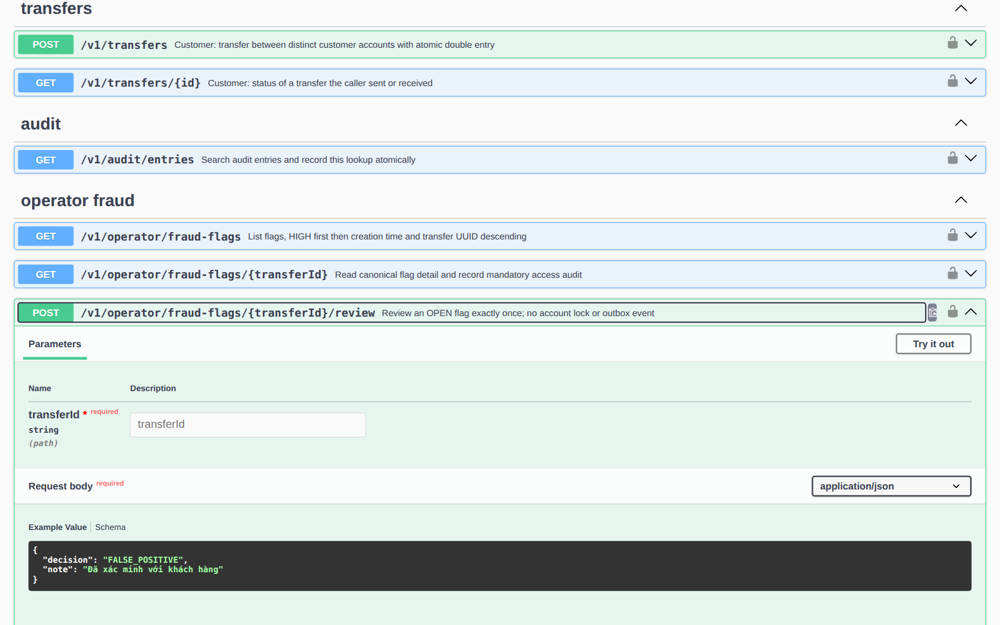
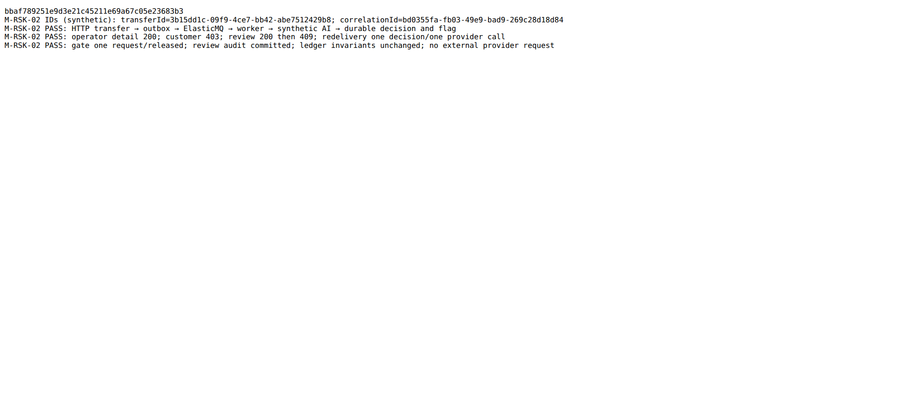
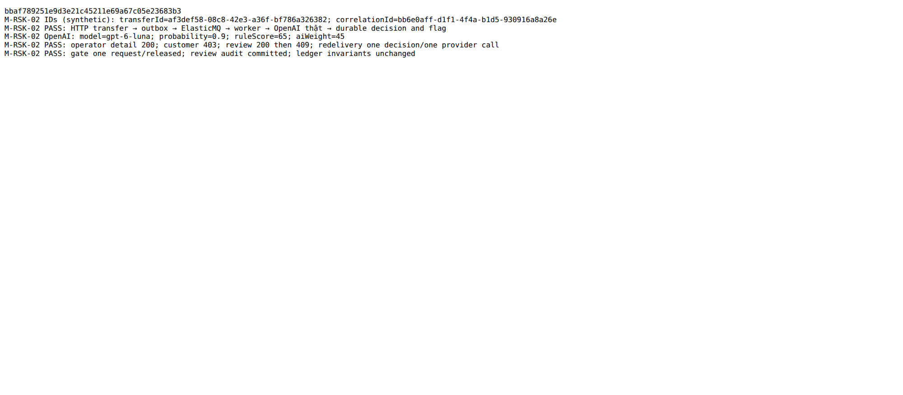

# RSK-02 · Tích hợp fraud worker với OpenAI Decisions

> **Trạng thái:** đã triển khai, smoke OpenAI thật với dữ liệu tổng hợp; CI 6/6 đạt tại `d5cb48e`, chờ Dev review và merge. Kiểm tra CI trên HEAD hiện tại tại PR #129. **Vai:** #4 Fraud. Không có phê duyệt gửi dữ liệu thật hoặc triển khai egress trong task này.

## 1. Bối cảnh và phạm vi

Story RSK-02, tuần 6, deliverable P5. **Expect từ board:** “Mặc định rule_only; bật rules_with_external_ai chỉ bằng phiên bản cấu hình; AI lỗi thì cờ vẫn ra từ luật.”

**DoD từ board:**

1. Mapper Features và sự kiện → FeatureInput (11 trường: medianAmount30d chia hai chính xác, minutesSinceReverse tính từ occurredAt, accountAgeHours từ fromAccountCreatedAt); chốt ngữ nghĩa median khi lịch sử dưới 5 lệnh với Dev risk; test từng trường.
2. AiGate cho tryAcquire: giới hạn đồng thời và ngân sách theo ngày, không chờ vô hạn, nhả permit đúng một lần; hết ngân sách thì BUDGET_EXHAUSTED.
3. Consumer gọi assess() sau khi dedup và kiểm risk_decisions, ngoài transaction có retry; score = rule_score + ai_applied_weight; ghi risk_decisions cho mọi TRANSFER (cả LOW và fallback); cờ chỉ do AI tạo được phép.
4. Mặc định rule_only không gọi mạng; ai.* hỏng thì ai_status = CONFIG_INVALID và vẫn chấm luật; provider lỗi, timeout hoặc 429 thì chạy baseline, không retry.
5. Không log body, khóa hay Authorization (qua SafeLogger); test kiểm.
6. PR đã merge vào main (CI xanh); Dev review; bảng «Đối chiếu test case» trong PR điền đủ.

DBS-108/110/111 và RSK-01 có code trên main; board RSK-01 còn To Do và RSK-08 In Progress nên không khẳng định board đã đồng bộ. Adapter đã có trên main. Nhánh này bổ sung gate và nối worker, đồng thời triển khai [offline](DBS-128-offline-features.md), [API operator](DBS-129-130-fraud-operator-api.md) và [sửa thứ tự feature](BUG-20261110-fraud-feature-order.md). Không sửa logic tiền/ledger, event contract, bộ generator hoặc nhãn holdout. Không train model.

**G1 — tự quyết:** tận dụng worker và schema đã merge, không tạo consumer/bảng decision thứ hai. Median null khi có dưới 5 giao dịch khớp rule R2 và mapper; ý kiến Dev nhận contract vẫn cần xác nhận (BL-042). `rule_only` giữ nguyên; việc kích hoạt AI còn cần policy, secret và quyền egress do Ops/data owner cấp một lần. Không tự xác nhận quyền gửi dữ liệu thật (BL-043/050).

## 2. Hành vi

Worker kiểm tra dedup event/transfer, chọn version, trích xuất đặc trưng và tính R1–R6 một lần. Với AI hợp lệ, mọi TRANSFER mới đều được admission; không lọc trước theo điểm rule. Snapshot chỉ gồm 11 trường allowlist, không ID, tên, email hay lịch sử thô. Không chấm DEPOSIT.

| Điều kiện | Kết quả |
|---|---|
| `rule_only` | Không gọi provider, lưu `DISABLED` và baseline |
| Khối AI hỏng hoặc thiếu key | `CONFIG_INVALID`, giữ baseline |
| Thiếu approval/policy, hết slot, lỗi DB gate hoặc quá hạn | `UNAVAILABLE`, không gửi request, giữ baseline |
| Hết quota request ngày | `BUDGET_EXHAUSTED`, không gửi request, giữ baseline |
| Provider lỗi, timeout, refusal, 429 | Lưu trạng thái tương ứng, không retry provider, giữ baseline |
| AI thành công và xác suất ≥ threshold của version | Cộng weight vào baseline; flag MEDIUM/HIGH có thể không có hit rule |

Hai worker đua vẫn có thể cùng gọi provider và bị tính phí hai lần. Chỉ một decision bất biến thắng `ON CONFLICT DO NOTHING`; flag, hits và audit ghi nguyên tử. Retry transaction dùng lại assessment thay vì gọi lại. Không log key, body hay feature; bảng lưu status, xác suất hợp lệ, model, SHA-256 input/rubric và request ID an toàn, không lưu phản hồi gốc.

## 3. Kiến trúc và an toàn

Luồng, bảng và role chi tiết ở [risk architecture](../components/risk/02-architecture.md). `RiskAiService` chỉ đăng ký ở worker; network ngoài transaction. AI mặc định không hoạt động: `RISK_AI_EGRESS_APPROVED=false`, không seed policy hay quota production. [OpenAI Decisions](https://developers.openai.com/api/docs/guides/decisions) hiện hỗ trợ `gpt-6-luna`; tài khoản thử nghiệm đã gọi thành công với synthetic, không suy ra quyền của tài khoản khác.

Migration `1795000001000` tạo `ai_gate_policy`, `ai_gate_days`, `ai_gate_permits` và hai hàm SECURITY DEFINER `ai_gate_acquire` / `ai_gate_release`. Search path `pg_catalog, pg_temp`, bảng tham chiếu qua `public`; chỉ worker được EXECUTE, PUBLIC/API không có quyền, worker không có quyền bảng gate. Script role giữ grant khi chạy lại; owner migration tách khỏi runtime.

Policy singleton do owner/Ops tạo, revision/cap/concurrency khớp worker. DB khóa policy để cấp permit; ngày UTC lấy từ đồng hồ DB sau khóa. Reservation không hoàn kể cả lỗi/timeout/commit không chắc chắn: giới hạn số request **không phải trần tiền**. Permit không tự hết hạn hoặc tự nhả khi sang ngày. Connect/query/lock/statement có deadline; lỗi cleanup giữ slot fail-closed. TLS/CA dùng databaseConfig, URL có `ssl*`/`uselibpqcompat` bị từ chối để pg không ghi đè TLS. Rollback yêu cầu READ COMMITTED, khóa bảng và từ chối nếu có lịch sử quota/permit.

Nếu cần khôi phục permit: tắt egress/admission và dừng mọi worker, xác minh request cũ không còn chạy, operator chỉ nhả token đã chứng minh kết thúc, giữ nguyên count ngày hiện tại và ghi audit vận hành. Không tự reset khi restore DB cũ. Không khẳng định ZDR hoặc ngừng tính phí sau abort.

## 4. Đối chiếu test case

| ID | DoD | Kiểm chứng | Kết quả |
|---|---|---|---|
| TC-RSK02-01 | 1 | `feature-projection.spec.ts`: 11 trường, median .5/bigint và lịch sử 0–4 | Đạt test; xác nhận Dev risk chưa có (BL-042) |
| TC-RSK02-02 | 2 | `ai-gate.db-spec.ts`: cap ngày, concurrency, deadline, release, rollback snapshot cũ | Đạt PostgreSQL; cap request không phải trần tiền |
| TC-RSK02-03 | 3 | `risk-scoring-ai-mode.db-spec.ts`, `risk-scoring.services-spec.ts` và manual §5 | Đạt loopback và OpenAI thật với synthetic; không hứa exactly-once billing |
| TC-RSK02-04 | 4 | `risk-scoring-ai-mode.db-spec.ts`: rule-only, config invalid, 429, refusal, timeout, quota | Các lỗi đạt synthetic loopback; success đã smoke provider thật, không ép lỗi thật |
| TC-RSK02-05 | 5 | `openai-decisions.spec.ts`, `risk-scoring-ai-mode.db-spec.ts`: request, body và key không vào log, dùng SafeLogger | Đạt |
| TC-RSK02-06 | 6 | [CI PR #129 tại `d5cb48e`](https://github.com/Lawliet119/digital-banking-simulator/actions/runs/42830471495), Dev review, merge | CI 6/6 đạt tại SHA nêu trên; Dev review và merge chưa có |

## 5. Test thủ công

Điều kiện: PostgreSQL thử nghiệm, Docker/ElasticMQ và dữ liệu tổng hợp. Từ `backend/`, đặt `DATABASE_URL` cho DB thử nghiệm rồi chạy `npx ts-node -r tsconfig-paths/register test/manual/fraud-ai-flow.manual.ts`; mặc định dùng loopback, không cần credential. Để gọi provider thật, cấp `OPENAI_API_KEY` qua môi trường an toàn và thêm `--live-openai`; không ghi giá trị vào lệnh, file hoặc log. Script tự tạo database và người dùng giả, chỉ gửi 11 đặc trưng synthetic; Redis cache được mô phỏng không khả dụng để đi đường fallback SQL.

| Bước | Thao tác / mong đợi | Kết quả thực |
|---|---|---|
| M-RSK02-01 | HTTP transfer → outbox → ElasticMQ → worker → AI synthetic | Decision `SUCCEEDED`, rule 0 + AI 45, flag AI-only |
| M-RSK02-02 | Operator xem chi tiết; customer thử xem; review hai lần | 200, 403, 200, 409 |
| M-RSK02-03 | Giao lại event khác ID, kiểm audit và sổ cái | Một decision, một lần gọi provider synthetic, audit 1, bất biến ledger sạch |
| M-RSK02-04 | `--live-openai` với dữ liệu giả, gọi provider thật qua gate; kiểm decision, cờ và review | Đạt: `gpt-6-luna`, xác suất 0,9, rule 65 + AI 45, một request, permit được nhả; operator 200, customer 403, review 200 rồi 409, replay không gọi lại |

[Output loopback và SHA](screenshots/RSK-02/manual-test.txt); [output OpenAI thật và cùng SHA](screenshots/RSK-02/live-openai-test.txt). Cả hai là synthetic; kết quả một giao dịch không chứng minh precision/recall hoặc threshold vận hành.

## 6. Review độc lập

Một reviewer AI kiểm adapter/gate/consumer phát hiện rollback `REPEATABLE READ` có thể xóa quota đã commit; test PostgreSQL trước sửa đỏ, sau sửa xanh. Re-review xác nhận không còn finding trong phạm vi thay đổi. [Bản review](screenshots/RSK-02/domain-review.md). [Reviewer thứ hai](screenshots/RSK-02/operator-review.md) phát hiện ORDER BY CASE không khớp index hàng đợi; đã sắp xếp theo `risk_level` và test cursor qua HIGH/MEDIUM; re-review không còn lỗi correctness. Chưa benchmark/index covering cho backlog lớn (BL-187).

**G2 — tự quyết:** không thêm index thường trên bảng đang có dữ liệu vì migration của repo chạy trong transaction và không hỗ trợ `CREATE INDEX CONCURRENTLY`; bàn giao Ops đo/tạo theo kế hoạch riêng. Không mở rộng metadata audit tự do: thêm hai `AuditReason` cố định cho kết luận review. Đây là review AI, không thay Dev review PR.

## 7. Kế hoạch và phạm vi thực tế

1. Tái sử dụng migration decision/worker main; bổ sung adapter version, gate bền vững, quyền và cấu hình tắt mặc định.
2. Nối consumer, test provider loopback, timeout/fallback/dedup và quyền PostgreSQL; không đổi luồng tiền.
3. Bổ sung provider offline, API operator/review, sửa feature đảo thứ tự và test xuyên HTTP → queue → AI synthetic → review.
4. Chạy lint/typecheck, unit, PostgreSQL, e2e, service, manual; review độc lập và cập nhật docs/BL.

**G3 — tự quyết:** sweep DoD/AC theo bảng §4; tại G3 phần live provider, phê duyệt dữ liệu/egress, đánh giá chất lượng, Dev review/CI/merge chưa hoàn tất. Sau đó đã smoke provider thật như §5; các phần còn lại theo BL-042/043/044/050/051/187. Các bước port và một phần tài liệu được hoàn thiện sau code tham chiếu; không tuyên bố mọi bản thiết kế đều được ghi trước từng thay đổi. Phạm vi thay đổi gồm `backend/src/modules/risk`, config/migration/grants, tests/manual, CI service và docs fraud; không thêm dependency hoặc sửa code ledger.

## 8. Kết quả và bàn giao

- Trước bổ sung manual live và sửa test CI: lint, typecheck, build đạt; unit 100 suite/1.807 test; PostgreSQL 66 suite/938 test; e2e 17 suite/163 test. Không có test skipped trong các lần chạy đầy đủ này.
- Service fraud: 5 suite/12 test đạt; sau đó suite risk-scoring mở rộng có 2 test đạt, bao gồm luồng AI synthetic đầy đủ. Test operator PostgreSQL 14/14 đạt, gồm OpenAPI.
- Đợt test DB tích hợp đầu phát hiện migration mới thiếu `name` và test revert mặc định giả định migration cuối; đã sửa và chạy DB đầy đủ đạt. Manual và ảnh theo SHA ở §5.
- CI cũ: lint/typecheck/unit/e2e/build đạt, DB có 2 test lỗi và job bị hủy ở giới hạn 10 phút. Sau sửa, `ai-gate.db-spec.ts` đạt 12/12; `outbox-schema.db-spec.ts` đạt toàn suite; lint/typecheck đạt. [CI GitHub](https://github.com/Lawliet119/digital-banking-simulator/actions/runs/42830471495) tại `d5cb48e` đạt đủ 6 job, gồm DB và E2E; kiểm trạng thái HEAD hiện tại trên PR.
- Chưa chạy: đánh giá B0/B1/B2 trên tune/holdout, benchmark 120 TPS/hot-account, alarm chi phí, cloud egress/secret và xác nhận điều khoản/ZDR; không dùng smoke hoặc mock thay chứng cứ này. Phần đánh giá dữ liệu bàn giao Dev dataset (BL-171/044), hạ tầng và quyền bàn giao Ops/data owner (BL-043/050/051), UI contract bàn giao Dev nhận API (BL-042).
- Cần xem khi triển khai: năm SELECT feature không cùng snapshot và tăng tải DB; duplicate delivery đồng thời có thể trả phí hai lần; không tạo index mới khóa bảng trong migration (BL-187).

### Quyết định bổ sung sau CI và test OpenAI thật · agent tự quyết

- CI PR #129 chạy `db` chạm giới hạn job 10 phút; output cho thấy 64 suite đạt, 2 suite lỗi trước khi job bị hủy. `outbox-schema` chạy nhiều lần khởi động CLI cho mỗi migration kế tiếp và vượt timeout 120 giây; test gate kiểm bảng ngay sau khi nhả khóa, trong khi truy vấn đã timeout có thể vẫn đang kết thúc ở PostgreSQL.
- Phương án: không bỏ test hoặc tăng timeout từng assertion. Giữ các bước CLI thật cần kiểm, hoàn nguyên các migration phụ trong cùng DataSource; giữ khóa policy đến khi kết nối gate đã đóng trước khi kiểm không có permit. Tăng giới hạn riêng job DB lên 20 phút để có dư địa cho 66 suite và khởi động CI. Việc này chỉ thay giới hạn thời gian CI, không đổi runtime chuyển tiền; có thể tiêu thụ thêm phút CI nếu job bị treo.
- Phạm vi kiểm OpenAI thật: dữ liệu tổng hợp, worker trong harness, ElasticMQ và PostgreSQL thật; cấu hình threshold 0,5 chỉ là cấu hình kiểm thử, không được xem là threshold vận hành hay đánh giá chất lượng. R3/R6 bảo đảm có cờ để kiểm review bất kể xác suất; AI cộng trọng số theo kết quả thật. Không gửi dữ liệu khách hàng thật, không lưu credential trong repo.
- Để Dev chạy lại được, mở rộng manual `fraud-ai-flow.manual.ts` bằng cờ `--live-openai` đọc credential từ biến môi trường; mặc định vẫn loopback. Chạy lại cả hai chế độ, giữ nguyên kiểm tra dedup/review/ledger, không commit credential.

**G4 — tự kiểm:**

- [x] Năm nhóm hành vi ở §4 được test; CI 6/6 đạt tại `d5cb48e`, còn Dev xác nhận median và review/merge, ghi BL-042 và trong PR.
- [x] Manual loopback và OpenAI thật trên commit code cuối, SHA/output đã lưu; đường thành công, từ chối và giao lại đã chạy bằng dữ liệu synthetic.
- [x] Ảnh Swagger và output manual đã có; output không chứa token, mật khẩu hay Authorization.
- [x] Đối chiếu các file thuộc phạm vi §7; thay đổi hỗ trợ ngoài risk gồm export truy vấn ledger, AuditReason, grants, fixture test và OpenAPI sinh từ ứng dụng; lý do ở §3/§6.
- [x] Lint/typecheck/build, unit, e2e và PostgreSQL đã chạy, số lượng ở trên; links được kiểm riêng.
- [x] Bàn giao dataset, hạ tầng, quyền, đánh giá và UI nêu ở §8 và BL tương ứng. Dev review và merge chưa được xác nhận; không đánh dấu hoàn tất.

## 9. Tài liệu cập nhật

`docs/components/risk/01-concept-brief.md`, `02-architecture.md`, `FRAUD_DETECTION_GUIDE.md`, `docs/03_HIGH_LEVEL_ARCHITECTURE.md`, `docs/deliverables/openapi.json` xuất từ `/docs-json` của API thật, README risk, feature docs DBS-128/129/130 và bug feature order, cùng `docs/BACKLOG.md` (BL-041/042/043/044/050/051/171/187). Lưu các đoạn lịch sử của guide nhưng ghi rõ ADR-14 là hiện hành.
