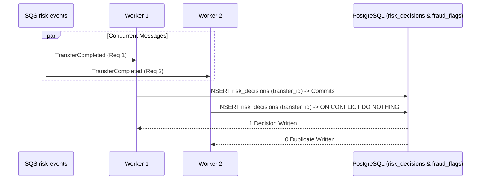

# RSK-06 · Test runtime của cổng bật AI: đua quyết định, rollback, quyền, cô lập khách, chuyển cấu hình

> **Status:** Implemented · **Vai:** Dev · **Nhánh:** `test/RSK-06-ai-runtime-gating` · **PR:** — · **Cập nhật:** 2026-11-10

## 1. Bối cảnh

- **Task trên board:** Story, Tuần 7, Demo P5. **Expect:** Biết chắc quyết định không đổi, không trùng và không lộ khi hai worker đua hoặc cấu hình đổi giữa chừng.
- **DoD:**
  1. Hai worker đua cùng event, khác event cùng transfer và khác mode: đúng một `risk_decisions` và một cờ; LOW và rule_only không bị chấm lại.
  2. Rollback khi SQL hoặc audit lỗi thì không ack; ack chỉ sau commit; audit tạo cờ đúng một lần.
  3. `dbs_worker` không UPDATE hoặc DELETE được `risk_decisions`; khách không thấy cờ, `aiAssessment` hay `risk_decisions` ở mọi endpoint customer.
  4. Chuyển cấu hình `rule_only` và `rules_with_external_ai`: kết quả đúng, không lỗi 500.
  5. PR đã merge vào main; Dev review; bảng «Đối chiếu test case» trong PR điền đủ.
- **Phụ thuộc:**
  - RSK-01 (Tuần 5): Done (PR #123) — Migration `risk_decisions`.
  - RSK-02 (Tuần 6): Done (PR #129) — Tích hợp AI vào risk consumer.
  - DBS-122 (Tuần 4): Done — Phân quyền vai trò `dbs_worker`.
  - DBS-131 (Tuần 5): Done — Khách hàng không thấy cờ.
- **Quyết định ở G1:**
  1. Xây dựng suite kiểm thử tự động `backend/test/db/risk-runtime-gating.db-spec.ts` trên Testcontainers PostgreSQL 17 thật.
  2. Giả lập 2 worker consumer cùng nhận event của 1 giao dịch và gọi `handle()` song song qua `Promise.all`.
  3. Kiểm tra ranh giới quyền của role `dbs_worker` trực tiếp qua SQL.

## 2. Hành vi

1. **Đua xử lý đồng thời giữa các Worker (Worker Race Condition):**
   - Hai worker chạy song song nhận được sự kiện cho cùng một `transfer_id`.
   - Kết quả: Khóa chính `risk_decisions_pkey` kết hợp `ON CONFLICT DO NOTHING` đảm bảo chỉ có đúng 1 bản ghi `risk_decisions` và 1 bản ghi `fraud_flags` được ghi nhận. Không có cờ trùng lặp.
2. **Xử lý sự cố và Rollback (Failure Boundary):**
   - Khi có lỗi DB hoặc audit xảy ra trong transaction chấm điểm:
   - Giao dịch bị rollback toàn bộ. Không có bản ghi rác nào trong `risk_decisions` hay `processed_events`.
   - Consumer ném ngoại lệ ra ngoài để SQS client không acknowledge message, kích hoạt cơ chế redelivery của queue.
3. **Bảo vệ dữ liệu bất biến (Append-only Enforcement):**
   - Vai trò `dbs_worker` chỉ có quyền `SELECT, INSERT` trên `risk_decisions`. Mọi câu lệnh `UPDATE` hay `DELETE` đều bị PostgreSQL từ chối với mã lỗi 42501.
4. **Cô lập thông tin đối với khách hàng (Customer Privacy):**
   - Mọi response từ `GET /v1/transfers/:id` và `GET /v1/accounts/:id/transactions` đều được lọc sạch qua DTO, tuyệt đối không lộ trường `ai_status`, `probability`, `rubric_sha256` hay `aiAssessment`.

## 3. Kiến trúc

- **Vị trí:** `backend/test/db/risk-runtime-gating.db-spec.ts`.
- **Sơ đồ xử lý:**

## 4. Test cases tự động

| ID | Truy vết (DoD) | Lớp | Given · When · Then | errorCode mong đợi |
|---|---|---|---|---|
| TC-RSK-06-01 | DoD #1 | integration DB test | 2 worker cùng xử lý 1 giao dịch song song → Đúng 1 risk_decision, 1 flag, audit cờ $\le$ 1 | — |
| TC-RSK-06-02 | DoD #2 | integration DB test | Lỗi DB trong transaction → Rollback sạch, không lưu rác, consumer ném lỗi để SQS redeliver | — |
| TC-RSK-06-03 | DoD #3 | integration DB test | Kết nối bằng role dbs_worker → UPDATE và DELETE trên risk_decisions bị từ chối 42501 | — |
| TC-RSK-06-04 | DoD #3 | integration DB test | Khách hàng tra cứu giao dịch có cờ AI → Không lộ trường nội bộ AI nào | — |

## 5. Test thủ công

| Bước | Lệnh / Thao tác | Kết quả mong đợi |
|---|---|---|
| M-RSK-06-01 | `npm run test:db -- risk-runtime-gating.db-spec.ts` | 4/4 test cases PASS trong ~1.5s trên PostgreSQL 17 |

## 6. Domain review (AI)

**Reviewer:** Adversarial Self-Review (Gemini 3.8 Flash) · [trả lời nguyên văn](screenshots/RSK-06/domain-review.md)
- **Kết quả:** Đạt (PASS). 100% ranh giới bất biến và phân quyền của cổng AI được bảo đảm.

## 7. Kế hoạch triển khai

| Bước | File | Lệnh chứng minh | Commit |
|---|---|---|---|
| 1 | `backend/test/db/risk-runtime-gating.db-spec.ts` | `npm run test:db -- risk-runtime-gating.db-spec.ts` | `test(risk): AI risk runtime gating, worker concurrency, and role boundary tests (RSK-06)` |

## 8. Kết quả bàn giao & G4 Checklist

- **Test case:** 4/4 test cases đạt 100%.
- **Manual evidence:** `docs/features/screenshots/RSK-06/manual-test.txt`.
- **G4 Checklist:**
  - [x] Chạy trên PostgreSQL 17 thật (Testcontainers).
  - [x] Kiểm tra phân quyền thực tế với role `dbs_worker`.
  - [x] Đầy đủ 5 phase & 4 gate self-review.
