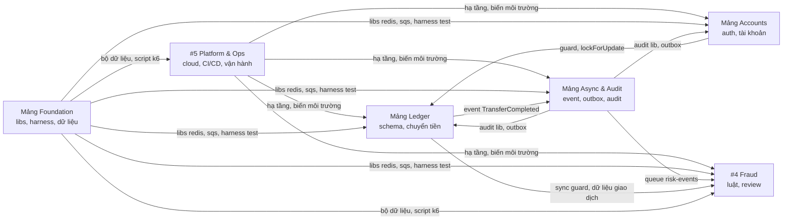

# Team Roles Playbook — Cách làm việc của từng vai

> **Status:** Active (cơ cấu vai v2, mô hình kéo, 2026-10-12) · **Owner:** cả nhóm · **Verified against code:** n/a · **Cập nhật:** 2026-10-12

> Tài liệu nội bộ, dùng kèm [`10_WEEK_PLAN.md`](10_WEEK_PLAN.md). Việc cụ thể từng tuần nằm trên board của nhóm (mỗi task có tuần, người làm, phụ thuộc), không chép lại ở đây. Quy trình làm một task: skill [`dbs-delivering-task`](../../.claude/skills/dbs-delivering-task/SKILL.md).
> Riêng mảng Fraud có hướng dẫn chi tiết ở [`FRAUD_DETECTION_GUIDE.md`](../components/risk/FRAUD_DETECTION_GUIDE.md).

---

## 0. Nhìn chung

### 0.1 Ba vai trên board, làm việc kiểu kéo

| Vai trên board | Số người | Sứ mệnh | Câu bảo vệ |
|---|---|---|---|
| **Dev** | 4 | Làm mọi task `Dev`: lên kế hoạch, implement, test, test thủ công, tài liệu và ảnh chụp, theo cùng một quy trình (5 phase, 4 gate). Các mảng: Ledger, Accounts & Identity, Async & Audit, Foundation & Data (mục 2–5) | người làm task liên quan chuẩn bị |
| **#4 Fraud** | 1 | Phát hiện gian lận nhanh, giải thích được, đo được; dẫn dắt P5 | 12 |
| **#5 Platform & Ops** | 1 | Hạ tầng tự động, an toàn, rẻ; vận hành chạy được; dẫn dắt P3 | 8, 9, 11 |

**Cách nhận việc:** dev nào thấy task `Dev` chưa ai nhận và phụ thuộc đã Done thì nhận: ghi «[Nhận: tên]» ở đầu cột Thực trạng, chuyển In Progress, làm theo thứ tự board (tuần sớm trước, ưu tiên cao trước). Không ai chờ ai: task bị chặn thì lấy task chưa làm khác. Không có chủ module, không có cặp cố định, không cần chia đều khối lượng; điều quan trọng là kết quả đầu ra. Task của #4 và #5 do hai người đó nhận.

### 0.2 Ai phụ thuộc vào ai



**Đường găng:** #5 + mảng Foundation (hạ tầng và nền chung tuần 1–2) → mảng Ledger + Accounts (chuyển tiền đúng tuần 3) → mảng Async (sự kiện tuần 4) → #4 (fraud tuần 4–5). Trễ ở đầu chuỗi thì cả chuỗi trễ; vì vậy dev rảnh ưu tiên nhận task nằm trên đường găng. Mỗi tên mảng trong sơ đồ là kiến thức cần đọc, không phải người sở hữu.

### 0.3 Ai chịu trách nhiệm cuối

| Hạng mục | Chịu trách nhiệm cuối |
|---|---|
| P1, P2, P4 (chủ biên) | Một Dev, nhóm chọn khi tới mốc |
| P3 — Security & DevOps | #5 |
| P5 — AI Engineering | #4 |
| Schema database, event contract | Dev đang nhận task đó; mọi migration do một Dev khác review |
| Hạ tầng, chi phí cloud, vận hành | #5 |
| Duyệt ADR | cả nhóm (đổi ADR cần ADR mới thay thế) |
| Lịch, board, nộp bài | một Dev nhận làm điều phối (không quá ~20% thời gian) |
| 5 demo bắt buộc chạy được | #5 điều phối; mọi người chạy phần của mình |

---

## 1. Cách làm chung của mọi task

Mỗi task, dù lớn hay nhỏ, đi đủ: **lên kế hoạch → implement → test → test thủ công**. Chi tiết nằm ở skill `dbs-delivering-task`; tóm tắt:

| Phase | Việc | Gate người duyệt |
|---|---|---|
| 1. Hiểu task | Đọc mô tả đầy đủ trên board, tài liệu và code hiện có, chạy baseline | G1 Phạm vi |
| 2. Thiết kế | Hành vi, kiến trúc, test case tự động, kịch bản test thủ công; AI domain review | G2 Thiết kế |
| 3. Kế hoạch | Từng bước, test viết trước, lệnh chứng minh | G3 Kế hoạch |
| 4. Implement và test | Code theo TDD, chạy test tự động, **chạy test thủ công thật** | — |
| 5. Tài liệu và bàn giao | Ảnh chụp, cập nhật docs, feature doc `docs/features/DBS-<n>-<slug>.md` | G4 Bàn giao |

- **Mỗi người tự test việc của mình** (unit, integration, thủ công). Test đồng thời và bảo mật là task riêng trên board, lớp kiểm tra thêm cho đường tiền và đường xác thực; nếu được thì do Dev không viết phần code đang được test nhận.
- **Không có chủ module.** Hai người cùng đụng một module thì giữ PR nhỏ, rebase thường xuyên; cần interface mà task khác còn đang làm thì thống nhất trong issue trước, và không giả lập (stub) thứ mà task chưa xong sẽ giao.
- **Review PR:** một Dev khác (không phải tác giả), ai rảnh trước thì review; tác giả không tự merge khi chưa có review. Đây là quy ước nhóm, GitHub không ép.
- **Khi duyệt PR có chạm tới tiền, kiểm tra:** mọi thay đổi số dư đi qua `ledger` trong một transaction; không có `UPDATE`/`DELETE` trên `ledger_entries`, `audit_log`; có test chạy trên Postgres thật.

---

## Ghi chú theo mảng việc (mục 2–5)

Bốn mục dưới đây là ghi chú theo **mảng việc**: phạm vi, thỏa thuận interface, bằng chứng cần có và bẫy hay gặp. Chúng **không phải phân công**: Dev nào nhận task thuộc mảng nào thì đọc mục đó trước khi làm. «#1, #2, #3, #6» trong các bảng thỏa thuận chỉ mảng tương ứng (Ledger, Accounts & Identity, Async & Audit, Foundation & Data); #4 và #5 là hai người thật.

## 2. Mảng Ledger (#1)

### Sứ mệnh
Mọi đồng tiền vào, ra, di chuyển trong hệ thống đều đúng — kể cả khi hàng trăm request đến cùng lúc, kể cả khi client gửi lại, kể cả khi server chết giữa chừng.

### Phạm vi mảng

| Loại | Nội dung |
|---|---|
| Code | Module `ledger`: nạp tiền (UC-3), chuyển tiền (UC-5), idempotency, **sync guard** (trạng thái, hạn mức lần, hạn mức ngày), job đối soát |
| Database | Toàn bộ schema; migration role `dbs_api`/`dbs_worker`/`dbs_migrator` và GRANT; mọi migration có Dev khác review |
| Tài liệu | `docs/03` mục 6.1, 8; ADR-01, 02, 04, 05, 07, 09 |
| Việc chung | Giữ tài liệu kiến trúc nhất quán; ADR mới thay thế khi đổi quyết định |

### Thỏa thuận với người khác

| Với | Thỏa thuận | Hạn |
|---|---|---|
| #2 | `AccountsService.lockForUpdate(ids, tx)`, `applyBalanceChange(...)` — ledger gọi, truyền transaction vào | Tuần 2 |
| #3 | Hàm ghi outbox và audit nhận transaction hiện tại | Tuần 2 |
| #4 | Danh sách `reject_reason`, chữ ký `checkGuards`; `v_transfer_facts` cho risk | Tuần 2 |
| #6 | Cách seed dữ liệu qua API nạp tiền (không `UPDATE balance` trực tiếp) | Tuần 2 |

### Bằng chứng cần có cho báo cáo
- Test AC-5.x xanh, chạy trên Postgres thật; ảnh chụp test thủ công chuyển tiền.
- Kết quả đối soát sau mỗi load test.
- Bảng so sánh database (ADR-02) và lý do chọn cơ chế khóa (ADR-04).

### Bẫy hay gặp
- Dùng `number` cho tiền → sai số. Luôn `bigint`/string.
- Kiểm tra hạn mức **trước** khi khóa tài khoản → hai lệnh song song cùng lọt.
- ORM tự mở transaction riêng cho từng câu lệnh → mất tính nguyên tử. Dùng một `QueryRunner` cho cả luồng.
- Gọi dịch vụ ngoài (Redis, HTTP) **bên trong** transaction đang giữ khóa → khóa bị giữ lâu, tài khoản nóng nghẽn.
- Pool kết nối không giới hạn → `số task × pool` vượt `max_connections` khi scale.

---

## 3. Mảng Accounts & Identity (#2)

### Sứ mệnh
Đúng người được làm đúng việc trên đúng dữ liệu.

### Phạm vi mảng

| Loại | Nội dung |
|---|---|
| Code | Module `identity` (xác minh JWT, guard vai trò, mốc thu hồi phiên, xác thực local/test), `accounts` (UC-1, 2, 4, 11), API lịch sử/trạng thái (UC-6, 7), rate limit |
| API | Chất lượng OpenAPI/Swagger của cả hệ thống: tên endpoint, mã lỗi, ví dụ |
| Tài liệu | `docs/03` mục 6.2, 7, 12 (phần ứng dụng); ADR-06 (phần Cognito) |
| Việc điều phối (một Dev nhận) | Lịch họp, board công việc, theo dõi deadline, ghép và nộp bài (không quá ~20% thời gian) |

### Thỏa thuận với người khác

| Với | Thỏa thuận | Hạn |
|---|---|---|
| #5 | Tên nhóm Cognito (`customer`, `operator`, `auditor`, `admin`), thời gian sống token | Tuần 1 |
| #1 | Interface `lockForUpdate`, `applyBalanceChange` | Tuần 2 |
| #6 | `libs/redis` (key `revoked_at:{userId}`, rate limit) | Tuần 3 |
| Cả nhóm | Định dạng lỗi `problem+json`, header `X-Correlation-Id` (đã có sẵn trong `backend/src/common`) | Tuần 2 |

### Việc PM hằng tuần

| Khi | Việc |
|---|---|
| Thứ Hai | Họp đứng 15 phút: mỗi người nói *xong gì / làm gì / vướng gì*; cập nhật board |
| Thứ Năm | Họp gỡ vướng 15 phút: chỉ bàn việc đang bị chặn |
| Chủ Nhật | Điều phối demo 15–20 phút, ghi hình, lưu link |
| Cuối tuần | Gửi tin nhắn tình trạng tuần vào nhóm (mẫu ở mục 8) |
| Liên tục | Theo dõi deadline P1–P5; nhắc trước hạn 1 tuần và 2 ngày |

### Bẫy hay gặp
- Chỉ kiểm tra vai trò mà quên kiểm tra **sở hữu** → khách A đọc được tài khoản của B.
- Trả `403` cho tài khoản của người khác → lộ rằng tài khoản đó tồn tại. Dùng `404`.
- Tin vào JWT mà không kiểm tra mốc thu hồi → tài khoản bị khóa vẫn dùng được tới khi token hết hạn.
- Quên ghi nhật ký cho lần **bị từ chối** quyền.
- Việc PM chiếm hết thời gian code: việc ghép tài liệu thì mỗi người tự viết phần của mình.

---

## 4. Mảng Async & Audit (#3)

### Sứ mệnh
Mọi sự kiện đã xảy ra đều tới được nơi cần tới (ít nhất một lần, xử lý đúng một lần), và mọi thao tác ghi đều để lại dấu vết không xóa được.

### Phạm vi mảng

| Loại | Nội dung |
|---|---|
| Code | Module `outbox` (relay + bảng định tuyến queue; khung consumer `processed_events`, retry, DLQ), `notification`, `audit` (thư viện + API tra cứu UC-8), event contract và `common/events`, metric hàng đợi và độ trễ tới cờ |
| Tài liệu | `docs/03` mục 10, 11; ADR-03 |
| Việc chung | Phần integration, event model của P2; hồ sơ cuối và slide (tuần 10) |

### Thỏa thuận với người khác

| Với | Thỏa thuận | Hạn |
|---|---|---|
| #1, #4 | Event contract `TransferCompleted` (gồm snapshot, `sameOwner`) | Tuần 1 |
| Cả nhóm | API thư viện audit: `audit.record(tx, { actor, action, target, correlationId })` | Tuần 2 |
| #5, #6 | Tên queue, DLQ, số lần retry, visibility timeout (khớp `infra/local/elasticmq.conf`); `libs/sqs` | Tuần 3 |
| #6 | Cách giả lập consumer lỗi để test DLQ | Tuần 4 |

### Bẫy hay gặp
- Gửi message **trước** khi transaction commit → rollback rồi mà sự kiện vẫn đi.
- Xóa message khỏi queue **trước** khi ghi DB xong → sự cố giữa chừng là mất sự kiện.
- Consumer không idempotent → nhận trùng là xử lý trùng.
- Message hỏng định dạng bị retry vô hạn → đưa thẳng vào DLQ.
- Ghi audit **ngoài** transaction nghiệp vụ → có thao tác thành công mà không có nhật ký.
- Dùng một queue cho nhiều consumer → mỗi message chỉ tới một consumer.

---

## 5. Mảng Foundation & Data (#6)

### Sứ mệnh
Làm nền chung mà mọi module dựa vào (client Redis và SQS, health, log, harness test), và biến mọi lời hứa trong tài liệu thành **test chạy được và số liệu đo được**, để khi hội đồng hỏi, nhóm trả lời bằng bằng chứng.

### Phạm vi mảng

| Loại | Nội dung |
|---|---|
| Code nền | `libs/redis` (timeout, circuit breaker), `libs/sqs`, `modules/health`, logger JSON và `correlationId` (`AsyncLocalStorage`) |
| Test | Harness Testcontainers và job test trong CI, script bất biến (`invariants.sql`), seed qua API, test đồng thời, test chống trùng, test bảo mật tập trung |
| Dữ liệu và đo | Generator dữ liệu fraud (Dev làm giữ nhãn holdout), script k6 (viết; #5 chạy), gói P4 |
| Tài liệu | `docs/03` mục 14, 17; hồ sơ P4 |

### Thỏa thuận với người khác

| Với | Thỏa thuận | Hạn |
|---|---|---|
| #1 | Seed dữ liệu qua API nạp tiền; script kiểm tra bất biến | Tuần 2 |
| #4 | Định dạng CSV, tên kịch bản, chia tập, lịch giao — **không chia sẻ code generator** | Tuần 2 |
| Cả nhóm | Tên metric, nhãn log | Tuần 5 |
| #5 | Môi trường và khung giờ chạy load test trên cloud; script k6 bàn giao cho #5 chạy | Tuần 6 |

### Bằng chứng cần có cho báo cáo
- Kết quả k6 (p95, p99, error rate) ở từng mốc tải, kèm cấu hình môi trường (phần chạy do #5).
- Kết quả kiểm tra bất biến sau **mỗi** lần load test.
- Bảng kịch bản sự cố: làm gì → hệ thống phản ứng ra sao → phục hồi sau bao lâu.

### Bẫy hay gặp
- Mock database trong test đồng thời → test xanh nhưng không chứng minh được gì.
- Redis chỉ test lúc tắt, không test lúc **chậm** → circuit breaker không được kiểm.
- Load test xong không kiểm tra bất biến → có thể đang "nhanh" mà tiền sai.
- Bỏ qua test lúc xanh lúc đỏ → thường đó chính là lỗi đồng thời.
- Lỡ cho #4 xem code generator → mất giá trị đánh giá.

---

## 6. Fraud (#4)

### Sứ mệnh
Đưa giao dịch đáng ngờ tới nhân viên trong vài giây, mỗi cảnh báo có lý do rõ ràng, và chứng minh bằng số liệu rằng cách phát hiện thực sự hiệu quả.

### Sở hữu

| Loại | Nội dung |
|---|---|
| Code | Module `risk`: 6 luật + tính điểm (worker), API xem và review cờ, cấu hình luật có phiên bản (api), script đánh giá offline; phần ML nếu qua cổng go/no-go (ADR-08) |
| Tài liệu | `docs/03` mục 15; ADR-08; báo cáo P5 |

Sync guard (hạn mức, trạng thái tài khoản) là code của #1; #4 cùng thống nhất danh sách lý do từ chối và review phần này.

### Thỏa thuận với người khác

| Với | Thỏa thuận | Hạn |
|---|---|---|
| #3 | Event contract có đủ snapshot | Tuần 1 |
| #1 | `checkGuards`, mã lỗi, view `v_transfer_facts` | Tuần 2 |
| #6 | Định dạng CSV, tên kịch bản, cách chia tập, lịch giao dữ liệu | Tuần 2 |
| #6, #5 | `libs/redis`, key Redis, role DB cho worker | Tuần 3 |
| Cả nhóm | Mục tiêu recall / số cảnh báo trên 1.000 giao dịch (đã chốt ở NFR-FRD-02) | Tuần 2 |

### Quy tắc riêng
- **Không xem code generator** (do Dev làm bộ dữ liệu giữ); chỉ biết tên kịch bản.
- **Chỉ chạy holdout một lần**, sau khi đã đóng băng cấu hình.

Chi tiết đầy đủ: [`FRAUD_DETECTION_GUIDE.md`](../components/risk/FRAUD_DETECTION_GUIDE.md); ghi chú cho agent: `.claude/skills/dbs-delivering-task/references/fraud.md`.

### Bẫy hay gặp
- Đọc số dư hiện tại thay vì snapshot trong sự kiện → R6 sai.
- Tính cửa sổ thời gian theo giờ worker thay vì `occurredAt` → kết quả phụ thuộc lúc xử lý.
- Chỉnh luật nhiều lần trên holdout → kết quả không còn giá trị.
- Báo cáo con số tổng mà không chia theo kịch bản → che mất điểm yếu.

---

## 7. Platform & Ops (#5)

### Sứ mệnh
Code merge vào `main` là tự lên cloud, có thể quay lui trong vài phút, không lộ bí mật, không đốt tiền ngoài ý muốn; và hệ thống chạy trên cloud được vận hành, quan sát và diễn tập sự cố có bằng chứng.

### Sở hữu

| Loại | Nội dung |
|---|---|
| Hạ tầng | `infra/terraform` (VPC, ECR, ECS, RDS, ElastiCache, SQS, Cognito, WAF, KMS, CloudWatch), `infra/local` |
| CI/CD | Pipeline deploy, quét image, quét secret, OIDC tới AWS, Dockerfile (job test trong CI do #6 viết) |
| Tài khoản | Tài khoản AWS, IAM user cho từng thành viên, MFA, AWS Budget, quyền repo GitHub |
| **Vận hành** | Dashboard và alarm theo SLO, chạy load test (script của #6) và diễn tập sự cố trên cloud (RDS failover, kill task, tắt Redis, tắt worker), rollback, báo cáo chi phí, chạy lại demo trên cloud |
| Tài liệu | `docs/03` mục 12, 13; ADR-06 (Fargate vs EKS), 10, 11; chủ biên P3 |

### Thỏa thuận với người khác

| Với | Thỏa thuận | Hạn |
|---|---|---|
| Cả nhóm | Tên biến môi trường (`.env.example` là chuẩn) | Tuần 1 |
| #6 | `/health/live`, `/health/ready`; job test trong CI; môi trường và khung giờ chạy load test | Tuần 1, 6 |
| #2 | Nhóm Cognito, thời gian sống token | Tuần 1 |
| #3 | Tên queue, DLQ, cấu hình retry | Tuần 3 |
| #1, #4 | Role DB cho `api` và `worker` | Tuần 4 |

### Việc định kỳ

| Khi | Việc |
|---|---|
| Hằng ngày làm việc | Dựng môi trường dev khi cần, `terraform destroy` phần dựng/xóa khi xong |
| Thứ Hai | Báo chi phí tuần trước vào nhóm |
| Khi có người mới / rời | Cấp / thu hồi quyền AWS và GitHub |

### Bẫy hay gặp
- Commit `terraform.tfstate` hoặc `*.tfvars` → lộ bí mật.
- Lỡ tạo NAT Gateway → ~$30+/tháng âm thầm (ADR-10).
- Quên `destroy` cuối tuần → mất cả chục đô.
- Lưu access key AWS trong GitHub Secrets thay vì dùng OIDC.
- Chạy migration lúc app khởi động → nhiều task cùng chạy migration một lúc.
- Chạy load test từ laptop qua mạng nhà → đo cả độ trễ mạng. Chạy từ một máy cùng region.
- Một người giữ mọi quyền và mật khẩu → phải có thêm một Dev có quyền dự phòng.

Chi tiết cho agent: `.claude/skills/dbs-delivering-task/references/platform.md`.

---

## 8. Quy tắc chung cho mọi vai

### 8.1 Nhịp tuần

| Ngày | Hoạt động | Thời lượng |
|---|---|---|
| Thứ Hai | Họp đứng: xong gì / làm gì / vướng gì | 15 phút |
| Thứ Năm | Họp gỡ vướng (chỉ việc đang bị chặn) | 15 phút |
| Chủ Nhật | Demo cuối tuần, ghi hình | 15–20 phút |
| Cuối tuần | Mỗi người gửi tình trạng tuần | 2 phút |

### 8.2 Mẫu tin nhắn tình trạng tuần

```
[Tuần N] <tên> — <Vai>
✅ Xong: ...
🔨 Đang làm: ...
⛔ Vướng: ... (cần ai: <tên>)
📅 Tuần sau: ...
```

### 8.3 Quy tắc giao tiếp

- **Bị chặn quá một buổi làm việc → báo ngay** trong nhóm, ghi rõ cần ai. Đừng ngồi chờ tới buổi họp.
- **Quyết định ảnh hưởng người khác** (đổi schema, đổi contract, đổi biến môi trường) phải ghi vào issue hoặc ADR, không chỉ chốt trong tin nhắn riêng.
- **Đổi contract đã thống nhất** (event, interface, API) → báo trước cho mọi người dùng nó và cập nhật tài liệu cùng PR.
- **Không im lặng.** Bận đột xuất thì báo sớm, ghi hiện trạng vào cột Thực trạng để Dev rảnh nhận tiếp.

### 8.4 Khi vắng mặt — mẫu bàn giao cho người nhận tiếp

```
Bàn giao từ <tên> cho <tên> (từ ngày ... đến ...)
- Đang làm: <issue, nhánh>
- Trạng thái: <đã xong gì, còn gì>
- Cần chú ý: <bẫy, quyết định đang chờ>
- Liên hệ khi cần: <cách liên lạc, giờ có thể trả lời>
```

### 8.5 Mỗi vai tự giữ cho mình

- [ ] README trong thư mục mình đã sửa luôn đúng với code
- [ ] Feature doc của task (`docs/features/`) đầy đủ, kể cả test thủ công và ảnh chụp
- [ ] ADR viết ngay khi chốt quyết định
- [ ] Có ít nhất một bằng chứng (test, số liệu, ảnh, video) cho mỗi câu bảo vệ liên quan tới việc mình làm
- [ ] Feature doc đủ rõ để Dev khác nhận tiếp khi cần
