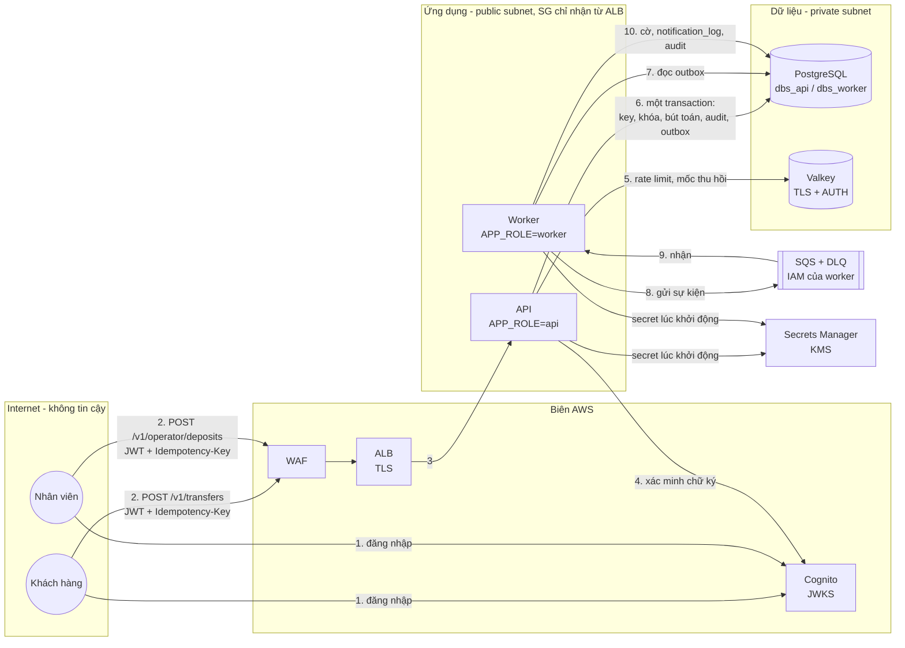

# Threat model: chuyển tiền và nạp tiền (STRIDE)

> **Status:** Accepted (2026-10-11) · **Owner:** #2 (ứng dụng), #5 (hạ tầng) · **Cặp đôi:** #3, #6 · **Verified against code:** chưa (bằng chứng là các task DBS-n ghi ở cột cuối; điền link test hoặc ảnh khi task xong; T5 đã kiểm bởi DBS-22; T9 có hàm kiểm tra schema từ DBS-24, chờ consumer) · **Cập nhật:** 2026-10-19

Phạm vi: hai luồng đụng tới tiền, UC-5 chuyển tiền và UC-3 nạp tiền tại quầy, cùng các thành phần chúng đi qua. Nguồn thiết kế: [docs/03 §6, §12, §13](../03_HIGH_LEVEL_ARCHITECTURE.md), [ADR-05](../adr/0005-idempotency-in-postgres.md), [ADR-06](../adr/0006-cognito-ecs-fargate.md), [ADR-10](../adr/0010-fargate-egress-public-subnet.md), [database-design §8](../components/_shared/database-design.md).

## 1. Sơ đồ luồng dữ liệu và ranh giới tin cậy

| Ranh giới | Giữa | Kiểm soát chính |
|---|---|---|
| B1 | Internet → biên AWS | TLS ở ALB, WAF (managed rules, rate rule), chỉ mở cổng 443 |
| B2 | Biên → ứng dụng | Security group của task chỉ nhận cổng 3000 từ security group của ALB; JWT xác minh ở mọi request |
| B3 | Ứng dụng → dữ liệu | Private subnet không route ra internet; security group chỉ nhận từ task; TLS tới RDS và Valkey; DB role tối thiểu |
| B4 | Ứng dụng → dịch vụ AWS | IAM task role riêng cho `api` và `worker`; GitHub → AWS qua OIDC |

## 2. Tài sản cần bảo vệ

| Tài sản | Nằm ở | Hậu quả nếu bị xâm phạm |
|---|---|---|
| Số dư và sổ cái (`accounts.balance`, `ledger_entries`, `transfers`) | PostgreSQL | Mất tiền, sai đối soát |
| Nhật ký kiểm toán (`audit_log`) | PostgreSQL | Mất khả năng truy vết |
| Mã yêu cầu và response đã lưu (`idempotency_keys`) | PostgreSQL | Trừ tiền hai lần, lộ response của người khác |
| Access token, mốc thu hồi phiên | Client, Valkey, `users.sessions_revoked_at` | Mạo danh |
| Cờ gian lận và lý do khóa | `fraud_flags`, `audit_log` | Lộ cho kẻ gian cách né luật (BR-13) |
| Secret (mật khẩu DB, AUTH Valkey, mật khẩu demo) | Secrets Manager | Chiếm quyền dữ liệu |
| Cấu hình luật (`risk_rule_sets`) | PostgreSQL | Tắt phát hiện gian lận |

## 3. Bảng STRIDE

Trạng thái: **Thiết kế** = biện pháp đã nằm trong thiết kế, chờ code; **Đã kiểm** = có test hoặc ảnh làm bằng chứng. Cột bằng chứng ghi task sẽ tạo ra bằng chứng đó.

Ngoài ra, **Đề xuất** = biện pháp thuộc một ADR còn ở trạng thái Proposed, nhóm chưa chấp nhận.

| # | STRIDE | Mối đe dọa | Biện pháp | Bằng chứng | Trạng thái |
|---|---|---|---|---|---|
| T1 | **S**poofing | Token giả, token ký bằng khóa khác, token hết hạn | Xác minh chữ ký qua JWKS, kiểm `iss`, `client_id`, `token_use`, `exp`; không tin claim trước khi verify | DBS-50, DBS-159 | Thiết kế |
| T2 | **S**poofing | Token cũ của tài khoản đã bị khóa vẫn dùng được tới khi hết hạn | Mốc `sessions_revoked_at` ghi cùng transaction khóa; guard so `iat` (token cùng giây với mốc bị từ chối); Redis chỉ là cache, miss thì đọc DB | AC-11.1, DBS-114, DBS-115, DBS-186 | Thiết kế |
| T3 | **S**poofing | Đường xác thực local (`AUTH_MODE=local`) lọt lên cloud | Validation schema từ chối khởi động ở staging/production; khóa dev sinh vào thư mục bị gitignore | DBS-53 | Thiết kế |
| T4 | **T**ampering | Sửa hoặc xóa bút toán, giao dịch, nhật ký | Trigger `forbid_mutation` chặn UPDATE/DELETE/TRUNCATE trên transfers, ledger_entries, audit_log; production còn cần thu quyền UPDATE/DELETE của `dbs_api`, `dbs_worker` | [DBS-27](../features/DBS-27-append-only-triggers.md) TC-27-01…12; DBS-122 | **Đã kiểm lớp trigger bằng owner NOSUPERUSER**; chưa kiểm production roles/grants hoặc chống owner cố ý đổi DDL/tắt trigger |
| T5 | **T**ampering | Client gửi số tiền âm, thập phân, vượt 2^63 hoặc dạng số mũ để làm sai số dư | DTO chỉ nhận chuỗi số nguyên dương; DB `CHECK (amount > 0)`; tiền là `bigint` | [DBS-22](../features/DBS-22-common-money-type-dto-validator.md) (TC-22-19, 20, 27, 28; M-22-05b), DBS-21 | **Đã kiểm** |
| T6 | **T**ampering | Gửi song song nhiều lệnh để vượt hạn mức ngày hoặc rút quá số dư | Khóa `FOR UPDATE` theo thứ tự id, sync guard sau khóa; DB `CHECK (balance >= 0)` cho tài khoản khách | AC-5.6, AC-5.9, DBS-98, DBS-99 | Thiết kế |
| T7 | **T**ampering | Gửi lại một lệnh (replay) để trừ tiền nhiều lần | `Idempotency-Key` bắt buộc, `PRIMARY KEY (user_id, idem_key)`, `ON CONFLICT DO NOTHING`, cùng transaction | AC-5.3, 5.4, 5.10, DBS-97, DBS-185 | Thiết kế |
| T8 | **T**ampering | Dùng cùng key với nội dung khác để đổi số tiền của lệnh đã chạy | `request_hash` SHA-256; khác hash → `422 IDEMPOTENCY_KEY_REUSED` | AC-5.5, DBS-79 | Thiết kế |
| T9 | **T**ampering | Message giả hoặc hỏng trong queue làm sai cờ | Chỉ IAM role của worker gửi/nhận được SQS; consumer validate schema, sai thì vào DLQ ngay; idempotent theo `eventId` | [DBS-24](../features/DBS-24-common-events-types-schema.md) (hàm kiểm tra `validateEvent`), DBS-101, DBS-104, DBS-120 | Thiết kế |
| T10 | **R**epudiation | Nhân viên chối đã nạp tiền, khóa tài khoản hay kết luận cờ | Mọi thao tác ghi có `audit_log` cùng transaction (fail-closed), kèm người, vai trò, lý do, `correlationId` | AC-11.3, AC-8.2, DBS-56, DBS-135 | Thiết kế |
| T11 | **R**epudiation | Lần truy cập bị từ chối không để lại dấu vết | Ghi `outcome = DENIED` cho truy cập trái quyền, ở transaction riêng để không bị rollback theo lỗi | AC-5.8, DBS-56, DBS-86 | Thiết kế |
| T12 | **I**nformation disclosure | Khách A đọc tài khoản hoặc giao dịch của khách B (IDOR) | Kiểm sở hữu trong service ở mọi endpoint có id; trả 404 giống hệt cho "không tồn tại" và "không phải của bạn" | AC-5.8, DBS-86, DBS-158 | Thiết kế |
| T13 | **I**nformation disclosure | Dùng `Idempotency-Key` của người khác để đọc response của họ | Key theo user nên hai user không bao giờ đụng nhau | DBS-159 | Thiết kế |
| T14 | **I**nformation disclosure | Khách biết giao dịch của mình bị gắn cờ, hoặc biết lý do khóa | API khách không có trường nào về cờ; event `AccountStatusChanged` và thông báo không mang lý do | AC-10.2, DBS-131, DBS-102 | Thiết kế |
| T15 | **I**nformation disclosure | Log, Redis hoặc lỗi 500 lộ token, số tài khoản đầy đủ, stack trace, SQL | Logger che key nhạy cảm, quét bí mật trong mọi giá trị chuỗi, bỏ body/URL/header và raw error/SQL; lỗi 500 trả nội dung chung; lỗi khởi động chỉ ghi tên biến sai, lỗi cấp tiến trình ra một dòng JSON không stack; Redis chỉ chứa id và số đếm | [DBS-42](../features/DBS-42-json-logger.md), DBS-158 | Đã kiểm phần logger/HTTP, bootstrap và lỗi cấp tiến trình (còn giới hạn ghi ở backend/README §8); Redis và phần kiểm thử mở rộng chờ DBS-158 |
| T16 | **I**nformation disclosure | Secret lộ trong repo, image hoặc biến môi trường viết thẳng | Secrets Manager; không có access key (OIDC); gitleaks và quét image trong CI | DBS-36, DBS-67, DBS-155 | Thiết kế |
| T17 | **I**nformation disclosure | Nghe lén đường truyền tới DB hoặc Redis | TLS bắt buộc (validation từ chối khởi động nếu thiếu ở staging/production); `rds.force_ssl = 1`; Valkey `rediss://` | DBS-67, DBS-75 | Thiết kế |
| T18 | **D**enial of service | Một user hoặc một IP spam lệnh chuyển | Rate limit 10 lệnh/phút/khách, 100 yêu cầu/phút/IP; WAF rate rule ở biên | NFR-SEC-05, DBS-89, DBS-153 | Thiết kế |
| T19 | **D**enial of service | Tài khoản nóng giữ khóa lâu làm cạn pool | `lock_timeout` 2 s, `statement_timeout` 5 s; không gọi dịch vụ ngoài trong transaction; trả 503 + `Retry-After` | DBS-80, DBS-166 | Thiết kế |
| T20 | **D**enial of service | Redis chậm kéo sập API | Timeout 50 ms, circuit breaker, đường dự phòng Postgres, rate limit fail-open | DBS-76, DBS-100, DBS-167 | Thiết kế |
| T21 | **E**levation of privilege | Khách tự gán vai trò `operator` qua body hoặc header | Vai trò chỉ lấy từ `cognito:groups` trong token đã verify; nhóm do Terraform và seed quản lý | DBS-51, DBS-159 | Thiết kế |
| T22 | **E**levation of privilege | Kiểm toán viên sửa dữ liệu | Role `auditor` chỉ có endpoint đọc; DB không cấp quyền ghi cho đường đó | AC-8.1, DBS-103 | Thiết kế |
| T23 | **E**levation of privilege | Một task bị chiếm dùng quyền AWS của task khác | Task role riêng: `api` không có quyền SQS; `worker` chỉ 2 queue + DLQ; execution role tách khỏi task role | DBS-120 | Thiết kế |
| T24 | **E**levation of privilege | Admin tắt luật gian lận âm thầm | Cấu hình luật chỉ thêm phiên bản mới (trigger chặn sửa), mỗi phiên bản ghi audit người tạo; alarm khi cảnh báo/1.000 bất thường | DBS-160, DBS-188 | Thiết kế |
| T25 | **I**nformation disclosure | Đề xuất ADR-14: đặc trưng giao dịch (số tiền, số dư trước giao dịch, tuổi tài khoản, thống kê cửa sổ) gửi tới dịch vụ AI bên ngoài bị lộ, bị giữ lại ngoài ý muốn hoặc lộ qua log/lỗi; khóa API bị lộ; dịch vụ ngoài lỗi hoặc chậm làm dừng phần phát hiện bổ sung | Chỉ gửi allowlist (không ID, tên, email, free text, nhãn); HTTPS; khóa trong Secrets Manager, không nằm trong repo hay image; không log body, raw response, `Authorization` (logger của DBS-42); timeout, hạn mức, không retry trong một lần xử lý; lỗi provider thì fallback về R1–R6, không chặn chuyển tiền; ZDR chỉ khi tài khoản đủ điều kiện và được xác nhận; AI tắt mặc định | [ADR-14](../adr/0014-fraud-rules-external-ai.md) (Proposed), BL-043, BL-050 | Đề xuất |

## 4. Rủi ro chấp nhận

| Rủi ro | Vì sao chấp nhận | Khi nào xem lại |
|---|---|---|
| Task ECS có IP công khai (ADR-10) | Security group chỉ nhận từ ALB; NAT Gateway tốn khoảng 10 lần | Chạy production lâu dài |
| Rate limit fail-open khi Redis lỗi | Không để lớp phụ làm sập API; WAF vẫn giới hạn theo IP | Nếu Redis lỗi thường xuyên |
| `USER_PASSWORD_AUTH` bật cho app client | Chỉ cho script seed và k6 với tài khoản demo, qua TLS | Khi có người dùng thật |
| Giao dịch gian lận đã chuyển xong khi bị gắn cờ | Async để không làm chậm chuyển tiền; nhân viên review và khóa ngay | Khi thêm giữ tiền chờ duyệt (`HELD`) |
| Không có MFA cho nhân viên trong ứng dụng | Ngoài phạm vi v1; nhân viên demo do seed tạo | Khi có nhân viên thật |
| Một DB role cho mọi phần của `worker` (không tách role riêng cho risk) | Đủ tách biệt ở v1 nhờ view `v_transfer_facts` chỉ đọc | Khi tách `risk` thành service riêng |

## 5. Cập nhật tài liệu này

Mỗi task ở cột bằng chứng khi xong thì đổi trạng thái hàng tương ứng thành **Đã kiểm** và thêm link test hoặc ảnh. Thêm luồng mới đụng tới tiền thì thêm hàng vào bảng STRIDE trong cùng PR.
